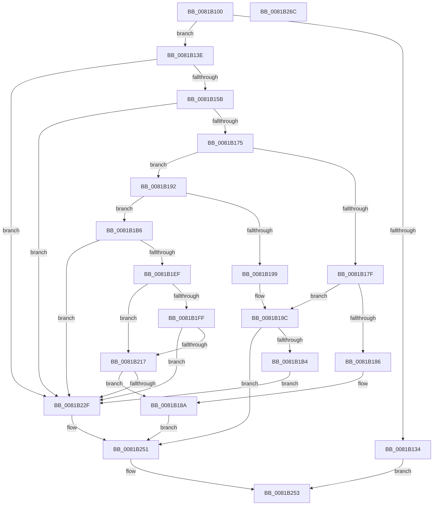

# AslPathCombine

- RVA: `0x0081B100`–`0x0081B26D` (길이 `365` bytes)
- VA: `0x000000014081B100`
- 실행 섹션: `PAGE`
- PDB 이름 있음: `예`; PDB Function 태그: `아니요`
- unwind 정보 RVA: `0x00093E28`
- 디코드: `103`개 명령, `365/365` bytes 표시
- 미해석 바이트: `0` (있으면 어셈블리에 `.byte`로 보존)

> 이 문서는 커널 이미지의 기계어와 PDB 기호를 분석해 생성했습니다. 4번과 5번은 함수 원형과 자료형을 바이너리 사용 방식에서 추정한 C 해석이며 원본 소스 복구 결과는 아닙니다.

## 1. Dependencies

- 직접 호출 지점: **7**; 고유 호출 대상: **4**
- 직접 호출자로 확인된 함수: **8**
- RIP 상대 이미지 참조: **3**

### Outgoing calls
- `0x0081B14C` → [RtlStringCchLengthW](../../text/43/RtlStringCchLengthW_function_00435A70.md) (function, `0x00435A70`)
- `0x0081B166` → [RtlStringCchLengthW](../../text/43/RtlStringCchLengthW_function_00435A70.md) (function, `0x00435A70`)
- `0x0081B1A5` → [RtlStringCchCopyW](../../text/26/RtlStringCchCopyW_function_0026E9A4.md) (function, `0x0026E9A4`)
- `0x0081B1E4` → [RtlStringCchCopyW](../../text/26/RtlStringCchCopyW_function_0026E9A4.md) (function, `0x0026E9A4`)
- `0x0081B20C` → [RtlStringCchCatW](../../text/4C/RtlStringCchCatW_function_004C7500.md) (function, `0x004C7500`)
- `0x0081B220` → [RtlStringCchCatW](../../text/4C/RtlStringCchCatW_function_004C7500.md) (function, `0x004C7500`)
- `0x0081B24C` → [AslLogCallPrintf](../95/AslLogCallPrintf_function_0095E4EC.md) (function, `0x0095E4EC`)

### Direct callers
- [SdbpGetPathAppPatchPreRS3](../../text/69/SdbpGetPathAppPatchPreRS3_function_0069CCF0.md) at `0x0069CE16`
- [SdbpGetPathCustomSdbPreRS3](../../text/69/SdbpGetPathCustomSdbPreRS3_function_0069CE80.md) at `0x0069CF96`
- [SdbpGetPathAppPatch](SdbpGetPathAppPatch_function_00817E30.md) at `0x00817EA8`
- [SdbpGetPathAppraiser](SdbpGetPathAppraiser_function_00817F30.md) at `0x00817FD4`
- [SdbpGetPathCustomSdb](SdbpGetPathCustomSdb_function_00818080.md) at `0x00818104`
- [SdbpGetPathMergeSource](SdbpGetPathMergeSource_function_00818180.md) at `0x00818214`
- [AslEnvGetSysNativeDirPathForGuestBuf](AslEnvGetSysNativeDirPathForGuestBuf_function_0081D184.md) at `0x0081D227`
- [AslEnvGetSystem32DirPathBuf](AslEnvGetSystem32DirPathBuf_function_0081D2BC.md) at `0x0081D3A0`

### Static image references
- `0x0081B1FF` → RVA `0x0001BD80` (`.rdata`; read)
- `0x0081B22F` → RVA `0x0003EFF0` (`.rdata`; read)
- `0x0081B240` → RVA `0x0003F010` (`.rdata`; read)

## 2. Other-region calls and transfers

- 다른 실행 섹션으로 향하는 call: **6**
  - `0x0081B14C` → [RtlStringCchLengthW](../../text/43/RtlStringCchLengthW_function_00435A70.md) (`PAGE` → `.text`)
  - `0x0081B166` → [RtlStringCchLengthW](../../text/43/RtlStringCchLengthW_function_00435A70.md) (`PAGE` → `.text`)
  - `0x0081B1A5` → [RtlStringCchCopyW](../../text/26/RtlStringCchCopyW_function_0026E9A4.md) (`PAGE` → `.text`)
  - `0x0081B1E4` → [RtlStringCchCopyW](../../text/26/RtlStringCchCopyW_function_0026E9A4.md) (`PAGE` → `.text`)
  - `0x0081B20C` → [RtlStringCchCatW](../../text/4C/RtlStringCchCatW_function_004C7500.md) (`PAGE` → `.text`)
  - `0x0081B220` → [RtlStringCchCatW](../../text/4C/RtlStringCchCatW_function_004C7500.md) (`PAGE` → `.text`)
- 별도 외부 분기/꼬리 이동을 확인하지 못했습니다.

## 3. Assembly (complete function range)

```asm
0081B100  48 8B C4                        mov rax, rsp
0081B103  48 89 58 08                     mov qword ptr [rax + 8], rbx
0081B107  48 89 68 10                     mov qword ptr [rax + 0x10], rbp
0081B10B  48 89 70 18                     mov qword ptr [rax + 0x18], rsi
0081B10F  57                              push rdi
0081B110  41 56                           push r14
0081B112  41 57                           push r15
0081B114  48 83 EC 40                     sub rsp, 0x40
0081B118  45 33 FF                        xor r15d, r15d
0081B11B  49 8B F1                        mov rsi, r9
0081B11E  4C 89 78 D8                     mov qword ptr [rax - 0x28], r15
0081B122  49 8B F8                        mov rdi, r8
0081B125  4C 89 78 20                     mov qword ptr [rax + 0x20], r15
0081B129  4C 8B D2                        mov r10, rdx
0081B12C  48 8B E9                        mov rbp, rcx
0081B12F  4D 85 C9                        test r9, r9
0081B132  75 0A                           jne 0x14081b13e
0081B134  B8 23 00 00 C0                  mov eax, 0xc0000023
0081B139  E9 15 01 00 00                  jmp 0x14081b253
0081B13E  41 BB FF FF FF 7F               mov r11d, 0x7fffffff
0081B144  4C 8D 44 24 30                  lea r8, [rsp + 0x30]
0081B149  41 8B D3                        mov edx, r11d
0081B14C  E8 1F A9 C1 FF                  call 0x140435a70
0081B151  8B D8                           mov ebx, eax
0081B153  85 C0                           test eax, eax
0081B155  0F 88 D4 00 00 00               js 0x14081b22f
0081B15B  4C 8D 44 24 78                  lea r8, [rsp + 0x78]
0081B160  41 8B D3                        mov edx, r11d
0081B163  49 8B CA                        mov rcx, r10
0081B166  E8 05 A9 C1 FF                  call 0x140435a70
0081B16B  8B D8                           mov ebx, eax
0081B16D  85 C0                           test eax, eax
0081B16F  0F 88 BA 00 00 00               js 0x14081b22f
0081B175  48 8B 44 24 30                  mov rax, qword ptr [rsp + 0x30]
0081B17A  48 85 C0                        test rax, rax
0081B17D  75 13                           jne 0x14081b192
0081B17F  4C 39 7C 24 78                  cmp qword ptr [rsp + 0x78], r15
0081B184  75 16                           jne 0x14081b19c
0081B186  66 44 89 3F                     mov word ptr [rdi], r15w
0081B18A  41 8B DF                        mov ebx, r15d
0081B18D  E9 BF 00 00 00                  jmp 0x14081b251
0081B192  4C 39 7C 24 78                  cmp qword ptr [rsp + 0x78], r15
0081B197  75 1D                           jne 0x14081b1b6
0081B199  4C 8B D5                        mov r10, rbp
0081B19C  4D 8B C2                        mov r8, r10
0081B19F  48 8B D6                        mov rdx, rsi
0081B1A2  48 8B CF                        mov rcx, rdi
0081B1A5  E8 FA 37 A5 FF                  call 0x14026e9a4
0081B1AA  8B D8                           mov ebx, eax
0081B1AC  85 C0                           test eax, eax
0081B1AE  0F 89 9D 00 00 00               jns 0x14081b251
0081B1B4  EB 79                           jmp 0x14081b22f
0081B1B6  66 83 7C 45 FE 5C               cmp word ptr [rbp + rax*2 - 2], 0x5c
0081B1BC  4D 8D 72 02                     lea r14, [r10 + 2]
0081B1C0  41 8B CF                        mov ecx, r15d
0081B1C3  4C 8B C5                        mov r8, rbp
0081B1C6  0F 94 C1                        sete cl
0081B1C9  48 8B D6                        mov rdx, rsi
0081B1CC  66 41 83 3A 5C                  cmp word ptr [r10], 0x5c
0081B1D1  44 8D 59 01                     lea r11d, [rcx + 1]
0081B1D5  44 0F 45 D9                     cmovne r11d, ecx
0081B1D9  48 8B CF                        mov rcx, rdi
0081B1DC  41 83 FB 01                     cmp r11d, 1
0081B1E0  4D 0F 46 F2                     cmovbe r14, r10
0081B1E4  E8 BB 37 A5 FF                  call 0x14026e9a4
0081B1E9  8B D8                           mov ebx, eax
0081B1EB  85 C0                           test eax, eax
0081B1ED  78 40                           js 0x14081b22f
0081B1EF  41 83 FB 01                     cmp r11d, 1
0081B1F3  41 8D 43 FF                     lea eax, [r11 - 1]
0081B1F7  41 0F 46 C3                     cmovbe eax, r11d
0081B1FB  85 C0                           test eax, eax
0081B1FD  75 18                           jne 0x14081b217
0081B1FF  4C 8D 05 7A 0B 80 FF            lea r8, [rip - 0x7ff486]
0081B206  48 8B D6                        mov rdx, rsi
0081B209  48 8B CF                        mov rcx, rdi
0081B20C  E8 EF C2 CA FF                  call 0x1404c7500
0081B211  8B D8                           mov ebx, eax
0081B213  85 C0                           test eax, eax
0081B215  78 18                           js 0x14081b22f
0081B217  4D 8B C6                        mov r8, r14
0081B21A  48 8B D6                        mov rdx, rsi
0081B21D  48 8B CF                        mov rcx, rdi
0081B220  E8 DB C2 CA FF                  call 0x1404c7500
0081B225  8B D8                           mov ebx, eax
0081B227  85 C0                           test eax, eax
0081B229  0F 89 5B FF FF FF               jns 0x14081b18a
0081B22F  4C 8D 0D BA 3D 82 FF            lea r9, [rip - 0x7dc246]
0081B236  89 5C 24 20                     mov dword ptr [rsp + 0x20], ebx
0081B23A  41 B8 92 05 00 00               mov r8d, 0x592
0081B240  48 8D 15 C9 3D 82 FF            lea rdx, [rip - 0x7dc237]
0081B247  B9 01 00 00 00                  mov ecx, 1
0081B24C  E8 9B 32 14 00                  call 0x14095e4ec
0081B251  8B C3                           mov eax, ebx
0081B253  48 8B 5C 24 60                  mov rbx, qword ptr [rsp + 0x60]
0081B258  48 8B 6C 24 68                  mov rbp, qword ptr [rsp + 0x68]
0081B25D  48 8B 74 24 70                  mov rsi, qword ptr [rsp + 0x70]
0081B262  48 83 C4 40                     add rsp, 0x40
0081B266  41 5F                           pop r15
0081B268  41 5E                           pop r14
0081B26A  5F                              pop rdi
0081B26B  C3                              ret
0081B26C  CC                              int3
```

## 4. C-style interpretation (structured pseudocode)

```c
__int64 __fastcall AslPathCombine(__int64 a1, __int64 a2, __int64 a3, __int64 a4)
{
    __int64 result;
    __int64 v_r11;
    __int64 v_r14;
    __int64 v_r15;
    __int64 v_rsp;
    unsigned __int64 v_stack_m28;
    unsigned int v_stack_m38;
    unsigned __int64 v_stack_p10;
    unsigned __int64 v_stack_p18;
    unsigned __int64 v_stack_p20;
    unsigned __int64 v_stack_p8;

    *(unsigned __int64 *)(v_rsp + 8) = v_rbx;
    *(unsigned __int64 *)(v_rsp + 16) = v_rbp;
    *(unsigned __int64 *)(v_rsp + 24) = v_rsi;
    v_rsp = (v_rsp) - (64);
    v_r15 = 0;
    *(unsigned __int64 *)(v_rsp - 40) = 0;
    *(unsigned __int64 *)(v_rsp + 32) = 0;
    if (a4 != 0) goto loc_0081B13E;
    goto loc_0081B253;
loc_0081B13E:
    result = RtlStringCchLengthW(a1, (unsigned int)((unsigned int)((unsigned int)(0x7FFFFFFFULL))), v_stack_m28, a4);
    if (sign_flag) goto loc_0081B22F;
    result = RtlStringCchLengthW(a2, (unsigned int)((unsigned int)((unsigned int)(0x7FFFFFFFULL))), v_stack_p20, a4);
    if (sign_flag) goto loc_0081B22F;
    if (v_stack_m28 != 0) goto loc_0081B192;
    if (v_stack_p20 != 0) goto loc_0081B19C;
    *(unsigned __int16 *)(a3) = 0;
loc_0081B18A:
    goto loc_0081B251;
loc_0081B192:
    if (v_stack_p20 != 0) goto loc_0081B1B6;
loc_0081B19C:
    result = RtlStringCchCopyW(a3, a4, a1, a4);
    if (!sign_flag) goto loc_0081B251;
    goto loc_0081B22F;
loc_0081B1B6:
    a1 = ((*(unsigned __int16 *)(a1 + result * 2 - 2)) == 92) ? 1 : 0;
    v_r11 = a1 + 1;
    if ((*(unsigned __int16 *)(a1)) != 92) { v_r11 = (unsigned int)(a1); }
    v_r14 = a1 + 2;
    if (((unsigned int)(v_r11)) <= 1) { v_r14 = a1; }
    result = RtlStringCchCopyW(a3, a4, a1, a4);
    if (sign_flag) goto loc_0081B22F;
    result = v_r11 - 1;
    if (((unsigned int)(v_r11)) <= 1) { result = (unsigned int)(v_r11); }
    if ((unsigned int)(result) != 0) goto loc_0081B217;
    result = RtlStringCchCatW(a3, a4, v_rip - 8385670, a4);
    if (sign_flag) goto loc_0081B22F;
loc_0081B217:
    result = RtlStringCchCatW(a3, a4, v_r14, a4);
    if (!sign_flag) goto loc_0081B18A;
loc_0081B22F:
    v_stack_m38 = (unsigned int)((unsigned int)((unsigned int)(result)));
    result = AslLogCallPrintf(1, v_rip - 8241719, (unsigned int)(0x592ULL), v_rip - 8241734);
loc_0081B251:
loc_0081B253:
    v_rsp = (v_rsp) + (64);
    return (unsigned int)((unsigned int)((unsigned int)((unsigned int)(result))));
}
```

## 5. (Beta) C Style

```c
int64_t AslPathCombine(void *Arg1, int64_t Arg2, void *Arg3, int64_t Arg4)
{
    uint8_t *arg1 = (uint8_t *)Arg1;
    uint8_t *arg3 = (uint8_t *)Arg3;

    int64_t result;
    int64_t local_r11;
    int64_t local_r14;
    int64_t local_r15;
    int64_t local_rsp;
    uint64_t v_stack_m28;
    uint32_t v_stack_m38;
    uint64_t v_stack_p10;
    uint64_t v_stack_p18;
    uint64_t v_stack_p20;
    uint64_t v_stack_p8;

    *(uint64_t *)(local_rsp + 0x8) = local_rbx;
    *(uint64_t *)(local_rsp + 0x10) = local_rbp;
    *(uint64_t *)(local_rsp + 0x18) = local_rsi;
    local_rsp = (local_rsp) - (64);
    local_r15 = 0;
    *(uint64_t *)(local_rsp - 0x28) = 0;
    *(uint64_t *)(local_rsp + 0x20) = 0;
    if (Arg4 != 0) goto loc_0081B13E;
    goto loc_0081B253;
loc_0081B13E:
    result = RtlStringCchLengthW(Arg1, (uint32_t)((uint32_t)((uint32_t)(0x7FFFFFFFULL))), v_stack_m28, Arg4);
    if (sign_flag) goto loc_0081B22F;
    result = RtlStringCchLengthW(Arg2, (uint32_t)((uint32_t)((uint32_t)(0x7FFFFFFFULL))), v_stack_p20, Arg4);
    if (sign_flag) goto loc_0081B22F;
    if (v_stack_m28 != 0) goto loc_0081B192;
    if (v_stack_p20 != 0) goto loc_0081B19C;
    *(uint16_t *)(arg3) = 0;
loc_0081B18A:
    goto loc_0081B251;
loc_0081B192:
    if (v_stack_p20 != 0) goto loc_0081B1B6;
loc_0081B19C:
    result = RtlStringCchCopyW(Arg3, Arg4, Arg1, Arg4);
    if (!sign_flag) goto loc_0081B251;
    goto loc_0081B22F;
loc_0081B1B6:
    Arg1 = ((*(uint16_t *)(arg1 + result * 2 - 0x2)) == 92) ? 1 : 0;
    local_r11 = Arg1 + 1;
    if ((*(uint16_t *)(arg1)) != 92) { local_r11 = (uint32_t)(Arg1); }
    local_r14 = Arg1 + 2;
    if (((uint32_t)(local_r11)) <= 1) { local_r14 = Arg1; }
    result = RtlStringCchCopyW(Arg3, Arg4, Arg1, Arg4);
    if (sign_flag) goto loc_0081B22F;
    result = local_r11 - 1;
    if (((uint32_t)(local_r11)) <= 1) { result = (uint32_t)(local_r11); }
    if ((uint32_t)(result) != 0) goto loc_0081B217;
    result = RtlStringCchCatW(Arg3, Arg4, v_rip - 8385670, Arg4);
    if (sign_flag) goto loc_0081B22F;
loc_0081B217:
    result = RtlStringCchCatW(Arg3, Arg4, local_r14, Arg4);
    if (!sign_flag) goto loc_0081B18A;
loc_0081B22F:
    v_stack_m38 = (uint32_t)((uint32_t)((uint32_t)(result)));
    result = AslLogCallPrintf(1, v_rip - 8241719, (uint32_t)(0x592ULL), v_rip - 8241734);
loc_0081B251:
loc_0081B253:
    local_rsp = (local_rsp) + (64);
    return (uint32_t)((uint32_t)((uint32_t)((uint32_t)(result))));
}
```

### 관측된 메모리 오프셋

구조체 형식이 확인되지 않은 접근은 인자 기준의 오프셋으로만 기록했습니다.

| 기준 인자 | 오프셋 표현 | 폭 (bit) | 접근 |
|---|---:|---:|---|
| `Arg1` | `- 0x2 + rax*2` | `16` | `R` |
| `Arg3` | `+ 0x0` | `16` | `W` |

## 6. Execution-region graph

[열기: 2D/3D 그래프와 함수 탐색 컨트롤 패널](../../../control-panel.html?section=page&rva=0x0081B100&view=graph)

- 2D 그래프는 위에서 아래로 흐르고, 3D 그래프는 빈 공간을 드래그해 회전합니다. Shift+드래그는 이동, 휠은 확대·축소, 함수 노드 선택은 대상 보고서 이동입니다.

### Static fallback


