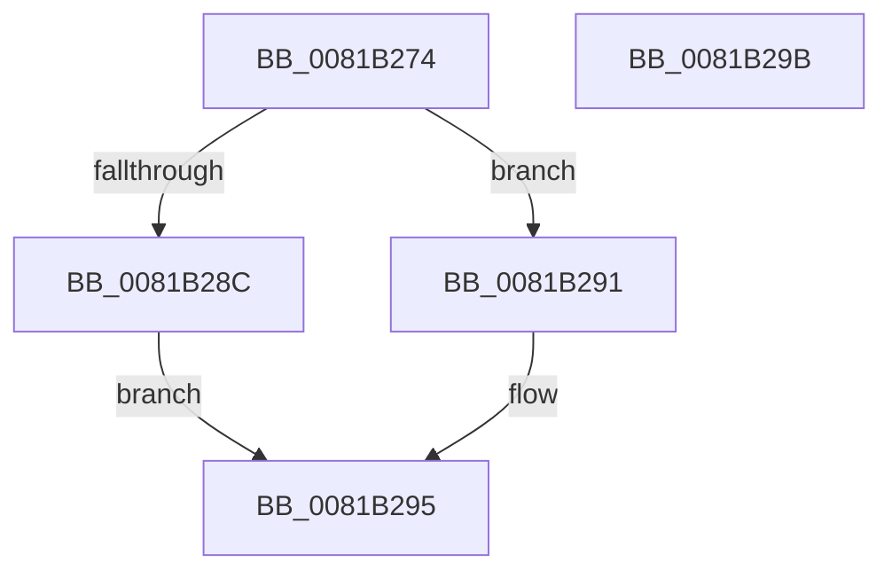

# AslPathGetFileNamePart

- RVA: `0x0081B274`–`0x0081B29C` (길이 `40` bytes)
- VA: `0x000000014081B274`
- 실행 섹션: `PAGE`
- PDB 이름 있음: `예`; PDB Function 태그: `아니요`
- unwind 정보 RVA: `0x0005CF00`
- 디코드: `14`개 명령, `40/40` bytes 표시
- 미해석 바이트: `0` (있으면 어셈블리에 `.byte`로 보존)

> 이 문서는 커널 이미지의 기계어와 PDB 기호를 분석해 생성했습니다. 4번과 5번은 함수 원형과 자료형을 바이너리 사용 방식에서 추정한 C 해석이며 원본 소스 복구 결과는 아닙니다.

## 1. Dependencies

- 직접 호출 지점: **1**; 고유 호출 대상: **1**
- 직접 호출자로 확인된 함수: **3**
- RIP 상대 이미지 참조: **0**

### Outgoing calls
- `0x0081B282` → [wcsrchr](../../text/50/wcsrchr_function_00501E50.md) (function, `0x00501E50`)

### Direct callers
- [SdbGetMergeRedirectPath](SdbGetMergeRedirectPath_function_0081210C.md) at `0x008121C7`
- [SdbOpenDatabaseEx](SdbOpenDatabaseEx_function_00812284.md) at `0x00812365`
- [SdbpGetMergeRedirectPathInternal](SdbpGetMergeRedirectPathInternal_function_00812B00.md) at `0x00812BBD`

### Static image references
- 디코드된 RIP-relative 메모리 참조가 없습니다.

## 2. Other-region calls and transfers

- 다른 실행 섹션으로 향하는 call: **1**
  - `0x0081B282` → [wcsrchr](../../text/50/wcsrchr_function_00501E50.md) (`PAGE` → `.text`)
- 별도 외부 분기/꼬리 이동을 확인하지 못했습니다.

## 3. Assembly (complete function range)

```asm
0081B274  40 53                           push rbx
0081B276  48 83 EC 20                     sub rsp, 0x20
0081B27A  BA 5C 00 00 00                  mov edx, 0x5c
0081B27F  48 8B D9                        mov rbx, rcx
0081B282  E8 C9 6B CE FF                  call 0x140501e50
0081B287  48 85 C0                        test rax, rax
0081B28A  75 05                           jne 0x14081b291
0081B28C  48 8B C3                        mov rax, rbx
0081B28F  EB 04                           jmp 0x14081b295
0081B291  48 83 C0 02                     add rax, 2
0081B295  48 83 C4 20                     add rsp, 0x20
0081B299  5B                              pop rbx
0081B29A  C3                              ret
0081B29B  CC                              int3
```

## 4. C-style interpretation (structured pseudocode)

```c
__int64 __fastcall AslPathGetFileNamePart(__int64 a1)
{
    __int64 result;
    __int64 v_rsp;

    v_rsp = (v_rsp) - (32);
    result = wcsrchr(a1, 92, a3, a4);
    if (result != 0) goto loc_0081B291;
    goto loc_0081B295;
loc_0081B291:
    result = (a1) + (2);
loc_0081B295:
    v_rsp = (v_rsp) + (32);
    return result;
}
```

## 5. (Beta) C Style

```c
int64_t AslPathGetFileNamePart(int64_t Arg1)
{
    int64_t result;
    int64_t local_rsp;

    local_rsp = (local_rsp) - (32);
    result = wcsrchr(Arg1, 92, a3, a4);
    if (result != 0) goto loc_0081B291;
    goto loc_0081B295;
loc_0081B291:
    result = (Arg1) + (2);
loc_0081B295:
    local_rsp = (local_rsp) + (32);
    return result;
}
```

## 6. Execution-region graph

[열기: 2D/3D 그래프와 함수 탐색 컨트롤 패널](../../../control-panel.html?section=page&rva=0x0081B274&view=graph)

- 2D 그래프는 위에서 아래로 흐르고, 3D 그래프는 빈 공간을 드래그해 회전합니다. Shift+드래그는 이동, 휠은 확대·축소, 함수 노드 선택은 대상 보고서 이동입니다.

### Static fallback


