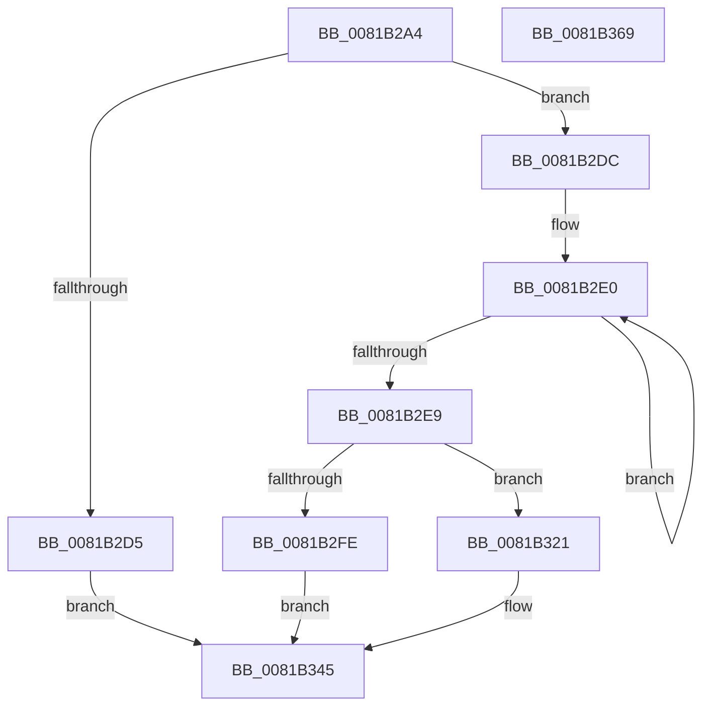

# AslPathToNetworkPathNt

- RVA: `0x0081B2A4`–`0x0081B36A` (길이 `198` bytes)
- VA: `0x000000014081B2A4`
- 실행 섹션: `PAGE`
- PDB 이름 있음: `예`; PDB Function 태그: `아니요`
- unwind 정보 RVA: `0x0005E6B4`
- 디코드: `54`개 명령, `198/198` bytes 표시
- 미해석 바이트: `0` (있으면 어셈블리에 `.byte`로 보존)

> 이 문서는 커널 이미지의 기계어와 PDB 기호를 분석해 생성했습니다. 4번과 5번은 함수 원형과 자료형을 바이너리 사용 방식에서 추정한 C 해석이며 원본 소스 복구 결과는 아닙니다.

## 1. Dependencies

- 직접 호출 지점: **6**; 고유 호출 대상: **6**
- 직접 호출자로 확인된 함수: **1**
- RIP 상대 이미지 참조: **3**

### Outgoing calls
- `0x0081B2CB` → [AslpDetermineDosPathNameType](AslpDetermineDosPathNameType_function_0081C4B4.md) (function, `0x0081C4B4`)
- `0x0081B2F1` → [AslAlloc](../95/AslAlloc_function_0095BD34.md) (function, `0x0095BD34`)
- `0x0081B31A` → [AslLogCallPrintf](../95/AslLogCallPrintf_function_0095E4EC.md) (function, `0x0095E4EC`)
- `0x0081B32E` → [wcscpy_s](../../text/50/wcscpy_s_function_005064B0.md) (function, `0x005064B0`)
- `0x0081B33D` → [wcscat_s](../../text/50/wcscat_s_function_00506410.md) (function, `0x00506410`)
- `0x0081B347` → [AslFree](../95/AslFree_function_0095B674.md) (function, `0x0095B674`)

### Direct callers
- [SdbpResolveMatchingFile](SdbpResolveMatchingFile_function_00816A20.md) at `0x00816CE1`

### Static image references
- `0x0081B2FE` → RVA `0x000129E0` (`.rdata`; read)
- `0x0081B30B` → RVA `0x0003F310` (`.rdata`; read)
- `0x0081B321` → RVA `0x0003F2F8` (`.rdata`; read)

## 2. Other-region calls and transfers

- 다른 실행 섹션으로 향하는 call: **2**
  - `0x0081B32E` → [wcscpy_s](../../text/50/wcscpy_s_function_005064B0.md) (`PAGE` → `.text`)
  - `0x0081B33D` → [wcscat_s](../../text/50/wcscat_s_function_00506410.md) (`PAGE` → `.text`)
- 별도 외부 분기/꼬리 이동을 확인하지 못했습니다.

## 3. Assembly (complete function range)

```asm
0081B2A4  48 8B C4                        mov rax, rsp
0081B2A7  48 89 58 08                     mov qword ptr [rax + 8], rbx
0081B2AB  48 89 68 10                     mov qword ptr [rax + 0x10], rbp
0081B2AF  48 89 70 18                     mov qword ptr [rax + 0x18], rsi
0081B2B3  48 89 78 20                     mov qword ptr [rax + 0x20], rdi
0081B2B7  41 56                           push r14
0081B2B9  48 83 EC 20                     sub rsp, 0x20
0081B2BD  33 DB                           xor ebx, ebx
0081B2BF  4C 8B F1                        mov r14, rcx
0081B2C2  48 89 19                        mov qword ptr [rcx], rbx
0081B2C5  48 8B F2                        mov rsi, rdx
0081B2C8  48 8B CA                        mov rcx, rdx
0081B2CB  E8 E4 11 00 00                  call 0x14081c4b4
0081B2D0  83 F8 01                        cmp eax, 1
0081B2D3  74 07                           je 0x14081b2dc
0081B2D5  BB 0D 00 00 C0                  mov ebx, 0xc000000d
0081B2DA  EB 69                           jmp 0x14081b345
0081B2DC  48 83 CF FF                     or rdi, 0xffffffffffffffff
0081B2E0  48 FF C7                        inc rdi
0081B2E3  66 39 1C 7E                     cmp word ptr [rsi + rdi*2], bx
0081B2E7  75 F7                           jne 0x14081b2e0
0081B2E9  48 83 C7 09                     add rdi, 9
0081B2ED  48 8D 14 3F                     lea rdx, [rdi + rdi]
0081B2F1  E8 3E 0A 14 00                  call 0x14095bd34
0081B2F6  48 8B E8                        mov rbp, rax
0081B2F9  48 85 C0                        test rax, rax
0081B2FC  75 23                           jne 0x14081b321
0081B2FE  4C 8D 0D DB 76 7F FF            lea r9, [rip - 0x808925]
0081B305  41 B8 62 01 00 00               mov r8d, 0x162
0081B30B  48 8D 15 FE 3F 82 FF            lea rdx, [rip - 0x7dc002]
0081B312  BB 17 00 00 C0                  mov ebx, 0xc0000017
0081B317  8D 48 01                        lea ecx, [rax + 1]
0081B31A  E8 CD 31 14 00                  call 0x14095e4ec
0081B31F  EB 24                           jmp 0x14081b345
0081B321  4C 8D 05 D0 3F 82 FF            lea r8, [rip - 0x7dc030]
0081B328  48 8B D7                        mov rdx, rdi
0081B32B  48 8B CD                        mov rcx, rbp
0081B32E  E8 7D B1 CE FF                  call 0x1405064b0
0081B333  4C 8D 46 04                     lea r8, [rsi + 4]
0081B337  48 8B D7                        mov rdx, rdi
0081B33A  48 8B CD                        mov rcx, rbp
0081B33D  E8 CE B0 CE FF                  call 0x140506410
0081B342  49 89 2E                        mov qword ptr [r14], rbp
0081B345  33 D2                           xor edx, edx
0081B347  E8 28 03 14 00                  call 0x14095b674
0081B34C  48 8B 6C 24 38                  mov rbp, qword ptr [rsp + 0x38]
0081B351  8B C3                           mov eax, ebx
0081B353  48 8B 5C 24 30                  mov rbx, qword ptr [rsp + 0x30]
0081B358  48 8B 74 24 40                  mov rsi, qword ptr [rsp + 0x40]
0081B35D  48 8B 7C 24 48                  mov rdi, qword ptr [rsp + 0x48]
0081B362  48 83 C4 20                     add rsp, 0x20
0081B366  41 5E                           pop r14
0081B368  C3                              ret
0081B369  CC                              int3
```

## 4. C-style interpretation (structured pseudocode)

```c
__int64 __fastcall AslPathToNetworkPathNt(__int64 a1, __int64 a2)
{
    __int64 result;
    __int64 v_rbx;
    __int64 v_rdi;
    __int64 v_rsp;
    unsigned __int64 v_stack_p10;
    unsigned __int64 v_stack_p18;
    unsigned __int64 v_stack_p20;
    unsigned __int64 v_stack_p8;

    *(unsigned __int64 *)(v_rsp + 8) = v_rbx;
    *(unsigned __int64 *)(v_rsp + 16) = v_rbp;
    *(unsigned __int64 *)(v_rsp + 24) = v_rsi;
    *(unsigned __int64 *)(v_rsp + 32) = v_rdi;
    v_rsp = (v_rsp) - (32);
    v_rbx = 0;
    *(unsigned __int64 *)(a1) = 0;
    result = AslpDetermineDosPathNameType(a2, a2, a3, a4);
    if (((unsigned int)(result)) == 1) goto loc_0081B2DC;
    goto loc_0081B345;
loc_0081B2DC:
    v_rdi = (v_rdi) | (-1);
loc_0081B2E0:
    v_rdi = (v_rdi) + 1;
    if ((*(unsigned __int16 *)(a2 + v_rdi * 2)) != ((unsigned __int16)((unsigned int)(0xC000000DULL)))) goto loc_0081B2E0;
    v_rdi = (v_rdi) + (9);
    result = AslAlloc(a2, v_rdi + v_rdi * 1, a3, a4);
    if (result != 0) goto loc_0081B321;
    result = AslLogCallPrintf(result + 1, v_rip - 8241154, 354, v_rip - 8423717);
    goto loc_0081B345;
loc_0081B321:
    result = wcscpy_s(result, v_rdi, v_rip - 8241200, v_rip - 8423717);
    result = wcscat_s(result, v_rdi, a2 + 4, v_rip - 8423717);
    *(unsigned __int64 *)(a1) = result;
loc_0081B345:
    a2 = 0;
    result = AslFree(result, a2, a2 + 4, v_rip - 8423717);
    v_rsp = (v_rsp) + (32);
    return (unsigned int)((unsigned int)((unsigned int)(0xC0000017ULL)));
}
```

## 5. (Beta) C Style

```c
int64_t AslPathToNetworkPathNt(void *Arg1, void *Arg2)
{
    uint8_t *arg1 = (uint8_t *)Arg1;
    uint8_t *arg2 = (uint8_t *)Arg2;

    int64_t result;
    int64_t local_rbx;
    int64_t local_rdi;
    int64_t local_rsp;
    uint64_t v_stack_p10;
    uint64_t v_stack_p18;
    uint64_t v_stack_p20;
    uint64_t v_stack_p8;

    *(uint64_t *)(local_rsp + 0x8) = local_rbx;
    *(uint64_t *)(local_rsp + 0x10) = local_rbp;
    *(uint64_t *)(local_rsp + 0x18) = local_rsi;
    *(uint64_t *)(local_rsp + 0x20) = local_rdi;
    local_rsp = (local_rsp) - (32);
    local_rbx = 0;
    *(uint64_t *)(arg1) = 0;
    result = AslpDetermineDosPathNameType(Arg2, Arg2, a3, a4);
    if (((uint32_t)(result)) == 1) goto loc_0081B2DC;
    goto loc_0081B345;
loc_0081B2DC:
    local_rdi = (local_rdi) | (-1);
loc_0081B2E0:
    local_rdi = (local_rdi) + 1;
    if ((*(uint16_t *)(arg2 + local_rdi * 2)) != ((uint16_t)((uint32_t)(0xC000000DULL)))) goto loc_0081B2E0;
    local_rdi = (local_rdi) + (9);
    result = AslAlloc(Arg2, local_rdi + local_rdi * 1, a3, a4);
    if (result != 0) goto loc_0081B321;
    result = AslLogCallPrintf(result + 1, v_rip - 8241154, 354, v_rip - 8423717);
    goto loc_0081B345;
loc_0081B321:
    result = wcscpy_s(result, local_rdi, v_rip - 8241200, v_rip - 8423717);
    result = wcscat_s(result, local_rdi, Arg2 + 4, v_rip - 8423717);
    *(uint64_t *)(arg1) = result;
loc_0081B345:
    Arg2 = 0;
    result = AslFree(result, Arg2, Arg2 + 4, v_rip - 8423717);
    local_rsp = (local_rsp) + (32);
    return (uint32_t)((uint32_t)((uint32_t)(0xC0000017ULL)));
}
```

### 관측된 메모리 오프셋

구조체 형식이 확인되지 않은 접근은 인자 기준의 오프셋으로만 기록했습니다.

| 기준 인자 | 오프셋 표현 | 폭 (bit) | 접근 |
|---|---:|---:|---|
| `Arg1` | `+ 0x0` | `64` | `W` |
| `Arg2` | `+ 0x0 + rdi*2` | `16` | `R` |
| `Arg2` | `+ 0x4` | `64` | `R` |

## 6. Execution-region graph

[열기: 2D/3D 그래프와 함수 탐색 컨트롤 패널](../../../control-panel.html?section=page&rva=0x0081B2A4&view=graph)

- 2D 그래프는 위에서 아래로 흐르고, 3D 그래프는 빈 공간을 드래그해 회전합니다. Shift+드래그는 이동, 휠은 확대·축소, 함수 노드 선택은 대상 보고서 이동입니다.

### Static fallback


