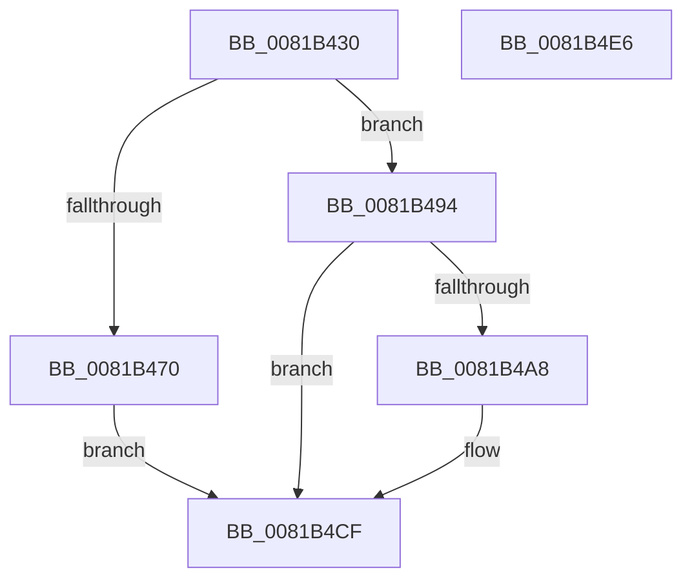

# AslPathToSystemPathBuf

- RVA: `0x0081B430`–`0x0081B4E7` (길이 `183` bytes)
- VA: `0x000000014081B430`
- 실행 섹션: `PAGE`
- PDB 이름 있음: `예`; PDB Function 태그: `아니요`
- unwind 정보 RVA: `0x00066400`
- 디코드: `47`개 명령, `183/183` bytes 표시
- 미해석 바이트: `0` (있으면 어셈블리에 `.byte`로 보존)

> 이 문서는 커널 이미지의 기계어와 PDB 기호를 분석해 생성했습니다. 4번과 5번은 함수 원형과 자료형을 바이너리 사용 방식에서 추정한 C 해석이며 원본 소스 복구 결과는 아닙니다.

## 1. Dependencies

- 직접 호출 지점: **5**; 고유 호출 대상: **4**
- 직접 호출자로 확인된 함수: **4**
- RIP 상대 이미지 참조: **4**

### Outgoing calls
- `0x0081B453` → [memset](../../text/6C/memset_function_006C6C40.md) (function, `0x006C6C40`)
- `0x0081B465` → [RtlStringCchCopyW](../../text/26/RtlStringCchCopyW_function_0026E9A4.md) (function, `0x0026E9A4`)
- `0x0081B48D` → [AslLogCallPrintf](../95/AslLogCallPrintf_function_0095E4EC.md) (function, `0x0095E4EC`)
- `0x0081B49D` → [RtlStringCchCatW](../../text/4C/RtlStringCchCatW_function_004C7500.md) (function, `0x004C7500`)
- `0x0081B4C5` → [AslLogCallPrintf](../95/AslLogCallPrintf_function_0095E4EC.md) (function, `0x0095E4EC`)

### Direct callers
- [SdbpGetPathAppPatch](SdbpGetPathAppPatch_function_00817E30.md) at `0x00817ECD`
- [AslPathToSystemPath](AslPathToSystemPath_function_0081B370.md) at `0x0081B3AE`
- [AslEnvGetSysNativeDirPathForGuestBuf](AslEnvGetSysNativeDirPathForGuestBuf_function_0081D184.md) at `0x0081D1F4`
- [AslEnvGetSystem32DirPathBuf](AslEnvGetSystem32DirPathBuf_function_0081D2BC.md) at `0x0081D358`

### Static image references
- `0x0081B458` → RVA `0x0003F020` (`.rdata`; read)
- `0x0081B470` → RVA `0x0003F038` (`.rdata`; read)
- `0x0081B481` → RVA `0x0003F058` (`.rdata`; read)
- `0x0081B4A8` → RVA `0x0003F070` (`.rdata`; read)

## 2. Other-region calls and transfers

- 다른 실행 섹션으로 향하는 call: **3**
  - `0x0081B453` → [memset](../../text/6C/memset_function_006C6C40.md) (`PAGE` → `.text`)
  - `0x0081B465` → [RtlStringCchCopyW](../../text/26/RtlStringCchCopyW_function_0026E9A4.md) (`PAGE` → `.text`)
  - `0x0081B49D` → [RtlStringCchCatW](../../text/4C/RtlStringCchCatW_function_004C7500.md) (`PAGE` → `.text`)
- 별도 외부 분기/꼬리 이동을 확인하지 못했습니다.

## 3. Assembly (complete function range)

```asm
0081B430  48 89 5C 24 08                  mov qword ptr [rsp + 8], rbx
0081B435  48 89 6C 24 10                  mov qword ptr [rsp + 0x10], rbp
0081B43A  48 89 74 24 18                  mov qword ptr [rsp + 0x18], rsi
0081B43F  57                              push rdi
0081B440  48 83 EC 30                     sub rsp, 0x30
0081B444  49 8B E8                        mov rbp, r8
0081B447  48 8B FA                        mov rdi, rdx
0081B44A  4C 8D 04 12                     lea r8, [rdx + rdx]
0081B44E  48 8B F1                        mov rsi, rcx
0081B451  33 D2                           xor edx, edx
0081B453  E8 E8 B7 EA FF                  call 0x1406c6c40
0081B458  4C 8D 05 C1 3B 82 FF            lea r8, [rip - 0x7dc43f]
0081B45F  48 8B D7                        mov rdx, rdi
0081B462  48 8B CE                        mov rcx, rsi
0081B465  E8 3A 35 A5 FF                  call 0x14026e9a4
0081B46A  8B D8                           mov ebx, eax
0081B46C  85 C0                           test eax, eax
0081B46E  79 24                           jns 0x14081b494
0081B470  4C 8D 0D C1 3B 82 FF            lea r9, [rip - 0x7dc43f]
0081B477  89 44 24 20                     mov dword ptr [rsp + 0x20], eax
0081B47B  41 B8 C5 05 00 00               mov r8d, 0x5c5
0081B481  48 8D 15 D0 3B 82 FF            lea rdx, [rip - 0x7dc430]
0081B488  B9 01 00 00 00                  mov ecx, 1
0081B48D  E8 5A 30 14 00                  call 0x14095e4ec
0081B492  EB 3B                           jmp 0x14081b4cf
0081B494  4C 8B C5                        mov r8, rbp
0081B497  48 8B D7                        mov rdx, rdi
0081B49A  48 8B CE                        mov rcx, rsi
0081B49D  E8 5E C0 CA FF                  call 0x1404c7500
0081B4A2  8B D8                           mov ebx, eax
0081B4A4  85 C0                           test eax, eax
0081B4A6  79 27                           jns 0x14081b4cf
0081B4A8  4C 8D 0D C1 3B 82 FF            lea r9, [rip - 0x7dc43f]
0081B4AF  89 44 24 20                     mov dword ptr [rsp + 0x20], eax
0081B4B3  41 B8 D6 05 00 00               mov r8d, 0x5d6
0081B4B9  48 8D 15 98 3B 82 FF            lea rdx, [rip - 0x7dc468]
0081B4C0  B9 01 00 00 00                  mov ecx, 1
0081B4C5  E8 22 30 14 00                  call 0x14095e4ec
0081B4CA  BB 0D 00 00 C0                  mov ebx, 0xc000000d
0081B4CF  48 8B 6C 24 48                  mov rbp, qword ptr [rsp + 0x48]
0081B4D4  8B C3                           mov eax, ebx
0081B4D6  48 8B 5C 24 40                  mov rbx, qword ptr [rsp + 0x40]
0081B4DB  48 8B 74 24 50                  mov rsi, qword ptr [rsp + 0x50]
0081B4E0  48 83 C4 30                     add rsp, 0x30
0081B4E4  5F                              pop rdi
0081B4E5  C3                              ret
0081B4E6  CC                              int3
```

## 4. C-style interpretation (structured pseudocode)

```c
__int64 __fastcall AslPathToSystemPathBuf(__int64 a1, __int64 a2, __int64 a3)
{
    __int64 result;
    __int64 v_rbx;
    __int64 v_rsp;
    unsigned int v_stack_m18;
    unsigned __int64 v_stack_p10;
    unsigned __int64 v_stack_p18;
    unsigned __int64 v_stack_p8;

    v_stack_p8 = v_rbx;
    v_stack_p10 = v_rbp;
    v_stack_p18 = v_rsi;
    v_rsp = (v_rsp) - (48);
    a2 = 0;
    result = memset(a1, a2, a2 + a2 * 1, a4);
    result = RtlStringCchCopyW(a1, 0, v_rip - 8242239, a4);
    if (!sign_flag) goto loc_0081B494;
    v_stack_m18 = (unsigned int)(result);
    result = AslLogCallPrintf(1, v_rip - 8242224, (unsigned int)(0x5C5ULL), v_rip - 8242239);
    goto loc_0081B4CF;
loc_0081B494:
    result = RtlStringCchCatW(a1, 0, a3, v_rip - 8242239);
    v_rbx = (unsigned int)((unsigned int)(result));
    if (sign_flag) {
        a4 = v_rip - 8242239;
        v_stack_m18 = (unsigned int)(result);
        a3 = 0x5D6ULL;
        a2 = v_rip - 8242280;
        a1 = 1;
        result = AslLogCallPrintf(a1, a2, a3, a4);
        v_rbx = 0xC000000DULL;
    }
    v_rsp = (v_rsp) + (48);
    return (unsigned int)((unsigned int)(v_rbx));
}
```

## 5. (Beta) C Style

```c
int64_t AslPathToSystemPathBuf(int64_t Arg1, void *Arg2, int64_t Arg3)
{
    uint8_t *arg2 = (uint8_t *)Arg2;

    int64_t result;
    int64_t local_rbx;
    int64_t local_rsp;
    uint32_t v_stack_m18;
    uint64_t v_stack_p10;
    uint64_t v_stack_p18;
    uint64_t v_stack_p8;

    v_stack_p8 = local_rbx;
    v_stack_p10 = local_rbp;
    v_stack_p18 = local_rsi;
    local_rsp = (local_rsp) - (48);
    Arg2 = 0;
    result = memset(Arg1, Arg2, Arg2 + Arg2 * 1, a4);
    result = RtlStringCchCopyW(Arg1, 0, v_rip - 8242239, a4);
    if (!sign_flag) goto loc_0081B494;
    v_stack_m18 = (uint32_t)(result);
    result = AslLogCallPrintf(1, v_rip - 8242224, (uint32_t)(0x5C5ULL), v_rip - 8242239);
    goto loc_0081B4CF;
loc_0081B494:
    result = RtlStringCchCatW(Arg1, 0, Arg3, v_rip - 8242239);
    local_rbx = (uint32_t)((uint32_t)(result));
    if (sign_flag) {
        a4 = v_rip - 8242239;
        v_stack_m18 = (uint32_t)(result);
        Arg3 = 0x5D6ULL;
        Arg2 = v_rip - 8242280;
        Arg1 = 1;
        result = AslLogCallPrintf(Arg1, Arg2, Arg3, a4);
        local_rbx = 0xC000000DULL;
    }
    local_rsp = (local_rsp) + (48);
    return (uint32_t)((uint32_t)(local_rbx));
}
```

### 관측된 메모리 오프셋

구조체 형식이 확인되지 않은 접근은 인자 기준의 오프셋으로만 기록했습니다.

| 기준 인자 | 오프셋 표현 | 폭 (bit) | 접근 |
|---|---:|---:|---|
| `Arg2` | `+ 0x0 + rdx*1` | `64` | `R` |

## 6. Execution-region graph

[열기: 2D/3D 그래프와 함수 탐색 컨트롤 패널](../../../control-panel.html?section=page&rva=0x0081B430&view=graph)

- 2D 그래프는 위에서 아래로 흐르고, 3D 그래프는 빈 공간을 드래그해 회전합니다. Shift+드래그는 이동, 휠은 확대·축소, 함수 노드 선택은 대상 보고서 이동입니다.

### Static fallback


