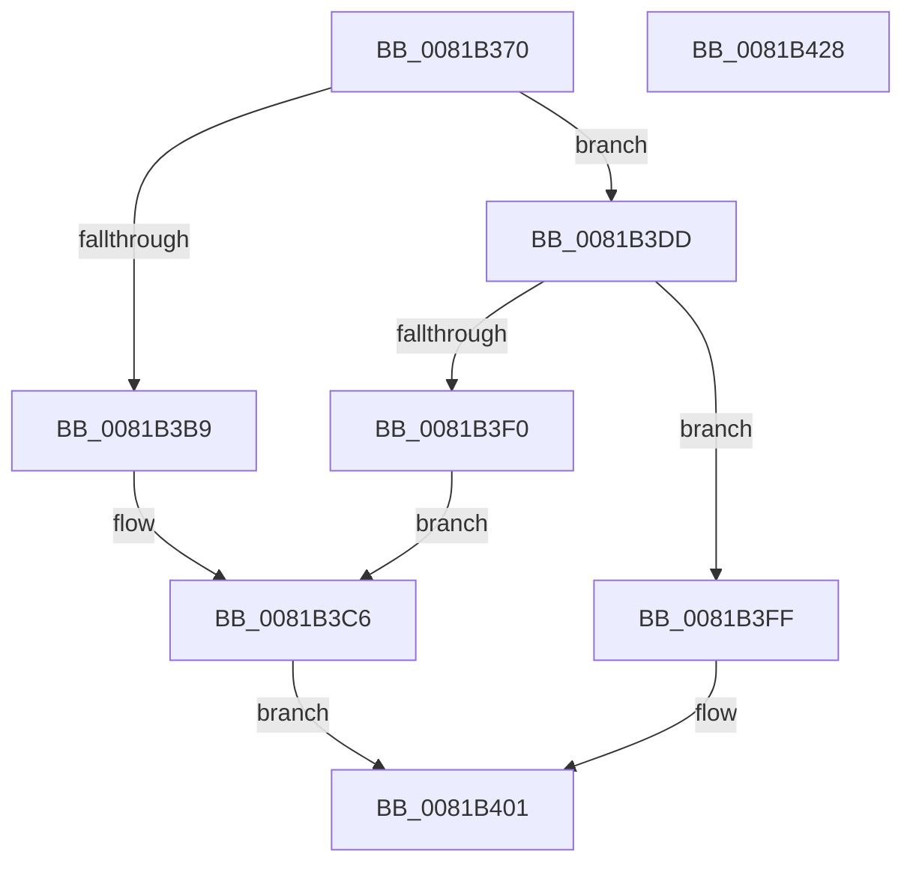

# AslPathToSystemPath

- RVA: `0x0081B370`–`0x0081B429` (길이 `185` bytes)
- VA: `0x000000014081B370`
- 실행 섹션: `PAGE`
- PDB 이름 있음: `예`; PDB Function 태그: `아니요`
- unwind 정보 RVA: `0x000D9D64`
- 디코드: `46`개 명령, `185/185` bytes 표시
- 미해석 바이트: `0` (있으면 어셈블리에 `.byte`로 보존)

> 이 문서는 커널 이미지의 기계어와 PDB 기호를 분석해 생성했습니다. 4번과 5번은 함수 원형과 자료형을 바이너리 사용 방식에서 추정한 C 해석이며 원본 소스 복구 결과는 아닙니다.

## 1. Dependencies

- 직접 호출 지점: **4**; 고유 호출 대상: **4**
- 직접 호출자로 확인된 함수: **1**
- RIP 상대 이미지 참조: **4**

### Outgoing calls
- `0x0081B3AE` → [AslPathToSystemPathBuf](AslPathToSystemPathBuf_function_0081B430.md) (function, `0x0081B430`)
- `0x0081B3D6` → [AslLogCallPrintf](../95/AslLogCallPrintf_function_0095E4EC.md) (function, `0x0095E4EC`)
- `0x0081B3E5` → [AslStringDuplicate](../95/AslStringDuplicate_function_00958604.md) (function, `0x00958604`)
- `0x0081B40E` → [_security_check_cookie](../../text/6A/_security_check_cookie_function_006AC640.md) (function, `0x006AC640`)

### Direct callers
- [SdbpGetManifestedMergeStubAlloc](SdbpGetManifestedMergeStubAlloc_function_0081275C.md) at `0x00812A0F`

### Static image references
- `0x0081B382` → RVA `0x00E0A740` (`.data`; read)
- `0x0081B3B9` → RVA `0x0003DD48` (`.rdata`; read)
- `0x0081B3C6` → RVA `0x0003F090` (`.rdata`; read)
- `0x0081B3F0` → RVA `0x0003F0A8` (`.rdata`; read)

## 2. Other-region calls and transfers

- 다른 실행 섹션으로 향하는 call: **1**
  - `0x0081B40E` → [_security_check_cookie](../../text/6A/_security_check_cookie_function_006AC640.md) (`PAGE` → `.text`)
- 별도 외부 분기/꼬리 이동을 확인하지 못했습니다.

## 3. Assembly (complete function range)

```asm
0081B370  48 89 5C 24 18                  mov qword ptr [rsp + 0x18], rbx
0081B375  48 89 74 24 20                  mov qword ptr [rsp + 0x20], rsi
0081B37A  57                              push rdi
0081B37B  48 81 EC 50 02 00 00            sub rsp, 0x250
0081B382  48 8B 05 B7 F3 5E 00            mov rax, qword ptr [rip + 0x5ef3b7]
0081B389  48 33 C4                        xor rax, rsp
0081B38C  48 89 84 24 40 02 00 00         mov qword ptr [rsp + 0x240], rax
0081B394  33 F6                           xor esi, esi
0081B396  48 8B F9                        mov rdi, rcx
0081B399  48 89 31                        mov qword ptr [rcx], rsi
0081B39C  4C 8B C2                        mov r8, rdx
0081B39F  48 8D 4C 24 30                  lea rcx, [rsp + 0x30]
0081B3A4  66 89 74 24 30                  mov word ptr [rsp + 0x30], si
0081B3A9  BA 04 01 00 00                  mov edx, 0x104
0081B3AE  E8 7D 00 00 00                  call 0x14081b430
0081B3B3  8B D8                           mov ebx, eax
0081B3B5  85 C0                           test eax, eax
0081B3B7  79 24                           jns 0x14081b3dd
0081B3B9  4C 8D 0D 88 29 82 FF            lea r9, [rip - 0x7dd678]
0081B3C0  41 B8 07 06 00 00               mov r8d, 0x607
0081B3C6  48 8D 15 C3 3C 82 FF            lea rdx, [rip - 0x7dc33d]
0081B3CD  89 44 24 20                     mov dword ptr [rsp + 0x20], eax
0081B3D1  B9 01 00 00 00                  mov ecx, 1
0081B3D6  E8 11 31 14 00                  call 0x14095e4ec
0081B3DB  EB 24                           jmp 0x14081b401
0081B3DD  48 8D 54 24 30                  lea rdx, [rsp + 0x30]
0081B3E2  48 8B CF                        mov rcx, rdi
0081B3E5  E8 1A D2 13 00                  call 0x140958604
0081B3EA  8B D8                           mov ebx, eax
0081B3EC  85 C0                           test eax, eax
0081B3EE  79 0F                           jns 0x14081b3ff
0081B3F0  4C 8D 0D B1 3C 82 FF            lea r9, [rip - 0x7dc34f]
0081B3F7  41 B8 0D 06 00 00               mov r8d, 0x60d
0081B3FD  EB C7                           jmp 0x14081b3c6
0081B3FF  8B DE                           mov ebx, esi
0081B401  8B C3                           mov eax, ebx
0081B403  48 8B 8C 24 40 02 00 00         mov rcx, qword ptr [rsp + 0x240]
0081B40B  48 33 CC                        xor rcx, rsp
0081B40E  E8 2D 12 E9 FF                  call 0x1406ac640
0081B413  4C 8D 9C 24 50 02 00 00         lea r11, [rsp + 0x250]
0081B41B  49 8B 5B 20                     mov rbx, qword ptr [r11 + 0x20]
0081B41F  49 8B 73 28                     mov rsi, qword ptr [r11 + 0x28]
0081B423  49 8B E3                        mov rsp, r11
0081B426  5F                              pop rdi
0081B427  C3                              ret
0081B428  CC                              int3
```

## 4. C-style interpretation (structured pseudocode)

```c
__int64 __fastcall AslPathToSystemPath(__int64 a1, __int64 a2)
{
    __int64 result;
    __int64 v_rsi;
    __int64 v_rsp;
    unsigned __int64 v_stack_m18;
    unsigned __int64 v_stack_m228;
    unsigned int v_stack_m238;
    unsigned __int64 v_stack_m8;
    unsigned __int64 v_stack_p18;
    unsigned __int64 v_stack_p20;

    v_stack_p18 = v_rbx;
    v_stack_p20 = v_rsi;
    v_rsp = (v_rsp) - (592);
    result = (*(unsigned __int64 *)(v_rip + 6222775)) ^ (v_rsp);
    v_stack_m18 = result;
    v_rsi = 0;
    *(unsigned __int64 *)(a1) = 0;
    v_stack_m228 = 0;
    result = AslPathToSystemPathBuf(v_stack_m228, 260, a2, a4);
    if (!sign_flag) goto loc_0081B3DD;
loc_0081B3C6:
    v_stack_m238 = (unsigned int)(result);
    result = AslLogCallPrintf(1, v_rip - 8241981, (unsigned int)(0x607ULL), v_rip - 8246904);
    goto loc_0081B401;
loc_0081B3DD:
    result = AslStringDuplicate(a1, v_stack_m228, (unsigned int)(0x607ULL), v_rip - 8246904);
    if (!sign_flag) goto loc_0081B3FF;
    goto loc_0081B3C6;
loc_0081B3FF:
loc_0081B401:
    a1 = (v_stack_m18) ^ (v_rsp);
    result = _security_check_cookie(a1, v_stack_m228, (unsigned int)(0x60DULL), v_rip - 8241999);
    return result;
}
```

## 5. (Beta) C Style

```c
int64_t AslPathToSystemPath(void *Arg1, int64_t Arg2)
{
    uint8_t *arg1 = (uint8_t *)Arg1;

    int64_t result;
    int64_t local_rsi;
    int64_t local_rsp;
    uint64_t v_stack_m18;
    uint64_t v_stack_m228;
    uint32_t v_stack_m238;
    uint64_t v_stack_m8;
    uint64_t v_stack_p18;
    uint64_t v_stack_p20;

    v_stack_p18 = local_rbx;
    v_stack_p20 = local_rsi;
    local_rsp = (local_rsp) - (592);
    result = (*(uint64_t *)(v_rip + 0x5EF3B7)) ^ (local_rsp);
    v_stack_m18 = result;
    local_rsi = 0;
    *(uint64_t *)(arg1) = 0;
    v_stack_m228 = 0;
    result = AslPathToSystemPathBuf(v_stack_m228, 260, Arg2, a4);
    if (!sign_flag) goto loc_0081B3DD;
loc_0081B3C6:
    v_stack_m238 = (uint32_t)(result);
    result = AslLogCallPrintf(1, v_rip - 8241981, (uint32_t)(0x607ULL), v_rip - 8246904);
    goto loc_0081B401;
loc_0081B3DD:
    result = AslStringDuplicate(Arg1, v_stack_m228, (uint32_t)(0x607ULL), v_rip - 8246904);
    if (!sign_flag) goto loc_0081B3FF;
    goto loc_0081B3C6;
loc_0081B3FF:
loc_0081B401:
    Arg1 = (v_stack_m18) ^ (local_rsp);
    result = _security_check_cookie(Arg1, v_stack_m228, (uint32_t)(0x60DULL), v_rip - 8241999);
    return result;
}
```

### 관측된 메모리 오프셋

구조체 형식이 확인되지 않은 접근은 인자 기준의 오프셋으로만 기록했습니다.

| 기준 인자 | 오프셋 표현 | 폭 (bit) | 접근 |
|---|---:|---:|---|
| `Arg1` | `+ 0x0` | `64` | `W` |

## 6. Execution-region graph

[열기: 2D/3D 그래프와 함수 탐색 컨트롤 패널](../../../control-panel.html?section=page&rva=0x0081B370&view=graph)

- 2D 그래프는 위에서 아래로 흐르고, 3D 그래프는 빈 공간을 드래그해 회전합니다. Shift+드래그는 이동, 휠은 확대·축소, 함수 노드 선택은 대상 보고서 이동입니다.

### Static fallback


