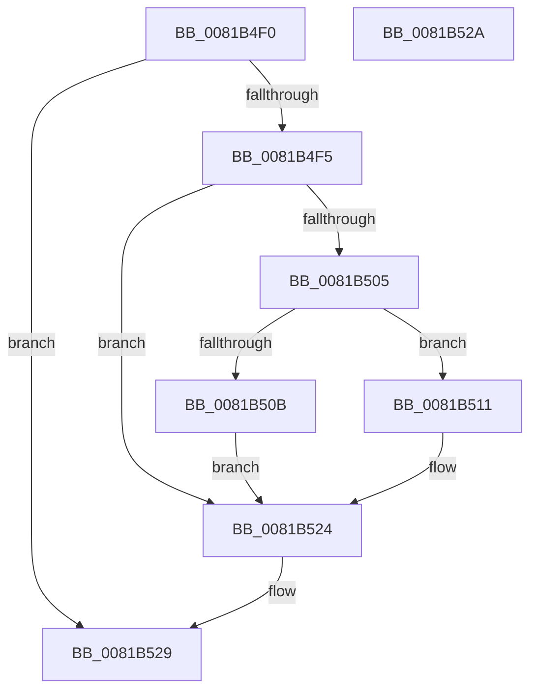

# AslPathWildcardFindClose

- RVA: `0x0081B4F0`–`0x0081B52B` (길이 `59` bytes)
- VA: `0x000000014081B4F0`
- 실행 섹션: `PAGE`
- PDB 이름 있음: `예`; PDB Function 태그: `아니요`
- unwind 정보 RVA: `0x000805BC`
- 디코드: `20`개 명령, `59/59` bytes 표시
- 미해석 바이트: `0` (있으면 어셈블리에 `.byte`로 보존)

> 이 문서는 커널 이미지의 기계어와 PDB 기호를 분석해 생성했습니다. 4번과 5번은 함수 원형과 자료형을 바이너리 사용 방식에서 추정한 C 해석이며 원본 소스 복구 결과는 아닙니다.

## 1. Dependencies

- 직접 호출 지점: **1**; 고유 호출 대상: **1**
- 직접 호출자로 확인된 함수: **1**
- RIP 상대 이미지 참조: **0**

### Outgoing calls
- `0x0081B51B` → [AslpPathWildcardFreeFindContext](AslpPathWildcardFreeFindContext_function_0081C844.md) (function, `0x0081C844`)

### Direct callers
- [SdbpCheckMatchingWildcardFiles](SdbpCheckMatchingWildcardFiles_function_00814E30.md) at `0x00814F8D`
- [SdbpCheckMatchingWildcardFiles](SdbpCheckMatchingWildcardFiles_function_00814E30.md) at `0x008150B1`

### Static image references
- 디코드된 RIP-relative 메모리 참조가 없습니다.

## 2. Other-region calls and transfers

- 다른 실행 섹션으로 향하는 call: **0**
- 별도 외부 분기/꼬리 이동을 확인하지 못했습니다.

## 3. Assembly (complete function range)

```asm
0081B4F0  48 85 C9                        test rcx, rcx
0081B4F3  74 34                           je 0x14081b529
0081B4F5  53                              push rbx
0081B4F6  48 83 EC 20                     sub rsp, 0x20
0081B4FA  48 8B 01                        mov rax, qword ptr [rcx]
0081B4FD  48 8B D9                        mov rbx, rcx
0081B500  48 85 C0                        test rax, rax
0081B503  74 1F                           je 0x14081b524
0081B505  48 83 F8 FF                     cmp rax, -1
0081B509  75 06                           jne 0x14081b511
0081B50B  48 83 21 00                     and qword ptr [rcx], 0
0081B50F  EB 13                           jmp 0x14081b524
0081B511  48 8D 4C 24 30                  lea rcx, [rsp + 0x30]
0081B516  48 89 44 24 30                  mov qword ptr [rsp + 0x30], rax
0081B51B  E8 24 13 00 00                  call 0x14081c844
0081B520  48 83 23 00                     and qword ptr [rbx], 0
0081B524  48 83 C4 20                     add rsp, 0x20
0081B528  5B                              pop rbx
0081B529  C3                              ret
0081B52A  CC                              int3
```

## 4. C-style interpretation (structured pseudocode)

```c
__int64 __fastcall AslPathWildcardFindClose(__int64 a1)
{
    __int64 result;
    __int64 v_rsp;
    unsigned __int64 v_stack_p8;

    if (a1 == 0) goto loc_0081B529;
    v_rsp = (v_rsp) - (32);
    if (*(unsigned __int64 *)(a1) == 0) goto loc_0081B524;
    if ((*(unsigned __int64 *)(a1)) != -1) goto loc_0081B511;
    goto loc_0081B524;
loc_0081B511:
    v_stack_p8 = *(unsigned __int64 *)(a1);
    result = AslpPathWildcardFreeFindContext(v_stack_p8, a2, a3, a4);
loc_0081B524:
    v_rsp = (v_rsp) + (32);
loc_0081B529:
    return result;
}
```

## 5. (Beta) C Style

```c
int64_t AslPathWildcardFindClose(int64_t Arg1)
{
    int64_t result;
    int64_t local_rsp;
    uint64_t v_stack_p8;

    if (Arg1 == 0) goto loc_0081B529;
    local_rsp = (local_rsp) - (32);
    if (*(uint64_t *)(Arg1) == 0) goto loc_0081B524;
    if ((*(uint64_t *)(Arg1)) != -1) goto loc_0081B511;
    goto loc_0081B524;
loc_0081B511:
    v_stack_p8 = *(uint64_t *)(Arg1);
    result = AslpPathWildcardFreeFindContext(v_stack_p8, a2, a3, a4);
loc_0081B524:
    local_rsp = (local_rsp) + (32);
loc_0081B529:
    return result;
}
```

## 6. Execution-region graph

[열기: 2D/3D 그래프와 함수 탐색 컨트롤 패널](../../../control-panel.html?section=page&rva=0x0081B4F0&view=graph)

- 2D 그래프는 위에서 아래로 흐르고, 3D 그래프는 빈 공간을 드래그해 회전합니다. Shift+드래그는 이동, 휠은 확대·축소, 함수 노드 선택은 대상 보고서 이동입니다.

### Static fallback


