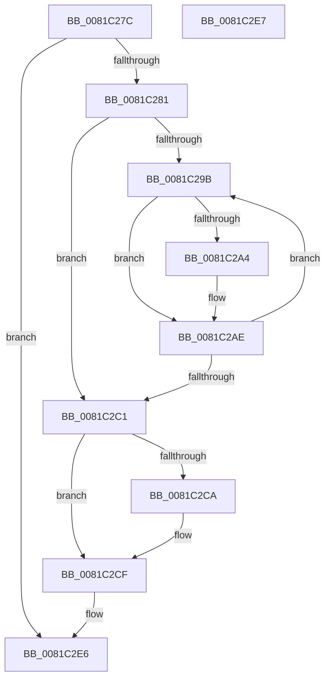

# AslRegWildcardFindClose

- RVA: `0x0081C27C`–`0x0081C2E8` (길이 `108` bytes)
- VA: `0x000000014081C27C`
- 실행 섹션: `PAGE`
- PDB 이름 있음: `예`; PDB Function 태그: `아니요`
- unwind 정보 RVA: `0x000ADC24`
- 디코드: `33`개 명령, `108/108` bytes 표시
- 미해석 바이트: `0` (있으면 어셈블리에 `.byte`로 보존)

> 이 문서는 커널 이미지의 기계어와 PDB 기호를 분석해 생성했습니다. 4번과 5번은 함수 원형과 자료형을 바이너리 사용 방식에서 추정한 C 해석이며 원본 소스 복구 결과는 아닙니다.

## 1. Dependencies

- 직접 호출 지점: **4**; 고유 호출 대상: **2**
- 직접 호출자로 확인된 함수: **2**
- RIP 상대 이미지 참조: **0**

### Outgoing calls
- `0x0081C2A4` → [ZwClose](../../text/6A/ZwClose_function_006AD2B0.md) (function, `0x006AD2B0`)
- `0x0081C2B4` → [AslFree](../95/AslFree_function_0095B674.md) (function, `0x0095B674`)
- `0x0081C2CA` → [AslFree](../95/AslFree_function_0095B674.md) (function, `0x0095B674`)
- `0x0081C2D2` → [AslFree](../95/AslFree_function_0095B674.md) (function, `0x0095B674`)

### Direct callers
- [SdbpCheckMatchingWildcardRegistryEntry](SdbpCheckMatchingWildcardRegistryEntry_function_0081523C.md) at `0x008152F6`
- [AslRegWildcardFindFirst](AslRegWildcardFindFirst_function_0081C2F0.md) at `0x0081C384`

### Static image references
- 디코드된 RIP-relative 메모리 참조가 없습니다.

## 2. Other-region calls and transfers

- 다른 실행 섹션으로 향하는 call: **1**
  - `0x0081C2A4` → [ZwClose](../../text/6A/ZwClose_function_006AD2B0.md) (`PAGE` → `.text`)
- 별도 외부 분기/꼬리 이동을 확인하지 못했습니다.

## 3. Assembly (complete function range)

```asm
0081C27C  48 85 C9                        test rcx, rcx
0081C27F  74 65                           je 0x14081c2e6
0081C281  48 89 5C 24 08                  mov qword ptr [rsp + 8], rbx
0081C286  48 89 74 24 10                  mov qword ptr [rsp + 0x10], rsi
0081C28B  57                              push rdi
0081C28C  48 83 EC 20                     sub rsp, 0x20
0081C290  48 8B 31                        mov rsi, qword ptr [rcx]
0081C293  48 8B F9                        mov rdi, rcx
0081C296  48 3B F1                        cmp rsi, rcx
0081C299  74 26                           je 0x14081c2c1
0081C29B  48 8B 4E 20                     mov rcx, qword ptr [rsi + 0x20]
0081C29F  48 85 C9                        test rcx, rcx
0081C2A2  74 0A                           je 0x14081c2ae
0081C2A4  E8 07 10 E9 FF                  call 0x1406ad2b0
0081C2A9  48 83 66 20 00                  and qword ptr [rsi + 0x20], 0
0081C2AE  48 8B 1E                        mov rbx, qword ptr [rsi]
0081C2B1  48 8B D6                        mov rdx, rsi
0081C2B4  E8 BB F3 13 00                  call 0x14095b674
0081C2B9  48 8B F3                        mov rsi, rbx
0081C2BC  48 3B DF                        cmp rbx, rdi
0081C2BF  75 DA                           jne 0x14081c29b
0081C2C1  48 8B 57 18                     mov rdx, qword ptr [rdi + 0x18]
0081C2C5  48 85 D2                        test rdx, rdx
0081C2C8  74 05                           je 0x14081c2cf
0081C2CA  E8 A5 F3 13 00                  call 0x14095b674
0081C2CF  48 8B D7                        mov rdx, rdi
0081C2D2  E8 9D F3 13 00                  call 0x14095b674
0081C2D7  48 8B 5C 24 30                  mov rbx, qword ptr [rsp + 0x30]
0081C2DC  48 8B 74 24 38                  mov rsi, qword ptr [rsp + 0x38]
0081C2E1  48 83 C4 20                     add rsp, 0x20
0081C2E5  5F                              pop rdi
0081C2E6  C3                              ret
0081C2E7  CC                              int3
```

## 4. C-style interpretation (structured pseudocode)

```c
__int64 __fastcall AslRegWildcardFindClose(__int64 a1)
{
    __int64 result;
    __int64 v_rsp;
    unsigned __int64 v_stack_p10;
    unsigned __int64 v_stack_p8;

    if (a1 == 0) goto loc_0081C2E6;
    v_stack_p8 = v_rbx;
    v_stack_p10 = v_rsi;
    v_rsp = (v_rsp) - (32);
    if ((*(unsigned __int64 *)(a1)) == a1) goto loc_0081C2C1;
loc_0081C29B:
    if (*(unsigned __int64 *)(*(unsigned __int64 *)(a1) + 32) != 0) {
        result = ZwClose(*(unsigned __int64 *)(*(unsigned __int64 *)(a1) + 32), a2, a3, a4);
    }
    result = AslFree(*(unsigned __int64 *)(*(unsigned __int64 *)(a1) + 32), *(unsigned __int64 *)(a1), a3, a4);
    if ((*(unsigned __int64 *)(*(unsigned __int64 *)(a1))) != a1) goto loc_0081C29B;
loc_0081C2C1:
    if (*(unsigned __int64 *)(a1 + 24) != 0) {
        result = AslFree(*(unsigned __int64 *)(*(unsigned __int64 *)(a1) + 32), *(unsigned __int64 *)(a1 + 24), a3, a4);
    }
    result = AslFree(*(unsigned __int64 *)(*(unsigned __int64 *)(a1) + 32), a1, a3, a4);
    v_rsp = (v_rsp) + (32);
loc_0081C2E6:
    return result;
}
```

## 5. (Beta) C Style

```c
int64_t AslRegWildcardFindClose(int64_t Arg1)
{
    int64_t result;
    int64_t local_rsp;
    uint64_t v_stack_p10;
    uint64_t v_stack_p8;

    if (Arg1 == 0) goto loc_0081C2E6;
    v_stack_p8 = local_rbx;
    v_stack_p10 = local_rsi;
    local_rsp = (local_rsp) - (32);
    if ((*(uint64_t *)(Arg1)) == Arg1) goto loc_0081C2C1;
loc_0081C29B:
    if (*(uint64_t *)(*(uint64_t *)(Arg1) + 0x20) != 0) {
        result = ZwClose(*(uint64_t *)(*(uint64_t *)(Arg1) + 0x20), a2, a3, a4);
    }
    result = AslFree(*(uint64_t *)(*(uint64_t *)(Arg1) + 0x20), *(uint64_t *)(Arg1), a3, a4);
    if ((*(uint64_t *)(*(uint64_t *)(Arg1))) != Arg1) goto loc_0081C29B;
loc_0081C2C1:
    if (*(uint64_t *)(Arg1 + 0x18) != 0) {
        result = AslFree(*(uint64_t *)(*(uint64_t *)(Arg1) + 0x20), *(uint64_t *)(Arg1 + 0x18), a3, a4);
    }
    result = AslFree(*(uint64_t *)(*(uint64_t *)(Arg1) + 0x20), Arg1, a3, a4);
    local_rsp = (local_rsp) + (32);
loc_0081C2E6:
    return result;
}
```

## 6. Execution-region graph

[열기: 2D/3D 그래프와 함수 탐색 컨트롤 패널](../../../control-panel.html?section=page&rva=0x0081C27C&view=graph)

- 2D 그래프는 위에서 아래로 흐르고, 3D 그래프는 빈 공간을 드래그해 회전합니다. Shift+드래그는 이동, 휠은 확대·축소, 함수 노드 선택은 대상 보고서 이동입니다.

### Static fallback


