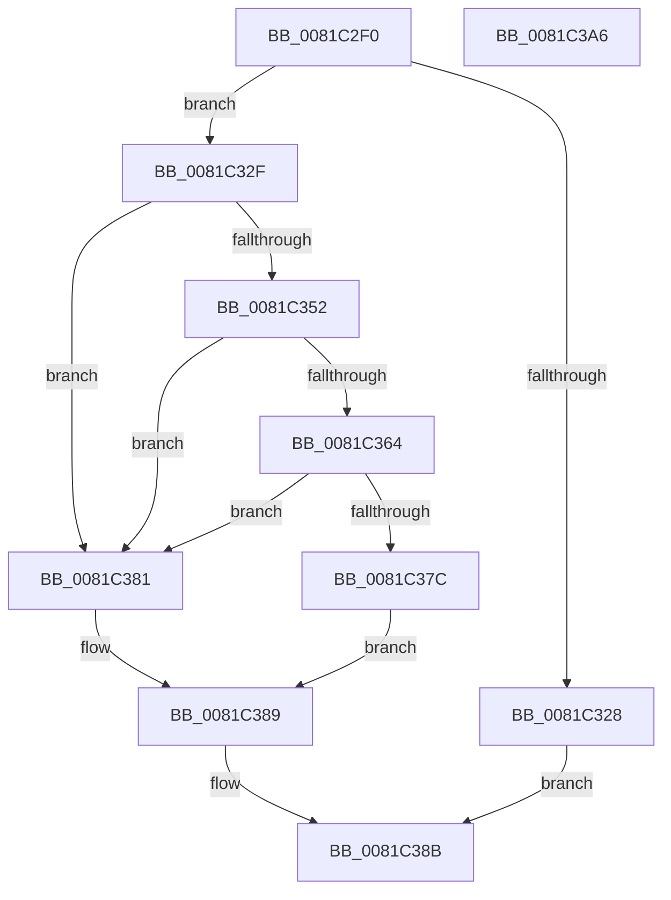

# AslRegWildcardFindFirst

- RVA: `0x0081C2F0`–`0x0081C3A7` (길이 `183` bytes)
- VA: `0x000000014081C2F0`
- 실행 섹션: `PAGE`
- PDB 이름 있음: `예`; PDB Function 태그: `아니요`
- unwind 정보 RVA: `0x0005E6B4`
- 디코드: `55`개 명령, `183/183` bytes 표시
- 미해석 바이트: `0` (있으면 어셈블리에 `.byte`로 보존)

> 이 문서는 커널 이미지의 기계어와 PDB 기호를 분석해 생성했습니다. 4번과 5번은 함수 원형과 자료형을 바이너리 사용 방식에서 추정한 C 해석이며 원본 소스 복구 결과는 아닙니다.

## 1. Dependencies

- 직접 호출 지점: **5**; 고유 호출 대상: **5**
- 직접 호출자로 확인된 함수: **1**
- RIP 상대 이미지 참조: **0**

### Outgoing calls
- `0x0081C31B` → [AslAlloc](../95/AslAlloc_function_0095BD34.md) (function, `0x0095BD34`)
- `0x0081C347` → [AslStringDuplicate](../95/AslStringDuplicate_function_00958604.md) (function, `0x00958604`)
- `0x0081C359` → [AslpParsePattern](AslpParsePattern_function_0081C570.md) (function, `0x0081C570`)
- `0x0081C371` → [AslRegWildcardFindNext](AslRegWildcardFindNext_function_0081C3B0.md) (function, `0x0081C3B0`)
- `0x0081C384` → [AslRegWildcardFindClose](AslRegWildcardFindClose_function_0081C27C.md) (function, `0x0081C27C`)

### Direct callers
- [SdbpCheckMatchingWildcardRegistryEntry](SdbpCheckMatchingWildcardRegistryEntry_function_0081523C.md) at `0x00815280`

### Static image references
- 디코드된 RIP-relative 메모리 참조가 없습니다.

## 2. Other-region calls and transfers

- 다른 실행 섹션으로 향하는 call: **0**
- 별도 외부 분기/꼬리 이동을 확인하지 못했습니다.

## 3. Assembly (complete function range)

```asm
0081C2F0  48 8B C4                        mov rax, rsp
0081C2F3  48 89 58 08                     mov qword ptr [rax + 8], rbx
0081C2F7  48 89 68 10                     mov qword ptr [rax + 0x10], rbp
0081C2FB  48 89 70 18                     mov qword ptr [rax + 0x18], rsi
0081C2FF  48 89 78 20                     mov qword ptr [rax + 0x20], rdi
0081C303  41 56                           push r14
0081C305  48 83 EC 20                     sub rsp, 0x20
0081C309  48 83 22 00                     and qword ptr [rdx], 0
0081C30D  48 8B F2                        mov rsi, rdx
0081C310  BA 20 00 00 00                  mov edx, 0x20
0081C315  49 8B F8                        mov rdi, r8
0081C318  48 8B E9                        mov rbp, rcx
0081C31B  E8 14 FA 13 00                  call 0x14095bd34
0081C320  48 8B D8                        mov rbx, rax
0081C323  48 85 C0                        test rax, rax
0081C326  75 07                           jne 0x14081c32f
0081C328  B8 17 00 00 C0                  mov eax, 0xc0000017
0081C32D  EB 5C                           jmp 0x14081c38b
0081C32F  48 83 60 10 00                  and qword ptr [rax + 0x10], 0
0081C334  48 8D 48 18                     lea rcx, [rax + 0x18]
0081C338  48 83 60 18 00                  and qword ptr [rax + 0x18], 0
0081C33D  48 8B D7                        mov rdx, rdi
0081C340  48 89 58 08                     mov qword ptr [rax + 8], rbx
0081C344  48 89 18                        mov qword ptr [rax], rbx
0081C347  E8 B8 C2 13 00                  call 0x140958604
0081C34C  8B F8                           mov edi, eax
0081C34E  85 C0                           test eax, eax
0081C350  78 2F                           js 0x14081c381
0081C352  48 8B 4B 18                     mov rcx, qword ptr [rbx + 0x18]
0081C356  48 8B D3                        mov rdx, rbx
0081C359  E8 12 02 00 00                  call 0x14081c570
0081C35E  8B F8                           mov edi, eax
0081C360  85 C0                           test eax, eax
0081C362  78 1D                           js 0x14081c381
0081C364  48 8B 03                        mov rax, qword ptr [rbx]
0081C367  48 8B D3                        mov rdx, rbx
0081C36A  48 8B CD                        mov rcx, rbp
0081C36D  48 89 43 10                     mov qword ptr [rbx + 0x10], rax
0081C371  E8 3A 00 00 00                  call 0x14081c3b0
0081C376  8B F8                           mov edi, eax
0081C378  85 C0                           test eax, eax
0081C37A  78 05                           js 0x14081c381
0081C37C  48 89 1E                        mov qword ptr [rsi], rbx
0081C37F  EB 08                           jmp 0x14081c389
0081C381  48 8B CB                        mov rcx, rbx
0081C384  E8 F3 FE FF FF                  call 0x14081c27c
0081C389  8B C7                           mov eax, edi
0081C38B  48 8B 5C 24 30                  mov rbx, qword ptr [rsp + 0x30]
0081C390  48 8B 6C 24 38                  mov rbp, qword ptr [rsp + 0x38]
0081C395  48 8B 74 24 40                  mov rsi, qword ptr [rsp + 0x40]
0081C39A  48 8B 7C 24 48                  mov rdi, qword ptr [rsp + 0x48]
0081C39F  48 83 C4 20                     add rsp, 0x20
0081C3A3  41 5E                           pop r14
0081C3A5  C3                              ret
0081C3A6  CC                              int3
```

## 4. C-style interpretation (structured pseudocode)

```c
__int64 __fastcall AslRegWildcardFindFirst(__int64 a1, __int64 a2, __int64 a3)
{
    __int64 result;
    __int64 v_rsp;
    unsigned __int64 v_stack_p10;
    unsigned __int64 v_stack_p18;
    unsigned __int64 v_stack_p20;
    unsigned __int64 v_stack_p8;

    *(unsigned __int64 *)(v_rsp + 8) = v_rbx;
    *(unsigned __int64 *)(v_rsp + 16) = v_rbp;
    *(unsigned __int64 *)(v_rsp + 24) = v_rsi;
    *(unsigned __int64 *)(v_rsp + 32) = v_rdi;
    v_rsp = (v_rsp) - (32);
    result = AslAlloc(a1, 32, a3, a4);
    if (result != 0) goto loc_0081C32F;
    goto loc_0081C38B;
loc_0081C32F:
    *(unsigned __int64 *)((unsigned int)(0xC0000017ULL) + 8) = result;
    *(unsigned __int64 *)((unsigned int)(0xC0000017ULL)) = result;
    result = AslStringDuplicate((unsigned int)(0xC0000017ULL) + 24, a3, a3, a4);
    if (sign_flag) goto loc_0081C381;
    result = AslpParsePattern(*(unsigned __int64 *)(result + 24), result, a3, a4);
    if (sign_flag) goto loc_0081C381;
    *(unsigned __int64 *)(result + 16) = *(unsigned __int64 *)(result);
    result = AslRegWildcardFindNext(a1, result, a3, a4);
    if (sign_flag) goto loc_0081C381;
    *(unsigned __int64 *)(a2) = result;
    goto loc_0081C389;
loc_0081C381:
    result = AslRegWildcardFindClose(result, result, a3, a4);
loc_0081C389:
loc_0081C38B:
    v_rsp = (v_rsp) + (32);
    return (unsigned int)((unsigned int)((unsigned int)((unsigned int)(result))));
}
```

## 5. (Beta) C Style

```c
int64_t AslRegWildcardFindFirst(int64_t Arg1, void *Arg2, int64_t Arg3)
{
    uint8_t *arg2 = (uint8_t *)Arg2;

    int64_t result;
    int64_t local_rsp;
    uint64_t v_stack_p10;
    uint64_t v_stack_p18;
    uint64_t v_stack_p20;
    uint64_t v_stack_p8;

    *(uint64_t *)(local_rsp + 0x8) = local_rbx;
    *(uint64_t *)(local_rsp + 0x10) = local_rbp;
    *(uint64_t *)(local_rsp + 0x18) = local_rsi;
    *(uint64_t *)(local_rsp + 0x20) = local_rdi;
    local_rsp = (local_rsp) - (32);
    result = AslAlloc(Arg1, 32, Arg3, a4);
    if (result != 0) goto loc_0081C32F;
    goto loc_0081C38B;
loc_0081C32F:
    *(uint64_t *)((uint32_t)(0xC0000017ULL) + 0x8) = result;
    *(uint64_t *)((uint32_t)(0xC0000017ULL)) = result;
    result = AslStringDuplicate((uint32_t)(0xC0000017ULL) + 24, Arg3, Arg3, a4);
    if (sign_flag) goto loc_0081C381;
    result = AslpParsePattern(*(uint64_t *)(result + 0x18), result, Arg3, a4);
    if (sign_flag) goto loc_0081C381;
    *(uint64_t *)(result + 0x10) = *(uint64_t *)(result);
    result = AslRegWildcardFindNext(Arg1, result, Arg3, a4);
    if (sign_flag) goto loc_0081C381;
    *(uint64_t *)(arg2) = result;
    goto loc_0081C389;
loc_0081C381:
    result = AslRegWildcardFindClose(result, result, Arg3, a4);
loc_0081C389:
loc_0081C38B:
    local_rsp = (local_rsp) + (32);
    return (uint32_t)((uint32_t)((uint32_t)((uint32_t)(result))));
}
```

### 관측된 메모리 오프셋

구조체 형식이 확인되지 않은 접근은 인자 기준의 오프셋으로만 기록했습니다.

| 기준 인자 | 오프셋 표현 | 폭 (bit) | 접근 |
|---|---:|---:|---|
| `Arg2` | `+ 0x0` | `64` | `R/W` |
| `Arg2` | `+ 0x0` | `64` | `W` |

## 6. Execution-region graph

[열기: 2D/3D 그래프와 함수 탐색 컨트롤 패널](../../../control-panel.html?section=page&rva=0x0081C2F0&view=graph)

- 2D 그래프는 위에서 아래로 흐르고, 3D 그래프는 빈 공간을 드래그해 회전합니다. Shift+드래그는 이동, 휠은 확대·축소, 함수 노드 선택은 대상 보고서 이동입니다.

### Static fallback


