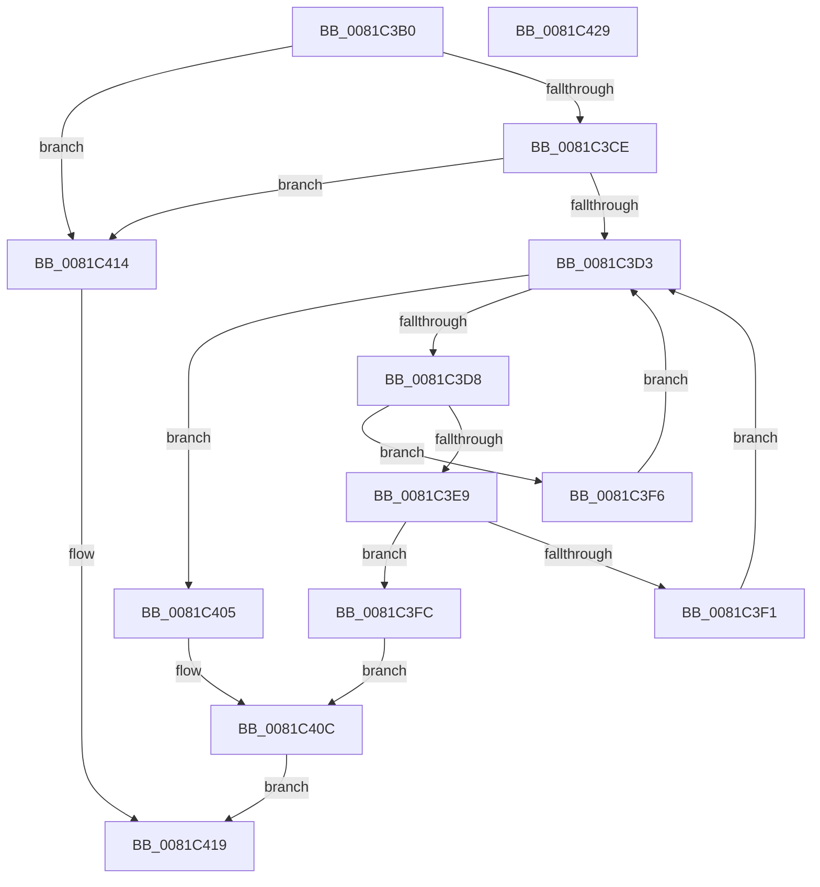

# AslRegWildcardFindNext

- RVA: `0x0081C3B0`–`0x0081C42A` (길이 `122` bytes)
- VA: `0x000000014081C3B0`
- 실행 섹션: `PAGE`
- PDB 이름 있음: `예`; PDB Function 태그: `아니요`
- unwind 정보 RVA: `0x00060BC4`
- 디코드: `41`개 명령, `122/122` bytes 표시
- 미해석 바이트: `0` (있으면 어셈블리에 `.byte`로 보존)

> 이 문서는 커널 이미지의 기계어와 PDB 기호를 분석해 생성했습니다. 4번과 5번은 함수 원형과 자료형을 바이너리 사용 방식에서 추정한 C 해석이며 원본 소스 복구 결과는 아닙니다.

## 1. Dependencies

- 직접 호출 지점: **1**; 고유 호출 대상: **1**
- 직접 호출자로 확인된 함수: **2**
- RIP 상대 이미지 참조: **0**

### Outgoing calls
- `0x0081C3DE` → [AslpProcessMatchRegNode](AslpProcessMatchRegNode_function_0081CB08.md) (function, `0x0081CB08`)

### Direct callers
- [SdbpCheckMatchingWildcardRegistryEntry](SdbpCheckMatchingWildcardRegistryEntry_function_0081523C.md) at `0x008152E8`
- [AslRegWildcardFindFirst](AslRegWildcardFindFirst_function_0081C2F0.md) at `0x0081C371`

### Static image references
- 디코드된 RIP-relative 메모리 참조가 없습니다.

## 2. Other-region calls and transfers

- 다른 실행 섹션으로 향하는 call: **0**
- 별도 외부 분기/꼬리 이동을 확인하지 못했습니다.

## 3. Assembly (complete function range)

```asm
0081C3B0  48 89 5C 24 08                  mov qword ptr [rsp + 8], rbx
0081C3B5  48 89 74 24 10                  mov qword ptr [rsp + 0x10], rsi
0081C3BA  57                              push rdi
0081C3BB  48 83 EC 20                     sub rsp, 0x20
0081C3BF  48 8B 5A 10                     mov rbx, qword ptr [rdx + 0x10]
0081C3C3  48 8B FA                        mov rdi, rdx
0081C3C6  48 8B F1                        mov rsi, rcx
0081C3C9  48 85 D2                        test rdx, rdx
0081C3CC  74 46                           je 0x14081c414
0081C3CE  48 85 DB                        test rbx, rbx
0081C3D1  74 41                           je 0x14081c414
0081C3D3  48 3B DF                        cmp rbx, rdi
0081C3D6  74 2D                           je 0x14081c405
0081C3D8  48 8B D7                        mov rdx, rdi
0081C3DB  48 8B CB                        mov rcx, rbx
0081C3DE  E8 25 07 00 00                  call 0x14081cb08
0081C3E3  8B C8                           mov ecx, eax
0081C3E5  85 C0                           test eax, eax
0081C3E7  78 0D                           js 0x14081c3f6
0081C3E9  48 8B 03                        mov rax, qword ptr [rbx]
0081C3EC  48 3B C7                        cmp rax, rdi
0081C3EF  74 0B                           je 0x14081c3fc
0081C3F1  48 8B D8                        mov rbx, rax
0081C3F4  EB DD                           jmp 0x14081c3d3
0081C3F6  48 8B 5B 08                     mov rbx, qword ptr [rbx + 8]
0081C3FA  EB D7                           jmp 0x14081c3d3
0081C3FC  48 8B 43 20                     mov rax, qword ptr [rbx + 0x20]
0081C400  48 89 06                        mov qword ptr [rsi], rax
0081C403  EB 07                           jmp 0x14081c40c
0081C405  B9 1A 00 00 80                  mov ecx, 0x8000001a
0081C40A  33 DB                           xor ebx, ebx
0081C40C  48 89 5F 10                     mov qword ptr [rdi + 0x10], rbx
0081C410  8B C1                           mov eax, ecx
0081C412  EB 05                           jmp 0x14081c419
0081C414  B8 1A 00 00 80                  mov eax, 0x8000001a
0081C419  48 8B 5C 24 30                  mov rbx, qword ptr [rsp + 0x30]
0081C41E  48 8B 74 24 38                  mov rsi, qword ptr [rsp + 0x38]
0081C423  48 83 C4 20                     add rsp, 0x20
0081C427  5F                              pop rdi
0081C428  C3                              ret
0081C429  CC                              int3
```

## 4. C-style interpretation (structured pseudocode)

```c
__int64 __fastcall AslRegWildcardFindNext(__int64 a1, __int64 a2)
{
    __int64 result;
    __int64 v_rbx;
    __int64 v_rsp;
    unsigned __int64 v_stack_p10;
    unsigned __int64 v_stack_p8;

    v_stack_p8 = v_rbx;
    v_stack_p10 = v_rsi;
    v_rsp = (v_rsp) - (32);
    if (a2 == 0) goto loc_0081C414;
    if (*(unsigned __int64 *)(a2 + 16) == 0) goto loc_0081C414;
loc_0081C3D3:
    if ((*(unsigned __int64 *)(a2 + 16)) == a2) goto loc_0081C405;
    result = AslpProcessMatchRegNode(*(unsigned __int64 *)(a2 + 16), a2, a3, a4);
    if (sign_flag) goto loc_0081C3F6;
    if ((*(unsigned __int64 *)(*(unsigned __int64 *)(a2 + 16))) == a2) goto loc_0081C3FC;
    goto loc_0081C3D3;
loc_0081C3F6:
    goto loc_0081C3D3;
loc_0081C3FC:
    *(unsigned __int64 *)(a1) = *(unsigned __int64 *)(*(unsigned __int64 *)(*(unsigned __int64 *)(*(unsigned __int64 *)(a2 + 16)) + 8) + 32);
    goto loc_0081C40C;
loc_0081C405:
    v_rbx = 0;
loc_0081C40C:
    *(unsigned __int64 *)(a2 + 16) = 0;
    goto loc_0081C419;
loc_0081C414:
loc_0081C419:
    v_rsp = (v_rsp) + (32);
    return (unsigned int)(0x8000001AULL);
}
```

## 5. (Beta) C Style

```c
int64_t AslRegWildcardFindNext(void *Arg1, void *Arg2)
{
    uint8_t *arg1 = (uint8_t *)Arg1;
    uint8_t *arg2 = (uint8_t *)Arg2;

    int64_t result;
    int64_t local_rbx;
    int64_t local_rsp;
    uint64_t v_stack_p10;
    uint64_t v_stack_p8;

    v_stack_p8 = local_rbx;
    v_stack_p10 = local_rsi;
    local_rsp = (local_rsp) - (32);
    if (Arg2 == NULL) goto loc_0081C414;
    if (*(uint64_t *)(arg2 + 0x10) == 0) goto loc_0081C414;
loc_0081C3D3:
    if ((*(uint64_t *)(arg2 + 0x10)) == Arg2) goto loc_0081C405;
    result = AslpProcessMatchRegNode(*(uint64_t *)(arg2 + 0x10), Arg2, a3, a4);
    if (sign_flag) goto loc_0081C3F6;
    if ((*(uint64_t *)(*(uint64_t *)(arg2 + 0x10))) == Arg2) goto loc_0081C3FC;
    goto loc_0081C3D3;
loc_0081C3F6:
    goto loc_0081C3D3;
loc_0081C3FC:
    *(uint64_t *)(arg1) = *(uint64_t *)(*(uint64_t *)(*(uint64_t *)(*(uint64_t *)(arg2 + 0x10)) + 0x8) + 0x20);
    goto loc_0081C40C;
loc_0081C405:
    local_rbx = 0;
loc_0081C40C:
    *(uint64_t *)(arg2 + 0x10) = 0;
    goto loc_0081C419;
loc_0081C414:
loc_0081C419:
    local_rsp = (local_rsp) + (32);
    return (uint32_t)(0x8000001AULL);
}
```

### 관측된 메모리 오프셋

구조체 형식이 확인되지 않은 접근은 인자 기준의 오프셋으로만 기록했습니다.

| 기준 인자 | 오프셋 표현 | 폭 (bit) | 접근 |
|---|---:|---:|---|
| `Arg1` | `+ 0x0` | `64` | `W` |
| `Arg2` | `+ 0x10` | `64` | `R` |
| `Arg2` | `+ 0x10` | `64` | `W` |

## 6. Execution-region graph

[열기: 2D/3D 그래프와 함수 탐색 컨트롤 패널](../../../control-panel.html?section=page&rva=0x0081C3B0&view=graph)

- 2D 그래프는 위에서 아래로 흐르고, 3D 그래프는 빈 공간을 드래그해 회전합니다. Shift+드래그는 이동, 휠은 확대·축소, 함수 노드 선택은 대상 보고서 이동입니다.

### Static fallback


