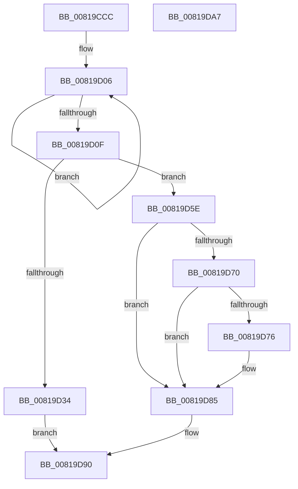

# AslRegistryBuildMachinePath

- RVA: `0x00819CCC`–`0x00819DA8` (길이 `220` bytes)
- VA: `0x0000000140819CCC`
- 실행 섹션: `PAGE`
- PDB 이름 있음: `예`; PDB Function 태그: `아니요`
- unwind 정보 RVA: `0x0007D3C0`
- 디코드: `59`개 명령, `220/220` bytes 표시
- 미해석 바이트: `0` (있으면 어셈블리에 `.byte`로 보존)

> 이 문서는 커널 이미지의 기계어와 PDB 기호를 분석해 생성했습니다. 4번과 5번은 함수 원형과 자료형을 바이너리 사용 방식에서 추정한 C 해석이며 원본 소스 복구 결과는 아닙니다.

## 1. Dependencies

- 직접 호출 지점: **6**; 고유 호출 대상: **5**
- 직접 호출자로 확인된 함수: **1**
- RIP 상대 이미지 참조: **4**

### Outgoing calls
- `0x00819CF8` → [RtlInitUnicodeString](../../text/42/RtlInitUnicodeString_function_0042A780.md) (function, `0x0042A780`)
- `0x00819D26` → [AslAlloc](../95/AslAlloc_function_0095BD34.md) (function, `0x0095BD34`)
- `0x00819D57` → [AslLogCallPrintf](../95/AslLogCallPrintf_function_0095E4EC.md) (function, `0x0095E4EC`)
- `0x00819D66` → [RtlAppendUnicodeStringToString](../../text/40/RtlAppendUnicodeStringToString_function_0040FA50.md) (function, `0x0040FA50`)
- `0x00819D80` → [RtlAppendUnicodeToString](../../text/40/RtlAppendUnicodeToString_function_0040F990.md) (function, `0x0040F990`)
- `0x00819D8B` → [RtlAppendUnicodeToString](../../text/40/RtlAppendUnicodeToString_function_0040F990.md) (function, `0x0040F990`)

### Direct callers
- [AslRegistryGetKey](AslRegistryGetKey_function_00819F64.md) at `0x00819FAA`

### Static image references
- `0x00819CE9` → RVA `0x0003E7D8` (`.rdata`; read)
- `0x00819D38` → RVA `0x0003E800` (`.rdata`; read)
- `0x00819D49` → RVA `0x0003E830` (`.rdata`; read)
- `0x00819D76` → RVA `0x0001BD80` (`.rdata`; read)

## 2. Other-region calls and transfers

- 다른 실행 섹션으로 향하는 call: **4**
  - `0x00819CF8` → [RtlInitUnicodeString](../../text/42/RtlInitUnicodeString_function_0042A780.md) (`PAGE` → `.text`)
  - `0x00819D66` → [RtlAppendUnicodeStringToString](../../text/40/RtlAppendUnicodeStringToString_function_0040FA50.md) (`PAGE` → `.text`)
  - `0x00819D80` → [RtlAppendUnicodeToString](../../text/40/RtlAppendUnicodeToString_function_0040F990.md) (`PAGE` → `.text`)
  - `0x00819D8B` → [RtlAppendUnicodeToString](../../text/40/RtlAppendUnicodeToString_function_0040F990.md) (`PAGE` → `.text`)
- 별도 외부 분기/꼬리 이동을 확인하지 못했습니다.

## 3. Assembly (complete function range)

```asm
00819CCC  48 8B C4                        mov rax, rsp
00819CCF  48 89 58 08                     mov qword ptr [rax + 8], rbx
00819CD3  48 89 68 10                     mov qword ptr [rax + 0x10], rbp
00819CD7  48 89 70 18                     mov qword ptr [rax + 0x18], rsi
00819CDB  57                              push rdi
00819CDC  48 83 EC 40                     sub rsp, 0x40
00819CE0  48 8B F2                        mov rsi, rdx
00819CE3  48 8B D9                        mov rbx, rcx
00819CE6  0F 57 C0                        xorps xmm0, xmm0
00819CE9  48 8D 15 E8 4A 82 FF            lea rdx, [rip - 0x7db518]
00819CF0  48 8D 48 E8                     lea rcx, [rax - 0x18]
00819CF4  0F 11 40 E8                     movups xmmword ptr [rax - 0x18], xmm0
00819CF8  E8 83 0A C1 FF                  call 0x14042a780
00819CFD  33 FF                           xor edi, edi
00819CFF  66 89 3B                        mov word ptr [rbx], di
00819D02  48 83 C8 FF                     or rax, 0xffffffffffffffff
00819D06  48 FF C0                        inc rax
00819D09  66 39 3C 46                     cmp word ptr [rsi + rax*2], di
00819D0D  75 F7                           jne 0x140819d06
00819D0F  BD 01 00 00 00                  mov ebp, 1
00819D14  66 03 C5                        add ax, bp
00819D17  66 03 C0                        add ax, ax
00819D1A  66 03 44 24 30                  add ax, word ptr [rsp + 0x30]
00819D1F  0F B7 D0                        movzx edx, ax
00819D22  66 89 53 02                     mov word ptr [rbx + 2], dx
00819D26  E8 09 20 14 00                  call 0x14095bd34
00819D2B  48 89 43 08                     mov qword ptr [rbx + 8], rax
00819D2F  48 85 C0                        test rax, rax
00819D32  75 2A                           jne 0x140819d5e
00819D34  0F B7 43 02                     movzx eax, word ptr [rbx + 2]
00819D38  4C 8D 0D C1 4A 82 FF            lea r9, [rip - 0x7db53f]
00819D3F  41 B8 EA 05 00 00               mov r8d, 0x5ea
00819D45  89 44 24 20                     mov dword ptr [rsp + 0x20], eax
00819D49  48 8D 15 E0 4A 82 FF            lea rdx, [rip - 0x7db520]
00819D50  8B CD                           mov ecx, ebp
00819D52  BF 17 00 00 C0                  mov edi, 0xc0000017
00819D57  E8 90 47 14 00                  call 0x14095e4ec
00819D5C  EB 32                           jmp 0x140819d90
00819D5E  48 8D 54 24 30                  lea rdx, [rsp + 0x30]
00819D63  48 8B CB                        mov rcx, rbx
00819D66  E8 E5 5C BF FF                  call 0x14040fa50
00819D6B  48 85 F6                        test rsi, rsi
00819D6E  74 15                           je 0x140819d85
00819D70  66 83 3E 5C                     cmp word ptr [rsi], 0x5c
00819D74  74 0F                           je 0x140819d85
00819D76  48 8D 15 03 20 80 FF            lea rdx, [rip - 0x7fdffd]
00819D7D  48 8B CB                        mov rcx, rbx
00819D80  E8 0B 5C BF FF                  call 0x14040f990
00819D85  48 8B D6                        mov rdx, rsi
00819D88  48 8B CB                        mov rcx, rbx
00819D8B  E8 00 5C BF FF                  call 0x14040f990
00819D90  48 8B 5C 24 50                  mov rbx, qword ptr [rsp + 0x50]
00819D95  8B C7                           mov eax, edi
00819D97  48 8B 6C 24 58                  mov rbp, qword ptr [rsp + 0x58]
00819D9C  48 8B 74 24 60                  mov rsi, qword ptr [rsp + 0x60]
00819DA1  48 83 C4 40                     add rsp, 0x40
00819DA5  5F                              pop rdi
00819DA6  C3                              ret
00819DA7  CC                              int3
```

## 4. C-style interpretation (structured pseudocode)

```c
__int64 __fastcall AslRegistryBuildMachinePath(__int64 a1, __int64 a2)
{
    __int64 result;
    __int64 v_rdi;
    __int64 v_rsp;
    unsigned __int16 v_stack_m18;
    unsigned int v_stack_m28;
    unsigned __int64 v_stack_p10;
    unsigned __int64 v_stack_p18;
    unsigned __int64 v_stack_p8;

    *(unsigned __int64 *)(v_rsp + 8) = v_rbx;
    *(unsigned __int64 *)(v_rsp + 16) = v_rbp;
    *(unsigned __int64 *)(v_rsp + 24) = v_rsi;
    v_rsp = (v_rsp) - (64);
    *(unsigned __int64 *)(v_rsp - 24) = v_xmm0;
    result = RtlInitUnicodeString(v_rsp - 24, v_rip - 8238360, a3, a4);
    v_rdi = 0;
    *(unsigned __int16 *)(a1) = 0;
    result = (result) | (-1);
loc_00819D06:
    result = (result) + 1;
    if ((*(unsigned __int16 *)(a2 + result * 2)) != 0) goto loc_00819D06;
    result = (unsigned __int16)((result) + (1));
    result = (unsigned __int16)((result) + ((unsigned __int16)(result)));
    result = (unsigned __int16)((result) + (v_stack_m18));
    *(unsigned __int16 *)(a1 + 2) = (unsigned __int16)((unsigned __int16)(result));
    result = AslAlloc(v_rsp - 24, (unsigned __int16)(result), a3, a4);
    *(unsigned __int64 *)(a1 + 8) = result;
    if (result != 0) goto loc_00819D5E;
    v_stack_m28 = (unsigned int)(*(unsigned __int16 *)(a1 + 2));
    result = AslLogCallPrintf(1, v_rip - 8238368, (unsigned int)(0x5EAULL), v_rip - 8238399);
    goto loc_00819D90;
loc_00819D5E:
    result = RtlAppendUnicodeStringToString(a1, v_stack_m18, (unsigned int)(0x5EAULL), v_rip - 8238399);
    if (a2 == 0) goto loc_00819D85;
    if ((*(unsigned __int16 *)(a2)) != 92) {
        a2 = v_rip - 8380413;
        a1 = a1;
        result = RtlAppendUnicodeToString(a1, a2, (unsigned int)(0x5EAULL), v_rip - 8238399);
    }
    result = RtlAppendUnicodeToString(a1, a2, (unsigned int)(0x5EAULL), v_rip - 8238399);
loc_00819D90:
    v_rsp = (v_rsp) + (64);
    return (unsigned int)((unsigned int)((unsigned int)(0xC0000017ULL)));
}
```

## 5. (Beta) C Style

```c
int64_t AslRegistryBuildMachinePath(void *Arg1, void *Arg2)
{
    uint8_t *arg1 = (uint8_t *)Arg1;
    uint8_t *arg2 = (uint8_t *)Arg2;

    int64_t result;
    int64_t local_rdi;
    int64_t local_rsp;
    uint16_t v_stack_m18;
    uint32_t v_stack_m28;
    uint64_t v_stack_p10;
    uint64_t v_stack_p18;
    uint64_t v_stack_p8;

    *(uint64_t *)(local_rsp + 0x8) = local_rbx;
    *(uint64_t *)(local_rsp + 0x10) = local_rbp;
    *(uint64_t *)(local_rsp + 0x18) = local_rsi;
    local_rsp = (local_rsp) - (64);
    *(uint64_t *)(local_rsp - 0x18) = v_xmm0;
    result = RtlInitUnicodeString(local_rsp - 24, v_rip - 8238360, a3, a4);
    local_rdi = 0;
    *(uint16_t *)(arg1) = 0;
    result = (result) | (-1);
loc_00819D06:
    result = (result) + 1;
    if ((*(uint16_t *)(arg2 + result * 2)) != 0) goto loc_00819D06;
    result = (uint16_t)((result) + (1));
    result = (uint16_t)((result) + ((uint16_t)(result)));
    result = (uint16_t)((result) + (v_stack_m18));
    *(uint16_t *)(arg1 + 0x2) = (uint16_t)((uint16_t)(result));
    result = AslAlloc(local_rsp - 24, (uint16_t)(result), a3, a4);
    *(uint64_t *)(arg1 + 0x8) = result;
    if (result != 0) goto loc_00819D5E;
    v_stack_m28 = (uint32_t)(*(uint16_t *)(arg1 + 0x2));
    result = AslLogCallPrintf(1, v_rip - 8238368, (uint32_t)(0x5EAULL), v_rip - 8238399);
    goto loc_00819D90;
loc_00819D5E:
    result = RtlAppendUnicodeStringToString(Arg1, v_stack_m18, (uint32_t)(0x5EAULL), v_rip - 8238399);
    if (Arg2 == NULL) goto loc_00819D85;
    if ((*(uint16_t *)(arg2)) != 92) {
        Arg2 = v_rip - 8380413;
        Arg1 = Arg1;
        result = RtlAppendUnicodeToString(Arg1, Arg2, (uint32_t)(0x5EAULL), v_rip - 8238399);
    }
    result = RtlAppendUnicodeToString(Arg1, Arg2, (uint32_t)(0x5EAULL), v_rip - 8238399);
loc_00819D90:
    local_rsp = (local_rsp) + (64);
    return (uint32_t)((uint32_t)((uint32_t)(0xC0000017ULL)));
}
```

### 관측된 메모리 오프셋

구조체 형식이 확인되지 않은 접근은 인자 기준의 오프셋으로만 기록했습니다.

| 기준 인자 | 오프셋 표현 | 폭 (bit) | 접근 |
|---|---:|---:|---|
| `Arg1` | `+ 0x0` | `16` | `W` |
| `Arg1` | `+ 0x2` | `16` | `R` |
| `Arg1` | `+ 0x2` | `16` | `W` |
| `Arg1` | `+ 0x8` | `64` | `W` |
| `Arg2` | `+ 0x0 + rax*2` | `16` | `R` |

## 6. Execution-region graph

[열기: 2D/3D 그래프와 함수 탐색 컨트롤 패널](../../../control-panel.html?section=page&rva=0x00819CCC&view=graph)

- 2D 그래프는 위에서 아래로 흐르고, 3D 그래프는 빈 공간을 드래그해 회전합니다. Shift+드래그는 이동, 휠은 확대·축소, 함수 노드 선택은 대상 보고서 이동입니다.

### Static fallback


