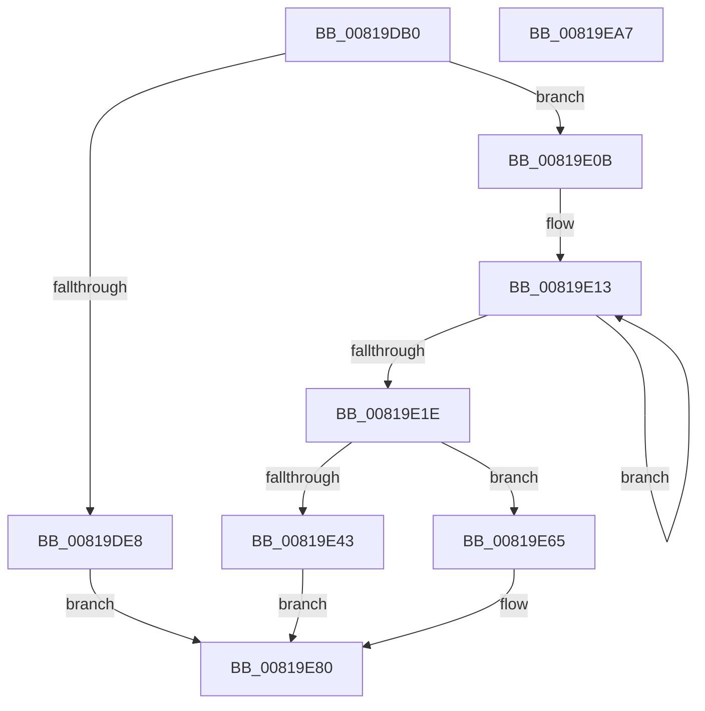

# AslRegistryBuildUserPath

- RVA: `0x00819DB0`–`0x00819EA8` (길이 `248` bytes)
- VA: `0x0000000140819DB0`
- 실행 섹션: `PAGE`
- PDB 이름 있음: `예`; PDB Function 태그: `아니요`
- unwind 정보 RVA: `0x00060130`
- 디코드: `64`개 명령, `248/248` bytes 표시
- 미해석 바이트: `0` (있으면 어셈블리에 `.byte`로 보존)

> 이 문서는 커널 이미지의 기계어와 PDB 기호를 분석해 생성했습니다. 4번과 5번은 함수 원형과 자료형을 바이너리 사용 방식에서 추정한 C 해석이며 원본 소스 복구 결과는 아닙니다.

## 1. Dependencies

- 직접 호출 지점: **7**; 고유 호출 대상: **6**
- 직접 호출자로 확인된 함수: **1**
- RIP 상대 이미지 참조: **3**

### Outgoing calls
- `0x00819DDA` → [RtlFormatCurrentUserKeyPath](../92/RtlFormatCurrentUserKeyPath_function_00927820.md) (function, `0x00927820`)
- `0x00819E04` → [AslLogCallPrintf](../95/AslLogCallPrintf_function_0095E4EC.md) (function, `0x0095E4EC`)
- `0x00819E35` → [AslAlloc](../95/AslAlloc_function_0095BD34.md) (function, `0x0095BD34`)
- `0x00819E5E` → [AslLogCallPrintf](../95/AslLogCallPrintf_function_0095E4EC.md) (function, `0x0095E4EC`)
- `0x00819E6D` → [RtlAppendUnicodeStringToString](../../text/40/RtlAppendUnicodeStringToString_function_0040FA50.md) (function, `0x0040FA50`)
- `0x00819E78` → [RtlAppendUnicodeToString](../../text/40/RtlAppendUnicodeToString_function_0040F990.md) (function, `0x0040F990`)
- `0x00819E85` → [RtlFreeAnsiString](../9C/RtlFreeAnsiString_function_009C0800.md) (function, `0x009C0800`)

### Direct callers
- [AslRegistryGetKey](AslRegistryGetKey_function_00819F64.md) at `0x00819FDE`

### Static image references
- `0x00819DE8` → RVA `0x0003E850` (`.rdata`; read)
- `0x00819DF9` → RVA `0x0003E878` (`.rdata`; read)
- `0x00819E43` → RVA `0x000129E0` (`.rdata`; read)

## 2. Other-region calls and transfers

- 다른 실행 섹션으로 향하는 call: **2**
  - `0x00819E6D` → [RtlAppendUnicodeStringToString](../../text/40/RtlAppendUnicodeStringToString_function_0040FA50.md) (`PAGE` → `.text`)
  - `0x00819E78` → [RtlAppendUnicodeToString](../../text/40/RtlAppendUnicodeToString_function_0040F990.md) (`PAGE` → `.text`)
- 별도 외부 분기/꼬리 이동을 확인하지 못했습니다.

## 3. Assembly (complete function range)

```asm
00819DB0  48 8B C4                        mov rax, rsp
00819DB3  48 89 58 08                     mov qword ptr [rax + 8], rbx
00819DB7  48 89 68 10                     mov qword ptr [rax + 0x10], rbp
00819DBB  48 89 70 18                     mov qword ptr [rax + 0x18], rsi
00819DBF  48 89 78 20                     mov qword ptr [rax + 0x20], rdi
00819DC3  41 56                           push r14
00819DC5  48 83 EC 40                     sub rsp, 0x40
00819DC9  48 8B F9                        mov rdi, rcx
00819DCC  0F 57 C0                        xorps xmm0, xmm0
00819DCF  48 8D 48 E8                     lea rcx, [rax - 0x18]
00819DD3  48 8B EA                        mov rbp, rdx
00819DD6  0F 11 40 E8                     movups xmmword ptr [rax - 0x18], xmm0
00819DDA  E8 41 DA 10 00                  call 0x140927820
00819DDF  45 33 F6                        xor r14d, r14d
00819DE2  8B D8                           mov ebx, eax
00819DE4  85 C0                           test eax, eax
00819DE6  79 23                           jns 0x140819e0b
00819DE8  4C 8D 0D 61 4A 82 FF            lea r9, [rip - 0x7db59f]
00819DEF  89 44 24 20                     mov dword ptr [rsp + 0x20], eax
00819DF3  41 B8 22 06 00 00               mov r8d, 0x622
00819DF9  48 8D 15 78 4A 82 FF            lea rdx, [rip - 0x7db588]
00819E00  41 8D 4E 01                     lea ecx, [r14 + 1]
00819E04  E8 E3 46 14 00                  call 0x14095e4ec
00819E09  EB 75                           jmp 0x140819e80
00819E0B  66 44 89 37                     mov word ptr [rdi], r14w
00819E0F  48 83 C8 FF                     or rax, 0xffffffffffffffff
00819E13  48 FF C0                        inc rax
00819E16  66 44 39 74 45 00               cmp word ptr [rbp + rax*2], r14w
00819E1C  75 F5                           jne 0x140819e13
00819E1E  BE 01 00 00 00                  mov esi, 1
00819E23  66 03 C6                        add ax, si
00819E26  66 03 C0                        add ax, ax
00819E29  66 03 44 24 30                  add ax, word ptr [rsp + 0x30]
00819E2E  0F B7 D0                        movzx edx, ax
00819E31  66 89 57 02                     mov word ptr [rdi + 2], dx
00819E35  E8 FA 1E 14 00                  call 0x14095bd34
00819E3A  48 89 47 08                     mov qword ptr [rdi + 8], rax
00819E3E  48 85 C0                        test rax, rax
00819E41  75 22                           jne 0x140819e65
00819E43  4C 8D 0D 96 8B 7F FF            lea r9, [rip - 0x80746a]
00819E4A  41 B8 2E 06 00 00               mov r8d, 0x62e
00819E50  48 8D 15 21 4A 82 FF            lea rdx, [rip - 0x7db5df]
00819E57  8B CE                           mov ecx, esi
00819E59  BB 17 00 00 C0                  mov ebx, 0xc0000017
00819E5E  E8 89 46 14 00                  call 0x14095e4ec
00819E63  EB 1B                           jmp 0x140819e80
00819E65  48 8D 54 24 30                  lea rdx, [rsp + 0x30]
00819E6A  48 8B CF                        mov rcx, rdi
00819E6D  E8 DE 5B BF FF                  call 0x14040fa50
00819E72  48 8B D5                        mov rdx, rbp
00819E75  48 8B CF                        mov rcx, rdi
00819E78  E8 13 5B BF FF                  call 0x14040f990
00819E7D  41 8B DE                        mov ebx, r14d
00819E80  48 8D 4C 24 30                  lea rcx, [rsp + 0x30]
00819E85  E8 76 69 1A 00                  call 0x1409c0800
00819E8A  48 8B 6C 24 58                  mov rbp, qword ptr [rsp + 0x58]
00819E8F  8B C3                           mov eax, ebx
00819E91  48 8B 5C 24 50                  mov rbx, qword ptr [rsp + 0x50]
00819E96  48 8B 74 24 60                  mov rsi, qword ptr [rsp + 0x60]
00819E9B  48 8B 7C 24 68                  mov rdi, qword ptr [rsp + 0x68]
00819EA0  48 83 C4 40                     add rsp, 0x40
00819EA4  41 5E                           pop r14
00819EA6  C3                              ret
00819EA7  CC                              int3
```

## 4. C-style interpretation (structured pseudocode)

```c
__int64 __fastcall AslRegistryBuildUserPath(__int64 a1, __int64 a2)
{
    __int64 result;
    __int64 v_r14;
    __int64 v_rsp;
    unsigned __int16 v_stack_m18;
    unsigned int v_stack_m28;
    unsigned __int64 v_stack_p10;
    unsigned __int64 v_stack_p18;
    unsigned __int64 v_stack_p20;
    unsigned __int64 v_stack_p8;

    *(unsigned __int64 *)(v_rsp + 8) = v_rbx;
    *(unsigned __int64 *)(v_rsp + 16) = v_rbp;
    *(unsigned __int64 *)(v_rsp + 24) = v_rsi;
    *(unsigned __int64 *)(v_rsp + 32) = v_rdi;
    v_rsp = (v_rsp) - (64);
    *(unsigned __int64 *)(v_rsp - 24) = v_xmm0;
    result = RtlFormatCurrentUserKeyPath(v_rsp - 24, a2, a3, a4);
    v_r14 = 0;
    if (!sign_flag) goto loc_00819E0B;
    v_stack_m28 = (unsigned int)(result);
    result = AslLogCallPrintf(v_r14 + 1, v_rip - 8238472, (unsigned int)(0x622ULL), v_rip - 8238495);
    goto loc_00819E80;
loc_00819E0B:
    *(unsigned __int16 *)(a1) = 0;
    result = (result) | (-1);
loc_00819E13:
    result = (result) + 1;
    if ((*(unsigned __int16 *)(a2 + result * 2)) != 0) goto loc_00819E13;
    result = (unsigned __int16)((result) + (1));
    result = (unsigned __int16)((result) + ((unsigned __int16)(result)));
    result = (unsigned __int16)((result) + (v_stack_m18));
    *(unsigned __int16 *)(a1 + 2) = (unsigned __int16)((unsigned __int16)(result));
    result = AslAlloc(v_r14 + 1, (unsigned __int16)(result), (unsigned int)(0x622ULL), v_rip - 8238495);
    *(unsigned __int64 *)(a1 + 8) = result;
    if (result != 0) goto loc_00819E65;
    result = AslLogCallPrintf(1, v_rip - 8238559, (unsigned int)(0x62EULL), v_rip - 8418410);
    goto loc_00819E80;
loc_00819E65:
    result = RtlAppendUnicodeStringToString(a1, v_stack_m18, (unsigned int)(0x62EULL), v_rip - 8418410);
    result = RtlAppendUnicodeToString(a1, a2, (unsigned int)(0x62EULL), v_rip - 8418410);
loc_00819E80:
    result = RtlFreeAnsiString(v_stack_m18, a2, (unsigned int)(0x62EULL), v_rip - 8418410);
    v_rsp = (v_rsp) + (64);
    return 0;
}
```

## 5. (Beta) C Style

```c
int64_t AslRegistryBuildUserPath(void *Arg1, void *Arg2)
{
    uint8_t *arg1 = (uint8_t *)Arg1;
    uint8_t *arg2 = (uint8_t *)Arg2;

    int64_t result;
    int64_t local_r14;
    int64_t local_rsp;
    uint16_t v_stack_m18;
    uint32_t v_stack_m28;
    uint64_t v_stack_p10;
    uint64_t v_stack_p18;
    uint64_t v_stack_p20;
    uint64_t v_stack_p8;

    *(uint64_t *)(local_rsp + 0x8) = local_rbx;
    *(uint64_t *)(local_rsp + 0x10) = local_rbp;
    *(uint64_t *)(local_rsp + 0x18) = local_rsi;
    *(uint64_t *)(local_rsp + 0x20) = local_rdi;
    local_rsp = (local_rsp) - (64);
    *(uint64_t *)(local_rsp - 0x18) = v_xmm0;
    result = RtlFormatCurrentUserKeyPath(local_rsp - 24, Arg2, a3, a4);
    local_r14 = 0;
    if (!sign_flag) goto loc_00819E0B;
    v_stack_m28 = (uint32_t)(result);
    result = AslLogCallPrintf(local_r14 + 1, v_rip - 8238472, (uint32_t)(0x622ULL), v_rip - 8238495);
    goto loc_00819E80;
loc_00819E0B:
    *(uint16_t *)(arg1) = 0;
    result = (result) | (-1);
loc_00819E13:
    result = (result) + 1;
    if ((*(uint16_t *)(arg2 + result * 2)) != 0) goto loc_00819E13;
    result = (uint16_t)((result) + (1));
    result = (uint16_t)((result) + ((uint16_t)(result)));
    result = (uint16_t)((result) + (v_stack_m18));
    *(uint16_t *)(arg1 + 0x2) = (uint16_t)((uint16_t)(result));
    result = AslAlloc(local_r14 + 1, (uint16_t)(result), (uint32_t)(0x622ULL), v_rip - 8238495);
    *(uint64_t *)(arg1 + 0x8) = result;
    if (result != 0) goto loc_00819E65;
    result = AslLogCallPrintf(1, v_rip - 8238559, (uint32_t)(0x62EULL), v_rip - 8418410);
    goto loc_00819E80;
loc_00819E65:
    result = RtlAppendUnicodeStringToString(Arg1, v_stack_m18, (uint32_t)(0x62EULL), v_rip - 8418410);
    result = RtlAppendUnicodeToString(Arg1, Arg2, (uint32_t)(0x62EULL), v_rip - 8418410);
loc_00819E80:
    result = RtlFreeAnsiString(v_stack_m18, Arg2, (uint32_t)(0x62EULL), v_rip - 8418410);
    local_rsp = (local_rsp) + (64);
    return 0;
}
```

### 관측된 메모리 오프셋

구조체 형식이 확인되지 않은 접근은 인자 기준의 오프셋으로만 기록했습니다.

| 기준 인자 | 오프셋 표현 | 폭 (bit) | 접근 |
|---|---:|---:|---|
| `Arg1` | `+ 0x0` | `16` | `W` |
| `Arg1` | `+ 0x2` | `16` | `W` |
| `Arg1` | `+ 0x8` | `64` | `W` |
| `Arg2` | `+ 0x0 + rax*2` | `16` | `R` |

## 6. Execution-region graph

[열기: 2D/3D 그래프와 함수 탐색 컨트롤 패널](../../../control-panel.html?section=page&rva=0x00819DB0&view=graph)

- 2D 그래프는 위에서 아래로 흐르고, 3D 그래프는 빈 공간을 드래그해 회전합니다. Shift+드래그는 이동, 휠은 확대·축소, 함수 노드 선택은 대상 보고서 이동입니다.

### Static fallback


