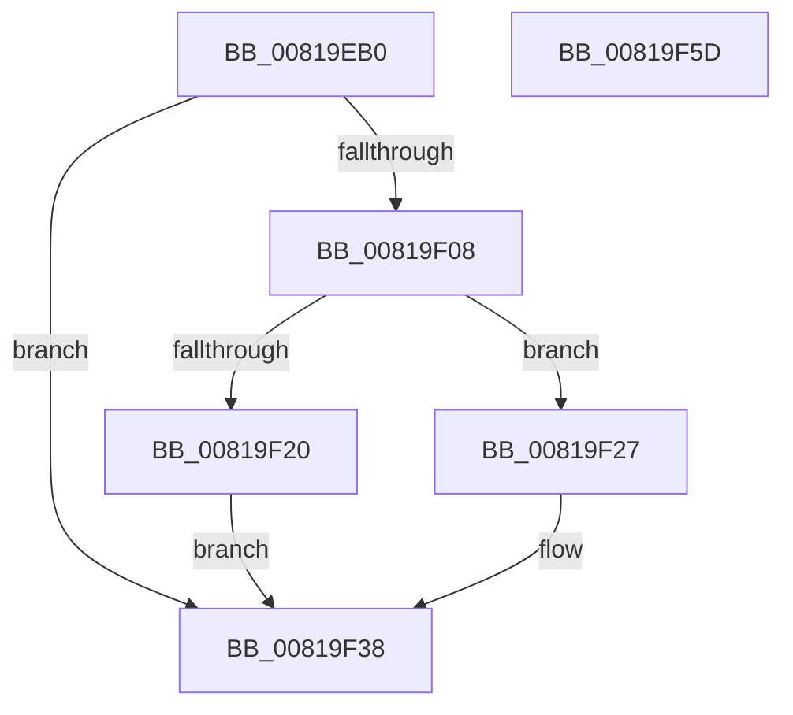

# AslRegistryEnumKey

- RVA: `0x00819EB0`–`0x00819F5E` (길이 `174` bytes)
- VA: `0x0000000140819EB0`
- 실행 섹션: `PAGE`
- PDB 이름 있음: `예`; PDB Function 태그: `아니요`
- unwind 정보 RVA: `0x000D9C30`
- 디코드: `46`개 명령, `174/174` bytes 표시
- 미해석 바이트: `0` (있으면 어셈블리에 `.byte`로 보존)

> 이 문서는 커널 이미지의 기계어와 PDB 기호를 분석해 생성했습니다. 4번과 5번은 함수 원형과 자료형을 바이너리 사용 방식에서 추정한 C 해석이며 원본 소스 복구 결과는 아닙니다.

## 1. Dependencies

- 직접 호출 지점: **3**; 고유 호출 대상: **3**
- 직접 호출자로 확인된 함수: **1**
- RIP 상대 이미지 참조: **1**

### Outgoing calls
- `0x00819EFD` → [ZwEnumerateKey](../../text/6A/ZwEnumerateKey_function_006AD710.md) (function, `0x006AD710`)
- `0x00819F2F` → [memcpy](../../text/6C/memcpy_function_006C6840.md) (function, `0x006C6840`)
- `0x00819F45` → [_security_check_cookie](../../text/6A/_security_check_cookie_function_006AC640.md) (function, `0x006AC640`)

### Direct callers
- [AslpProcessMatchRegNode](AslpProcessMatchRegNode_function_0081CB08.md) at `0x0081CBB9`

### Static image references
- `0x00819EBF` → RVA `0x00E0A740` (`.data`; read)

## 2. Other-region calls and transfers

- 다른 실행 섹션으로 향하는 call: **3**
  - `0x00819EFD` → [ZwEnumerateKey](../../text/6A/ZwEnumerateKey_function_006AD710.md) (`PAGE` → `.text`)
  - `0x00819F2F` → [memcpy](../../text/6C/memcpy_function_006C6840.md) (`PAGE` → `.text`)
  - `0x00819F45` → [_security_check_cookie](../../text/6A/_security_check_cookie_function_006AC640.md) (`PAGE` → `.text`)
- 별도 외부 분기/꼬리 이동을 확인하지 못했습니다.

## 3. Assembly (complete function range)

```asm
00819EB0  48 89 5C 24 10                  mov qword ptr [rsp + 0x10], rbx
00819EB5  55                              push rbp
00819EB6  56                              push rsi
00819EB7  57                              push rdi
00819EB8  48 81 EC 60 02 00 00            sub rsp, 0x260
00819EBF  48 8B 05 7A 08 5F 00            mov rax, qword ptr [rip + 0x5f087a]
00819EC6  48 33 C4                        xor rax, rsp
00819EC9  48 89 84 24 50 02 00 00         mov qword ptr [rsp + 0x250], rax
00819ED1  48 8B F1                        mov rsi, rcx
00819ED4  49 8B C0                        mov rax, r8
00819ED7  48 8D 4C 24 30                  lea rcx, [rsp + 0x30]
00819EDC  41 8B D1                        mov edx, r9d
00819EDF  48 89 4C 24 28                  mov qword ptr [rsp + 0x28], rcx
00819EE4  4C 8D 4C 24 40                  lea r9, [rsp + 0x40]
00819EE9  33 ED                           xor ebp, ebp
00819EEB  C7 44 24 20 0C 02 00 00         mov dword ptr [rsp + 0x20], 0x20c
00819EF3  48 8B C8                        mov rcx, rax
00819EF6  89 6C 24 30                     mov dword ptr [rsp + 0x30], ebp
00819EFA  45 33 C0                        xor r8d, r8d
00819EFD  E8 0E 38 E9 FF                  call 0x1406ad710
00819F02  8B F8                           mov edi, eax
00819F04  85 C0                           test eax, eax
00819F06  78 30                           js 0x140819f38
00819F08  44 8B 44 24 4C                  mov r8d, dword ptr [rsp + 0x4c]
00819F0D  41 8B D8                        mov ebx, r8d
00819F10  48 D1 EB                        shr rbx, 1
00819F13  48 8D 4B 01                     lea rcx, [rbx + 1]
00819F17  48 81 F9 04 01 00 00            cmp rcx, 0x104
00819F1E  72 07                           jb 0x140819f27
00819F20  BF 23 00 00 C0                  mov edi, 0xc0000023
00819F25  EB 11                           jmp 0x140819f38
00819F27  48 8D 54 24 50                  lea rdx, [rsp + 0x50]
00819F2C  48 8B CE                        mov rcx, rsi
00819F2F  E8 0C C9 EA FF                  call 0x1406c6840
00819F34  66 89 2C 5E                     mov word ptr [rsi + rbx*2], bp
00819F38  8B C7                           mov eax, edi
00819F3A  48 8B 8C 24 50 02 00 00         mov rcx, qword ptr [rsp + 0x250]
00819F42  48 33 CC                        xor rcx, rsp
00819F45  E8 F6 26 E9 FF                  call 0x1406ac640
00819F4A  48 8B 9C 24 88 02 00 00         mov rbx, qword ptr [rsp + 0x288]
00819F52  48 81 C4 60 02 00 00            add rsp, 0x260
00819F59  5F                              pop rdi
00819F5A  5E                              pop rsi
00819F5B  5D                              pop rbp
00819F5C  C3                              ret
00819F5D  CC                              int3
```

## 4. C-style interpretation (structured pseudocode)

```c
__int64 __fastcall AslRegistryEnumKey(__int64 a1, __int64 a2, __int64 a3, int a4)
{
    __int64 result;
    __int64 v_rbp;
    __int64 v_rbx;
    __int64 v_rsp;
    unsigned __int64 v_stack_m228;
    unsigned int v_stack_m22C;
    unsigned __int64 v_stack_m238;
    unsigned __int64 v_stack_m248;
    unsigned __int64 v_stack_m250;
    unsigned int v_stack_m258;
    unsigned __int64 v_stack_m28;
    unsigned __int64 v_stack_p10;

    v_stack_p10 = v_rbx;
    v_rsp = (v_rsp) - (608);
    result = (*(unsigned __int64 *)(v_rip + 6228090)) ^ (v_rsp);
    v_stack_m28 = result;
    v_stack_m250 = v_stack_m248;
    v_rbp = 0;
    v_stack_m258 = 524;
    v_stack_m248 = 0;
    a3 = 0;
    result = ZwEnumerateKey(a3, (unsigned int)(a4), a3, v_stack_m238);
    if (sign_flag) goto loc_00819F38;
    v_rbx = ((unsigned int)((unsigned int)((unsigned int)(v_stack_m22C)))) >> (1);
    if ((v_rbx + 1) < 260) goto loc_00819F27;
    goto loc_00819F38;
loc_00819F27:
    result = memcpy(a1, v_stack_m228, (unsigned int)(v_stack_m22C), v_stack_m238);
    *(unsigned __int16 *)(a1 + v_rbx * 2) = 0;
loc_00819F38:
    a1 = (v_stack_m28) ^ (v_rsp);
    result = _security_check_cookie(a1, v_stack_m228, (unsigned int)(v_stack_m22C), v_stack_m238);
    v_rsp = (v_rsp) + (608);
    return result;
}
```

## 5. (Beta) C Style

```c
int64_t AslRegistryEnumKey(void *Arg1, int64_t Arg2, int64_t Arg3, int32_t Arg4)
{
    uint8_t *arg1 = (uint8_t *)Arg1;

    int64_t result;
    int64_t local_rbp;
    int64_t local_rbx;
    int64_t local_rsp;
    uint64_t v_stack_m228;
    uint32_t v_stack_m22C;
    uint64_t v_stack_m238;
    uint64_t v_stack_m248;
    uint64_t v_stack_m250;
    uint32_t v_stack_m258;
    uint64_t v_stack_m28;
    uint64_t v_stack_p10;

    v_stack_p10 = local_rbx;
    local_rsp = (local_rsp) - (608);
    result = (*(uint64_t *)(v_rip + 0x5F087A)) ^ (local_rsp);
    v_stack_m28 = result;
    v_stack_m250 = v_stack_m248;
    local_rbp = 0;
    v_stack_m258 = 524;
    v_stack_m248 = 0;
    Arg3 = 0;
    result = ZwEnumerateKey(Arg3, (uint32_t)(Arg4), Arg3, v_stack_m238);
    if (sign_flag) goto loc_00819F38;
    local_rbx = ((uint32_t)((uint32_t)((uint32_t)(v_stack_m22C)))) >> (1);
    if ((local_rbx + 1) < 260) goto loc_00819F27;
    goto loc_00819F38;
loc_00819F27:
    result = memcpy(Arg1, v_stack_m228, (uint32_t)(v_stack_m22C), v_stack_m238);
    *(uint16_t *)(arg1 + local_rbx * 2) = 0;
loc_00819F38:
    Arg1 = (v_stack_m28) ^ (local_rsp);
    result = _security_check_cookie(Arg1, v_stack_m228, (uint32_t)(v_stack_m22C), v_stack_m238);
    local_rsp = (local_rsp) + (608);
    return result;
}
```

### 관측된 메모리 오프셋

구조체 형식이 확인되지 않은 접근은 인자 기준의 오프셋으로만 기록했습니다.

| 기준 인자 | 오프셋 표현 | 폭 (bit) | 접근 |
|---|---:|---:|---|
| `Arg1` | `+ 0x0 + rbx*2` | `16` | `W` |

## 6. Execution-region graph

[열기: 2D/3D 그래프와 함수 탐색 컨트롤 패널](../../../control-panel.html?section=page&rva=0x00819EB0&view=graph)

- 2D 그래프는 위에서 아래로 흐르고, 3D 그래프는 빈 공간을 드래그해 회전합니다. Shift+드래그는 이동, 휠은 확대·축소, 함수 노드 선택은 대상 보고서 이동입니다.

### Static fallback


