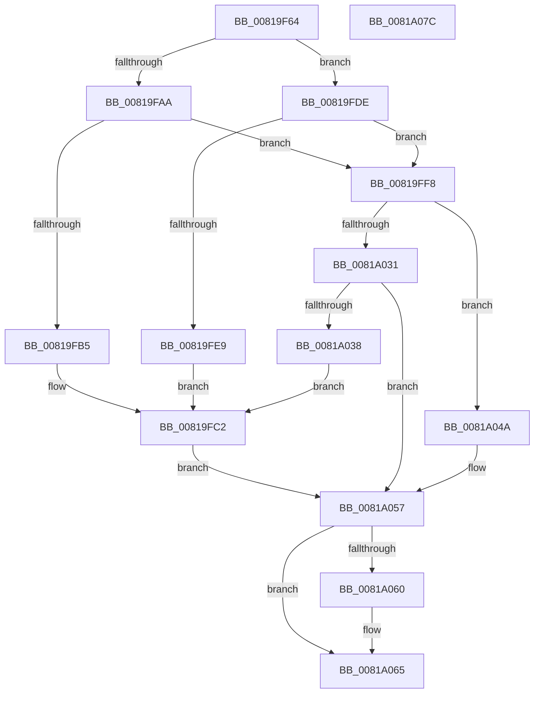

# AslRegistryGetKey

- RVA: `0x00819F64`–`0x0081A07D` (길이 `281` bytes)
- VA: `0x0000000140819F64`
- 실행 섹션: `PAGE`
- PDB 이름 있음: `예`; PDB Function 태그: `아니요`
- unwind 정보 RVA: `0x000C7C04`
- 디코드: `78`개 명령, `281/281` bytes 표시
- 미해석 바이트: `0` (있으면 어셈블리에 `.byte`로 보존)

> 이 문서는 커널 이미지의 기계어와 PDB 기호를 분석해 생성했습니다. 4번과 5번은 함수 원형과 자료형을 바이너리 사용 방식에서 추정한 C 해석이며 원본 소스 복구 결과는 아닙니다.

## 1. Dependencies

- 직접 호출 지점: **5**; 고유 호출 대상: **5**
- 직접 호출자로 확인된 함수: **5**
- RIP 상대 이미지 참조: **4**

### Outgoing calls
- `0x00819FAA` → [AslRegistryBuildMachinePath](AslRegistryBuildMachinePath_function_00819CCC.md) (function, `0x00819CCC`)
- `0x00819FD7` → [AslLogCallPrintf](../95/AslLogCallPrintf_function_0095E4EC.md) (function, `0x0095E4EC`)
- `0x00819FDE` → [AslRegistryBuildUserPath](AslRegistryBuildUserPath_function_00819DB0.md) (function, `0x00819DB0`)
- `0x0081A026` → [ZwOpenKey](../../text/6A/ZwOpenKey_function_006AD310.md) (function, `0x006AD310`)
- `0x0081A060` → [AslFree](../95/AslFree_function_0095B674.md) (function, `0x0095B674`)

### Direct callers
- [SdbpGetManifestedMergeStubAlloc](SdbpGetManifestedMergeStubAlloc_function_0081275C.md) at `0x0081280C`
- [SdbpGetMergeRedirectPathInternal](SdbpGetMergeRedirectPathInternal_function_00812B00.md) at `0x00812CBB`
- [SdbpGetMergeSdbsDisabled](SdbpGetMergeSdbsDisabled_function_008130A8.md) at `0x008130DB`
- [SdbpQueryAppCompatFlagsByExeID](SdbpQueryAppCompatFlagsByExeID_function_00818704.md) at `0x0081873D`
- [AslpProcessMatchRegNode](AslpProcessMatchRegNode_function_0081CB08.md) at `0x0081CB50`

### Static image references
- `0x00819FB5` → RVA `0x0003E898` (`.rdata`; read)
- `0x00819FC7` → RVA `0x0003E8C8` (`.rdata`; read)
- `0x00819FE9` → RVA `0x0003E8E0` (`.rdata`; read)
- `0x0081A038` → RVA `0x0003E910` (`.rdata`; read)

## 2. Other-region calls and transfers

- 다른 실행 섹션으로 향하는 call: **1**
  - `0x0081A026` → [ZwOpenKey](../../text/6A/ZwOpenKey_function_006AD310.md) (`PAGE` → `.text`)
- 별도 외부 분기/꼬리 이동을 확인하지 못했습니다.

## 3. Assembly (complete function range)

```asm
00819F64  48 89 5C 24 10                  mov qword ptr [rsp + 0x10], rbx
00819F69  48 89 74 24 18                  mov qword ptr [rsp + 0x18], rsi
00819F6E  55                              push rbp
00819F6F  57                              push rdi
00819F70  41 56                           push r14
00819F72  48 8B EC                        mov rbp, rsp
00819F75  48 83 EC 70                     sub rsp, 0x70
00819F79  33 C0                           xor eax, eax
00819F7B  0F 57 C0                        xorps xmm0, xmm0
00819F7E  48 21 01                        and qword ptr [rcx], rax
00819F81  48 8B F1                        mov rsi, rcx
00819F84  48 21 45 20                     and qword ptr [rbp + 0x20], rax
00819F88  48 8D 4D C0                     lea rcx, [rbp - 0x40]
00819F8C  48 89 45 F0                     mov qword ptr [rbp - 0x10], rax
00819F90  45 8B F0                        mov r14d, r8d
00819F93  89 45 F8                        mov dword ptr [rbp - 8], eax
00819F96  48 8B FA                        mov rdi, rdx
00819F99  0F 11 45 D0                     movups xmmword ptr [rbp - 0x30], xmm0
00819F9D  0F 11 45 E0                     movups xmmword ptr [rbp - 0x20], xmm0
00819FA1  0F 11 45 C0                     movups xmmword ptr [rbp - 0x40], xmm0
00819FA5  45 85 C9                        test r9d, r9d
00819FA8  74 34                           je 0x140819fde
00819FAA  E8 1D FD FF FF                  call 0x140819ccc
00819FAF  8B D8                           mov ebx, eax
00819FB1  85 C0                           test eax, eax
00819FB3  79 43                           jns 0x140819ff8
00819FB5  4C 8D 0D DC 48 82 FF            lea r9, [rip - 0x7db724]
00819FBC  41 B8 72 06 00 00               mov r8d, 0x672
00819FC2  48 89 7C 24 28                  mov qword ptr [rsp + 0x28], rdi
00819FC7  48 8D 15 FA 48 82 FF            lea rdx, [rip - 0x7db706]
00819FCE  B9 01 00 00 00                  mov ecx, 1
00819FD3  89 44 24 20                     mov dword ptr [rsp + 0x20], eax
00819FD7  E8 10 45 14 00                  call 0x14095e4ec
00819FDC  EB 79                           jmp 0x14081a057
00819FDE  E8 CD FD FF FF                  call 0x140819db0
00819FE3  8B D8                           mov ebx, eax
00819FE5  85 C0                           test eax, eax
00819FE7  79 0F                           jns 0x140819ff8
00819FE9  4C 8D 0D F0 48 82 FF            lea r9, [rip - 0x7db710]
00819FF0  41 B8 79 06 00 00               mov r8d, 0x679
00819FF6  EB CA                           jmp 0x140819fc2
00819FF8  48 83 65 D8 00                  and qword ptr [rbp - 0x28], 0
00819FFD  48 8D 45 C0                     lea rax, [rbp - 0x40]
0081A001  0F 57 C0                        xorps xmm0, xmm0
0081A004  48 89 45 E0                     mov qword ptr [rbp - 0x20], rax
0081A008  4C 8D 45 D0                     lea r8, [rbp - 0x30]
0081A00C  C7 45 D0 30 00 00 00            mov dword ptr [rbp - 0x30], 0x30
0081A013  41 8B D6                        mov edx, r14d
0081A016  C7 45 E8 40 02 00 00            mov dword ptr [rbp - 0x18], 0x240
0081A01D  48 8D 4D 20                     lea rcx, [rbp + 0x20]
0081A021  F3 0F 7F 45 F0                  movdqu xmmword ptr [rbp - 0x10], xmm0
0081A026  E8 E5 32 E9 FF                  call 0x1406ad310
0081A02B  8B D8                           mov ebx, eax
0081A02D  85 C0                           test eax, eax
0081A02F  79 19                           jns 0x14081a04a
0081A031  3D 34 00 00 C0                  cmp eax, 0xc0000034
0081A036  74 1F                           je 0x14081a057
0081A038  4C 8D 0D D1 48 82 FF            lea r9, [rip - 0x7db72f]
0081A03F  41 B8 A5 06 00 00               mov r8d, 0x6a5
0081A045  E9 78 FF FF FF                  jmp 0x140819fc2
0081A04A  48 8B 45 20                     mov rax, qword ptr [rbp + 0x20]
0081A04E  33 DB                           xor ebx, ebx
0081A050  48 21 5D 20                     and qword ptr [rbp + 0x20], rbx
0081A054  48 89 06                        mov qword ptr [rsi], rax
0081A057  48 8B 55 C8                     mov rdx, qword ptr [rbp - 0x38]
0081A05B  48 85 D2                        test rdx, rdx
0081A05E  74 05                           je 0x14081a065
0081A060  E8 0F 16 14 00                  call 0x14095b674
0081A065  4C 8D 5C 24 70                  lea r11, [rsp + 0x70]
0081A06A  8B C3                           mov eax, ebx
0081A06C  49 8B 5B 28                     mov rbx, qword ptr [r11 + 0x28]
0081A070  49 8B 73 30                     mov rsi, qword ptr [r11 + 0x30]
0081A074  49 8B E3                        mov rsp, r11
0081A077  41 5E                           pop r14
0081A079  5F                              pop rdi
0081A07A  5D                              pop rbp
0081A07B  C3                              ret
0081A07C  CC                              int3
```

## 4. C-style interpretation (structured pseudocode)

```c
__int64 __fastcall AslRegistryGetKey(__int64 a1, __int64 a2, int a3, int a4)
{
    __int64 result;
    __int64 v_rbx;
    __int64 v_rsp;
    unsigned __int64 v_stack_m18;
    unsigned int v_stack_m20;
    unsigned __int64 v_stack_m28;
    unsigned int v_stack_m30;
    unsigned __int64 v_stack_m38;
    unsigned __int64 v_stack_m40;
    unsigned __int64 v_stack_m48;
    unsigned __int64 v_stack_m50;
    unsigned __int64 v_stack_m58;
    unsigned __int64 v_stack_m60;
    unsigned int v_stack_m68;
    unsigned __int64 v_stack_p10;
    unsigned __int64 v_stack_p18;
    unsigned __int64 v_stack_p8;

    v_stack_p10 = v_rbx;
    v_stack_p18 = v_rsi;
    v_rsp = (v_rsp) - (112);
    result = 0;
    v_stack_m28 = 0;
    v_stack_m20 = 0;
    v_stack_m48 = v_xmm0;
    v_stack_m38 = v_xmm0;
    v_stack_m58 = v_xmm0;
    if (a4 == 0) goto loc_00819FDE;
    result = AslRegistryBuildMachinePath(v_stack_m58, a2, a3, a4);
    if (!sign_flag) goto loc_00819FF8;
loc_00819FC2:
    v_stack_m60 = a2;
    v_stack_m68 = (unsigned int)(result);
    result = AslLogCallPrintf(1, v_rip - 8238854, (unsigned int)(0x672ULL), v_rip - 8238884);
    goto loc_0081A057;
loc_00819FDE:
    result = AslRegistryBuildUserPath(1, v_rip - 8238854, (unsigned int)(0x672ULL), v_rip - 8238884);
    if (!sign_flag) goto loc_00819FF8;
    goto loc_00819FC2;
loc_00819FF8:
    v_stack_m38 = v_stack_m58;
    v_stack_m48 = 48;
    v_stack_m30 = 576;
    v_stack_m28 = v_xmm0;
    result = ZwOpenKey(v_stack_p8, (unsigned int)((unsigned int)((unsigned int)(a3))), v_stack_m48, v_rip - 8238864);
    if (!sign_flag) goto loc_0081A04A;
    if (((unsigned int)(result)) == 0xC0000034ULL) goto loc_0081A057;
    goto loc_00819FC2;
loc_0081A04A:
    v_rbx = 0;
    *(unsigned __int64 *)(a1) = v_stack_p8;
loc_0081A057:
    result = v_stack_p8;
    if (v_stack_m50 != 0) {
        result = AslFree(v_stack_p8, v_stack_m50, (unsigned int)(0x6A5ULL), v_rip - 8238895);
    }
    return 0;
}
```

## 5. (Beta) C Style

```c
int64_t AslRegistryGetKey(void *Arg1, int64_t Arg2, int32_t Arg3, int32_t Arg4)
{
    uint8_t *arg1 = (uint8_t *)Arg1;

    int64_t result;
    int64_t local_rbx;
    int64_t local_rsp;
    uint64_t v_stack_m18;
    uint32_t v_stack_m20;
    uint64_t v_stack_m28;
    uint32_t v_stack_m30;
    uint64_t v_stack_m38;
    uint64_t v_stack_m40;
    uint64_t v_stack_m48;
    uint64_t v_stack_m50;
    uint64_t v_stack_m58;
    uint64_t v_stack_m60;
    uint32_t v_stack_m68;
    uint64_t v_stack_p10;
    uint64_t v_stack_p18;
    uint64_t v_stack_p8;

    v_stack_p10 = local_rbx;
    v_stack_p18 = local_rsi;
    local_rsp = (local_rsp) - (112);
    result = 0;
    v_stack_m28 = 0;
    v_stack_m20 = 0;
    v_stack_m48 = v_xmm0;
    v_stack_m38 = v_xmm0;
    v_stack_m58 = v_xmm0;
    if (Arg4 == 0) goto loc_00819FDE;
    result = AslRegistryBuildMachinePath(v_stack_m58, Arg2, Arg3, Arg4);
    if (!sign_flag) goto loc_00819FF8;
loc_00819FC2:
    v_stack_m60 = Arg2;
    v_stack_m68 = (uint32_t)(result);
    result = AslLogCallPrintf(1, v_rip - 8238854, (uint32_t)(0x672ULL), v_rip - 8238884);
    goto loc_0081A057;
loc_00819FDE:
    result = AslRegistryBuildUserPath(1, v_rip - 8238854, (uint32_t)(0x672ULL), v_rip - 8238884);
    if (!sign_flag) goto loc_00819FF8;
    goto loc_00819FC2;
loc_00819FF8:
    v_stack_m38 = v_stack_m58;
    v_stack_m48 = 48;
    v_stack_m30 = 576;
    v_stack_m28 = v_xmm0;
    result = ZwOpenKey(v_stack_p8, (uint32_t)((uint32_t)((uint32_t)(Arg3))), v_stack_m48, v_rip - 8238864);
    if (!sign_flag) goto loc_0081A04A;
    if (((uint32_t)(result)) == 0xC0000034ULL) goto loc_0081A057;
    goto loc_00819FC2;
loc_0081A04A:
    local_rbx = 0;
    *(uint64_t *)(arg1) = v_stack_p8;
loc_0081A057:
    result = v_stack_p8;
    if (v_stack_m50 != 0) {
        result = AslFree(v_stack_p8, v_stack_m50, (uint32_t)(0x6A5ULL), v_rip - 8238895);
    }
    return 0;
}
```

### 관측된 메모리 오프셋

구조체 형식이 확인되지 않은 접근은 인자 기준의 오프셋으로만 기록했습니다.

| 기준 인자 | 오프셋 표현 | 폭 (bit) | 접근 |
|---|---:|---:|---|
| `Arg1` | `+ 0x0` | `64` | `R/W` |
| `Arg1` | `+ 0x0` | `64` | `W` |

## 6. Execution-region graph

[열기: 2D/3D 그래프와 함수 탐색 컨트롤 패널](../../../control-panel.html?section=page&rva=0x00819F64&view=graph)

- 2D 그래프는 위에서 아래로 흐르고, 3D 그래프는 빈 공간을 드래그해 회전합니다. Shift+드래그는 이동, 휠은 확대·축소, 함수 노드 선택은 대상 보고서 이동입니다.

### Static fallback


