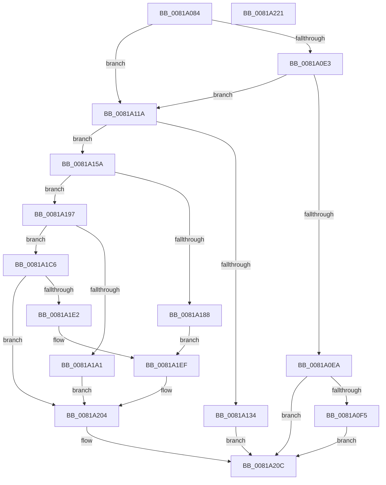

# AslRegistryGetString

- RVA: `0x0081A084`–`0x0081A222` (길이 `414` bytes)
- VA: `0x000000014081A084`
- 실행 섹션: `PAGE`
- PDB 이름 있음: `예`; PDB Function 태그: `아니요`
- unwind 정보 RVA: `0x00099F28`
- 디코드: `106`개 명령, `414/414` bytes 표시
- 미해석 바이트: `0` (있으면 어셈블리에 `.byte`로 보존)

> 이 문서는 커널 이미지의 기계어와 PDB 기호를 분석해 생성했습니다. 4번과 5번은 함수 원형과 자료형을 바이너리 사용 방식에서 추정한 C 해석이며 원본 소스 복구 결과는 아닙니다.

## 1. Dependencies

- 직접 호출 지점: **10**; 고유 호출 대상: **6**
- 직접 호출자로 확인된 함수: **1**
- RIP 상대 이미지 참조: **5**

### Outgoing calls
- `0x0081A0B3` → [RtlInitUnicodeString](../../text/42/RtlInitUnicodeString_function_0042A780.md) (function, `0x0042A780`)
- `0x0081A0D5` → [ZwQueryValueKey](../../text/6A/ZwQueryValueKey_function_006AD3B0.md) (function, `0x006AD3B0`)
- `0x0081A110` → [AslLogCallPrintf](../95/AslLogCallPrintf_function_0095E4EC.md) (function, `0x0095E4EC`)
- `0x0081A127` → [AslAlloc](../95/AslAlloc_function_0095BD34.md) (function, `0x0095BD34`)
- `0x0081A150` → [AslLogCallPrintf](../95/AslLogCallPrintf_function_0095E4EC.md) (function, `0x0095E4EC`)
- `0x0081A17D` → [ZwQueryValueKey](../../text/6A/ZwQueryValueKey_function_006AD3B0.md) (function, `0x006AD3B0`)
- `0x0081A1BA` → [AslLogCallPrintf](../95/AslLogCallPrintf_function_0095E4EC.md) (function, `0x0095E4EC`)
- `0x0081A1D7` → [AslStringDuplicate](../95/AslStringDuplicate_function_00958604.md) (function, `0x00958604`)
- `0x0081A1FF` → [AslLogCallPrintf](../95/AslLogCallPrintf_function_0095E4EC.md) (function, `0x0095E4EC`)
- `0x0081A207` → [AslFree](../95/AslFree_function_0095B674.md) (function, `0x0095B674`)

### Direct callers
- [SdbpGetMergeRedirectPathInternal](SdbpGetMergeRedirectPathInternal_function_00812B00.md) at `0x00812D00`

### Static image references
- `0x0081A0F5` → RVA `0x0003E710` (`.rdata`; read)
- `0x0081A106` → RVA `0x0003E7A8` (`.rdata`; read)
- `0x0081A134` → RVA `0x000129E0` (`.rdata`; read)
- `0x0081A1A1` → RVA `0x0003E750` (`.rdata`; read)
- `0x0081A1E2` → RVA `0x0003E7C0` (`.rdata`; read)

## 2. Other-region calls and transfers

- 다른 실행 섹션으로 향하는 call: **3**
  - `0x0081A0B3` → [RtlInitUnicodeString](../../text/42/RtlInitUnicodeString_function_0042A780.md) (`PAGE` → `.text`)
  - `0x0081A0D5` → [ZwQueryValueKey](../../text/6A/ZwQueryValueKey_function_006AD3B0.md) (`PAGE` → `.text`)
  - `0x0081A17D` → [ZwQueryValueKey](../../text/6A/ZwQueryValueKey_function_006AD3B0.md) (`PAGE` → `.text`)
- 별도 외부 분기/꼬리 이동을 확인하지 못했습니다.

## 3. Assembly (complete function range)

```asm
0081A084  48 8B C4                        mov rax, rsp
0081A087  48 89 58 10                     mov qword ptr [rax + 0x10], rbx
0081A08B  48 89 68 18                     mov qword ptr [rax + 0x18], rbp
0081A08F  56                              push rsi
0081A090  57                              push rdi
0081A091  41 56                           push r14
0081A093  48 83 EC 40                     sub rsp, 0x40
0081A097  33 ED                           xor ebp, ebp
0081A099  48 8B F2                        mov rsi, rdx
0081A09C  48 89 29                        mov qword ptr [rcx], rbp
0081A09F  4C 8B F1                        mov r14, rcx
0081A0A2  0F 57 C0                        xorps xmm0, xmm0
0081A0A5  89 68 08                        mov dword ptr [rax + 8], ebp
0081A0A8  48 8D 48 D8                     lea rcx, [rax - 0x28]
0081A0AC  49 8B D0                        mov rdx, r8
0081A0AF  0F 11 40 D8                     movups xmmword ptr [rax - 0x28], xmm0
0081A0B3  E8 C8 06 C1 FF                  call 0x14042a780
0081A0B8  48 8D 44 24 60                  lea rax, [rsp + 0x60]
0081A0BD  45 33 C9                        xor r9d, r9d
0081A0C0  48 89 44 24 28                  mov qword ptr [rsp + 0x28], rax
0081A0C5  44 8D 45 02                     lea r8d, [rbp + 2]
0081A0C9  48 8D 54 24 30                  lea rdx, [rsp + 0x30]
0081A0CE  89 6C 24 20                     mov dword ptr [rsp + 0x20], ebp
0081A0D2  48 8B CE                        mov rcx, rsi
0081A0D5  E8 D6 32 E9 FF                  call 0x1406ad3b0
0081A0DA  8B D8                           mov ebx, eax
0081A0DC  3D 05 00 00 80                  cmp eax, 0x80000005
0081A0E1  74 37                           je 0x14081a11a
0081A0E3  3D 23 00 00 C0                  cmp eax, 0xc0000023
0081A0E8  74 30                           je 0x14081a11a
0081A0EA  3D 34 00 00 C0                  cmp eax, 0xc0000034
0081A0EF  0F 84 17 01 00 00               je 0x14081a20c
0081A0F5  4C 8D 0D 14 46 82 FF            lea r9, [rip - 0x7db9ec]
0081A0FC  89 44 24 20                     mov dword ptr [rsp + 0x20], eax
0081A100  41 B8 F2 04 00 00               mov r8d, 0x4f2
0081A106  48 8D 15 9B 46 82 FF            lea rdx, [rip - 0x7db965]
0081A10D  8D 4D 01                        lea ecx, [rbp + 1]
0081A110  E8 D7 43 14 00                  call 0x14095e4ec
0081A115  E9 F2 00 00 00                  jmp 0x14081a20c
0081A11A  8B 44 24 60                     mov eax, dword ptr [rsp + 0x60]
0081A11E  83 C0 02                        add eax, 2
0081A121  8B D0                           mov edx, eax
0081A123  89 44 24 60                     mov dword ptr [rsp + 0x60], eax
0081A127  E8 08 1C 14 00                  call 0x14095bd34
0081A12C  48 8B F8                        mov rdi, rax
0081A12F  48 85 C0                        test rax, rax
0081A132  75 26                           jne 0x14081a15a
0081A134  4C 8D 0D A5 88 7F FF            lea r9, [rip - 0x80775b]
0081A13B  41 B8 00 05 00 00               mov r8d, 0x500
0081A141  48 8D 15 60 46 82 FF            lea rdx, [rip - 0x7db9a0]
0081A148  BB 17 00 00 C0                  mov ebx, 0xc0000017
0081A14D  8D 48 01                        lea ecx, [rax + 1]
0081A150  E8 97 43 14 00                  call 0x14095e4ec
0081A155  E9 B2 00 00 00                  jmp 0x14081a20c
0081A15A  48 8D 44 24 60                  lea rax, [rsp + 0x60]
0081A15F  4C 8B CF                        mov r9, rdi
0081A162  48 89 44 24 28                  mov qword ptr [rsp + 0x28], rax
0081A167  48 8D 54 24 30                  lea rdx, [rsp + 0x30]
0081A16C  8B 44 24 60                     mov eax, dword ptr [rsp + 0x60]
0081A170  41 B8 02 00 00 00               mov r8d, 2
0081A176  48 8B CE                        mov rcx, rsi
0081A179  89 44 24 20                     mov dword ptr [rsp + 0x20], eax
0081A17D  E8 2E 32 E9 FF                  call 0x1406ad3b0
0081A182  8B D8                           mov ebx, eax
0081A184  85 C0                           test eax, eax
0081A186  79 0F                           jns 0x14081a197
0081A188  4C 8D 0D 81 45 82 FF            lea r9, [rip - 0x7dba7f]
0081A18F  41 B8 0C 05 00 00               mov r8d, 0x50c
0081A195  EB 58                           jmp 0x14081a1ef
0081A197  8B 47 04                        mov eax, dword ptr [rdi + 4]
0081A19A  FF C8                           dec eax
0081A19C  83 F8 01                        cmp eax, 1
0081A19F  76 25                           jbe 0x14081a1c6
0081A1A1  4C 8D 0D A8 45 82 FF            lea r9, [rip - 0x7dba58]
0081A1A8  41 B8 14 05 00 00               mov r8d, 0x514
0081A1AE  48 8D 15 F3 45 82 FF            lea rdx, [rip - 0x7dba0d]
0081A1B5  B9 01 00 00 00                  mov ecx, 1
0081A1BA  E8 2D 43 14 00                  call 0x14095e4ec
0081A1BF  BB 24 00 00 C0                  mov ebx, 0xc0000024
0081A1C4  EB 3E                           jmp 0x14081a204
0081A1C6  8B 47 08                        mov eax, dword ptr [rdi + 8]
0081A1C9  48 8D 57 0C                     lea rdx, [rdi + 0xc]
0081A1CD  48 D1 E8                        shr rax, 1
0081A1D0  49 8B CE                        mov rcx, r14
0081A1D3  66 89 2C 42                     mov word ptr [rdx + rax*2], bp
0081A1D7  E8 28 E4 13 00                  call 0x140958604
0081A1DC  8B D8                           mov ebx, eax
0081A1DE  85 C0                           test eax, eax
0081A1E0  79 22                           jns 0x14081a204
0081A1E2  4C 8D 0D D7 45 82 FF            lea r9, [rip - 0x7dba29]
0081A1E9  41 B8 1E 05 00 00               mov r8d, 0x51e
0081A1EF  48 8D 15 B2 45 82 FF            lea rdx, [rip - 0x7dba4e]
0081A1F6  89 44 24 20                     mov dword ptr [rsp + 0x20], eax
0081A1FA  B9 01 00 00 00                  mov ecx, 1
0081A1FF  E8 E8 42 14 00                  call 0x14095e4ec
0081A204  48 8B D7                        mov rdx, rdi
0081A207  E8 68 14 14 00                  call 0x14095b674
0081A20C  48 8B 6C 24 70                  mov rbp, qword ptr [rsp + 0x70]
0081A211  8B C3                           mov eax, ebx
0081A213  48 8B 5C 24 68                  mov rbx, qword ptr [rsp + 0x68]
0081A218  48 83 C4 40                     add rsp, 0x40
0081A21C  41 5E                           pop r14
0081A21E  5F                              pop rdi
0081A21F  5E                              pop rsi
0081A220  C3                              ret
0081A221  CC                              int3
```

## 4. C-style interpretation (structured pseudocode)

```c
__int64 __fastcall AslRegistryGetString(__int64 a1, __int64 a2, __int64 a3, int a4)
{
    __int64 result;
    __int64 v_rbp;
    __int64 v_rsp;
    unsigned __int64 v_stack_m28;
    unsigned __int64 v_stack_m30;
    unsigned int v_stack_m38;
    unsigned __int64 v_stack_p10;
    unsigned __int64 v_stack_p18;
    unsigned __int64 v_stack_p8;

    *(unsigned __int64 *)(v_rsp + 16) = v_rbx;
    *(unsigned __int64 *)(v_rsp + 24) = v_rbp;
    v_rsp = (v_rsp) - (64);
    v_rbp = 0;
    *(unsigned __int64 *)(a1) = 0;
    *(unsigned int *)(v_rsp + 8) = 0;
    *(unsigned __int64 *)(v_rsp - 40) = v_xmm0;
    result = RtlInitUnicodeString(v_rsp - 40, a3, a3, a4);
    a4 = 0;
    v_stack_m30 = v_stack_p8;
    v_stack_m38 = 0;
    result = ZwQueryValueKey(a2, v_stack_m28, v_rbp + 2, a4);
    if (((unsigned int)(result)) == 0x80000005ULL) goto loc_0081A11A;
    if (((unsigned int)(result)) == 0xC0000023ULL) goto loc_0081A11A;
    if (((unsigned int)(result)) == 0xC0000034ULL) goto loc_0081A20C;
    v_stack_m38 = (unsigned int)(result);
    result = AslLogCallPrintf(v_rbp + 1, v_rip - 8239461, (unsigned int)(0x4F2ULL), v_rip - 8239596);
    goto loc_0081A20C;
loc_0081A11A:
    result = (unsigned int)(((unsigned int)(v_stack_p8)) + (2));
    v_stack_p8 = (unsigned int)(result);
    result = AslAlloc(v_rbp + 1, (unsigned int)((unsigned int)(result)), (unsigned int)(0x4F2ULL), v_rip - 8239596);
    if (result != 0) goto loc_0081A15A;
    result = AslLogCallPrintf(result + 1, v_rip - 8239520, (unsigned int)(0x500ULL), v_rip - 8419163);
    goto loc_0081A20C;
loc_0081A15A:
    v_stack_m30 = v_stack_p8;
    v_stack_m38 = (unsigned int)((unsigned int)(v_stack_p8));
    result = ZwQueryValueKey(a2, v_stack_m28, 2, result);
    if (!sign_flag) goto loc_0081A197;
    goto loc_0081A1EF;
loc_0081A197:
    result = (unsigned int)(((unsigned int)(*(unsigned int *)(result + 4))) - 1);
    if (((unsigned int)(result)) <= 1) goto loc_0081A1C6;
    result = AslLogCallPrintf(1, v_rip - 8239629, (unsigned int)(0x514ULL), v_rip - 8239704);
    goto loc_0081A204;
loc_0081A1C6:
    result = ((unsigned int)(*(unsigned int *)(result + 8))) >> (1);
    *(unsigned __int16 *)(result + 12 + result * 2) = 0;
    result = AslStringDuplicate(a1, result + 12, (unsigned int)(0x514ULL), v_rip - 8239704);
    if (!sign_flag) goto loc_0081A204;
loc_0081A1EF:
    v_stack_m38 = (unsigned int)(result);
    result = AslLogCallPrintf(1, v_rip - 8239694, (unsigned int)(0x51EULL), v_rip - 8239657);
loc_0081A204:
    result = AslFree(1, result, (unsigned int)(0x51EULL), v_rip - 8239657);
loc_0081A20C:
    v_rsp = (v_rsp) + (64);
    return (unsigned int)((unsigned int)((unsigned int)((unsigned int)(result))));
}
```

## 5. (Beta) C Style

```c
int64_t AslRegistryGetString(void *Arg1, int64_t Arg2, int64_t Arg3, int32_t Arg4)
{
    uint8_t *arg1 = (uint8_t *)Arg1;

    int64_t result;
    int64_t local_rbp;
    int64_t local_rsp;
    uint64_t v_stack_m28;
    uint64_t v_stack_m30;
    uint32_t v_stack_m38;
    uint64_t v_stack_p10;
    uint64_t v_stack_p18;
    uint64_t v_stack_p8;

    *(uint64_t *)(local_rsp + 0x10) = local_rbx;
    *(uint64_t *)(local_rsp + 0x18) = local_rbp;
    local_rsp = (local_rsp) - (64);
    local_rbp = 0;
    *(uint64_t *)(arg1) = 0;
    *(uint32_t *)(local_rsp + 0x8) = 0;
    *(uint64_t *)(local_rsp - 0x28) = v_xmm0;
    result = RtlInitUnicodeString(local_rsp - 40, Arg3, Arg3, Arg4);
    Arg4 = 0;
    v_stack_m30 = v_stack_p8;
    v_stack_m38 = 0;
    result = ZwQueryValueKey(Arg2, v_stack_m28, local_rbp + 2, Arg4);
    if (((uint32_t)(result)) == 0x80000005ULL) goto loc_0081A11A;
    if (((uint32_t)(result)) == 0xC0000023ULL) goto loc_0081A11A;
    if (((uint32_t)(result)) == 0xC0000034ULL) goto loc_0081A20C;
    v_stack_m38 = (uint32_t)(result);
    result = AslLogCallPrintf(local_rbp + 1, v_rip - 8239461, (uint32_t)(0x4F2ULL), v_rip - 8239596);
    goto loc_0081A20C;
loc_0081A11A:
    result = (uint32_t)(((uint32_t)(v_stack_p8)) + (2));
    v_stack_p8 = (uint32_t)(result);
    result = AslAlloc(local_rbp + 1, (uint32_t)((uint32_t)(result)), (uint32_t)(0x4F2ULL), v_rip - 8239596);
    if (result != 0) goto loc_0081A15A;
    result = AslLogCallPrintf(result + 1, v_rip - 8239520, (uint32_t)(0x500ULL), v_rip - 8419163);
    goto loc_0081A20C;
loc_0081A15A:
    v_stack_m30 = v_stack_p8;
    v_stack_m38 = (uint32_t)((uint32_t)(v_stack_p8));
    result = ZwQueryValueKey(Arg2, v_stack_m28, 2, result);
    if (!sign_flag) goto loc_0081A197;
    goto loc_0081A1EF;
loc_0081A197:
    result = (uint32_t)(((uint32_t)(*(uint32_t *)(result + 0x4))) - 1);
    if (((uint32_t)(result)) <= 1) goto loc_0081A1C6;
    result = AslLogCallPrintf(1, v_rip - 8239629, (uint32_t)(0x514ULL), v_rip - 8239704);
    goto loc_0081A204;
loc_0081A1C6:
    result = ((uint32_t)(*(uint32_t *)(result + 0x8))) >> (1);
    *(uint16_t *)(result + 0xC + result * 2) = 0;
    result = AslStringDuplicate(Arg1, result + 12, (uint32_t)(0x514ULL), v_rip - 8239704);
    if (!sign_flag) goto loc_0081A204;
loc_0081A1EF:
    v_stack_m38 = (uint32_t)(result);
    result = AslLogCallPrintf(1, v_rip - 8239694, (uint32_t)(0x51EULL), v_rip - 8239657);
loc_0081A204:
    result = AslFree(1, result, (uint32_t)(0x51EULL), v_rip - 8239657);
loc_0081A20C:
    local_rsp = (local_rsp) + (64);
    return (uint32_t)((uint32_t)((uint32_t)((uint32_t)(result))));
}
```

### 관측된 메모리 오프셋

구조체 형식이 확인되지 않은 접근은 인자 기준의 오프셋으로만 기록했습니다.

| 기준 인자 | 오프셋 표현 | 폭 (bit) | 접근 |
|---|---:|---:|---|
| `Arg1` | `+ 0x0` | `64` | `W` |

## 6. Execution-region graph

[열기: 2D/3D 그래프와 함수 탐색 컨트롤 패널](../../../control-panel.html?section=page&rva=0x0081A084&view=graph)

- 2D 그래프는 위에서 아래로 흐르고, 3D 그래프는 빈 공간을 드래그해 회전합니다. Shift+드래그는 이동, 휠은 확대·축소, 함수 노드 선택은 대상 보고서 이동입니다.

### Static fallback


