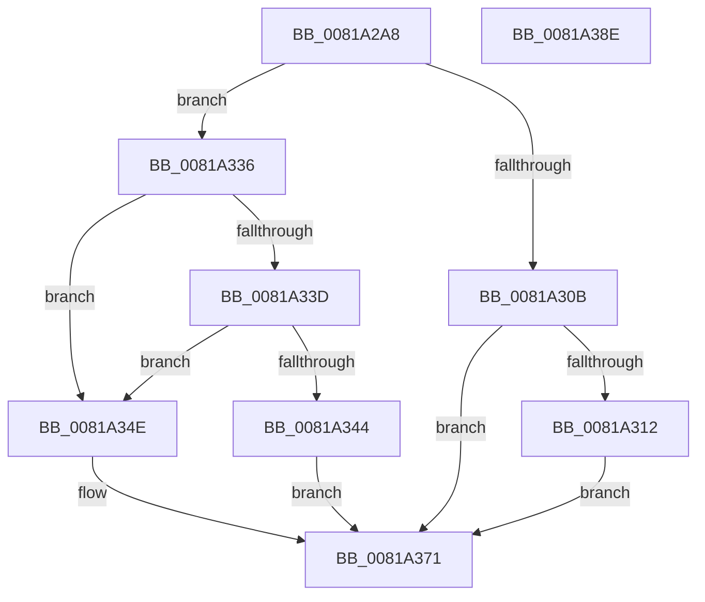

# AslRegistryGetUInt32_UStr

- RVA: `0x0081A2A8`–`0x0081A38F` (길이 `231` bytes)
- VA: `0x000000014081A2A8`
- 실행 섹션: `PAGE`
- PDB 이름 있음: `예`; PDB Function 태그: `아니요`
- unwind 정보 RVA: `0x000D9C50`
- 디코드: `59`개 명령, `231/231` bytes 표시
- 미해석 바이트: `0` (있으면 어셈블리에 `.byte`로 보존)

> 이 문서는 커널 이미지의 기계어와 PDB 기호를 분석해 생성했습니다. 4번과 5번은 함수 원형과 자료형을 바이너리 사용 방식에서 추정한 C 해석이며 원본 소스 복구 결과는 아닙니다.

## 1. Dependencies

- 직접 호출 지점: **4**; 고유 호출 대상: **3**
- 직접 호출자로 확인된 함수: **2**
- RIP 상대 이미지 참조: **4**

### Outgoing calls
- `0x0081A300` → [ZwQueryValueKey](../../text/6A/ZwQueryValueKey_function_006AD3B0.md) (function, `0x006AD3B0`)
- `0x0081A32F` → [AslLogCallPrintf](../95/AslLogCallPrintf_function_0095E4EC.md) (function, `0x0095E4EC`)
- `0x0081A367` → [AslLogCallPrintf](../95/AslLogCallPrintf_function_0095E4EC.md) (function, `0x0095E4EC`)
- `0x0081A37B` → [_security_check_cookie](../../text/6A/_security_check_cookie_function_006AC640.md) (function, `0x006AC640`)

### Direct callers
- [SdbResolveDatabaseEx](SdbResolveDatabaseEx_function_00817A54.md) at `0x00817C7B`
- [SdbResolveDatabaseEx](SdbResolveDatabaseEx_function_00817A54.md) at `0x00817CCC`
- [AslRegistryGetUInt32](AslRegistryGetUInt32_function_0081A228.md) at `0x0081A286`

### Static image references
- `0x0081A2B4` → RVA `0x00E0A740` (`.data`; read)
- `0x0081A312` → RVA `0x0003E710` (`.rdata`; read)
- `0x0081A323` → RVA `0x0003E730` (`.rdata`; read)
- `0x0081A34E` → RVA `0x0003E750` (`.rdata`; read)

## 2. Other-region calls and transfers

- 다른 실행 섹션으로 향하는 call: **2**
  - `0x0081A300` → [ZwQueryValueKey](../../text/6A/ZwQueryValueKey_function_006AD3B0.md) (`PAGE` → `.text`)
  - `0x0081A37B` → [_security_check_cookie](../../text/6A/_security_check_cookie_function_006AC640.md) (`PAGE` → `.text`)
- 별도 외부 분기/꼬리 이동을 확인하지 못했습니다.

## 3. Assembly (complete function range)

```asm
0081A2A8  4C 8B DC                        mov r11, rsp
0081A2AB  49 89 5B 20                     mov qword ptr [r11 + 0x20], rbx
0081A2AF  57                              push rdi
0081A2B0  48 83 EC 60                     sub rsp, 0x60
0081A2B4  48 8B 05 85 04 5F 00            mov rax, qword ptr [rip + 0x5f0485]
0081A2BB  48 33 C4                        xor rax, rsp
0081A2BE  48 89 44 24 50                  mov qword ptr [rsp + 0x50], rax
0081A2C3  48 8B F9                        mov rdi, rcx
0081A2C6  4D 8D 4B D0                     lea r9, [r11 - 0x30]
0081A2CA  33 C9                           xor ecx, ecx
0081A2CC  4D 8B D0                        mov r10, r8
0081A2CF  21 4C 24 30                     and dword ptr [rsp + 0x30], ecx
0081A2D3  48 8B C2                        mov rax, rdx
0081A2D6  89 4C 24 48                     mov dword ptr [rsp + 0x48], ecx
0081A2DA  0F 57 C0                        xorps xmm0, xmm0
0081A2DD  21 0F                           and dword ptr [rdi], ecx
0081A2DF  41 B8 02 00 00 00               mov r8d, 2
0081A2E5  49 8D 4B C8                     lea rcx, [r11 - 0x38]
0081A2E9  49 8B D2                        mov rdx, r10
0081A2EC  49 89 4B C0                     mov qword ptr [r11 - 0x40], rcx
0081A2F0  48 8B C8                        mov rcx, rax
0081A2F3  0F 11 44 24 38                  movups xmmword ptr [rsp + 0x38], xmm0
0081A2F8  C7 44 24 20 14 00 00 00         mov dword ptr [rsp + 0x20], 0x14
0081A300  E8 AB 30 E9 FF                  call 0x1406ad3b0
0081A305  8B D8                           mov ebx, eax
0081A307  85 C0                           test eax, eax
0081A309  79 2B                           jns 0x14081a336
0081A30B  3D 34 00 00 C0                  cmp eax, 0xc0000034
0081A310  74 5F                           je 0x14081a371
0081A312  4C 8D 0D F7 43 82 FF            lea r9, [rip - 0x7dbc09]
0081A319  89 44 24 20                     mov dword ptr [rsp + 0x20], eax
0081A31D  41 B8 FF 03 00 00               mov r8d, 0x3ff
0081A323  48 8D 15 06 44 82 FF            lea rdx, [rip - 0x7dbbfa]
0081A32A  B9 01 00 00 00                  mov ecx, 1
0081A32F  E8 B8 41 14 00                  call 0x14095e4ec
0081A334  EB 3B                           jmp 0x14081a371
0081A336  83 7C 24 3C 04                  cmp dword ptr [rsp + 0x3c], 4
0081A33B  75 11                           jne 0x14081a34e
0081A33D  83 7C 24 40 04                  cmp dword ptr [rsp + 0x40], 4
0081A342  75 0A                           jne 0x14081a34e
0081A344  8B 44 24 44                     mov eax, dword ptr [rsp + 0x44]
0081A348  33 DB                           xor ebx, ebx
0081A34A  89 07                           mov dword ptr [rdi], eax
0081A34C  EB 23                           jmp 0x14081a371
0081A34E  4C 8D 0D FB 43 82 FF            lea r9, [rip - 0x7dbc05]
0081A355  41 B8 06 04 00 00               mov r8d, 0x406
0081A35B  48 8D 15 CE 43 82 FF            lea rdx, [rip - 0x7dbc32]
0081A362  B9 01 00 00 00                  mov ecx, 1
0081A367  E8 80 41 14 00                  call 0x14095e4ec
0081A36C  BB 24 00 00 C0                  mov ebx, 0xc0000024
0081A371  8B C3                           mov eax, ebx
0081A373  48 8B 4C 24 50                  mov rcx, qword ptr [rsp + 0x50]
0081A378  48 33 CC                        xor rcx, rsp
0081A37B  E8 C0 22 E9 FF                  call 0x1406ac640
0081A380  48 8B 9C 24 88 00 00 00         mov rbx, qword ptr [rsp + 0x88]
0081A388  48 83 C4 60                     add rsp, 0x60
0081A38C  5F                              pop rdi
0081A38D  C3                              ret
0081A38E  CC                              int3
```

## 4. C-style interpretation (structured pseudocode)

```c
__int64 __fastcall AslRegistryGetUInt32_UStr(__int64 a1, __int64 a2, __int64 a3)
{
    __int64 result;
    __int64 v_rbx;
    __int64 v_rsp;
    unsigned __int64 v_stack_m18;
    unsigned int v_stack_m20;
    unsigned int v_stack_m24;
    unsigned int v_stack_m28;
    unsigned int v_stack_m2C;
    unsigned __int64 v_stack_m30;
    unsigned int v_stack_m38;
    unsigned int v_stack_m48;
    unsigned __int64 v_stack_p20;

    *(unsigned __int64 *)(v_rsp + 32) = v_rbx;
    v_rsp = (v_rsp) - (96);
    result = (*(unsigned __int64 *)(v_rip + 6227077)) ^ (v_rsp);
    v_stack_m18 = result;
    a1 = 0;
    v_stack_m20 = 0;
    *(unsigned __int64 *)(v_rsp - 64) = v_rsp - 56;
    v_stack_m30 = v_xmm0;
    v_stack_m48 = 20;
    result = ZwQueryValueKey(a2, a3, 2, v_rsp - 48);
    if (!sign_flag) goto loc_0081A336;
    if (((unsigned int)(result)) == 0xC0000034ULL) goto loc_0081A371;
    v_stack_m48 = (unsigned int)(result);
    result = AslLogCallPrintf(1, v_rip - 8240122, (unsigned int)(0x3FFULL), v_rip - 8240137);
    goto loc_0081A371;
loc_0081A336:
    if (v_stack_m2C != 4) goto loc_0081A34E;
    if (v_stack_m28 != 4) goto loc_0081A34E;
    v_rbx = 0;
    *(unsigned int *)(a1) = (unsigned int)((unsigned int)(v_stack_m24));
    goto loc_0081A371;
loc_0081A34E:
    result = AslLogCallPrintf(1, v_rip - 8240178, (unsigned int)(0x406ULL), v_rip - 8240133);
loc_0081A371:
    a1 = (v_stack_m18) ^ (v_rsp);
    result = _security_check_cookie(a1, v_rip - 8240178, (unsigned int)(0x406ULL), v_rip - 8240133);
    v_rsp = (v_rsp) + (96);
    return result;
}
```

## 5. (Beta) C Style

```c
int64_t AslRegistryGetUInt32_UStr(void *Arg1, int64_t Arg2, int64_t Arg3)
{
    uint8_t *arg1 = (uint8_t *)Arg1;

    int64_t result;
    int64_t local_rbx;
    int64_t local_rsp;
    uint64_t v_stack_m18;
    uint32_t v_stack_m20;
    uint32_t v_stack_m24;
    uint32_t v_stack_m28;
    uint32_t v_stack_m2C;
    uint64_t v_stack_m30;
    uint32_t v_stack_m38;
    uint32_t v_stack_m48;
    uint64_t v_stack_p20;

    *(uint64_t *)(local_rsp + 0x20) = local_rbx;
    local_rsp = (local_rsp) - (96);
    result = (*(uint64_t *)(v_rip + 0x5F0485)) ^ (local_rsp);
    v_stack_m18 = result;
    Arg1 = 0;
    v_stack_m20 = 0;
    *(uint64_t *)(local_rsp - 0x40) = local_rsp - 56;
    v_stack_m30 = v_xmm0;
    v_stack_m48 = 20;
    result = ZwQueryValueKey(Arg2, Arg3, 2, local_rsp - 48);
    if (!sign_flag) goto loc_0081A336;
    if (((uint32_t)(result)) == 0xC0000034ULL) goto loc_0081A371;
    v_stack_m48 = (uint32_t)(result);
    result = AslLogCallPrintf(1, v_rip - 8240122, (uint32_t)(0x3FFULL), v_rip - 8240137);
    goto loc_0081A371;
loc_0081A336:
    if (v_stack_m2C != 4) goto loc_0081A34E;
    if (v_stack_m28 != 4) goto loc_0081A34E;
    local_rbx = 0;
    *(uint32_t *)(arg1) = (uint32_t)((uint32_t)(v_stack_m24));
    goto loc_0081A371;
loc_0081A34E:
    result = AslLogCallPrintf(1, v_rip - 8240178, (uint32_t)(0x406ULL), v_rip - 8240133);
loc_0081A371:
    Arg1 = (v_stack_m18) ^ (local_rsp);
    result = _security_check_cookie(Arg1, v_rip - 8240178, (uint32_t)(0x406ULL), v_rip - 8240133);
    local_rsp = (local_rsp) + (96);
    return result;
}
```

### 관측된 메모리 오프셋

구조체 형식이 확인되지 않은 접근은 인자 기준의 오프셋으로만 기록했습니다.

| 기준 인자 | 오프셋 표현 | 폭 (bit) | 접근 |
|---|---:|---:|---|
| `Arg1` | `+ 0x0` | `32` | `R/W` |
| `Arg1` | `+ 0x0` | `32` | `W` |

## 6. Execution-region graph

[열기: 2D/3D 그래프와 함수 탐색 컨트롤 패널](../../../control-panel.html?section=page&rva=0x0081A2A8&view=graph)

- 2D 그래프는 위에서 아래로 흐르고, 3D 그래프는 빈 공간을 드래그해 회전합니다. Shift+드래그는 이동, 휠은 확대·축소, 함수 노드 선택은 대상 보고서 이동입니다.

### Static fallback


