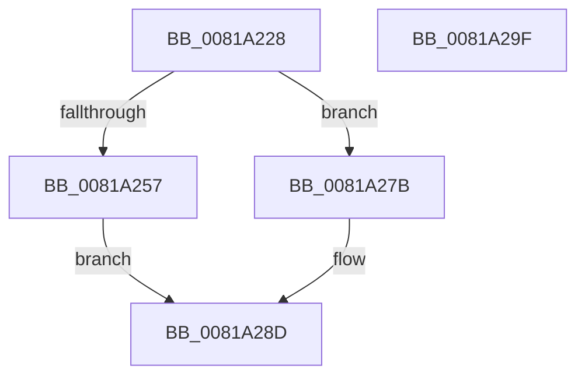

# AslRegistryGetUInt32

- RVA: `0x0081A228`–`0x0081A2A0` (길이 `120` bytes)
- VA: `0x000000014081A228`
- 실행 섹션: `PAGE`
- PDB 이름 있음: `예`; PDB Function 태그: `아니요`
- unwind 정보 RVA: `0x000718AC`
- 디코드: `34`개 명령, `120/120` bytes 표시
- 미해석 바이트: `0` (있으면 어셈블리에 `.byte`로 보존)

> 이 문서는 커널 이미지의 기계어와 PDB 기호를 분석해 생성했습니다. 4번과 5번은 함수 원형과 자료형을 바이너리 사용 방식에서 추정한 C 해석이며 원본 소스 복구 결과는 아닙니다.

## 1. Dependencies

- 직접 호출 지점: **3**; 고유 호출 대상: **3**
- 직접 호출자로 확인된 함수: **3**
- RIP 상대 이미지 참조: **2**

### Outgoing calls
- `0x0081A24C` → [RtlInitUnicodeStringEx](../../text/46/RtlInitUnicodeStringEx_function_00463960.md) (function, `0x00463960`)
- `0x0081A274` → [AslLogCallPrintf](../95/AslLogCallPrintf_function_0095E4EC.md) (function, `0x0095E4EC`)
- `0x0081A286` → [AslRegistryGetUInt32_UStr](AslRegistryGetUInt32_UStr_function_0081A2A8.md) (function, `0x0081A2A8`)

### Direct callers
- [SdbpGetMergeRedirectPathInternal](SdbpGetMergeRedirectPathInternal_function_00812B00.md) at `0x00812D9A`
- [SdbpGetMergeRedirectPathInternal](SdbpGetMergeRedirectPathInternal_function_00812B00.md) at `0x00812DD5`
- [SdbpGetMergeRedirectPathInternal](SdbpGetMergeRedirectPathInternal_function_00812B00.md) at `0x00812EC4`
- [SdbpGetMergeSdbsDisabled](SdbpGetMergeSdbsDisabled_function_008130A8.md) at `0x00813125`
- [SdbpQueryAppCompatFlagsByExeID](SdbpQueryAppCompatFlagsByExeID_function_00818704.md) at `0x0081877F`

### Static image references
- `0x0081A257` → RVA `0x0003E768` (`.rdata`; read)
- `0x0081A268` → RVA `0x0003E790` (`.rdata`; read)

## 2. Other-region calls and transfers

- 다른 실행 섹션으로 향하는 call: **1**
  - `0x0081A24C` → [RtlInitUnicodeStringEx](../../text/46/RtlInitUnicodeStringEx_function_00463960.md) (`PAGE` → `.text`)
- 별도 외부 분기/꼬리 이동을 확인하지 못했습니다.

## 3. Assembly (complete function range)

```asm
0081A228  48 8B C4                        mov rax, rsp
0081A22B  48 89 58 08                     mov qword ptr [rax + 8], rbx
0081A22F  48 89 70 10                     mov qword ptr [rax + 0x10], rsi
0081A233  57                              push rdi
0081A234  48 83 EC 40                     sub rsp, 0x40
0081A238  48 8B FA                        mov rdi, rdx
0081A23B  48 8B F1                        mov rsi, rcx
0081A23E  0F 57 C0                        xorps xmm0, xmm0
0081A241  48 8D 48 E8                     lea rcx, [rax - 0x18]
0081A245  49 8B D0                        mov rdx, r8
0081A248  0F 11 40 E8                     movups xmmword ptr [rax - 0x18], xmm0
0081A24C  E8 0F 97 C4 FF                  call 0x140463960
0081A251  8B D8                           mov ebx, eax
0081A253  85 C0                           test eax, eax
0081A255  79 24                           jns 0x14081a27b
0081A257  4C 8D 0D 0A 45 82 FF            lea r9, [rip - 0x7dbaf6]
0081A25E  89 44 24 20                     mov dword ptr [rsp + 0x20], eax
0081A262  41 B8 38 04 00 00               mov r8d, 0x438
0081A268  48 8D 15 21 45 82 FF            lea rdx, [rip - 0x7dbadf]
0081A26F  B9 01 00 00 00                  mov ecx, 1
0081A274  E8 73 42 14 00                  call 0x14095e4ec
0081A279  EB 12                           jmp 0x14081a28d
0081A27B  4C 8D 44 24 30                  lea r8, [rsp + 0x30]
0081A280  48 8B D7                        mov rdx, rdi
0081A283  48 8B CE                        mov rcx, rsi
0081A286  E8 1D 00 00 00                  call 0x14081a2a8
0081A28B  8B D8                           mov ebx, eax
0081A28D  48 8B 74 24 58                  mov rsi, qword ptr [rsp + 0x58]
0081A292  8B C3                           mov eax, ebx
0081A294  48 8B 5C 24 50                  mov rbx, qword ptr [rsp + 0x50]
0081A299  48 83 C4 40                     add rsp, 0x40
0081A29D  5F                              pop rdi
0081A29E  C3                              ret
0081A29F  CC                              int3
```

## 4. C-style interpretation (structured pseudocode)

```c
__int64 __fastcall AslRegistryGetUInt32(__int64 a1, __int64 a2, __int64 a3)
{
    __int64 result;
    __int64 v_rsp;
    unsigned __int64 v_stack_m18;
    unsigned int v_stack_m28;
    unsigned __int64 v_stack_p10;
    unsigned __int64 v_stack_p8;

    *(unsigned __int64 *)(v_rsp + 8) = v_rbx;
    *(unsigned __int64 *)(v_rsp + 16) = v_rsi;
    v_rsp = (v_rsp) - (64);
    *(unsigned __int64 *)(v_rsp - 24) = v_xmm0;
    result = RtlInitUnicodeStringEx(v_rsp - 24, a3, a3, a4);
    if (!sign_flag) goto loc_0081A27B;
    v_stack_m28 = (unsigned int)(result);
    result = AslLogCallPrintf(1, v_rip - 8239839, (unsigned int)(0x438ULL), v_rip - 8239862);
    goto loc_0081A28D;
loc_0081A27B:
    result = AslRegistryGetUInt32_UStr(a1, a2, v_stack_m18, v_rip - 8239862);
loc_0081A28D:
    v_rsp = (v_rsp) + (64);
    return (unsigned int)((unsigned int)((unsigned int)((unsigned int)(result))));
}
```

## 5. (Beta) C Style

```c
int64_t AslRegistryGetUInt32(int64_t Arg1, int64_t Arg2, int64_t Arg3)
{
    int64_t result;
    int64_t local_rsp;
    uint64_t v_stack_m18;
    uint32_t v_stack_m28;
    uint64_t v_stack_p10;
    uint64_t v_stack_p8;

    *(uint64_t *)(local_rsp + 0x8) = local_rbx;
    *(uint64_t *)(local_rsp + 0x10) = local_rsi;
    local_rsp = (local_rsp) - (64);
    *(uint64_t *)(local_rsp - 0x18) = v_xmm0;
    result = RtlInitUnicodeStringEx(local_rsp - 24, Arg3, Arg3, a4);
    if (!sign_flag) goto loc_0081A27B;
    v_stack_m28 = (uint32_t)(result);
    result = AslLogCallPrintf(1, v_rip - 8239839, (uint32_t)(0x438ULL), v_rip - 8239862);
    goto loc_0081A28D;
loc_0081A27B:
    result = AslRegistryGetUInt32_UStr(Arg1, Arg2, v_stack_m18, v_rip - 8239862);
loc_0081A28D:
    local_rsp = (local_rsp) + (64);
    return (uint32_t)((uint32_t)((uint32_t)((uint32_t)(result))));
}
```

## 6. Execution-region graph

[열기: 2D/3D 그래프와 함수 탐색 컨트롤 패널](../../../control-panel.html?section=page&rva=0x0081A228&view=graph)

- 2D 그래프는 위에서 아래로 흐르고, 3D 그래프는 빈 공간을 드래그해 회전합니다. Shift+드래그는 이동, 휠은 확대·축소, 함수 노드 선택은 대상 보고서 이동입니다.

### Static fallback


