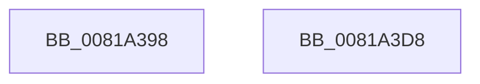

# AslRegistryOpenKey_UStr

- RVA: `0x0081A398`–`0x0081A3D9` (길이 `65` bytes)
- VA: `0x000000014081A398`
- 실행 섹션: `PAGE`
- PDB 이름 있음: `예`; PDB Function 태그: `아니요`
- unwind 정보 RVA: `0x0005CC98`
- 디코드: `16`개 명령, `65/65` bytes 표시
- 미해석 바이트: `0` (있으면 어셈블리에 `.byte`로 보존)

> 이 문서는 커널 이미지의 기계어와 PDB 기호를 분석해 생성했습니다. 4번과 5번은 함수 원형과 자료형을 바이너리 사용 방식에서 추정한 C 해석이며 원본 소스 복구 결과는 아닙니다.

## 1. Dependencies

- 직접 호출 지점: **1**; 고유 호출 대상: **1**
- 직접 호출자로 확인된 함수: **1**
- RIP 상대 이미지 참조: **0**

### Outgoing calls
- `0x0081A3CE` → [ZwOpenKey](../../text/6A/ZwOpenKey_function_006AD310.md) (function, `0x006AD310`)

### Direct callers
- [SdbResolveDatabaseEx](SdbResolveDatabaseEx_function_00817A54.md) at `0x00817C30`

### Static image references
- 디코드된 RIP-relative 메모리 참조가 없습니다.

## 2. Other-region calls and transfers

- 다른 실행 섹션으로 향하는 call: **1**
  - `0x0081A3CE` → [ZwOpenKey](../../text/6A/ZwOpenKey_function_006AD310.md) (`PAGE` → `.text`)
- 별도 외부 분기/꼬리 이동을 확인하지 못했습니다.

## 3. Assembly (complete function range)

```asm
0081A398  4C 8B DC                        mov r11, rsp
0081A39B  48 83 EC 58                     sub rsp, 0x58
0081A39F  33 C0                           xor eax, eax
0081A3A1  49 89 53 D8                     mov qword ptr [r11 - 0x28], rdx
0081A3A5  0F 57 C0                        xorps xmm0, xmm0
0081A3A8  49 89 43 D0                     mov qword ptr [r11 - 0x30], rax
0081A3AC  49 C7 43 C8 30 00 00 00         mov qword ptr [r11 - 0x38], 0x30
0081A3B4  4D 8D 43 C8                     lea r8, [r11 - 0x38]
0081A3B8  49 C7 43 E0 40 02 00 00         mov qword ptr [r11 - 0x20], 0x240
0081A3C0  BA 00 01 00 80                  mov edx, 0x80000100
0081A3C5  F3 0F 7F 44 24 40               movdqu xmmword ptr [rsp + 0x40], xmm0
0081A3CB  48 89 01                        mov qword ptr [rcx], rax
0081A3CE  E8 3D 2F E9 FF                  call 0x1406ad310
0081A3D3  48 83 C4 58                     add rsp, 0x58
0081A3D7  C3                              ret
0081A3D8  CC                              int3
```

## 4. C-style interpretation (structured pseudocode)

```c
__int64 __fastcall AslRegistryOpenKey_UStr(__int64 a1, __int64 a2)
{
    __int64 result;
    __int64 v_rsp;
    unsigned __int64 v_stack_m18;

    v_rsp = (v_rsp) - (88);
    result = 0;
    *(unsigned __int64 *)(v_rsp - 40) = a2;
    *(unsigned __int64 *)(v_rsp - 48) = 0;
    *(unsigned __int64 *)(v_rsp - 56) = 48;
    *(unsigned __int64 *)(v_rsp - 32) = 576;
    v_stack_m18 = v_xmm0;
    *(unsigned __int64 *)(a1) = 0;
    result = ZwOpenKey(a1, (unsigned int)(0x80000100ULL), v_rsp - 56, a4);
    v_rsp = (v_rsp) + (88);
    return result;
}
```

## 5. (Beta) C Style

```c
int64_t AslRegistryOpenKey_UStr(void *Arg1, int64_t Arg2)
{
    uint8_t *arg1 = (uint8_t *)Arg1;

    int64_t result;
    int64_t local_rsp;
    uint64_t v_stack_m18;

    local_rsp = (local_rsp) - (88);
    result = 0;
    *(uint64_t *)(local_rsp - 0x28) = Arg2;
    *(uint64_t *)(local_rsp - 0x30) = 0;
    *(uint64_t *)(local_rsp - 0x38) = 48;
    *(uint64_t *)(local_rsp - 0x20) = 576;
    v_stack_m18 = v_xmm0;
    *(uint64_t *)(arg1) = 0;
    result = ZwOpenKey(Arg1, (uint32_t)(0x80000100ULL), local_rsp - 56, a4);
    local_rsp = (local_rsp) + (88);
    return result;
}
```

### 관측된 메모리 오프셋

구조체 형식이 확인되지 않은 접근은 인자 기준의 오프셋으로만 기록했습니다.

| 기준 인자 | 오프셋 표현 | 폭 (bit) | 접근 |
|---|---:|---:|---|
| `Arg1` | `+ 0x0` | `64` | `W` |

## 6. Execution-region graph

[열기: 2D/3D 그래프와 함수 탐색 컨트롤 패널](../../../control-panel.html?section=page&rva=0x0081A398&view=graph)

- 2D 그래프는 위에서 아래로 흐르고, 3D 그래프는 빈 공간을 드래그해 회전합니다. Shift+드래그는 이동, 휠은 확대·축소, 함수 노드 선택은 대상 보고서 이동입니다.

### Static fallback


