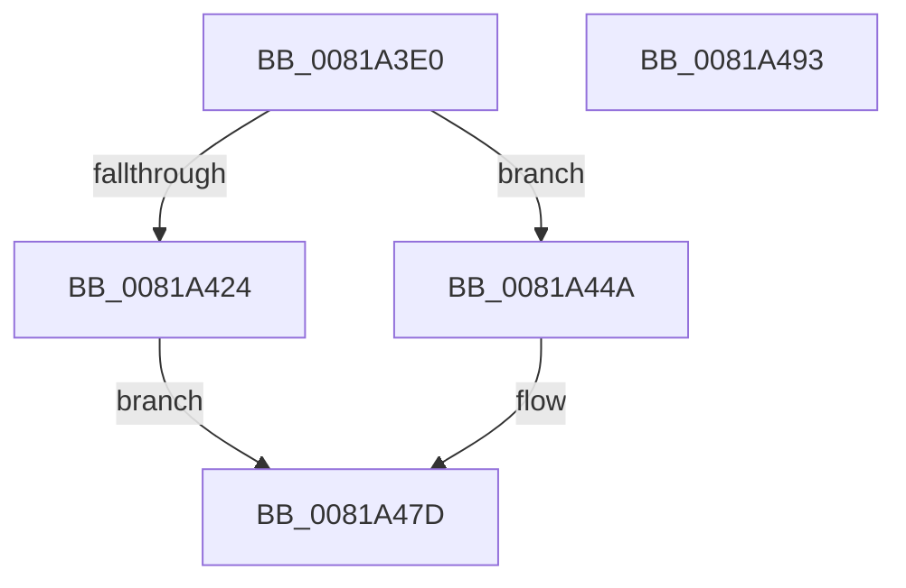

# AslRegistryOpenSubKey

- RVA: `0x0081A3E0`–`0x0081A494` (길이 `180` bytes)
- VA: `0x000000014081A3E0`
- 실행 섹션: `PAGE`
- PDB 이름 있음: `예`; PDB Function 태그: `아니요`
- unwind 정보 RVA: `0x000C7B70`
- 디코드: `48`개 명령, `180/180` bytes 표시
- 미해석 바이트: `0` (있으면 어셈블리에 `.byte`로 보존)

> 이 문서는 커널 이미지의 기계어와 PDB 기호를 분석해 생성했습니다. 4번과 5번은 함수 원형과 자료형을 바이너리 사용 방식에서 추정한 C 해석이며 원본 소스 복구 결과는 아닙니다.

## 1. Dependencies

- 직접 호출 지점: **3**; 고유 호출 대상: **3**
- 직접 호출자로 확인된 함수: **1**
- RIP 상대 이미지 참조: **2**

### Outgoing calls
- `0x0081A419` → [RtlInitUnicodeStringEx](../../text/46/RtlInitUnicodeStringEx_function_00463960.md) (function, `0x00463960`)
- `0x0081A441` → [AslLogCallPrintf](../95/AslLogCallPrintf_function_0095E4EC.md) (function, `0x0095E4EC`)
- `0x0081A478` → [ZwOpenKey](../../text/6A/ZwOpenKey_function_006AD310.md) (function, `0x006AD310`)

### Direct callers
- [AslpProcessMatchRegNode](AslpProcessMatchRegNode_function_0081CB08.md) at `0x0081CC2E`

### Static image references
- `0x0081A424` → RVA `0x0003E6C8` (`.rdata`; read)
- `0x0081A435` → RVA `0x0003E6F8` (`.rdata`; read)

## 2. Other-region calls and transfers

- 다른 실행 섹션으로 향하는 call: **2**
  - `0x0081A419` → [RtlInitUnicodeStringEx](../../text/46/RtlInitUnicodeStringEx_function_00463960.md) (`PAGE` → `.text`)
  - `0x0081A478` → [ZwOpenKey](../../text/6A/ZwOpenKey_function_006AD310.md) (`PAGE` → `.text`)
- 별도 외부 분기/꼬리 이동을 확인하지 못했습니다.

## 3. Assembly (complete function range)

```asm
0081A3E0  48 89 5C 24 08                  mov qword ptr [rsp + 8], rbx
0081A3E5  48 89 74 24 10                  mov qword ptr [rsp + 0x10], rsi
0081A3EA  48 89 7C 24 18                  mov qword ptr [rsp + 0x18], rdi
0081A3EF  55                              push rbp
0081A3F0  48 8B EC                        mov rbp, rsp
0081A3F3  48 83 EC 70                     sub rsp, 0x70
0081A3F7  33 C0                           xor eax, eax
0081A3F9  48 8B F2                        mov rsi, rdx
0081A3FC  48 21 01                        and qword ptr [rcx], rax
0081A3FF  48 8B F9                        mov rdi, rcx
0081A402  21 45 EC                        and dword ptr [rbp - 0x14], eax
0081A405  48 8D 4D C0                     lea rcx, [rbp - 0x40]
0081A409  0F 57 C0                        xorps xmm0, xmm0
0081A40C  89 45 D4                        mov dword ptr [rbp - 0x2c], eax
0081A40F  21 45 D4                        and dword ptr [rbp - 0x2c], eax
0081A412  49 8B D0                        mov rdx, r8
0081A415  0F 11 45 C0                     movups xmmword ptr [rbp - 0x40], xmm0
0081A419  E8 42 95 C4 FF                  call 0x140463960
0081A41E  8B D8                           mov ebx, eax
0081A420  85 C0                           test eax, eax
0081A422  79 26                           jns 0x14081a44a
0081A424  4C 8D 0D 9D 42 82 FF            lea r9, [rip - 0x7dbd63]
0081A42B  89 44 24 20                     mov dword ptr [rsp + 0x20], eax
0081A42F  41 B8 7A 03 00 00               mov r8d, 0x37a
0081A435  48 8D 15 BC 42 82 FF            lea rdx, [rip - 0x7dbd44]
0081A43C  B9 01 00 00 00                  mov ecx, 1
0081A441  E8 A6 40 14 00                  call 0x14095e4ec
0081A446  8B C3                           mov eax, ebx
0081A448  EB 33                           jmp 0x14081a47d
0081A44A  48 8D 45 C0                     lea rax, [rbp - 0x40]
0081A44E  C7 45 D0 30 00 00 00            mov dword ptr [rbp - 0x30], 0x30
0081A455  0F 57 C0                        xorps xmm0, xmm0
0081A458  48 89 45 E0                     mov qword ptr [rbp - 0x20], rax
0081A45C  4C 8D 45 D0                     lea r8, [rbp - 0x30]
0081A460  48 89 75 D8                     mov qword ptr [rbp - 0x28], rsi
0081A464  BA 19 00 02 00                  mov edx, 0x20019
0081A469  C7 45 E8 40 02 00 00            mov dword ptr [rbp - 0x18], 0x240
0081A470  48 8B CF                        mov rcx, rdi
0081A473  F3 0F 7F 45 F0                  movdqu xmmword ptr [rbp - 0x10], xmm0
0081A478  E8 93 2E E9 FF                  call 0x1406ad310
0081A47D  4C 8D 5C 24 70                  lea r11, [rsp + 0x70]
0081A482  49 8B 5B 10                     mov rbx, qword ptr [r11 + 0x10]
0081A486  49 8B 73 18                     mov rsi, qword ptr [r11 + 0x18]
0081A48A  49 8B 7B 20                     mov rdi, qword ptr [r11 + 0x20]
0081A48E  49 8B E3                        mov rsp, r11
0081A491  5D                              pop rbp
0081A492  C3                              ret
0081A493  CC                              int3
```

## 4. C-style interpretation (structured pseudocode)

```c
__int64 __fastcall AslRegistryOpenSubKey(__int64 a1, __int64 a2, __int64 a3)
{
    __int64 result;
    __int64 v_rsp;
    unsigned __int64 v_stack_m18;
    unsigned int v_stack_m1C;
    unsigned int v_stack_m20;
    unsigned __int64 v_stack_m28;
    unsigned __int64 v_stack_m30;
    unsigned int v_stack_m34;
    unsigned int v_stack_m38;
    unsigned __int64 v_stack_m48;
    unsigned int v_stack_m58;
    unsigned __int64 v_stack_m8;
    unsigned __int64 v_stack_p10;
    unsigned __int64 v_stack_p18;
    unsigned __int64 v_stack_p8;

    v_stack_p8 = v_rbx;
    v_stack_p10 = v_rsi;
    v_stack_p18 = v_rdi;
    v_rsp = (v_rsp) - (112);
    result = 0;
    v_stack_m34 = 0;
    v_stack_m48 = v_xmm0;
    result = RtlInitUnicodeStringEx(v_stack_m48, a3, a3, a4);
    if (!sign_flag) goto loc_0081A44A;
    v_stack_m58 = (unsigned int)(result);
    result = AslLogCallPrintf(1, v_rip - 8240452, 890, v_rip - 8240483);
    goto loc_0081A47D;
loc_0081A44A:
    v_stack_m38 = 48;
    v_stack_m28 = v_stack_m48;
    v_stack_m30 = a2;
    v_stack_m20 = 576;
    v_stack_m18 = v_xmm0;
    result = ZwOpenKey(a1, (unsigned int)(0x20019ULL), v_stack_m38, v_rip - 8240483);
loc_0081A47D:
    return result;
}
```

## 5. (Beta) C Style

```c
int64_t AslRegistryOpenSubKey(void *Arg1, int64_t Arg2, int64_t Arg3)
{
    uint8_t *arg1 = (uint8_t *)Arg1;

    int64_t result;
    int64_t local_rsp;
    uint64_t v_stack_m18;
    uint32_t v_stack_m1C;
    uint32_t v_stack_m20;
    uint64_t v_stack_m28;
    uint64_t v_stack_m30;
    uint32_t v_stack_m34;
    uint32_t v_stack_m38;
    uint64_t v_stack_m48;
    uint32_t v_stack_m58;
    uint64_t v_stack_m8;
    uint64_t v_stack_p10;
    uint64_t v_stack_p18;
    uint64_t v_stack_p8;

    v_stack_p8 = local_rbx;
    v_stack_p10 = local_rsi;
    v_stack_p18 = local_rdi;
    local_rsp = (local_rsp) - (112);
    result = 0;
    v_stack_m34 = 0;
    v_stack_m48 = v_xmm0;
    result = RtlInitUnicodeStringEx(v_stack_m48, Arg3, Arg3, a4);
    if (!sign_flag) goto loc_0081A44A;
    v_stack_m58 = (uint32_t)(result);
    result = AslLogCallPrintf(1, v_rip - 8240452, 890, v_rip - 8240483);
    goto loc_0081A47D;
loc_0081A44A:
    v_stack_m38 = 48;
    v_stack_m28 = v_stack_m48;
    v_stack_m30 = Arg2;
    v_stack_m20 = 576;
    v_stack_m18 = v_xmm0;
    result = ZwOpenKey(Arg1, (uint32_t)(0x20019ULL), v_stack_m38, v_rip - 8240483);
loc_0081A47D:
    return result;
}
```

### 관측된 메모리 오프셋

구조체 형식이 확인되지 않은 접근은 인자 기준의 오프셋으로만 기록했습니다.

| 기준 인자 | 오프셋 표현 | 폭 (bit) | 접근 |
|---|---:|---:|---|
| `Arg1` | `+ 0x0` | `64` | `R/W` |

## 6. Execution-region graph

[열기: 2D/3D 그래프와 함수 탐색 컨트롤 패널](../../../control-panel.html?section=page&rva=0x0081A3E0&view=graph)

- 2D 그래프는 위에서 아래로 흐르고, 3D 그래프는 빈 공간을 드래그해 회전합니다. Shift+드래그는 이동, 휠은 확대·축소, 함수 노드 선택은 대상 보고서 이동입니다.

### Static fallback


