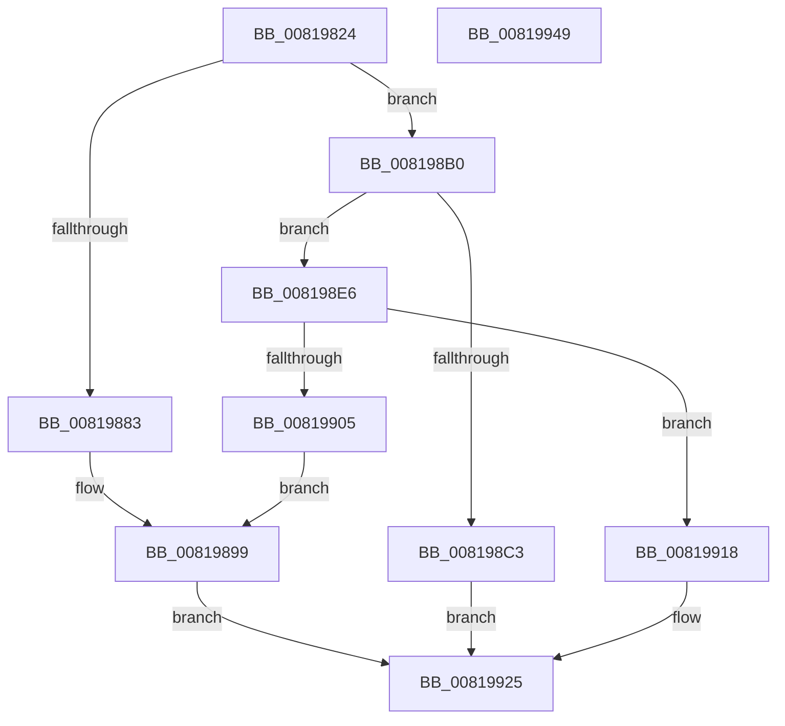

# AslStringAnsiToUnicode

- RVA: `0x00819824`–`0x0081994A` (길이 `294` bytes)
- VA: `0x0000000140819824`
- 실행 섹션: `PAGE`
- PDB 이름 있음: `예`; PDB Function 태그: `아니요`
- unwind 정보 RVA: `0x000D9C14`
- 디코드: `78`개 명령, `294/294` bytes 표시
- 미해석 바이트: `0` (있으면 어셈블리에 `.byte`로 보존)

> 이 문서는 커널 이미지의 기계어와 PDB 기호를 분석해 생성했습니다. 4번과 5번은 함수 원형과 자료형을 바이너리 사용 방식에서 추정한 C 해석이며 원본 소스 복구 결과는 아닙니다.

## 1. Dependencies

- 직접 호출 지점: **7**; 고유 호출 대상: **6**
- 직접 호출자로 확인된 함수: **4**
- RIP 상대 이미지 참조: **4**

### Outgoing calls
- `0x0081984D` → [RtlInitAnsiString](../../text/47/RtlInitAnsiString_function_00470F40.md) (function, `0x00470F40`)
- `0x00819866` → [RtlMultiByteToUnicodeSize](../90/RtlMultiByteToUnicodeSize_function_0090CBC0.md) (function, `0x0090CBC0`)
- `0x008198A5` → [AslLogCallPrintf](../95/AslLogCallPrintf_function_0095E4EC.md) (function, `0x0095E4EC`)
- `0x008198B2` → [AslAlloc](../95/AslAlloc_function_0095BD34.md) (function, `0x0095BD34`)
- `0x008198DF` → [AslLogCallPrintf](../95/AslLogCallPrintf_function_0095E4EC.md) (function, `0x0095E4EC`)
- `0x008198FA` → [RtlAnsiStringToUnicodeString](../90/RtlAnsiStringToUnicodeString_function_0090BEA0.md) (function, `0x0090BEA0`)
- `0x00819928` → [AslFree](../95/AslFree_function_0095B674.md) (function, `0x0095B674`)

### Direct callers
- [AslpFileGet16BitDescription](AslpFileGet16BitDescription_function_0081DE94.md) at `0x0081DF20`
- [AslpFileGet16BitModuleName](AslpFileGet16BitModuleName_function_0081DF78.md) at `0x0081E004`
- [AslpFileGetClrVersionAttribute](AslpFileGetClrVersionAttribute_function_0081E54C.md) at `0x0081E63C`
- [AslpFileGetExportName](AslpFileGetExportName_function_0081ED30.md) at `0x0081EDB4`

### Static image references
- `0x0081988C` → RVA `0x0003E608` (`.rdata`; read)
- `0x00819899` → RVA `0x0003E638` (`.rdata`; read)
- `0x008198C3` → RVA `0x000129E0` (`.rdata`; read)
- `0x00819909` → RVA `0x0003E650` (`.rdata`; read)

## 2. Other-region calls and transfers

- 다른 실행 섹션으로 향하는 call: **1**
  - `0x0081984D` → [RtlInitAnsiString](../../text/47/RtlInitAnsiString_function_00470F40.md) (`PAGE` → `.text`)
- 별도 외부 분기/꼬리 이동을 확인하지 못했습니다.

## 3. Assembly (complete function range)

```asm
00819824  48 89 5C 24 10                  mov qword ptr [rsp + 0x10], rbx
00819829  48 89 74 24 18                  mov qword ptr [rsp + 0x18], rsi
0081982E  48 89 7C 24 20                  mov qword ptr [rsp + 0x20], rdi
00819833  55                              push rbp
00819834  41 56                           push r14
00819836  41 57                           push r15
00819838  48 8B EC                        mov rbp, rsp
0081983B  48 83 EC 50                     sub rsp, 0x50
0081983F  4C 8B F1                        mov r14, rcx
00819842  0F 57 C0                        xorps xmm0, xmm0
00819845  48 8D 4D F0                     lea rcx, [rbp - 0x10]
00819849  0F 11 45 F0                     movups xmmword ptr [rbp - 0x10], xmm0
0081984D  E8 EE 76 C5 FF                  call 0x140470f40
00819852  44 0F B7 45 F0                  movzx r8d, word ptr [rbp - 0x10]
00819857  48 8D 4D 20                     lea rcx, [rbp + 0x20]
0081985B  48 8B 55 F8                     mov rdx, qword ptr [rbp - 8]
0081985F  45 33 FF                        xor r15d, r15d
00819862  44 89 7D 20                     mov dword ptr [rbp + 0x20], r15d
00819866  E8 55 33 0F 00                  call 0x14090cbc0
0081986B  8B 75 20                        mov esi, dword ptr [rbp + 0x20]
0081986E  0F 57 C0                        xorps xmm0, xmm0
00819871  83 C6 02                        add esi, 2
00819874  4D 89 3E                        mov qword ptr [r14], r15
00819877  0F 11 45 E0                     movups xmmword ptr [rbp - 0x20], xmm0
0081987B  81 FE FF FF 00 00               cmp esi, 0xffff
00819881  76 2D                           jbe 0x1408198b0
00819883  BF 0D 00 00 C0                  mov edi, 0xc000000d
00819888  89 74 24 20                     mov dword ptr [rsp + 0x20], esi
0081988C  4C 8D 0D 75 4D 82 FF            lea r9, [rip - 0x7db28b]
00819893  41 B8 8D 01 00 00               mov r8d, 0x18d
00819899  48 8D 15 98 4D 82 FF            lea rdx, [rip - 0x7db268]
008198A0  B9 01 00 00 00                  mov ecx, 1
008198A5  E8 42 4C 14 00                  call 0x14095e4ec
008198AA  48 8B 5D E8                     mov rbx, qword ptr [rbp - 0x18]
008198AE  EB 75                           jmp 0x140819925
008198B0  8B D6                           mov edx, esi
008198B2  E8 7D 24 14 00                  call 0x14095bd34
008198B7  48 89 45 E8                     mov qword ptr [rbp - 0x18], rax
008198BB  48 8B D8                        mov rbx, rax
008198BE  48 85 C0                        test rax, rax
008198C1  75 23                           jne 0x1408198e6
008198C3  4C 8D 0D 16 91 7F FF            lea r9, [rip - 0x806eea]
008198CA  41 B8 94 01 00 00               mov r8d, 0x194
008198D0  48 8D 15 61 4D 82 FF            lea rdx, [rip - 0x7db29f]
008198D7  BF 17 00 00 C0                  mov edi, 0xc0000017
008198DC  8D 48 01                        lea ecx, [rax + 1]
008198DF  E8 08 4C 14 00                  call 0x14095e4ec
008198E4  EB 3F                           jmp 0x140819925
008198E6  45 33 C0                        xor r8d, r8d
008198E9  66 89 75 E2                     mov word ptr [rbp - 0x1e], si
008198ED  48 8D 55 F0                     lea rdx, [rbp - 0x10]
008198F1  66 44 89 7D E0                  mov word ptr [rbp - 0x20], r15w
008198F6  48 8D 4D E0                     lea rcx, [rbp - 0x20]
008198FA  E8 A1 25 0F 00                  call 0x14090bea0
008198FF  8B F8                           mov edi, eax
00819901  85 C0                           test eax, eax
00819903  79 13                           jns 0x140819918
00819905  89 44 24 20                     mov dword ptr [rsp + 0x20], eax
00819909  4C 8D 0D 40 4D 82 FF            lea r9, [rip - 0x7db2c0]
00819910  41 B8 9D 01 00 00               mov r8d, 0x19d
00819916  EB 81                           jmp 0x140819899
00819918  48 8B 45 E8                     mov rax, qword ptr [rbp - 0x18]
0081991C  49 8B DF                        mov rbx, r15
0081991F  49 89 06                        mov qword ptr [r14], rax
00819922  41 8B FF                        mov edi, r15d
00819925  48 8B D3                        mov rdx, rbx
00819928  E8 47 1D 14 00                  call 0x14095b674
0081992D  4C 8D 5C 24 50                  lea r11, [rsp + 0x50]
00819932  8B C7                           mov eax, edi
00819934  49 8B 5B 28                     mov rbx, qword ptr [r11 + 0x28]
00819938  49 8B 73 30                     mov rsi, qword ptr [r11 + 0x30]
0081993C  49 8B 7B 38                     mov rdi, qword ptr [r11 + 0x38]
00819940  49 8B E3                        mov rsp, r11
00819943  41 5F                           pop r15
00819945  41 5E                           pop r14
00819947  5D                              pop rbp
00819948  C3                              ret
00819949  CC                              int3
```

## 4. C-style interpretation (structured pseudocode)

```c
__int64 __fastcall AslStringAnsiToUnicode(__int64 a1)
{
    __int64 result;
    __int64 v_r15;
    __int64 v_rsi;
    __int64 v_rsp;
    unsigned __int64 v_stack_m18;
    unsigned __int64 v_stack_m20;
    unsigned __int64 v_stack_m28;
    unsigned __int64 v_stack_m30;
    unsigned __int16 v_stack_m36;
    unsigned __int64 v_stack_m38;
    unsigned int v_stack_m48;
    unsigned __int64 v_stack_p10;
    unsigned __int64 v_stack_p18;
    unsigned __int64 v_stack_p20;
    unsigned __int64 v_stack_p8;

    v_stack_p10 = v_rbx;
    v_stack_p18 = v_rsi;
    v_stack_p20 = v_rdi;
    v_rsp = (v_rsp) - (80);
    v_stack_m28 = v_xmm0;
    result = RtlInitAnsiString(v_stack_m28, a2, a3, a4);
    v_r15 = 0;
    v_stack_p8 = 0;
    result = RtlMultiByteToUnicodeSize(v_stack_p8, v_stack_m20, v_stack_m28, a4);
    v_rsi = (unsigned int)(((unsigned int)(v_stack_p8)) + (2));
    *(unsigned __int64 *)(a1) = 0;
    v_stack_m38 = v_xmm0;
    if (((unsigned int)(v_rsi)) <= 0xFFFFULL) goto loc_008198B0;
    v_stack_m48 = (unsigned int)(v_rsi);
loc_00819899:
    result = AslLogCallPrintf(1, v_rip - 8237672, 397, v_rip - 8237707);
    goto loc_00819925;
loc_008198B0:
    result = AslAlloc(1, (unsigned int)((unsigned int)(v_rsi)), 397, v_rip - 8237707);
    v_stack_m30 = result;
    if (result != 0) goto loc_008198E6;
    result = AslLogCallPrintf(result + 1, v_rip - 8237727, 404, v_rip - 8417002);
    goto loc_00819925;
loc_008198E6:
    a3 = 0;
    v_stack_m36 = (unsigned __int16)(v_rsi);
    v_stack_m38 = 0;
    result = RtlAnsiStringToUnicodeString(v_stack_m38, v_stack_m28, a3, v_rip - 8417002);
    if (!sign_flag) goto loc_00819918;
    v_stack_m48 = (unsigned int)(result);
    goto loc_00819899;
loc_00819918:
    *(unsigned __int64 *)(a1) = v_stack_m30;
loc_00819925:
    result = AslFree(v_stack_m38, 0, 413, v_rip - 8237760);
    return 0;
}
```

## 5. (Beta) C Style

```c
int64_t AslStringAnsiToUnicode(void *Arg1)
{
    uint8_t *arg1 = (uint8_t *)Arg1;

    int64_t result;
    int64_t local_r15;
    int64_t local_rsi;
    int64_t local_rsp;
    uint64_t v_stack_m18;
    uint64_t v_stack_m20;
    uint64_t v_stack_m28;
    uint64_t v_stack_m30;
    uint16_t v_stack_m36;
    uint64_t v_stack_m38;
    uint32_t v_stack_m48;
    uint64_t v_stack_p10;
    uint64_t v_stack_p18;
    uint64_t v_stack_p20;
    uint64_t v_stack_p8;

    v_stack_p10 = local_rbx;
    v_stack_p18 = local_rsi;
    v_stack_p20 = local_rdi;
    local_rsp = (local_rsp) - (80);
    v_stack_m28 = v_xmm0;
    result = RtlInitAnsiString(v_stack_m28, a2, a3, a4);
    local_r15 = 0;
    v_stack_p8 = 0;
    result = RtlMultiByteToUnicodeSize(v_stack_p8, v_stack_m20, v_stack_m28, a4);
    local_rsi = (uint32_t)(((uint32_t)(v_stack_p8)) + (2));
    *(uint64_t *)(arg1) = 0;
    v_stack_m38 = v_xmm0;
    if (((uint32_t)(local_rsi)) <= 0xFFFFULL) goto loc_008198B0;
    v_stack_m48 = (uint32_t)(local_rsi);
loc_00819899:
    result = AslLogCallPrintf(1, v_rip - 8237672, 397, v_rip - 8237707);
    goto loc_00819925;
loc_008198B0:
    result = AslAlloc(1, (uint32_t)((uint32_t)(local_rsi)), 397, v_rip - 8237707);
    v_stack_m30 = result;
    if (result != 0) goto loc_008198E6;
    result = AslLogCallPrintf(result + 1, v_rip - 8237727, 404, v_rip - 8417002);
    goto loc_00819925;
loc_008198E6:
    a3 = 0;
    v_stack_m36 = (uint16_t)(local_rsi);
    v_stack_m38 = 0;
    result = RtlAnsiStringToUnicodeString(v_stack_m38, v_stack_m28, a3, v_rip - 8417002);
    if (!sign_flag) goto loc_00819918;
    v_stack_m48 = (uint32_t)(result);
    goto loc_00819899;
loc_00819918:
    *(uint64_t *)(arg1) = v_stack_m30;
loc_00819925:
    result = AslFree(v_stack_m38, 0, 413, v_rip - 8237760);
    return 0;
}
```

### 관측된 메모리 오프셋

구조체 형식이 확인되지 않은 접근은 인자 기준의 오프셋으로만 기록했습니다.

| 기준 인자 | 오프셋 표현 | 폭 (bit) | 접근 |
|---|---:|---:|---|
| `Arg1` | `+ 0x0` | `64` | `W` |

## 6. Execution-region graph

[열기: 2D/3D 그래프와 함수 탐색 컨트롤 패널](../../../control-panel.html?section=page&rva=0x00819824&view=graph)

- 2D 그래프는 위에서 아래로 흐르고, 3D 그래프는 빈 공간을 드래그해 회전합니다. Shift+드래그는 이동, 휠은 확대·축소, 함수 노드 선택은 대상 보고서 이동입니다.

### Static fallback


