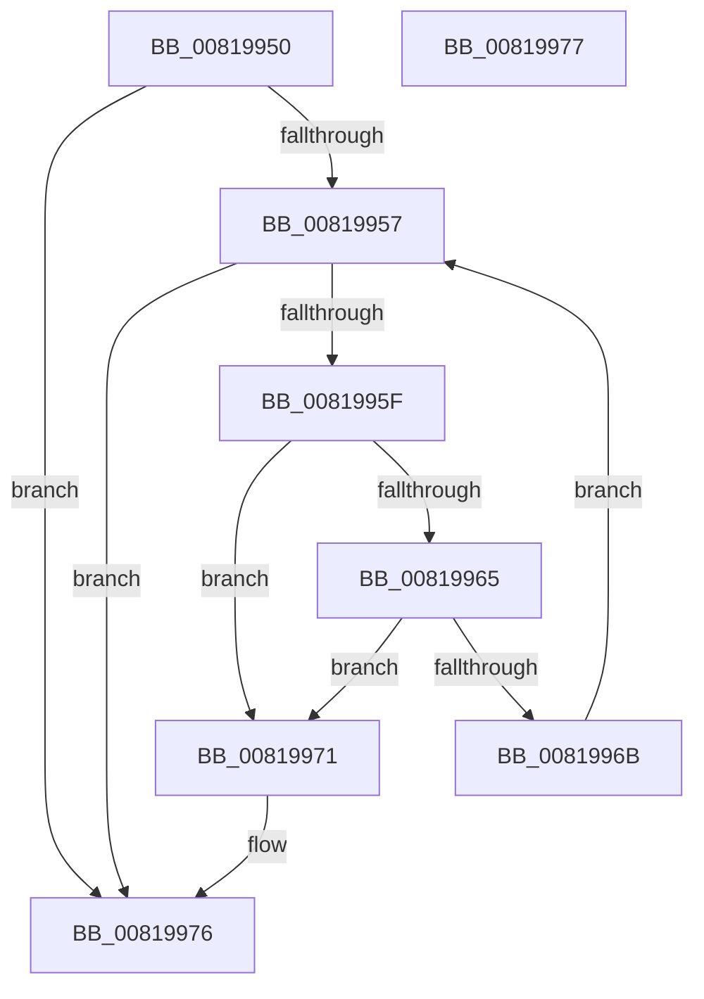

# AslStringHasWildcard

- RVA: `0x00819950`–`0x00819978` (길이 `40` bytes)
- VA: `0x0000000140819950`
- 실행 섹션: `PAGE`
- PDB 이름 있음: `예`; PDB Function 태그: `아니요`
- unwind 정보 RVA: `0x000DB714`
- 디코드: `15`개 명령, `40/40` bytes 표시
- 미해석 바이트: `0` (있으면 어셈블리에 `.byte`로 보존)

> 이 문서는 커널 이미지의 기계어와 PDB 기호를 분석해 생성했습니다. 4번과 5번은 함수 원형과 자료형을 바이너리 사용 방식에서 추정한 C 해석이며 원본 소스 복구 결과는 아닙니다.

## 1. Dependencies

- 직접 호출 지점: **0**; 고유 호출 대상: **0**
- 직접 호출자로 확인된 함수: **1**
- RIP 상대 이미지 참조: **0**

### Outgoing calls
- 직접 디코드된 call 명령이 없습니다.

### Direct callers
- [AslpPathWildcardMakeLeaves](AslpPathWildcardMakeLeaves_function_0081C960.md) at `0x0081CAA3`

### Static image references
- 디코드된 RIP-relative 메모리 참조가 없습니다.

## 2. Other-region calls and transfers

- 다른 실행 섹션으로 향하는 call: **0**
- 별도 외부 분기/꼬리 이동을 확인하지 못했습니다.

## 3. Assembly (complete function range)

```asm
00819950  33 C0                           xor eax, eax
00819952  48 85 C9                        test rcx, rcx
00819955  74 1F                           je 0x140819976
00819957  0F B7 11                        movzx edx, word ptr [rcx]
0081995A  66 85 D2                        test dx, dx
0081995D  74 17                           je 0x140819976
0081995F  66 83 FA 2A                     cmp dx, 0x2a
00819963  74 0C                           je 0x140819971
00819965  66 83 FA 3F                     cmp dx, 0x3f
00819969  74 06                           je 0x140819971
0081996B  48 83 C1 02                     add rcx, 2
0081996F  EB E6                           jmp 0x140819957
00819971  B8 01 00 00 00                  mov eax, 1
00819976  C3                              ret
00819977  CC                              int3
```

## 4. C-style interpretation (structured pseudocode)

```c
__int64 __fastcall AslStringHasWildcard(__int64 a1)
{
    __int64 result;

    result = 0;
    if (a1 == 0) goto loc_00819976;
loc_00819957:
    if ((unsigned __int16)(*(unsigned __int16 *)(a1)) == 0) goto loc_00819976;
    if (((unsigned __int16)(*(unsigned __int16 *)(a1))) == 42) goto loc_00819971;
    if (((unsigned __int16)(*(unsigned __int16 *)(a1))) == 63) goto loc_00819971;
    a1 = (a1) + (2);
    goto loc_00819957;
loc_00819971:
loc_00819976:
    return 1;
}
```

## 5. (Beta) C Style

```c
int64_t AslStringHasWildcard(int64_t Arg1)
{
    int64_t result;

    result = 0;
    if (Arg1 == 0) goto loc_00819976;
loc_00819957:
    if ((uint16_t)(*(uint16_t *)(Arg1)) == 0) goto loc_00819976;
    if (((uint16_t)(*(uint16_t *)(Arg1))) == 42) goto loc_00819971;
    if (((uint16_t)(*(uint16_t *)(Arg1))) == 63) goto loc_00819971;
    Arg1 = (Arg1) + (2);
    goto loc_00819957;
loc_00819971:
loc_00819976:
    return 1;
}
```

## 6. Execution-region graph

[열기: 2D/3D 그래프와 함수 탐색 컨트롤 패널](../../../control-panel.html?section=page&rva=0x00819950&view=graph)

- 2D 그래프는 위에서 아래로 흐르고, 3D 그래프는 빈 공간을 드래그해 회전합니다. Shift+드래그는 이동, 휠은 확대·축소, 함수 노드 선택은 대상 보고서 이동입니다.

### Static fallback


