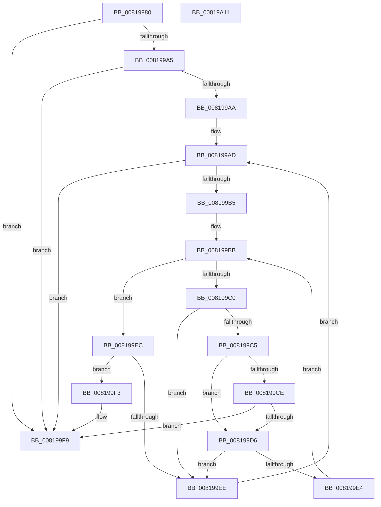

# AslStringSearchA

- RVA: `0x00819980`–`0x00819A12` (길이 `146` bytes)
- VA: `0x0000000140819980`
- 실행 섹션: `PAGE`
- PDB 이름 있음: `예`; PDB Function 태그: `아니요`
- unwind 정보 RVA: `0x000A5A38`
- 디코드: `50`개 명령, `146/146` bytes 표시
- 미해석 바이트: `0` (있으면 어셈블리에 `.byte`로 보존)

> 이 문서는 커널 이미지의 기계어와 PDB 기호를 분석해 생성했습니다. 4번과 5번은 함수 원형과 자료형을 바이너리 사용 방식에서 추정한 C 해석이며 원본 소스 복구 결과는 아닙니다.

## 1. Dependencies

- 직접 호출 지점: **0**; 고유 호출 대상: **0**
- 직접 호출자로 확인된 함수: **1**
- RIP 상대 이미지 참조: **0**

### Outgoing calls
- 직접 디코드된 call 명령이 없습니다.

### Direct callers
- [SdbpCheckMatchingTextEntry](SdbpCheckMatchingTextEntry_function_00814A70.md) at `0x00814D07`

### Static image references
- 디코드된 RIP-relative 메모리 참조가 없습니다.

## 2. Other-region calls and transfers

- 다른 실행 섹션으로 향하는 call: **0**
- 별도 외부 분기/꼬리 이동을 확인하지 못했습니다.

## 3. Assembly (complete function range)

```asm
00819980  48 8B C4                        mov rax, rsp
00819983  48 89 58 08                     mov qword ptr [rax + 8], rbx
00819987  48 89 68 10                     mov qword ptr [rax + 0x10], rbp
0081998B  48 89 70 18                     mov qword ptr [rax + 0x18], rsi
0081998F  48 89 78 20                     mov qword ptr [rax + 0x20], rdi
00819993  45 33 D2                        xor r10d, r10d
00819996  41 8B F9                        mov edi, r9d
00819999  49 8B E8                        mov rbp, r8
0081999C  8B DA                           mov ebx, edx
0081999E  48 8B F1                        mov rsi, rcx
008199A1  85 D2                           test edx, edx
008199A3  74 54                           je 0x1408199f9
008199A5  44 3B CA                        cmp r9d, edx
008199A8  77 4F                           ja 0x1408199f9
008199AA  45 8B DA                        mov r11d, r10d
008199AD  41 8D 04 3B                     lea eax, [r11 + rdi]
008199B1  3B C3                           cmp eax, ebx
008199B3  77 44                           ja 0x1408199f9
008199B5  45 8B CA                        mov r9d, r10d
008199B8  45 8B C3                        mov r8d, r11d
008199BB  44 3B CF                        cmp r9d, edi
008199BE  73 2C                           jae 0x1408199ec
008199C0  44 3B C3                        cmp r8d, ebx
008199C3  73 29                           jae 0x1408199ee
008199C5  41 8B C0                        mov eax, r8d
008199C8  44 38 14 30                     cmp byte ptr [rax + rsi], r10b
008199CC  75 08                           jne 0x1408199d6
008199CE  41 FF C0                        inc r8d
008199D1  44 3B C3                        cmp r8d, ebx
008199D4  73 23                           jae 0x1408199f9
008199D6  41 8B C1                        mov eax, r9d
008199D9  41 8B D0                        mov edx, r8d
008199DC  8A 0C 28                        mov cl, byte ptr [rax + rbp]
008199DF  38 0C 32                        cmp byte ptr [rdx + rsi], cl
008199E2  75 0A                           jne 0x1408199ee
008199E4  41 FF C1                        inc r9d
008199E7  41 FF C0                        inc r8d
008199EA  EB CF                           jmp 0x1408199bb
008199EC  74 05                           je 0x1408199f3
008199EE  41 FF C3                        inc r11d
008199F1  EB BA                           jmp 0x1408199ad
008199F3  45 8B D3                        mov r10d, r11d
008199F6  4C 03 D6                        add r10, rsi
008199F9  48 8B 5C 24 08                  mov rbx, qword ptr [rsp + 8]
008199FE  49 8B C2                        mov rax, r10
00819A01  48 8B 6C 24 10                  mov rbp, qword ptr [rsp + 0x10]
00819A06  48 8B 74 24 18                  mov rsi, qword ptr [rsp + 0x18]
00819A0B  48 8B 7C 24 20                  mov rdi, qword ptr [rsp + 0x20]
00819A10  C3                              ret
00819A11  CC                              int3
```

## 4. C-style interpretation (structured pseudocode)

```c
__int64 __fastcall AslStringSearchA(__int64 a1, int a2, __int64 a3, int a4)
{
    __int64 v_r10;
    __int64 v_r11;
    unsigned __int64 v_stack_p10;
    unsigned __int64 v_stack_p18;
    unsigned __int64 v_stack_p20;
    unsigned __int64 v_stack_p8;

    *(unsigned __int64 *)(v_rsp + 8) = v_rbx;
    *(unsigned __int64 *)(v_rsp + 16) = v_rbp;
    *(unsigned __int64 *)(v_rsp + 24) = v_rsi;
    *(unsigned __int64 *)(v_rsp + 32) = v_rdi;
    v_r10 = 0;
    if (a2 == 0) goto loc_008199F9;
    if (a4 > a2) goto loc_008199F9;
loc_008199AD:
    if (((unsigned int)(0 + (unsigned int)(a4) * 1)) > ((unsigned int)((unsigned int)(a2)))) goto loc_008199F9;
loc_008199BB:
    if (0 >= ((unsigned int)((unsigned int)(a4)))) goto loc_008199EC;
    if (0 >= ((unsigned int)((unsigned int)(a2)))) goto loc_008199EE;
    if ((*(unsigned __int8 *)(0 + a1 * 1)) != 0) goto loc_008199D6;
    a3 = (unsigned int)((0) + 1);
    if (((unsigned int)(a3)) >= ((unsigned int)((unsigned int)(a2)))) goto loc_008199F9;
loc_008199D6:
    if ((*(unsigned __int8 *)((unsigned int)((unsigned int)(a3)) + a1 * 1)) != ((unsigned __int8)(*(unsigned __int8 *)(0 + a3 * 1)))) goto loc_008199EE;
    a4 = (unsigned int)((0) + 1);
    a3 = (unsigned int)((a3) + 1);
    goto loc_008199BB;
loc_008199EC:
    if ((*(unsigned __int8 *)((unsigned int)((unsigned int)(a3)) + a1 * 1)) == ((unsigned __int8)(*(unsigned __int8 *)(0 + a3 * 1)))) goto loc_008199F3;
loc_008199EE:
    v_r11 = (unsigned int)((0) + 1);
    goto loc_008199AD;
loc_008199F3:
    v_r10 = ((unsigned int)((unsigned int)(v_r11))) + (a1);
loc_008199F9:
    return v_r10;
}
```

## 5. (Beta) C Style

```c
int64_t AslStringSearchA(int64_t Arg1, int32_t Arg2, int64_t Arg3, int32_t Arg4)
{
    int64_t local_r10;
    int64_t local_r11;
    uint64_t v_stack_p10;
    uint64_t v_stack_p18;
    uint64_t v_stack_p20;
    uint64_t v_stack_p8;

    *(uint64_t *)(local_rsp + 0x8) = local_rbx;
    *(uint64_t *)(local_rsp + 0x10) = local_rbp;
    *(uint64_t *)(local_rsp + 0x18) = local_rsi;
    *(uint64_t *)(local_rsp + 0x20) = local_rdi;
    local_r10 = 0;
    if (Arg2 == 0) goto loc_008199F9;
    if (Arg4 > Arg2) goto loc_008199F9;
loc_008199AD:
    if (((uint32_t)(0 + (uint32_t)(Arg4) * 1)) > ((uint32_t)((uint32_t)(Arg2)))) goto loc_008199F9;
loc_008199BB:
    if (0 >= ((uint32_t)((uint32_t)(Arg4)))) goto loc_008199EC;
    if (0 >= ((uint32_t)((uint32_t)(Arg2)))) goto loc_008199EE;
    if ((*(uint8_t *)(0 + Arg1 * 1)) != 0) goto loc_008199D6;
    Arg3 = (uint32_t)((0) + 1);
    if (((uint32_t)(Arg3)) >= ((uint32_t)((uint32_t)(Arg2)))) goto loc_008199F9;
loc_008199D6:
    if ((*(uint8_t *)((uint32_t)((uint32_t)(Arg3)) + Arg1 * 1)) != ((uint8_t)(*(uint8_t *)(0 + Arg3 * 1)))) goto loc_008199EE;
    Arg4 = (uint32_t)((0) + 1);
    Arg3 = (uint32_t)((Arg3) + 1);
    goto loc_008199BB;
loc_008199EC:
    if ((*(uint8_t *)((uint32_t)((uint32_t)(Arg3)) + Arg1 * 1)) == ((uint8_t)(*(uint8_t *)(0 + Arg3 * 1)))) goto loc_008199F3;
loc_008199EE:
    local_r11 = (uint32_t)((0) + 1);
    goto loc_008199AD;
loc_008199F3:
    local_r10 = ((uint32_t)((uint32_t)(local_r11))) + (Arg1);
loc_008199F9:
    return local_r10;
}
```

## 6. Execution-region graph

[열기: 2D/3D 그래프와 함수 탐색 컨트롤 패널](../../../control-panel.html?section=page&rva=0x00819980&view=graph)

- 2D 그래프는 위에서 아래로 흐르고, 3D 그래프는 빈 공간을 드래그해 회전합니다. Shift+드래그는 이동, 휠은 확대·축소, 함수 노드 선택은 대상 보고서 이동입니다.

### Static fallback


