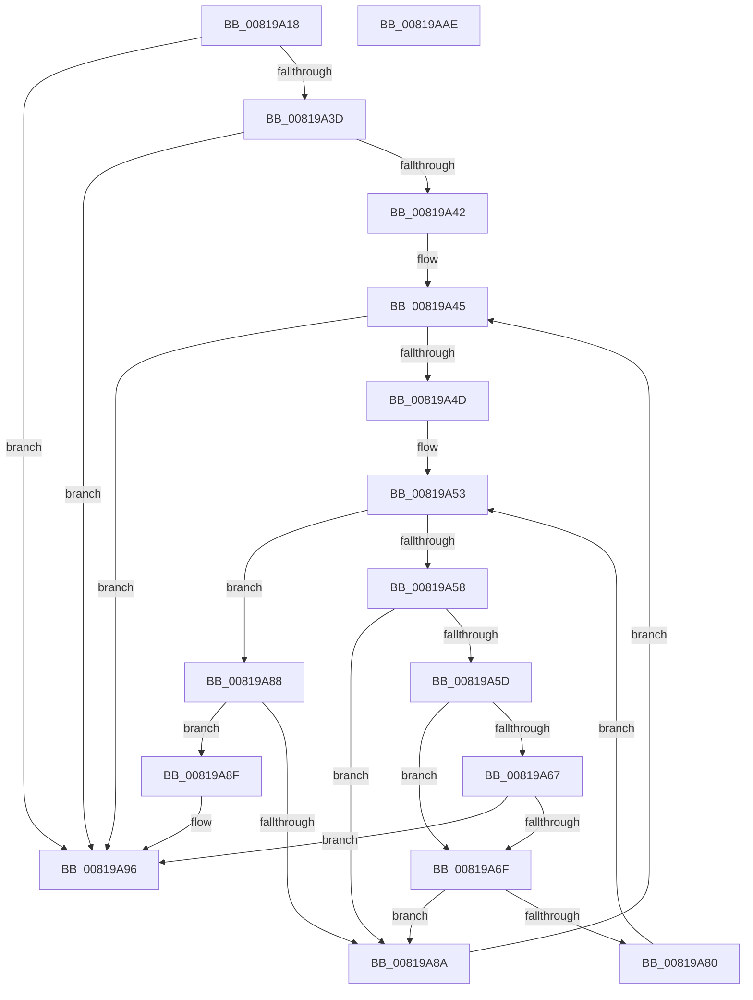

# AslStringSearchW

- RVA: `0x00819A18`–`0x00819AAF` (길이 `151` bytes)
- VA: `0x0000000140819A18`
- 실행 섹션: `PAGE`
- PDB 이름 있음: `예`; PDB Function 태그: `아니요`
- unwind 정보 RVA: `0x0007AE6C`
- 디코드: `50`개 명령, `151/151` bytes 표시
- 미해석 바이트: `0` (있으면 어셈블리에 `.byte`로 보존)

> 이 문서는 커널 이미지의 기계어와 PDB 기호를 분석해 생성했습니다. 4번과 5번은 함수 원형과 자료형을 바이너리 사용 방식에서 추정한 C 해석이며 원본 소스 복구 결과는 아닙니다.

## 1. Dependencies

- 직접 호출 지점: **0**; 고유 호출 대상: **0**
- 직접 호출자로 확인된 함수: **1**
- RIP 상대 이미지 참조: **0**

### Outgoing calls
- 직접 디코드된 call 명령이 없습니다.

### Direct callers
- [SdbpCheckMatchingTextEntry](SdbpCheckMatchingTextEntry_function_00814A70.md) at `0x00814CDE`

### Static image references
- 디코드된 RIP-relative 메모리 참조가 없습니다.

## 2. Other-region calls and transfers

- 다른 실행 섹션으로 향하는 call: **0**
- 별도 외부 분기/꼬리 이동을 확인하지 못했습니다.

## 3. Assembly (complete function range)

```asm
00819A18  48 8B C4                        mov rax, rsp
00819A1B  48 89 58 08                     mov qword ptr [rax + 8], rbx
00819A1F  48 89 70 10                     mov qword ptr [rax + 0x10], rsi
00819A23  48 89 78 18                     mov qword ptr [rax + 0x18], rdi
00819A27  4C 89 70 20                     mov qword ptr [rax + 0x20], r14
00819A2B  45 33 D2                        xor r10d, r10d
00819A2E  41 8B F9                        mov edi, r9d
00819A31  4D 8B F0                        mov r14, r8
00819A34  8B DA                           mov ebx, edx
00819A36  48 8B F1                        mov rsi, rcx
00819A39  85 D2                           test edx, edx
00819A3B  74 59                           je 0x140819a96
00819A3D  44 3B CA                        cmp r9d, edx
00819A40  77 54                           ja 0x140819a96
00819A42  45 8B DA                        mov r11d, r10d
00819A45  41 8D 04 3B                     lea eax, [r11 + rdi]
00819A49  3B C3                           cmp eax, ebx
00819A4B  77 49                           ja 0x140819a96
00819A4D  45 8B CA                        mov r9d, r10d
00819A50  45 8B C3                        mov r8d, r11d
00819A53  44 3B CF                        cmp r9d, edi
00819A56  73 30                           jae 0x140819a88
00819A58  44 3B C3                        cmp r8d, ebx
00819A5B  73 2D                           jae 0x140819a8a
00819A5D  41 8B C0                        mov eax, r8d
00819A60  66 44 39 14 46                  cmp word ptr [rsi + rax*2], r10w
00819A65  75 08                           jne 0x140819a6f
00819A67  41 FF C0                        inc r8d
00819A6A  44 3B C3                        cmp r8d, ebx
00819A6D  73 27                           jae 0x140819a96
00819A6F  41 8B C1                        mov eax, r9d
00819A72  41 8B D0                        mov edx, r8d
00819A75  41 0F B7 0C 46                  movzx ecx, word ptr [r14 + rax*2]
00819A7A  66 39 0C 56                     cmp word ptr [rsi + rdx*2], cx
00819A7E  75 0A                           jne 0x140819a8a
00819A80  41 FF C1                        inc r9d
00819A83  41 FF C0                        inc r8d
00819A86  EB CB                           jmp 0x140819a53
00819A88  74 05                           je 0x140819a8f
00819A8A  41 FF C3                        inc r11d
00819A8D  EB B6                           jmp 0x140819a45
00819A8F  41 8B C3                        mov eax, r11d
00819A92  4C 8D 14 46                     lea r10, [rsi + rax*2]
00819A96  48 8B 5C 24 08                  mov rbx, qword ptr [rsp + 8]
00819A9B  49 8B C2                        mov rax, r10
00819A9E  48 8B 74 24 10                  mov rsi, qword ptr [rsp + 0x10]
00819AA3  48 8B 7C 24 18                  mov rdi, qword ptr [rsp + 0x18]
00819AA8  4C 8B 74 24 20                  mov r14, qword ptr [rsp + 0x20]
00819AAD  C3                              ret
00819AAE  CC                              int3
```

## 4. C-style interpretation (structured pseudocode)

```c
__int64 __fastcall AslStringSearchW(__int64 a1, int a2, __int64 a3, int a4)
{
    __int64 v_r10;
    __int64 v_r11;
    unsigned __int64 v_stack_p10;
    unsigned __int64 v_stack_p18;
    unsigned __int64 v_stack_p20;
    unsigned __int64 v_stack_p8;

    *(unsigned __int64 *)(v_rsp + 8) = v_rbx;
    *(unsigned __int64 *)(v_rsp + 16) = v_rsi;
    *(unsigned __int64 *)(v_rsp + 24) = v_rdi;
    *(unsigned __int64 *)(v_rsp + 32) = v_r14;
    v_r10 = 0;
    if (a2 == 0) goto loc_00819A96;
    if (a4 > a2) goto loc_00819A96;
loc_00819A45:
    if (((unsigned int)(0 + (unsigned int)(a4) * 1)) > ((unsigned int)((unsigned int)(a2)))) goto loc_00819A96;
loc_00819A53:
    if (0 >= ((unsigned int)((unsigned int)(a4)))) goto loc_00819A88;
    if (0 >= ((unsigned int)((unsigned int)(a2)))) goto loc_00819A8A;
    if ((*(unsigned __int16 *)(a1 + 0 * 2)) != 0) goto loc_00819A6F;
    a3 = (unsigned int)((0) + 1);
    if (((unsigned int)(a3)) >= ((unsigned int)((unsigned int)(a2)))) goto loc_00819A96;
loc_00819A6F:
    if ((*(unsigned __int16 *)(a1 + (unsigned int)((unsigned int)(a3)) * 2)) != ((unsigned __int16)(*(unsigned __int16 *)(a3 + 0 * 2)))) goto loc_00819A8A;
    a4 = (unsigned int)((0) + 1);
    a3 = (unsigned int)((a3) + 1);
    goto loc_00819A53;
loc_00819A88:
    if ((*(unsigned __int16 *)(a1 + (unsigned int)((unsigned int)(a3)) * 2)) == ((unsigned __int16)(*(unsigned __int16 *)(a3 + 0 * 2)))) goto loc_00819A8F;
loc_00819A8A:
    v_r11 = (unsigned int)((0) + 1);
    goto loc_00819A45;
loc_00819A8F:
loc_00819A96:
    return a1 + (unsigned int)((unsigned int)(v_r11)) * 2;
}
```

## 5. (Beta) C Style

```c
int64_t AslStringSearchW(void *Arg1, int32_t Arg2, void *Arg3, int32_t Arg4)
{
    uint8_t *arg1 = (uint8_t *)Arg1;
    uint8_t *arg3 = (uint8_t *)Arg3;

    int64_t local_r10;
    int64_t local_r11;
    uint64_t v_stack_p10;
    uint64_t v_stack_p18;
    uint64_t v_stack_p20;
    uint64_t v_stack_p8;

    *(uint64_t *)(local_rsp + 0x8) = local_rbx;
    *(uint64_t *)(local_rsp + 0x10) = local_rsi;
    *(uint64_t *)(local_rsp + 0x18) = local_rdi;
    *(uint64_t *)(local_rsp + 0x20) = local_r14;
    local_r10 = 0;
    if (Arg2 == 0) goto loc_00819A96;
    if (Arg4 > Arg2) goto loc_00819A96;
loc_00819A45:
    if (((uint32_t)(0 + (uint32_t)(Arg4) * 1)) > ((uint32_t)((uint32_t)(Arg2)))) goto loc_00819A96;
loc_00819A53:
    if (0 >= ((uint32_t)((uint32_t)(Arg4)))) goto loc_00819A88;
    if (0 >= ((uint32_t)((uint32_t)(Arg2)))) goto loc_00819A8A;
    if ((*(uint16_t *)(arg1 + 0x0 * 2)) != 0) goto loc_00819A6F;
    Arg3 = (uint32_t)((0) + 1);
    if (((uint32_t)(Arg3)) >= ((uint32_t)((uint32_t)(Arg2)))) goto loc_00819A96;
loc_00819A6F:
    if ((*(uint16_t *)(arg1 + (uint32_t)((uint32_t)(arg3)) * 2)) != ((uint16_t)(*(uint16_t *)(arg3 + 0x0 * 2)))) goto loc_00819A8A;
    Arg4 = (uint32_t)((0) + 1);
    Arg3 = (uint32_t)((Arg3) + 1);
    goto loc_00819A53;
loc_00819A88:
    if ((*(uint16_t *)(arg1 + (uint32_t)((uint32_t)(arg3)) * 2)) == ((uint16_t)(*(uint16_t *)(arg3 + 0x0 * 2)))) goto loc_00819A8F;
loc_00819A8A:
    local_r11 = (uint32_t)((0) + 1);
    goto loc_00819A45;
loc_00819A8F:
loc_00819A96:
    return Arg1 + (uint32_t)((uint32_t)(local_r11)) * 2;
}
```

### 관측된 메모리 오프셋

구조체 형식이 확인되지 않은 접근은 인자 기준의 오프셋으로만 기록했습니다.

| 기준 인자 | 오프셋 표현 | 폭 (bit) | 접근 |
|---|---:|---:|---|
| `Arg1` | `+ 0x0 + rax*2` | `16` | `R` |
| `Arg1` | `+ 0x0 + rax*2` | `64` | `R` |
| `Arg1` | `+ 0x0 + rdx*2` | `16` | `R` |
| `Arg3` | `+ 0x0 + rax*2` | `16` | `R` |

## 6. Execution-region graph

[열기: 2D/3D 그래프와 함수 탐색 컨트롤 패널](../../../control-panel.html?section=page&rva=0x00819A18&view=graph)

- 2D 그래프는 위에서 아래로 흐르고, 3D 그래프는 빈 공간을 드래그해 회전합니다. Shift+드래그는 이동, 휠은 확대·축소, 함수 노드 선택은 대상 보고서 이동입니다.

### Static fallback


