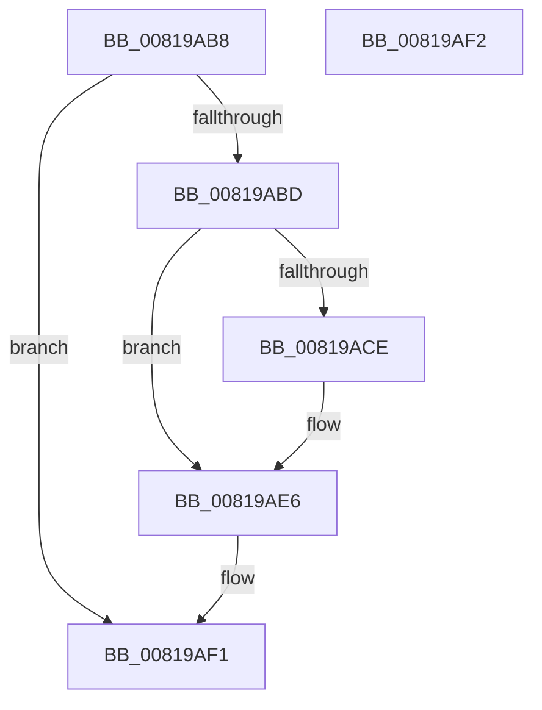

# AslUnicodeStringFree

- RVA: `0x00819AB8`–`0x00819AF3` (길이 `59` bytes)
- VA: `0x0000000140819AB8`
- 실행 섹션: `PAGE`
- PDB 이름 있음: `예`; PDB Function 태그: `아니요`
- unwind 정보 RVA: `0x000805BC`
- 디코드: `19`개 명령, `59/59` bytes 표시
- 미해석 바이트: `0` (있으면 어셈블리에 `.byte`로 보존)

> 이 문서는 커널 이미지의 기계어와 PDB 기호를 분석해 생성했습니다. 4번과 5번은 함수 원형과 자료형을 바이너리 사용 방식에서 추정한 C 해석이며 원본 소스 복구 결과는 아닙니다.

## 1. Dependencies

- 직접 호출 지점: **2**; 고유 호출 대상: **2**
- 직접 호출자로 확인된 함수: **1**
- RIP 상대 이미지 참조: **0**

### Outgoing calls
- `0x00819AD8` → [memset](../../text/6C/memset_function_006C6C40.md) (function, `0x006C6C40`)
- `0x00819AE1` → [AslFree](../95/AslFree_function_0095B674.md) (function, `0x0095B674`)

### Direct callers
- [SdbResolveDatabaseEx](SdbResolveDatabaseEx_function_00817A54.md) at `0x00817D6F`

### Static image references
- 디코드된 RIP-relative 메모리 참조가 없습니다.

## 2. Other-region calls and transfers

- 다른 실행 섹션으로 향하는 call: **1**
  - `0x00819AD8` → [memset](../../text/6C/memset_function_006C6C40.md) (`PAGE` → `.text`)
- 별도 외부 분기/꼬리 이동을 확인하지 못했습니다.

## 3. Assembly (complete function range)

```asm
00819AB8  48 85 C9                        test rcx, rcx
00819ABB  74 34                           je 0x140819af1
00819ABD  53                              push rbx
00819ABE  48 83 EC 20                     sub rsp, 0x20
00819AC2  48 8B D9                        mov rbx, rcx
00819AC5  48 8B 49 08                     mov rcx, qword ptr [rcx + 8]
00819AC9  48 85 C9                        test rcx, rcx
00819ACC  74 18                           je 0x140819ae6
00819ACE  44 0F B7 43 02                  movzx r8d, word ptr [rbx + 2]
00819AD3  BA 42 00 00 00                  mov edx, 0x42
00819AD8  E8 63 D1 EA FF                  call 0x1406c6c40
00819ADD  48 8B 53 08                     mov rdx, qword ptr [rbx + 8]
00819AE1  E8 8E 1B 14 00                  call 0x14095b674
00819AE6  0F 57 C0                        xorps xmm0, xmm0
00819AE9  0F 11 03                        movups xmmword ptr [rbx], xmm0
00819AEC  48 83 C4 20                     add rsp, 0x20
00819AF0  5B                              pop rbx
00819AF1  C3                              ret
00819AF2  CC                              int3
```

## 4. C-style interpretation (structured pseudocode)

```c
__int64 __fastcall AslUnicodeStringFree(__int64 a1)
{
    __int64 result;
    __int64 v_rsp;

    if (a1 == 0) goto loc_00819AF1;
    v_rsp = (v_rsp) - (32);
    if (*(unsigned __int64 *)(a1 + 8) != 0) {
        a3 = *(unsigned __int16 *)(a1 + 2);
        a2 = 66;
        result = memset(*(unsigned __int64 *)(a1 + 8), a2, a3, a4);
        a2 = *(unsigned __int64 *)(a1 + 8);
        result = AslFree(*(unsigned __int64 *)(a1 + 8), a2, a3, a4);
    }
    *(unsigned __int64 *)(a1) = v_xmm0;
    v_rsp = (v_rsp) + (32);
loc_00819AF1:
    return result;
}
```

## 5. (Beta) C Style

```c
int64_t AslUnicodeStringFree(int64_t Arg1)
{
    int64_t result;
    int64_t local_rsp;

    if (Arg1 == 0) goto loc_00819AF1;
    local_rsp = (local_rsp) - (32);
    if (*(uint64_t *)(Arg1 + 0x8) != 0) {
        a3 = *(uint16_t *)(Arg1 + 0x2);
        a2 = 66;
        result = memset(*(uint64_t *)(Arg1 + 0x8), a2, a3, a4);
        a2 = *(uint64_t *)(Arg1 + 0x8);
        result = AslFree(*(uint64_t *)(Arg1 + 0x8), a2, a3, a4);
    }
    *(uint64_t *)(Arg1) = v_xmm0;
    local_rsp = (local_rsp) + (32);
loc_00819AF1:
    return result;
}
```

## 6. Execution-region graph

[열기: 2D/3D 그래프와 함수 탐색 컨트롤 패널](../../../control-panel.html?section=page&rva=0x00819AB8&view=graph)

- 2D 그래프는 위에서 아래로 흐르고, 3D 그래프는 빈 공간을 드래그해 회전합니다. Shift+드래그는 이동, 휠은 확대·축소, 함수 노드 선택은 대상 보고서 이동입니다.

### Static fallback


