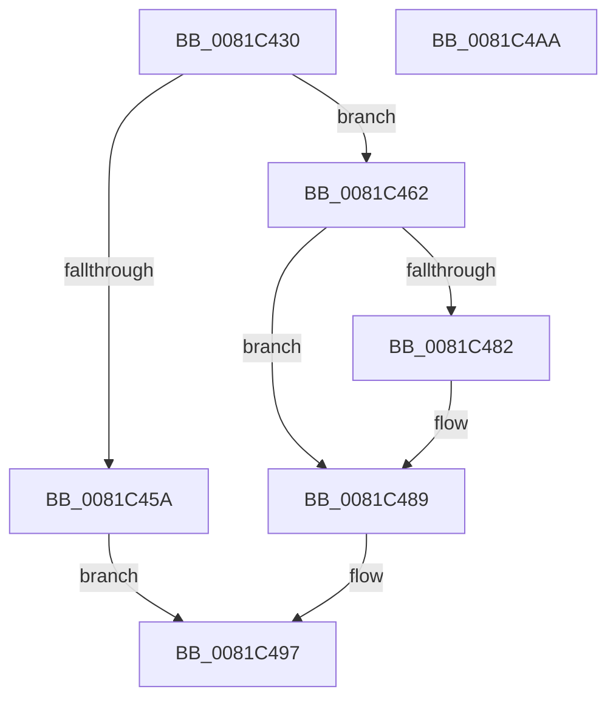

# AslpAllocMatchNode

- RVA: `0x0081C430`–`0x0081C4AB` (길이 `123` bytes)
- VA: `0x000000014081C430`
- 실행 섹션: `PAGE`
- PDB 이름 있음: `예`; PDB Function 태그: `아니요`
- unwind 정보 RVA: `0x00060BC4`
- 디코드: `36`개 명령, `123/123` bytes 표시
- 미해석 바이트: `0` (있으면 어셈블리에 `.byte`로 보존)

> 이 문서는 커널 이미지의 기계어와 PDB 기호를 분석해 생성했습니다. 4번과 5번은 함수 원형과 자료형을 바이너리 사용 방식에서 추정한 C 해석이며 원본 소스 복구 결과는 아닙니다.

## 1. Dependencies

- 직접 호출 지점: **1**; 고유 호출 대상: **1**
- 직접 호출자로 확인된 함수: **1**
- RIP 상대 이미지 참조: **0**

### Outgoing calls
- `0x0081C44D` → [AslAlloc](../95/AslAlloc_function_0095BD34.md) (function, `0x0095BD34`)

### Direct callers
- [AslpParsePattern](AslpParsePattern_function_0081C570.md) at `0x0081C5CB`
- [AslpParsePattern](AslpParsePattern_function_0081C570.md) at `0x0081C5FD`

### Static image references
- 디코드된 RIP-relative 메모리 참조가 없습니다.

## 2. Other-region calls and transfers

- 다른 실행 섹션으로 향하는 call: **0**
- 별도 외부 분기/꼬리 이동을 확인하지 못했습니다.

## 3. Assembly (complete function range)

```asm
0081C430  48 89 5C 24 08                  mov qword ptr [rsp + 8], rbx
0081C435  48 89 74 24 10                  mov qword ptr [rsp + 0x10], rsi
0081C43A  57                              push rdi
0081C43B  48 83 EC 20                     sub rsp, 0x20
0081C43F  48 8B FA                        mov rdi, rdx
0081C442  49 8B D8                        mov rbx, r8
0081C445  BA 30 00 00 00                  mov edx, 0x30
0081C44A  48 8B F1                        mov rsi, rcx
0081C44D  E8 E2 F8 13 00                  call 0x14095bd34
0081C452  45 33 C9                        xor r9d, r9d
0081C455  48 85 C0                        test rax, rax
0081C458  75 08                           jne 0x14081c462
0081C45A  41 B9 17 00 00 C0               mov r9d, 0xc0000017
0081C460  EB 35                           jmp 0x14081c497
0081C462  48 89 40 08                     mov qword ptr [rax + 8], rax
0081C466  48 89 00                        mov qword ptr [rax], rax
0081C469  44 89 48 28                     mov dword ptr [rax + 0x28], r9d
0081C46D  4C 89 48 20                     mov qword ptr [rax + 0x20], r9
0081C471  48 89 78 18                     mov qword ptr [rax + 0x18], rdi
0081C475  48 89 70 10                     mov qword ptr [rax + 0x10], rsi
0081C479  48 8B 0B                        mov rcx, qword ptr [rbx]
0081C47C  48 39 59 08                     cmp qword ptr [rcx + 8], rbx
0081C480  74 07                           je 0x14081c489
0081C482  B9 03 00 00 00                  mov ecx, 3
0081C487  CD 29                           int 0x29
0081C489  48 89 08                        mov qword ptr [rax], rcx
0081C48C  48 89 58 08                     mov qword ptr [rax + 8], rbx
0081C490  48 89 41 08                     mov qword ptr [rcx + 8], rax
0081C494  48 89 03                        mov qword ptr [rbx], rax
0081C497  48 8B 5C 24 30                  mov rbx, qword ptr [rsp + 0x30]
0081C49C  41 8B C1                        mov eax, r9d
0081C49F  48 8B 74 24 38                  mov rsi, qword ptr [rsp + 0x38]
0081C4A4  48 83 C4 20                     add rsp, 0x20
0081C4A8  5F                              pop rdi
0081C4A9  C3                              ret
0081C4AA  CC                              int3
```

## 4. C-style interpretation (structured pseudocode)

```c
__int64 __fastcall AslpAllocMatchNode(__int64 a1, __int64 a2, __int64 a3, int a4)
{
    __int64 result;
    __int64 v_rsp;
    unsigned __int64 v_stack_p10;
    unsigned __int64 v_stack_p8;

    v_stack_p8 = v_rbx;
    v_stack_p10 = v_rsi;
    v_rsp = (v_rsp) - (32);
    result = AslAlloc(a1, 48, a3, a4);
    a4 = 0;
    if (result != 0) goto loc_0081C462;
    goto loc_0081C497;
loc_0081C462:
    *(unsigned __int64 *)(result + 8) = result;
    *(unsigned __int64 *)(result) = result;
    *(unsigned int *)(result + 40) = (unsigned int)((unsigned int)(0xC0000017ULL));
    *(unsigned __int64 *)(result + 32) = (unsigned int)(0xC0000017ULL);
    *(unsigned __int64 *)(result + 24) = a2;
    *(unsigned __int64 *)(result + 16) = a1;
    if ((*(unsigned __int64 *)(*(unsigned __int64 *)(a3) + 8)) != a3) {
        a1 = 3;
    }
    *(unsigned __int64 *)(result) = a1;
    *(unsigned __int64 *)(result + 8) = a3;
    *(unsigned __int64 *)(a1 + 8) = result;
    *(unsigned __int64 *)(a3) = result;
loc_0081C497:
    v_rsp = (v_rsp) + (32);
    return (unsigned int)((unsigned int)((unsigned int)(0xC0000017ULL)));
}
```

## 5. (Beta) C Style

```c
int64_t AslpAllocMatchNode(int64_t Arg1, int64_t Arg2, void *Arg3, int32_t Arg4)
{
    uint8_t *arg3 = (uint8_t *)Arg3;

    int64_t result;
    int64_t local_rsp;
    uint64_t v_stack_p10;
    uint64_t v_stack_p8;

    v_stack_p8 = local_rbx;
    v_stack_p10 = local_rsi;
    local_rsp = (local_rsp) - (32);
    result = AslAlloc(Arg1, 48, Arg3, Arg4);
    Arg4 = 0;
    if (result != 0) goto loc_0081C462;
    goto loc_0081C497;
loc_0081C462:
    *(uint64_t *)(result + 0x8) = result;
    *(uint64_t *)(result) = result;
    *(uint32_t *)(result + 0x28) = (uint32_t)((uint32_t)(0xC0000017ULL));
    *(uint64_t *)(result + 0x20) = (uint32_t)(0xC0000017ULL);
    *(uint64_t *)(result + 0x18) = Arg2;
    *(uint64_t *)(result + 0x10) = Arg1;
    if ((*(uint64_t *)(*(uint64_t *)(arg3) + 0x8)) != Arg3) {
        Arg1 = 3;
    }
    *(uint64_t *)(result) = Arg1;
    *(void **)(result + 0x8) = Arg3;
    *(uint64_t *)(Arg1 + 0x8) = result;
    *(uint64_t *)(arg3) = result;
loc_0081C497:
    local_rsp = (local_rsp) + (32);
    return (uint32_t)((uint32_t)((uint32_t)(0xC0000017ULL)));
}
```

### 관측된 메모리 오프셋

구조체 형식이 확인되지 않은 접근은 인자 기준의 오프셋으로만 기록했습니다.

| 기준 인자 | 오프셋 표현 | 폭 (bit) | 접근 |
|---|---:|---:|---|
| `Arg3` | `+ 0x0` | `64` | `R` |
| `Arg3` | `+ 0x0` | `64` | `W` |

## 6. Execution-region graph

[열기: 2D/3D 그래프와 함수 탐색 컨트롤 패널](../../../control-panel.html?section=page&rva=0x0081C430&view=graph)

- 2D 그래프는 위에서 아래로 흐르고, 3D 그래프는 빈 공간을 드래그해 회전합니다. Shift+드래그는 이동, 휠은 확대·축소, 함수 노드 선택은 대상 보고서 이동입니다.

### Static fallback


