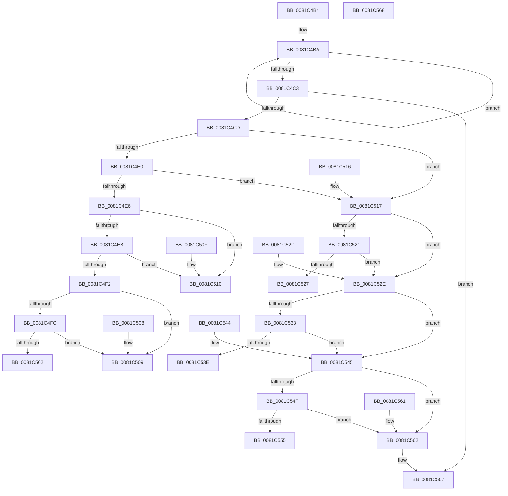

# AslpDetermineDosPathNameType

- RVA: `0x0081C4B4`–`0x0081C569` (길이 `181` bytes)
- VA: `0x000000014081C4B4`
- 실행 섹션: `PAGE`
- PDB 이름 있음: `예`; PDB Function 태그: `아니요`
- unwind 정보 RVA: `0x000DB714`
- 디코드: `62`개 명령, `181/181` bytes 표시
- 미해석 바이트: `0` (있으면 어셈블리에 `.byte`로 보존)

> 이 문서는 커널 이미지의 기계어와 PDB 기호를 분석해 생성했습니다. 4번과 5번은 함수 원형과 자료형을 바이너리 사용 방식에서 추정한 C 해석이며 원본 소스 복구 결과는 아닙니다.

## 1. Dependencies

- 직접 호출 지점: **0**; 고유 호출 대상: **0**
- 직접 호출자로 확인된 함수: **1**
- RIP 상대 이미지 참조: **0**

### Outgoing calls
- 직접 디코드된 call 명령이 없습니다.

### Direct callers
- [AslPathToNetworkPathNt](AslPathToNetworkPathNt_function_0081B2A4.md) at `0x0081B2CB`

### Static image references
- 디코드된 RIP-relative 메모리 참조가 없습니다.

## 2. Other-region calls and transfers

- 다른 실행 섹션으로 향하는 call: **0**
- 별도 외부 분기/꼬리 이동을 확인하지 못했습니다.

## 3. Assembly (complete function range)

```asm
0081C4B4  48 83 CA FF                     or rdx, 0xffffffffffffffff
0081C4B8  33 C0                           xor eax, eax
0081C4BA  48 FF C2                        inc rdx
0081C4BD  66 39 04 51                     cmp word ptr [rcx + rdx*2], ax
0081C4C1  75 F7                           jne 0x14081c4ba
0081C4C3  48 83 FA 04                     cmp rdx, 4
0081C4C7  0F 86 9A 00 00 00               jbe 0x14081c567
0081C4CD  0F B7 11                        movzx edx, word ptr [rcx]
0081C4D0  66 41 B9 5C 00                  mov r9w, 0x5c
0081C4D5  66 41 B8 2F 00                  mov r8w, 0x2f
0081C4DA  66 41 3B D1                     cmp dx, r9w
0081C4DE  74 37                           je 0x14081c517
0081C4E0  66 41 3B D0                     cmp dx, r8w
0081C4E4  74 31                           je 0x14081c517
0081C4E6  66 85 D2                        test dx, dx
0081C4E9  74 25                           je 0x14081c510
0081C4EB  66 83 79 02 3A                  cmp word ptr [rcx + 2], 0x3a
0081C4F0  75 1E                           jne 0x14081c510
0081C4F2  0F B7 41 04                     movzx eax, word ptr [rcx + 4]
0081C4F6  66 41 3B C1                     cmp ax, r9w
0081C4FA  74 0D                           je 0x14081c509
0081C4FC  66 41 3B C0                     cmp ax, r8w
0081C500  74 07                           je 0x14081c509
0081C502  B8 03 00 00 00                  mov eax, 3
0081C507  C3                              ret
0081C508  CC                              int3
0081C509  B8 02 00 00 00                  mov eax, 2
0081C50E  C3                              ret
0081C50F  CC                              int3
0081C510  B8 05 00 00 00                  mov eax, 5
0081C515  C3                              ret
0081C516  CC                              int3
0081C517  0F B7 41 02                     movzx eax, word ptr [rcx + 2]
0081C51B  66 41 3B C1                     cmp ax, r9w
0081C51F  74 0D                           je 0x14081c52e
0081C521  66 41 3B C0                     cmp ax, r8w
0081C525  74 07                           je 0x14081c52e
0081C527  B8 04 00 00 00                  mov eax, 4
0081C52C  C3                              ret
0081C52D  CC                              int3
0081C52E  0F B7 41 04                     movzx eax, word ptr [rcx + 4]
0081C532  66 83 F8 2E                     cmp ax, 0x2e
0081C536  74 0D                           je 0x14081c545
0081C538  66 83 F8 3F                     cmp ax, 0x3f
0081C53C  74 07                           je 0x14081c545
0081C53E  B8 01 00 00 00                  mov eax, 1
0081C543  C3                              ret
0081C544  CC                              int3
0081C545  0F B7 41 06                     movzx eax, word ptr [rcx + 6]
0081C549  66 41 3B C1                     cmp ax, r9w
0081C54D  74 13                           je 0x14081c562
0081C54F  66 41 3B C0                     cmp ax, r8w
0081C553  74 0D                           je 0x14081c562
0081C555  66 F7 D8                        neg ax
0081C558  1B C0                           sbb eax, eax
0081C55A  83 E0 FA                        and eax, 0xfffffffa
0081C55D  83 C0 07                        add eax, 7
0081C560  C3                              ret
0081C561  CC                              int3
0081C562  B8 06 00 00 00                  mov eax, 6
0081C567  C3                              ret
0081C568  CC                              int3
```

## 4. C-style interpretation (structured pseudocode)

```c
__int64 __fastcall AslpDetermineDosPathNameType(__int64 a1, __int64 a2)
{
    __int64 result;

    a2 = (a2) | (-1);
    result = 0;
loc_0081C4BA:
    a2 = (a2) + 1;
    if ((*(unsigned __int16 *)(a1 + a2 * 2)) != 0) goto loc_0081C4BA;
    if (a2 <= 4) goto loc_0081C567;
    if (((unsigned __int16)(*(unsigned __int16 *)(a1))) == 92) goto loc_0081C517;
    if (((unsigned __int16)(*(unsigned __int16 *)(a1))) == 47) goto loc_0081C517;
    if ((unsigned __int16)(*(unsigned __int16 *)(a1)) == 0) goto loc_0081C510;
    if ((*(unsigned __int16 *)(a1 + 2)) != 58) goto loc_0081C510;
    if (((unsigned __int16)(*(unsigned __int16 *)(a1 + 4))) == 92) goto loc_0081C509;
    if (((unsigned __int16)(*(unsigned __int16 *)(a1 + 4))) == 47) goto loc_0081C509;
    return 3;
loc_0081C509:
    return 2;
loc_0081C510:
    return 5;
loc_0081C517:
    if (((unsigned __int16)(*(unsigned __int16 *)(a1 + 2))) == 92) goto loc_0081C52E;
    if (((unsigned __int16)(*(unsigned __int16 *)(a1 + 2))) == 47) goto loc_0081C52E;
    return 4;
loc_0081C52E:
    if (((unsigned __int16)(*(unsigned __int16 *)(a1 + 4))) == 46) goto loc_0081C545;
    if (((unsigned __int16)(*(unsigned __int16 *)(a1 + 4))) == 63) goto loc_0081C545;
    return 1;
loc_0081C545:
    if (((unsigned __int16)(*(unsigned __int16 *)(a1 + 6))) == 92) goto loc_0081C562;
    if (((unsigned __int16)(*(unsigned __int16 *)(a1 + 6))) == 47) goto loc_0081C562;
    result = (unsigned __int16)(-(*(unsigned __int16 *)(a1 + 6)));
    result = (unsigned int)((result) & (0xFFFFFFFAULL));
    result = (unsigned int)((result) + (7));
    return result;
loc_0081C562:
loc_0081C567:
    return 6;
}
```

## 5. (Beta) C Style

```c
int64_t AslpDetermineDosPathNameType(void *Arg1, int64_t Arg2)
{
    uint8_t *arg1 = (uint8_t *)Arg1;

    int64_t result;

    Arg2 = (Arg2) | (-1);
    result = 0;
loc_0081C4BA:
    Arg2 = (Arg2) + 1;
    if ((*(uint16_t *)(arg1 + Arg2 * 2)) != 0) goto loc_0081C4BA;
    if (Arg2 <= 4) goto loc_0081C567;
    if (((uint16_t)(*(uint16_t *)(arg1))) == 92) goto loc_0081C517;
    if (((uint16_t)(*(uint16_t *)(arg1))) == 47) goto loc_0081C517;
    if ((uint16_t)(*(uint16_t *)(arg1)) == 0) goto loc_0081C510;
    if ((*(uint16_t *)(arg1 + 0x2)) != 58) goto loc_0081C510;
    if (((uint16_t)(*(uint16_t *)(arg1 + 0x4))) == 92) goto loc_0081C509;
    if (((uint16_t)(*(uint16_t *)(arg1 + 0x4))) == 47) goto loc_0081C509;
    return 3;
loc_0081C509:
    return 2;
loc_0081C510:
    return 5;
loc_0081C517:
    if (((uint16_t)(*(uint16_t *)(arg1 + 0x2))) == 92) goto loc_0081C52E;
    if (((uint16_t)(*(uint16_t *)(arg1 + 0x2))) == 47) goto loc_0081C52E;
    return 4;
loc_0081C52E:
    if (((uint16_t)(*(uint16_t *)(arg1 + 0x4))) == 46) goto loc_0081C545;
    if (((uint16_t)(*(uint16_t *)(arg1 + 0x4))) == 63) goto loc_0081C545;
    return 1;
loc_0081C545:
    if (((uint16_t)(*(uint16_t *)(arg1 + 0x6))) == 92) goto loc_0081C562;
    if (((uint16_t)(*(uint16_t *)(arg1 + 0x6))) == 47) goto loc_0081C562;
    result = (uint16_t)(-(*(uint16_t *)(arg1 + 0x6)));
    result = (uint32_t)((result) & (0xFFFFFFFAULL));
    result = (uint32_t)((result) + (7));
    return result;
loc_0081C562:
loc_0081C567:
    return 6;
}
```

### 관측된 메모리 오프셋

구조체 형식이 확인되지 않은 접근은 인자 기준의 오프셋으로만 기록했습니다.

| 기준 인자 | 오프셋 표현 | 폭 (bit) | 접근 |
|---|---:|---:|---|
| `Arg1` | `+ 0x0` | `16` | `R` |
| `Arg1` | `+ 0x0 + rdx*2` | `16` | `R` |
| `Arg1` | `+ 0x2` | `16` | `R` |
| `Arg1` | `+ 0x4` | `16` | `R` |
| `Arg1` | `+ 0x6` | `16` | `R` |

## 6. Execution-region graph

[열기: 2D/3D 그래프와 함수 탐색 컨트롤 패널](../../../control-panel.html?section=page&rva=0x0081C4B4&view=graph)

- 2D 그래프는 위에서 아래로 흐르고, 3D 그래프는 빈 공간을 드래그해 회전합니다. Shift+드래그는 이동, 휠은 확대·축소, 함수 노드 선택은 대상 보고서 이동입니다.

### Static fallback


