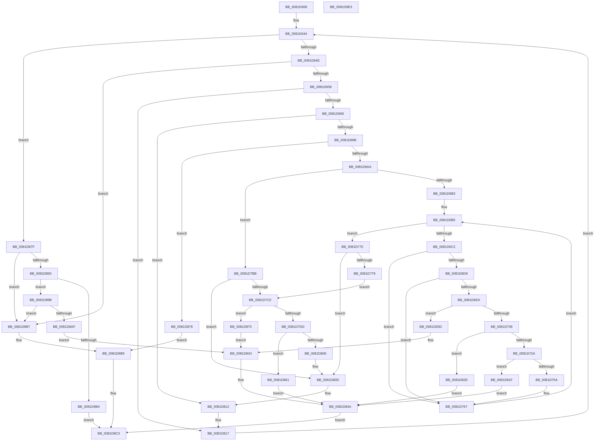

# AslpEnvResolveVars

- RVA: `0x0081D608`–`0x0081D8E4` (길이 `732` bytes)
- VA: `0x000000014081D608`
- 실행 섹션: `PAGE`
- PDB 이름 있음: `예`; PDB Function 태그: `아니요`
- unwind 정보 RVA: `0x000C397C`
- 디코드: `174`개 명령, `732/732` bytes 표시
- 미해석 바이트: `0` (있으면 어셈블리에 `.byte`로 보존)

> 이 문서는 커널 이미지의 기계어와 PDB 기호를 분석해 생성했습니다. 4번과 5번은 함수 원형과 자료형을 바이너리 사용 방식에서 추정한 C 해석이며 원본 소스 복구 결과는 아닙니다.

## 1. Dependencies

- 직접 호출 지점: **9**; 고유 호출 대상: **4**
- 직접 호출자로 확인된 함수: **1**
- RIP 상대 이미지 참조: **6**

### Outgoing calls
- `0x0081D677` → [wcsnicmp](../../text/50/wcsnicmp_function_005001C0.md) (function, `0x005001C0`)
- `0x0081D6F7` → [RtlStringCchCopyW](../../text/26/RtlStringCchCopyW_function_0026E9A4.md) (function, `0x0026E9A4`)
- `0x0081D71B` → [RtlStringCchCatW](../../text/4C/RtlStringCchCatW_function_004C7500.md) (function, `0x004C7500`)
- `0x0081D74B` → [RtlStringCchCatW](../../text/4C/RtlStringCchCatW_function_004C7500.md) (function, `0x004C7500`)
- `0x0081D7A9` → [AslLogCallPrintf](../95/AslLogCallPrintf_function_0095E4EC.md) (function, `0x0095E4EC`)
- `0x0081D7CE` → [RtlStringCchCopyW](../../text/26/RtlStringCchCopyW_function_0026E9A4.md) (function, `0x0026E9A4`)
- `0x0081D7FB` → [RtlStringCchCatW](../../text/4C/RtlStringCchCatW_function_004C7500.md) (function, `0x004C7500`)
- `0x0081D85A` → [AslLogCallPrintf](../95/AslLogCallPrintf_function_0095E4EC.md) (function, `0x0095E4EC`)
- `0x0081D8A4` → [RtlStringCchCopyW](../../text/26/RtlStringCchCopyW_function_0026E9A4.md) (function, `0x0026E9A4`)

### Direct callers
- [AslEnvExpandStrings2](AslEnvExpandStrings2_function_0081CECC.md) at `0x0081CF52`
- [AslEnvExpandStrings2](AslEnvExpandStrings2_function_0081CECC.md) at `0x0081CFFC`

### Static image references
- `0x0081D63A` → RVA `0x00000000` (`image boundary/outside`; read)
- `0x0081D6EA` → RVA `0x0003F7E0` (`.rdata`; read)
- `0x0081D781` → RVA `0x0003F5F0` (`.rdata`; read)
- `0x0081D790` → RVA `0x0003F5D8` (`.rdata`; read)
- `0x0081D81F` → RVA `0x0003DCB0` (`.rdata`; read)
- `0x0081D843` → RVA `0x0003E680` (`.rdata`; read)

## 2. Other-region calls and transfers

- 다른 실행 섹션으로 향하는 call: **7**
  - `0x0081D677` → [wcsnicmp](../../text/50/wcsnicmp_function_005001C0.md) (`PAGE` → `.text`)
  - `0x0081D6F7` → [RtlStringCchCopyW](../../text/26/RtlStringCchCopyW_function_0026E9A4.md) (`PAGE` → `.text`)
  - `0x0081D71B` → [RtlStringCchCatW](../../text/4C/RtlStringCchCatW_function_004C7500.md) (`PAGE` → `.text`)
  - `0x0081D74B` → [RtlStringCchCatW](../../text/4C/RtlStringCchCatW_function_004C7500.md) (`PAGE` → `.text`)
  - `0x0081D7CE` → [RtlStringCchCopyW](../../text/26/RtlStringCchCopyW_function_0026E9A4.md) (`PAGE` → `.text`)
  - `0x0081D7FB` → [RtlStringCchCatW](../../text/4C/RtlStringCchCatW_function_004C7500.md) (`PAGE` → `.text`)
  - `0x0081D8A4` → [RtlStringCchCopyW](../../text/26/RtlStringCchCopyW_function_0026E9A4.md) (`PAGE` → `.text`)
- 별도 외부 분기/꼬리 이동을 확인하지 못했습니다.

## 3. Assembly (complete function range)

```asm
0081D608  48 8B C4                        mov rax, rsp
0081D60B  48 89 58 10                     mov qword ptr [rax + 0x10], rbx
0081D60F  48 89 68 18                     mov qword ptr [rax + 0x18], rbp
0081D613  48 89 70 20                     mov qword ptr [rax + 0x20], rsi
0081D617  48 89 48 08                     mov qword ptr [rax + 8], rcx
0081D61B  57                              push rdi
0081D61C  41 54                           push r12
0081D61E  41 55                           push r13
0081D620  41 56                           push r14
0081D622  41 57                           push r15
0081D624  48 83 EC 40                     sub rsp, 0x40
0081D628  33 DB                           xor ebx, ebx
0081D62A  45 8B E9                        mov r13d, r9d
0081D62D  45 33 FF                        xor r15d, r15d
0081D630  33 F6                           xor esi, esi
0081D632  8B EA                           mov ebp, edx
0081D634  45 33 F6                        xor r14d, r14d
0081D637  4D 8B E0                        mov r12, r8
0081D63A  48 8D 15 BF 29 7E FF            lea rdx, [rip - 0x81d641]
0081D641  4C 8B C9                        mov r9, rcx
0081D644  49 83 FE 04                     cmp r14, 4
0081D648  0F 83 31 02 00 00               jae 0x14081d87f
0081D64E  85 DB                           test ebx, ebx
0081D650  0F 85 61 02 00 00               jne 0x14081d8b7
0081D656  4B 8D 04 76                     lea rax, [r14 + r14*2]
0081D65A  8B 8C C2 10 A2 E0 00            mov ecx, dword ptr [rdx + rax*8 + 0xe0a210]
0081D661  3B E9                           cmp ebp, ecx
0081D663  0F 86 AE 01 00 00               jbe 0x14081d817
0081D669  48 8B 94 C2 00 A2 E0 00         mov rdx, qword ptr [rdx + rax*8 + 0xe0a200]
0081D671  44 8B C1                        mov r8d, ecx
0081D674  49 8B C9                        mov rcx, r9
0081D677  E8 44 2B CE FF                  call 0x1405001c0
0081D67C  48 8D 15 7D 29 7E FF            lea rdx, [rip - 0x81d683]
0081D683  85 C0                           test eax, eax
0081D685  0F 85 87 01 00 00               jne 0x14081d812
0081D68B  4F 8D 1C 76                     lea r11, [r14 + r14*2]
0081D68F  42 8B B4 DA 14 A2 E0 00         mov esi, dword ptr [rdx + r11*8 + 0xe0a214]
0081D697  42 2B B4 DA 10 A2 E0 00         sub esi, dword ptr [rdx + r11*8 + 0xe0a210]
0081D69F  03 F5                           add esi, ebp
0081D6A1  41 3B F5                        cmp esi, r13d
0081D6A4  0F 87 CE 01 00 00               ja 0x14081d878
0081D6AA  4D 85 F6                        test r14, r14
0081D6AD  0F 85 08 01 00 00               jne 0x14081d7bb
0081D6B3  33 FF                           xor edi, edi
0081D6B5  48 81 FF 80 00 00 00            cmp rdi, 0x80
0081D6BC  0F 83 AE 00 00 00               jae 0x14081d770
0081D6C2  0F B7 84 24 90 00 00 00         movzx eax, word ptr [rsp + 0x90]
0081D6CA  66 39 84 17 80 A1 E0 00         cmp word ptr [rdi + rdx + 0xe0a180], ax
0081D6D2  0F 85 8F 00 00 00               jne 0x14081d767
0081D6D8  0F B7 84 24 98 00 00 00         movzx eax, word ptr [rsp + 0x98]
0081D6E0  66 39 84 17 82 A1 E0 00         cmp word ptr [rdi + rdx + 0xe0a182], ax
0081D6E8  75 7D                           jne 0x14081d767
0081D6EA  4C 8D 05 EF 20 82 FF            lea r8, [rip - 0x7ddf11]
0081D6F1  49 8B D5                        mov rdx, r13
0081D6F4  49 8B CC                        mov rcx, r12
0081D6F7  E8 A8 12 A5 FF                  call 0x14026e9a4
0081D6FC  8B D8                           mov ebx, eax
0081D6FE  85 C0                           test eax, eax
0081D700  0F 88 37 01 00 00               js 0x14081d83d
0081D706  48 8D 05 F3 28 7E FF            lea rax, [rip - 0x81d70d]
0081D70D  49 8B D5                        mov rdx, r13
0081D710  4C 8B 84 07 88 A1 E0 00         mov r8, qword ptr [rdi + rax + 0xe0a188]
0081D718  49 8B CC                        mov rcx, r12
0081D71B  E8 E0 9D CA FF                  call 0x1404c7500
0081D720  8B D8                           mov ebx, eax
0081D722  85 C0                           test eax, eax
0081D724  0F 88 04 01 00 00               js 0x14081d82e
0081D72A  48 8D 0D CF 28 7E FF            lea rcx, [rip - 0x81d731]
0081D731  49 8B D5                        mov rdx, r13
0081D734  4B 8D 04 76                     lea rax, [r14 + r14*2]
0081D738  8B 84 C1 10 A2 E0 00            mov eax, dword ptr [rcx + rax*8 + 0xe0a210]
0081D73F  48 8B 4C 24 70                  mov rcx, qword ptr [rsp + 0x70]
0081D744  4C 8D 04 41                     lea r8, [rcx + rax*2]
0081D748  49 8B CC                        mov rcx, r12
0081D74B  E8 B0 9D CA FF                  call 0x1404c7500
0081D750  8B D8                           mov ebx, eax
0081D752  85 C0                           test eax, eax
0081D754  0F 88 C5 00 00 00               js 0x14081d81f
0081D75A  41 BF 01 00 00 00               mov r15d, 1
0081D760  48 8D 15 99 28 7E FF            lea rdx, [rip - 0x81d767]
0081D767  48 83 C7 10                     add rdi, 0x10
0081D76B  E9 45 FF FF FF                  jmp 0x14081d6b5
0081D770  45 85 FF                        test r15d, r15d
0081D773  0F 85 94 00 00 00               jne 0x14081d80d
0081D779  0F B7 8C 24 90 00 00 00         movzx ecx, word ptr [rsp + 0x90]
0081D781  4C 8D 0D 68 1E 82 FF            lea r9, [rip - 0x7de198]
0081D788  0F B7 84 24 98 00 00 00         movzx eax, word ptr [rsp + 0x98]
0081D790  48 8D 15 41 1E 82 FF            lea rdx, [rip - 0x7de1bf]
0081D797  89 44 24 28                     mov dword ptr [rsp + 0x28], eax
0081D79B  41 B8 D6 03 00 00               mov r8d, 0x3d6
0081D7A1  89 4C 24 20                     mov dword ptr [rsp + 0x20], ecx
0081D7A5  41 8D 4F 01                     lea ecx, [r15 + 1]
0081D7A9  E8 3E 0D 14 00                  call 0x14095e4ec
0081D7AE  4F 8D 1C 76                     lea r11, [r14 + r14*2]
0081D7B2  48 8D 15 47 28 7E FF            lea rdx, [rip - 0x81d7b9]
0081D7B9  EB 05                           jmp 0x14081d7c0
0081D7BB  45 85 FF                        test r15d, r15d
0081D7BE  75 4D                           jne 0x14081d80d
0081D7C0  4E 8B 84 DA 08 A2 E0 00         mov r8, qword ptr [rdx + r11*8 + 0xe0a208]
0081D7C8  49 8B CC                        mov rcx, r12
0081D7CB  49 8B D5                        mov rdx, r13
0081D7CE  E8 D1 11 A5 FF                  call 0x14026e9a4
0081D7D3  8B D8                           mov ebx, eax
0081D7D5  85 C0                           test eax, eax
0081D7D7  0F 88 93 00 00 00               js 0x14081d870
0081D7DD  48 8B 4C 24 70                  mov rcx, qword ptr [rsp + 0x70]
0081D7E2  48 8D 05 17 28 7E FF            lea rax, [rip - 0x81d7e9]
0081D7E9  42 8B 84 D8 10 A2 E0 00         mov eax, dword ptr [rax + r11*8 + 0xe0a210]
0081D7F1  49 8B D5                        mov rdx, r13
0081D7F4  4C 8D 04 41                     lea r8, [rcx + rax*2]
0081D7F8  49 8B CC                        mov rcx, r12
0081D7FB  E8 00 9D CA FF                  call 0x1404c7500
0081D800  8B D8                           mov ebx, eax
0081D802  85 C0                           test eax, eax
0081D804  78 5B                           js 0x14081d861
0081D806  48 8D 15 F3 27 7E FF            lea rdx, [rip - 0x81d80d]
0081D80D  BB 01 00 00 00                  mov ebx, 1
0081D812  4C 8B 4C 24 70                  mov r9, qword ptr [rsp + 0x70]
0081D817  49 FF C6                        inc r14
0081D81A  E9 25 FE FF FF                  jmp 0x14081d644
0081D81F  4C 8D 0D 8A 04 82 FF            lea r9, [rip - 0x7dfb76]
0081D826  41 B8 CB 03 00 00               mov r8d, 0x3cb
0081D82C  EB 1C                           jmp 0x14081d84a
0081D82E  4C 8D 0D 7B 04 82 FF            lea r9, [rip - 0x7dfb85]
0081D835  41 B8 C5 03 00 00               mov r8d, 0x3c5
0081D83B  EB 0D                           jmp 0x14081d84a
0081D83D  41 B8 BF 03 00 00               mov r8d, 0x3bf
0081D843  4C 8D 0D 36 0E 82 FF            lea r9, [rip - 0x7df1ca]
0081D84A  48 8D 15 87 1D 82 FF            lea rdx, [rip - 0x7de279]
0081D851  89 44 24 20                     mov dword ptr [rsp + 0x20], eax
0081D855  B9 01 00 00 00                  mov ecx, 1
0081D85A  E8 8D 0C 14 00                  call 0x14095e4ec
0081D85F  EB 62                           jmp 0x14081d8c3
0081D861  4C 8D 0D 48 04 82 FF            lea r9, [rip - 0x7dfbb8]
0081D868  41 B8 ED 03 00 00               mov r8d, 0x3ed
0081D86E  EB DA                           jmp 0x14081d84a
0081D870  41 B8 E7 03 00 00               mov r8d, 0x3e7
0081D876  EB CB                           jmp 0x14081d843
0081D878  BB 23 00 00 C0                  mov ebx, 0xc0000023
0081D87D  EB 3A                           jmp 0x14081d8b9
0081D87F  85 DB                           test ebx, ebx
0081D881  75 34                           jne 0x14081d8b7
0081D883  8B F5                           mov esi, ebp
0081D885  41 3B ED                        cmp ebp, r13d
0081D888  76 11                           jbe 0x14081d89b
0081D88A  48 8B 84 24 A0 00 00 00         mov rax, qword ptr [rsp + 0xa0]
0081D892  BB 23 00 00 C0                  mov ebx, 0xc0000023
0081D897  89 28                           mov dword ptr [rax], ebp
0081D899  EB 28                           jmp 0x14081d8c3
0081D89B  49 8B D5                        mov rdx, r13
0081D89E  4D 8B C1                        mov r8, r9
0081D8A1  49 8B CC                        mov rcx, r12
0081D8A4  E8 FB 10 A5 FF                  call 0x14026e9a4
0081D8A9  8B D8                           mov ebx, eax
0081D8AB  85 C0                           test eax, eax
0081D8AD  79 08                           jns 0x14081d8b7
0081D8AF  41 B8 0D 04 00 00               mov r8d, 0x40d
0081D8B5  EB 8C                           jmp 0x14081d843
0081D8B7  33 DB                           xor ebx, ebx
0081D8B9  48 8B 84 24 A0 00 00 00         mov rax, qword ptr [rsp + 0xa0]
0081D8C1  89 30                           mov dword ptr [rax], esi
0081D8C3  4C 8D 5C 24 40                  lea r11, [rsp + 0x40]
0081D8C8  8B C3                           mov eax, ebx
0081D8CA  49 8B 5B 38                     mov rbx, qword ptr [r11 + 0x38]
0081D8CE  49 8B 6B 40                     mov rbp, qword ptr [r11 + 0x40]
0081D8D2  49 8B 73 48                     mov rsi, qword ptr [r11 + 0x48]
0081D8D6  49 8B E3                        mov rsp, r11
0081D8D9  41 5F                           pop r15
0081D8DB  41 5E                           pop r14
0081D8DD  41 5D                           pop r13
0081D8DF  41 5C                           pop r12
0081D8E1  5F                              pop rdi
0081D8E2  C3                              ret
0081D8E3  CC                              int3
```

## 4. C-style interpretation (structured pseudocode)

```c
__int64 __fastcall AslpEnvResolveVars(__int64 a1, int a2, __int64 a3, int a4, unsigned __int16 a5, unsigned __int16 a6, __int64 a7)
{
    __int64 result;
    __int64 v_r14;
    __int64 v_r15;
    __int64 v_rbx;
    __int64 v_rdi;
    __int64 v_rsi;
    __int64 v_rsp;
    unsigned __int64 v_stack_m28;
    unsigned int v_stack_m40;
    unsigned int v_stack_m48;
    unsigned __int64 v_stack_p8;

    *(unsigned __int64 *)(v_rsp + 16) = v_rbx;
    *(unsigned __int64 *)(v_rsp + 24) = v_rbp;
    *(unsigned __int64 *)(v_rsp + 32) = v_rsi;
    *(unsigned __int64 *)(v_rsp + 8) = a1;
    v_rsp = (v_rsp) - (64);
    v_rbx = 0;
    v_r15 = 0;
    v_rsi = 0;
    v_r14 = 0;
loc_0081D644:
    if (0 >= 4) goto loc_0081D87F;
    if (0 != 0) goto loc_0081D8B7;
    if (((unsigned int)((unsigned int)(a2))) <= ((unsigned int)((unsigned int)(*(unsigned int *)(v_rip - 8508993 + v_r14 + v_r14 * 2 * 8 + 14721552))))) goto loc_0081D817;
    result = wcsnicmp(a1, *(unsigned __int64 *)(v_rip - 8508993 + v_r14 + v_r14 * 2 * 8 + 14721536), (unsigned int)((unsigned int)((unsigned int)(*(unsigned int *)(v_rip - 8508993 + v_r14 + v_r14 * 2 * 8 + 14721552)))), a1);
    if ((unsigned int)(result) != 0) goto loc_0081D812;
    v_rsi = (unsigned int)(((unsigned int)(*(unsigned int *)(v_rip - 8509059 + v_r14 + v_r14 * 2 * 8 + 14721556))) - (*(unsigned int *)(v_rip - 8509059 + v_r14 + v_r14 * 2 * 8 + 14721552)));
    v_rsi = (unsigned int)((v_rsi) + ((unsigned int)((unsigned int)(a2))));
    if (((unsigned int)(v_rsi)) > ((unsigned int)((unsigned int)(a4)))) goto loc_0081D878;
    if (0 != 0) goto loc_0081D7BB;
    v_rdi = 0;
loc_0081D6B5:
    if (0 >= 128) goto loc_0081D770;
    if ((*(unsigned __int16 *)(v_rdi + v_rip - 8509059 * 1 + 14721408)) != a5) goto loc_0081D767;
    if ((*(unsigned __int16 *)(v_rdi + v_rip - 8509059 * 1 + 14721410)) != a6) goto loc_0081D767;
    result = RtlStringCchCopyW(a3, (unsigned int)(a4), v_rip - 8249105, a1);
    if (sign_flag) goto loc_0081D83D;
    result = RtlStringCchCatW(a3, (unsigned int)(a4), *(unsigned __int64 *)(v_rdi + v_rip - 8509197 * 1 + 14721416), a1);
    if (sign_flag) goto loc_0081D82E;
    result = RtlStringCchCatW(a3, (unsigned int)(a4), v_stack_p8 + (unsigned int)(*(unsigned int *)(v_rip - 8509233 + v_r14 + v_r14 * 2 * 8 + 14721552)) * 2, a1);
    if (sign_flag) goto loc_0081D81F;
loc_0081D767:
    v_rdi = (v_rdi) + (16);
    goto loc_0081D6B5;
loc_0081D770:
    if (1 != 0) goto loc_0081D80D;
    v_stack_m40 = a6;
    v_stack_m48 = a5;
    result = AslLogCallPrintf(1 + 1, v_rip - 8249791, 982, v_rip - 8249752);
    goto loc_0081D7C0;
loc_0081D7BB:
    if (1 != 0) goto loc_0081D80D;
loc_0081D7C0:
    result = RtlStringCchCopyW(a3, (unsigned int)(a4), *(unsigned __int64 *)(v_rip - 8509369 + v_r14 + v_r14 * 2 * 8 + 14721544), v_rip - 8249752);
    if (sign_flag) goto loc_0081D870;
    result = RtlStringCchCatW(a3, (unsigned int)(a4), v_stack_p8 + (unsigned int)(*(unsigned int *)(v_rip - 8509417 + v_r14 + v_r14 * 2 * 8 + 14721552)) * 2, v_rip - 8249752);
    if (sign_flag) goto loc_0081D861;
loc_0081D80D:
loc_0081D812:
loc_0081D817:
    v_r14 = (v_r14) + 1;
    goto loc_0081D644;
loc_0081D81F:
    goto loc_0081D84A;
loc_0081D82E:
    goto loc_0081D84A;
loc_0081D83D:
loc_0081D843:
loc_0081D84A:
    v_stack_m48 = (unsigned int)(result);
    result = AslLogCallPrintf(1, v_rip - 8249977, 959, v_rip - 8253898);
    goto loc_0081D8C3;
loc_0081D861:
    goto loc_0081D84A;
loc_0081D870:
    goto loc_0081D843;
loc_0081D878:
    goto loc_0081D8B9;
loc_0081D87F:
    if ((unsigned int)((unsigned int)(0xC0000023ULL)) != 0) goto loc_0081D8B7;
    if (((unsigned int)((unsigned int)(a2))) <= ((unsigned int)((unsigned int)(a4)))) goto loc_0081D89B;
    *(unsigned int *)(a7) = (unsigned int)((unsigned int)(a2));
    goto loc_0081D8C3;
loc_0081D89B:
    result = RtlStringCchCopyW(a3, (unsigned int)(a4), v_rip - 8256440, v_rip - 8256440);
    if (!sign_flag) goto loc_0081D8B7;
    goto loc_0081D843;
loc_0081D8B7:
    v_rbx = 0;
loc_0081D8B9:
    *(unsigned int *)(a7) = (unsigned int)((unsigned int)((unsigned int)((unsigned int)(a2))));
loc_0081D8C3:
    return 0;
}
```

## 5. (Beta) C Style

```c
int64_t AslpEnvResolveVars(int64_t Arg1, int32_t Arg2, int64_t Arg3, int32_t Arg4, uint16_t Arg5, uint16_t Arg6, void *Arg7)
{
    uint8_t *arg7 = (uint8_t *)Arg7;

    int64_t result;
    int64_t local_r14;
    int64_t local_r15;
    int64_t local_rbx;
    int64_t local_rdi;
    int64_t local_rsi;
    int64_t local_rsp;
    uint64_t v_stack_m28;
    uint32_t v_stack_m40;
    uint32_t v_stack_m48;
    uint64_t v_stack_p8;

    *(uint64_t *)(local_rsp + 0x10) = local_rbx;
    *(uint64_t *)(local_rsp + 0x18) = local_rbp;
    *(uint64_t *)(local_rsp + 0x20) = local_rsi;
    *(uint64_t *)(local_rsp + 0x8) = Arg1;
    local_rsp = (local_rsp) - (64);
    local_rbx = 0;
    local_r15 = 0;
    local_rsi = 0;
    local_r14 = 0;
loc_0081D644:
    if (0 >= 4) goto loc_0081D87F;
    if (0 != 0) goto loc_0081D8B7;
    if (((uint32_t)((uint32_t)(Arg2))) <= ((uint32_t)((uint32_t)(*(uint32_t *)(v_rip - 0x81D641 + local_r14 + local_r14 * 2 * 8 + 0xE0A210))))) goto loc_0081D817;
    result = wcsnicmp(Arg1, *(uint64_t *)(v_rip - 0x81D641 + local_r14 + local_r14 * 2 * 8 + 0xE0A200), (uint32_t)((uint32_t)((uint32_t)(*(uint32_t *)(v_rip - 0x81D641 + local_r14 + local_r14 * 2 * 8 + 0xE0A210)))), Arg1);
    if ((uint32_t)(result) != 0) goto loc_0081D812;
    local_rsi = (uint32_t)(((uint32_t)(*(uint32_t *)(v_rip - 0x81D683 + local_r14 + local_r14 * 2 * 8 + 0xE0A214))) - (*(uint32_t *)(v_rip - 0x81D683 + local_r14 + local_r14 * 2 * 8 + 0xE0A210)));
    local_rsi = (uint32_t)((local_rsi) + ((uint32_t)((uint32_t)(Arg2))));
    if (((uint32_t)(local_rsi)) > ((uint32_t)((uint32_t)(Arg4)))) goto loc_0081D878;
    if (0 != 0) goto loc_0081D7BB;
    local_rdi = 0;
loc_0081D6B5:
    if (0 >= 128) goto loc_0081D770;
    if ((*(uint16_t *)(local_rdi + v_rip - 0x81D683 * 1 + 0xE0A180)) != Arg5) goto loc_0081D767;
    if ((*(uint16_t *)(local_rdi + v_rip - 0x81D683 * 1 + 0xE0A182)) != Arg6) goto loc_0081D767;
    result = RtlStringCchCopyW(Arg3, (uint32_t)(Arg4), v_rip - 8249105, Arg1);
    if (sign_flag) goto loc_0081D83D;
    result = RtlStringCchCatW(Arg3, (uint32_t)(Arg4), *(uint64_t *)(local_rdi + v_rip - 0x81D70D * 1 + 0xE0A188), Arg1);
    if (sign_flag) goto loc_0081D82E;
    result = RtlStringCchCatW(Arg3, (uint32_t)(Arg4), v_stack_p8 + (uint32_t)(*(uint32_t *)(v_rip - 0x81D731 + local_r14 + local_r14 * 2 * 8 + 0xE0A210)) * 2, Arg1);
    if (sign_flag) goto loc_0081D81F;
loc_0081D767:
    local_rdi = (local_rdi) + (16);
    goto loc_0081D6B5;
loc_0081D770:
    if (1 != 0) goto loc_0081D80D;
    v_stack_m40 = Arg6;
    v_stack_m48 = Arg5;
    result = AslLogCallPrintf(1 + 1, v_rip - 8249791, 982, v_rip - 8249752);
    goto loc_0081D7C0;
loc_0081D7BB:
    if (1 != 0) goto loc_0081D80D;
loc_0081D7C0:
    result = RtlStringCchCopyW(Arg3, (uint32_t)(Arg4), *(uint64_t *)(v_rip - 0x81D7B9 + local_r14 + local_r14 * 2 * 8 + 0xE0A208), v_rip - 8249752);
    if (sign_flag) goto loc_0081D870;
    result = RtlStringCchCatW(Arg3, (uint32_t)(Arg4), v_stack_p8 + (uint32_t)(*(uint32_t *)(v_rip - 0x81D7E9 + local_r14 + local_r14 * 2 * 8 + 0xE0A210)) * 2, v_rip - 8249752);
    if (sign_flag) goto loc_0081D861;
loc_0081D80D:
loc_0081D812:
loc_0081D817:
    local_r14 = (local_r14) + 1;
    goto loc_0081D644;
loc_0081D81F:
    goto loc_0081D84A;
loc_0081D82E:
    goto loc_0081D84A;
loc_0081D83D:
loc_0081D843:
loc_0081D84A:
    v_stack_m48 = (uint32_t)(result);
    result = AslLogCallPrintf(1, v_rip - 8249977, 959, v_rip - 8253898);
    goto loc_0081D8C3;
loc_0081D861:
    goto loc_0081D84A;
loc_0081D870:
    goto loc_0081D843;
loc_0081D878:
    goto loc_0081D8B9;
loc_0081D87F:
    if ((uint32_t)((uint32_t)(0xC0000023ULL)) != 0) goto loc_0081D8B7;
    if (((uint32_t)((uint32_t)(Arg2))) <= ((uint32_t)((uint32_t)(Arg4)))) goto loc_0081D89B;
    *(uint32_t *)(arg7) = (uint32_t)((uint32_t)(Arg2));
    goto loc_0081D8C3;
loc_0081D89B:
    result = RtlStringCchCopyW(Arg3, (uint32_t)(Arg4), v_rip - 8256440, v_rip - 8256440);
    if (!sign_flag) goto loc_0081D8B7;
    goto loc_0081D843;
loc_0081D8B7:
    local_rbx = 0;
loc_0081D8B9:
    *(uint32_t *)(arg7) = (uint32_t)((uint32_t)((uint32_t)((uint32_t)(Arg2))));
loc_0081D8C3:
    return 0;
}
```

### 관측된 메모리 오프셋

구조체 형식이 확인되지 않은 접근은 인자 기준의 오프셋으로만 기록했습니다.

| 기준 인자 | 오프셋 표현 | 폭 (bit) | 접근 |
|---|---:|---:|---|
| `Arg7` | `+ 0x0` | `32` | `W` |

## 6. Execution-region graph

[열기: 2D/3D 그래프와 함수 탐색 컨트롤 패널](../../../control-panel.html?section=page&rva=0x0081D608&view=graph)

- 2D 그래프는 위에서 아래로 흐르고, 3D 그래프는 빈 공간을 드래그해 회전합니다. Shift+드래그는 이동, 휠은 확대·축소, 함수 노드 선택은 대상 보고서 이동입니다.

### Static fallback


