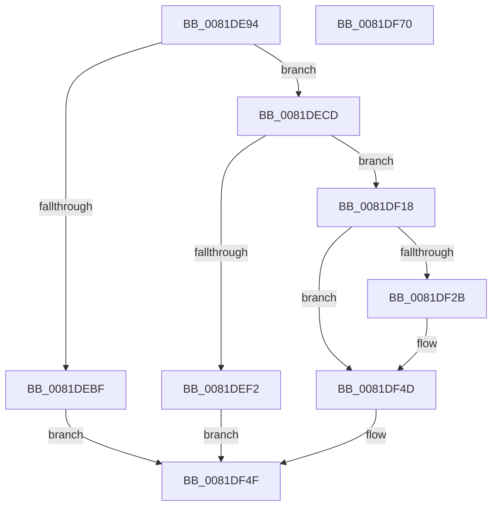

# AslpFileGet16BitDescription

- RVA: `0x0081DE94`–`0x0081DF71` (길이 `221` bytes)
- VA: `0x000000014081DE94`
- 실행 섹션: `PAGE`
- PDB 이름 있음: `예`; PDB Function 태그: `아니요`
- unwind 정보 RVA: `0x000D9F60`
- 디코드: `52`개 명령, `221/221` bytes 표시
- 미해석 바이트: `0` (있으면 어셈블리에 `.byte`로 보존)

> 이 문서는 커널 이미지의 기계어와 PDB 기호를 분석해 생성했습니다. 4번과 5번은 함수 원형과 자료형을 바이너리 사용 방식에서 추정한 C 해석이며 원본 소스 복구 결과는 아닙니다.

## 1. Dependencies

- 직접 호출 지점: **6**; 고유 호출 대상: **5**
- 직접 호출자로 확인된 함수: **1**
- RIP 상대 이미지 참조: **4**

### Outgoing calls
- `0x0081DEDA` → [memset](../../text/6C/memset_function_006C6C40.md) (function, `0x006C6C40`)
- `0x0081DEE7` → [AslpFileQuery16BitDescription](../82/AslpFileQuery16BitDescription_function_00820B70.md) (function, `0x00820B70`)
- `0x0081DF0F` → [AslLogCallPrintf](../95/AslLogCallPrintf_function_0095E4EC.md) (function, `0x0095E4EC`)
- `0x0081DF20` → [AslStringAnsiToUnicode](AslStringAnsiToUnicode_function_00819824.md) (function, `0x00819824`)
- `0x0081DF48` → [AslLogCallPrintf](../95/AslLogCallPrintf_function_0095E4EC.md) (function, `0x0095E4EC`)
- `0x0081DF5A` → [_security_check_cookie](../../text/6A/_security_check_cookie_function_006AC640.md) (function, `0x006AC640`)

### Direct callers
- [AslpFileGetHeaderAttributesNE](AslpFileGetHeaderAttributesNE_function_0081EE80.md) at `0x0081EF51`

### Static image references
- `0x0081DEA1` → RVA `0x00E0A740` (`.data`; read)
- `0x0081DEF2` → RVA `0x000409D0` (`.rdata`; read)
- `0x0081DF03` → RVA `0x00040A00` (`.rdata`; read)
- `0x0081DF2B` → RVA `0x000408F8` (`.rdata`; read)

## 2. Other-region calls and transfers

- 다른 실행 섹션으로 향하는 call: **2**
  - `0x0081DEDA` → [memset](../../text/6C/memset_function_006C6C40.md) (`PAGE` → `.text`)
  - `0x0081DF5A` → [_security_check_cookie](../../text/6A/_security_check_cookie_function_006AC640.md) (`PAGE` → `.text`)
- 별도 외부 분기/꼬리 이동을 확인하지 못했습니다.

## 3. Assembly (complete function range)

```asm
0081DE94  48 89 5C 24 18                  mov qword ptr [rsp + 0x18], rbx
0081DE99  57                              push rdi
0081DE9A  48 81 EC 40 01 00 00            sub rsp, 0x140
0081DEA1  48 8B 05 98 C8 5E 00            mov rax, qword ptr [rip + 0x5ec898]
0081DEA8  48 33 C4                        xor rax, rsp
0081DEAB  48 89 84 24 30 01 00 00         mov qword ptr [rsp + 0x130], rax
0081DEB3  83 7A 40 05                     cmp dword ptr [rdx + 0x40], 5
0081DEB7  48 8B FA                        mov rdi, rdx
0081DEBA  48 8B D9                        mov rbx, rcx
0081DEBD  74 0E                           je 0x14081decd
0081DEBF  48 83 21 00                     and qword ptr [rcx], 0
0081DEC3  B8 BB 00 00 C0                  mov eax, 0xc00000bb
0081DEC8  E9 82 00 00 00                  jmp 0x14081df4f
0081DECD  33 D2                           xor edx, edx
0081DECF  48 8D 4C 24 30                  lea rcx, [rsp + 0x30]
0081DED4  41 B8 00 01 00 00               mov r8d, 0x100
0081DEDA  E8 61 8D EA FF                  call 0x1406c6c40
0081DEDF  48 8B D7                        mov rdx, rdi
0081DEE2  48 8D 4C 24 30                  lea rcx, [rsp + 0x30]
0081DEE7  E8 84 2C 00 00                  call 0x140820b70
0081DEEC  8B F8                           mov edi, eax
0081DEEE  85 C0                           test eax, eax
0081DEF0  79 26                           jns 0x14081df18
0081DEF2  4C 8D 0D D7 2A 82 FF            lea r9, [rip - 0x7dd529]
0081DEF9  89 44 24 20                     mov dword ptr [rsp + 0x20], eax
0081DEFD  41 B8 5D 11 00 00               mov r8d, 0x115d
0081DF03  48 8D 15 F6 2A 82 FF            lea rdx, [rip - 0x7dd50a]
0081DF0A  B9 01 00 00 00                  mov ecx, 1
0081DF0F  E8 D8 05 14 00                  call 0x14095e4ec
0081DF14  8B C7                           mov eax, edi
0081DF16  EB 37                           jmp 0x14081df4f
0081DF18  48 8D 54 24 30                  lea rdx, [rsp + 0x30]
0081DF1D  48 8B CB                        mov rcx, rbx
0081DF20  E8 FF B8 FF FF                  call 0x140819824
0081DF25  8B D8                           mov ebx, eax
0081DF27  85 C0                           test eax, eax
0081DF29  79 22                           jns 0x14081df4d
0081DF2B  4C 8D 0D C6 29 82 FF            lea r9, [rip - 0x7dd63a]
0081DF32  89 44 24 20                     mov dword ptr [rsp + 0x20], eax
0081DF36  41 B8 63 11 00 00               mov r8d, 0x1163
0081DF3C  48 8D 15 BD 2A 82 FF            lea rdx, [rip - 0x7dd543]
0081DF43  B9 01 00 00 00                  mov ecx, 1
0081DF48  E8 9F 05 14 00                  call 0x14095e4ec
0081DF4D  8B C3                           mov eax, ebx
0081DF4F  48 8B 8C 24 30 01 00 00         mov rcx, qword ptr [rsp + 0x130]
0081DF57  48 33 CC                        xor rcx, rsp
0081DF5A  E8 E1 E6 E8 FF                  call 0x1406ac640
0081DF5F  48 8B 9C 24 60 01 00 00         mov rbx, qword ptr [rsp + 0x160]
0081DF67  48 81 C4 40 01 00 00            add rsp, 0x140
0081DF6E  5F                              pop rdi
0081DF6F  C3                              ret
0081DF70  CC                              int3
```

## 4. C-style interpretation (structured pseudocode)

```c
__int64 __fastcall AslpFileGet16BitDescription(__int64 a1, __int64 a2)
{
    __int64 result;
    __int64 v_rsp;
    unsigned __int64 v_stack_m118;
    unsigned int v_stack_m128;
    unsigned __int64 v_stack_m18;
    unsigned __int64 v_stack_p18;

    v_stack_p18 = v_rbx;
    v_rsp = (v_rsp) - (320);
    result = (*(unsigned __int64 *)(v_rip + 6211736)) ^ (v_rsp);
    v_stack_m18 = result;
    if ((*(unsigned int *)(a2 + 64)) == 5) goto loc_0081DECD;
    goto loc_0081DF4F;
loc_0081DECD:
    a2 = 0;
    result = memset(v_stack_m118, a2, 256, a4);
    result = AslpFileQuery16BitDescription(v_stack_m118, 0, 256, a4);
    if (!sign_flag) goto loc_0081DF18;
    v_stack_m128 = (unsigned int)(result);
    result = AslLogCallPrintf(1, v_rip - 8246538, (unsigned int)(0x115DULL), v_rip - 8246569);
    goto loc_0081DF4F;
loc_0081DF18:
    result = AslStringAnsiToUnicode(a1, v_stack_m118, (unsigned int)(0x115DULL), v_rip - 8246569);
    if (sign_flag) {
        a4 = v_rip - 8246842;
        v_stack_m128 = (unsigned int)(result);
        a3 = 0x1163ULL;
        a2 = v_rip - 8246595;
        a1 = 1;
        result = AslLogCallPrintf(a1, a2, a3, a4);
    }
loc_0081DF4F:
    a1 = (v_stack_m18) ^ (v_rsp);
    result = _security_check_cookie(a1, a2, a3, a4);
    v_rsp = (v_rsp) + (320);
    return result;
}
```

## 5. (Beta) C Style

```c
int64_t AslpFileGet16BitDescription(void *Arg1, void *Arg2)
{
    uint8_t *arg1 = (uint8_t *)Arg1;
    uint8_t *arg2 = (uint8_t *)Arg2;

    int64_t result;
    int64_t local_rsp;
    uint64_t v_stack_m118;
    uint32_t v_stack_m128;
    uint64_t v_stack_m18;
    uint64_t v_stack_p18;

    v_stack_p18 = local_rbx;
    local_rsp = (local_rsp) - (320);
    result = (*(uint64_t *)(v_rip + 0x5EC898)) ^ (local_rsp);
    v_stack_m18 = result;
    if ((*(uint32_t *)(arg2 + 0x40)) == 5) goto loc_0081DECD;
    goto loc_0081DF4F;
loc_0081DECD:
    Arg2 = 0;
    result = memset(v_stack_m118, Arg2, 256, a4);
    result = AslpFileQuery16BitDescription(v_stack_m118, 0, 256, a4);
    if (!sign_flag) goto loc_0081DF18;
    v_stack_m128 = (uint32_t)(result);
    result = AslLogCallPrintf(1, v_rip - 8246538, (uint32_t)(0x115DULL), v_rip - 8246569);
    goto loc_0081DF4F;
loc_0081DF18:
    result = AslStringAnsiToUnicode(Arg1, v_stack_m118, (uint32_t)(0x115DULL), v_rip - 8246569);
    if (sign_flag) {
        a4 = v_rip - 8246842;
        v_stack_m128 = (uint32_t)(result);
        a3 = 0x1163ULL;
        Arg2 = v_rip - 8246595;
        Arg1 = 1;
        result = AslLogCallPrintf(Arg1, Arg2, a3, a4);
    }
loc_0081DF4F:
    Arg1 = (v_stack_m18) ^ (local_rsp);
    result = _security_check_cookie(Arg1, Arg2, a3, a4);
    local_rsp = (local_rsp) + (320);
    return result;
}
```

### 관측된 메모리 오프셋

구조체 형식이 확인되지 않은 접근은 인자 기준의 오프셋으로만 기록했습니다.

| 기준 인자 | 오프셋 표현 | 폭 (bit) | 접근 |
|---|---:|---:|---|
| `Arg1` | `+ 0x0` | `64` | `R/W` |
| `Arg2` | `+ 0x40` | `32` | `R` |

## 6. Execution-region graph

[열기: 2D/3D 그래프와 함수 탐색 컨트롤 패널](../../../control-panel.html?section=page&rva=0x0081DE94&view=graph)

- 2D 그래프는 위에서 아래로 흐르고, 3D 그래프는 빈 공간을 드래그해 회전합니다. Shift+드래그는 이동, 휠은 확대·축소, 함수 노드 선택은 대상 보고서 이동입니다.

### Static fallback


