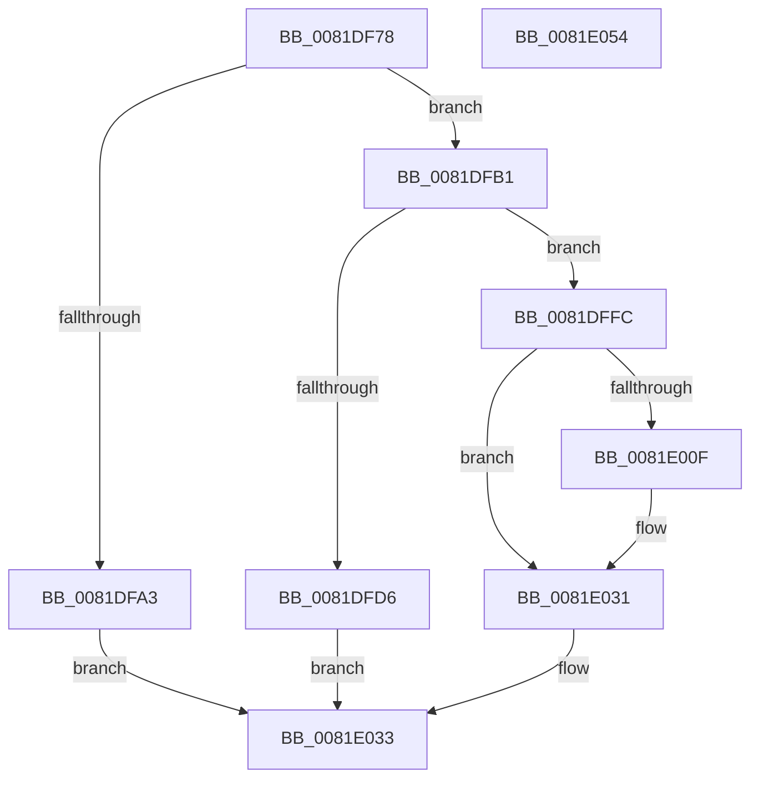

# AslpFileGet16BitModuleName

- RVA: `0x0081DF78`–`0x0081E055` (길이 `221` bytes)
- VA: `0x000000014081DF78`
- 실행 섹션: `PAGE`
- PDB 이름 있음: `예`; PDB Function 태그: `아니요`
- unwind 정보 RVA: `0x000D9F60`
- 디코드: `52`개 명령, `221/221` bytes 표시
- 미해석 바이트: `0` (있으면 어셈블리에 `.byte`로 보존)

> 이 문서는 커널 이미지의 기계어와 PDB 기호를 분석해 생성했습니다. 4번과 5번은 함수 원형과 자료형을 바이너리 사용 방식에서 추정한 C 해석이며 원본 소스 복구 결과는 아닙니다.

## 1. Dependencies

- 직접 호출 지점: **6**; 고유 호출 대상: **5**
- 직접 호출자로 확인된 함수: **1**
- RIP 상대 이미지 참조: **4**

### Outgoing calls
- `0x0081DFBE` → [memset](../../text/6C/memset_function_006C6C40.md) (function, `0x006C6C40`)
- `0x0081DFCB` → [AslpFileQuery16BitModuleName](../82/AslpFileQuery16BitModuleName_function_00820D08.md) (function, `0x00820D08`)
- `0x0081DFF3` → [AslLogCallPrintf](../95/AslLogCallPrintf_function_0095E4EC.md) (function, `0x0095E4EC`)
- `0x0081E004` → [AslStringAnsiToUnicode](AslStringAnsiToUnicode_function_00819824.md) (function, `0x00819824`)
- `0x0081E02C` → [AslLogCallPrintf](../95/AslLogCallPrintf_function_0095E4EC.md) (function, `0x0095E4EC`)
- `0x0081E03E` → [_security_check_cookie](../../text/6A/_security_check_cookie_function_006AC640.md) (function, `0x006AC640`)

### Direct callers
- [AslpFileGetHeaderAttributesNE](AslpFileGetHeaderAttributesNE_function_0081EE80.md) at `0x0081EFC0`

### Static image references
- `0x0081DF85` → RVA `0x00E0A740` (`.data`; read)
- `0x0081DFD6` → RVA `0x00040A20` (`.rdata`; read)
- `0x0081DFE7` → RVA `0x00040A50` (`.rdata`; read)
- `0x0081E00F` → RVA `0x000408F8` (`.rdata`; read)

## 2. Other-region calls and transfers

- 다른 실행 섹션으로 향하는 call: **2**
  - `0x0081DFBE` → [memset](../../text/6C/memset_function_006C6C40.md) (`PAGE` → `.text`)
  - `0x0081E03E` → [_security_check_cookie](../../text/6A/_security_check_cookie_function_006AC640.md) (`PAGE` → `.text`)
- 별도 외부 분기/꼬리 이동을 확인하지 못했습니다.

## 3. Assembly (complete function range)

```asm
0081DF78  48 89 5C 24 18                  mov qword ptr [rsp + 0x18], rbx
0081DF7D  57                              push rdi
0081DF7E  48 81 EC 40 01 00 00            sub rsp, 0x140
0081DF85  48 8B 05 B4 C7 5E 00            mov rax, qword ptr [rip + 0x5ec7b4]
0081DF8C  48 33 C4                        xor rax, rsp
0081DF8F  48 89 84 24 30 01 00 00         mov qword ptr [rsp + 0x130], rax
0081DF97  83 7A 40 05                     cmp dword ptr [rdx + 0x40], 5
0081DF9B  48 8B FA                        mov rdi, rdx
0081DF9E  48 8B D9                        mov rbx, rcx
0081DFA1  74 0E                           je 0x14081dfb1
0081DFA3  48 83 21 00                     and qword ptr [rcx], 0
0081DFA7  B8 BB 00 00 C0                  mov eax, 0xc00000bb
0081DFAC  E9 82 00 00 00                  jmp 0x14081e033
0081DFB1  33 D2                           xor edx, edx
0081DFB3  48 8D 4C 24 30                  lea rcx, [rsp + 0x30]
0081DFB8  41 B8 00 01 00 00               mov r8d, 0x100
0081DFBE  E8 7D 8C EA FF                  call 0x1406c6c40
0081DFC3  48 8B D7                        mov rdx, rdi
0081DFC6  48 8D 4C 24 30                  lea rcx, [rsp + 0x30]
0081DFCB  E8 38 2D 00 00                  call 0x140820d08
0081DFD0  8B F8                           mov edi, eax
0081DFD2  85 C0                           test eax, eax
0081DFD4  79 26                           jns 0x14081dffc
0081DFD6  4C 8D 0D 43 2A 82 FF            lea r9, [rip - 0x7dd5bd]
0081DFDD  89 44 24 20                     mov dword ptr [rsp + 0x20], eax
0081DFE1  41 B8 8B 11 00 00               mov r8d, 0x118b
0081DFE7  48 8D 15 62 2A 82 FF            lea rdx, [rip - 0x7dd59e]
0081DFEE  B9 01 00 00 00                  mov ecx, 1
0081DFF3  E8 F4 04 14 00                  call 0x14095e4ec
0081DFF8  8B C7                           mov eax, edi
0081DFFA  EB 37                           jmp 0x14081e033
0081DFFC  48 8D 54 24 30                  lea rdx, [rsp + 0x30]
0081E001  48 8B CB                        mov rcx, rbx
0081E004  E8 1B B8 FF FF                  call 0x140819824
0081E009  8B D8                           mov ebx, eax
0081E00B  85 C0                           test eax, eax
0081E00D  79 22                           jns 0x14081e031
0081E00F  4C 8D 0D E2 28 82 FF            lea r9, [rip - 0x7dd71e]
0081E016  89 44 24 20                     mov dword ptr [rsp + 0x20], eax
0081E01A  41 B8 91 11 00 00               mov r8d, 0x1191
0081E020  48 8D 15 29 2A 82 FF            lea rdx, [rip - 0x7dd5d7]
0081E027  B9 01 00 00 00                  mov ecx, 1
0081E02C  E8 BB 04 14 00                  call 0x14095e4ec
0081E031  8B C3                           mov eax, ebx
0081E033  48 8B 8C 24 30 01 00 00         mov rcx, qword ptr [rsp + 0x130]
0081E03B  48 33 CC                        xor rcx, rsp
0081E03E  E8 FD E5 E8 FF                  call 0x1406ac640
0081E043  48 8B 9C 24 60 01 00 00         mov rbx, qword ptr [rsp + 0x160]
0081E04B  48 81 C4 40 01 00 00            add rsp, 0x140
0081E052  5F                              pop rdi
0081E053  C3                              ret
0081E054  CC                              int3
```

## 4. C-style interpretation (structured pseudocode)

```c
__int64 __fastcall AslpFileGet16BitModuleName(__int64 a1, __int64 a2)
{
    __int64 result;
    __int64 v_rsp;
    unsigned __int64 v_stack_m118;
    unsigned int v_stack_m128;
    unsigned __int64 v_stack_m18;
    unsigned __int64 v_stack_p18;

    v_stack_p18 = v_rbx;
    v_rsp = (v_rsp) - (320);
    result = (*(unsigned __int64 *)(v_rip + 6211508)) ^ (v_rsp);
    v_stack_m18 = result;
    if ((*(unsigned int *)(a2 + 64)) == 5) goto loc_0081DFB1;
    goto loc_0081E033;
loc_0081DFB1:
    a2 = 0;
    result = memset(v_stack_m118, a2, 256, a4);
    result = AslpFileQuery16BitModuleName(v_stack_m118, 0, 256, a4);
    if (!sign_flag) goto loc_0081DFFC;
    v_stack_m128 = (unsigned int)(result);
    result = AslLogCallPrintf(1, v_rip - 8246686, (unsigned int)(0x118BULL), v_rip - 8246717);
    goto loc_0081E033;
loc_0081DFFC:
    result = AslStringAnsiToUnicode(a1, v_stack_m118, (unsigned int)(0x118BULL), v_rip - 8246717);
    if (sign_flag) {
        a4 = v_rip - 8247070;
        v_stack_m128 = (unsigned int)(result);
        a3 = 0x1191ULL;
        a2 = v_rip - 8246743;
        a1 = 1;
        result = AslLogCallPrintf(a1, a2, a3, a4);
    }
loc_0081E033:
    a1 = (v_stack_m18) ^ (v_rsp);
    result = _security_check_cookie(a1, a2, a3, a4);
    v_rsp = (v_rsp) + (320);
    return result;
}
```

## 5. (Beta) C Style

```c
int64_t AslpFileGet16BitModuleName(void *Arg1, void *Arg2)
{
    uint8_t *arg1 = (uint8_t *)Arg1;
    uint8_t *arg2 = (uint8_t *)Arg2;

    int64_t result;
    int64_t local_rsp;
    uint64_t v_stack_m118;
    uint32_t v_stack_m128;
    uint64_t v_stack_m18;
    uint64_t v_stack_p18;

    v_stack_p18 = local_rbx;
    local_rsp = (local_rsp) - (320);
    result = (*(uint64_t *)(v_rip + 0x5EC7B4)) ^ (local_rsp);
    v_stack_m18 = result;
    if ((*(uint32_t *)(arg2 + 0x40)) == 5) goto loc_0081DFB1;
    goto loc_0081E033;
loc_0081DFB1:
    Arg2 = 0;
    result = memset(v_stack_m118, Arg2, 256, a4);
    result = AslpFileQuery16BitModuleName(v_stack_m118, 0, 256, a4);
    if (!sign_flag) goto loc_0081DFFC;
    v_stack_m128 = (uint32_t)(result);
    result = AslLogCallPrintf(1, v_rip - 8246686, (uint32_t)(0x118BULL), v_rip - 8246717);
    goto loc_0081E033;
loc_0081DFFC:
    result = AslStringAnsiToUnicode(Arg1, v_stack_m118, (uint32_t)(0x118BULL), v_rip - 8246717);
    if (sign_flag) {
        a4 = v_rip - 8247070;
        v_stack_m128 = (uint32_t)(result);
        a3 = 0x1191ULL;
        Arg2 = v_rip - 8246743;
        Arg1 = 1;
        result = AslLogCallPrintf(Arg1, Arg2, a3, a4);
    }
loc_0081E033:
    Arg1 = (v_stack_m18) ^ (local_rsp);
    result = _security_check_cookie(Arg1, Arg2, a3, a4);
    local_rsp = (local_rsp) + (320);
    return result;
}
```

### 관측된 메모리 오프셋

구조체 형식이 확인되지 않은 접근은 인자 기준의 오프셋으로만 기록했습니다.

| 기준 인자 | 오프셋 표현 | 폭 (bit) | 접근 |
|---|---:|---:|---|
| `Arg1` | `+ 0x0` | `64` | `R/W` |
| `Arg2` | `+ 0x40` | `32` | `R` |

## 6. Execution-region graph

[열기: 2D/3D 그래프와 함수 탐색 컨트롤 패널](../../../control-panel.html?section=page&rva=0x0081DF78&view=graph)

- 2D 그래프는 위에서 아래로 흐르고, 3D 그래프는 빈 공간을 드래그해 회전합니다. Shift+드래그는 이동, 휠은 확대·축소, 함수 노드 선택은 대상 보고서 이동입니다.

### Static fallback


