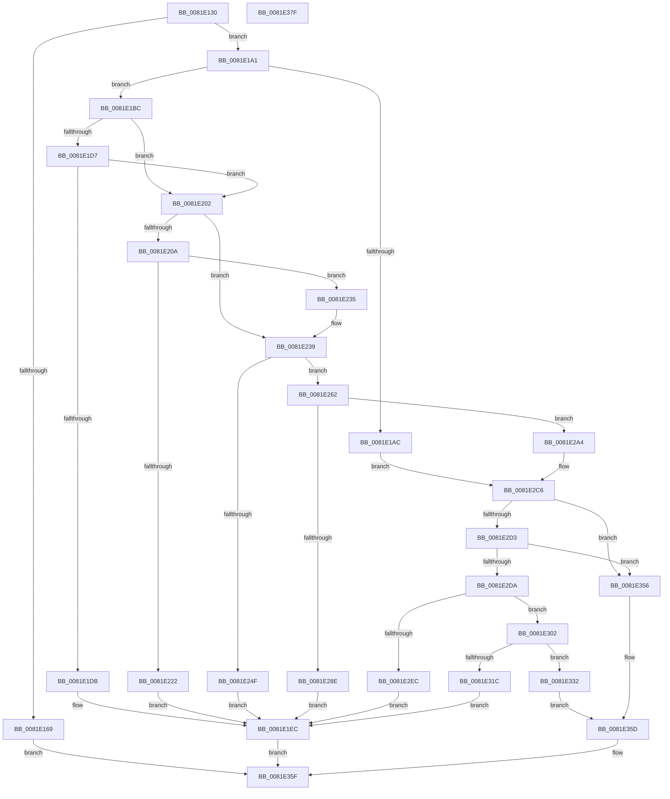

# AslpFileGetChecksumAttributes

- RVA: `0x0081E130`–`0x0081E380` (길이 `592` bytes)
- VA: `0x000000014081E130`
- 실행 섹션: `PAGE`
- PDB 이름 있음: `예`; PDB Function 태그: `아니요`
- unwind 정보 RVA: `0x000D9EDC`
- 디코드: `147`개 명령, `592/592` bytes 표시
- 미해석 바이트: `0` (있으면 어셈블리에 `.byte`로 보존)

> 이 문서는 커널 이미지의 기계어와 PDB 기호를 분석해 생성했습니다. 4번과 5번은 함수 원형과 자료형을 바이너리 사용 방식에서 추정한 C 해석이며 원본 소스 복구 결과는 아닙니다.

## 1. Dependencies

- 직접 호출 지점: **10**; 고유 호출 대상: **9**
- 직접 호출자로 확인된 함수: **1**
- RIP 상대 이미지 참조: **8**

### Outgoing calls
- `0x0081E180` → [AslLogCallPrintf](../95/AslLogCallPrintf_function_0095E4EC.md) (function, `0x0095E4EC`)
- `0x0081E1BF` → [AslFileMappingEnsureMappedAs](AslFileMappingEnsureMappedAs_function_0081A6BC.md) (function, `0x0081A6BC`)
- `0x0081E1F8` → [AslLogCallPrintf](../95/AslLogCallPrintf_function_0095E4EC.md) (function, `0x0095E4EC`)
- `0x0081E217` → [RtlFileMapMapView](../../text/69/RtlFileMapMapView_function_0069D048.md) (function, `0x0069D048`)
- `0x0081E244` → [AslpFileGetChecksum](AslpFileGetChecksum_function_0081E05C.md) (function, `0x0081E05C`)
- `0x0081E283` → [AslpFileGetCrcChecksum](AslpFileGetCrcChecksum_function_0081E6DC.md) (function, `0x0081E6DC`)
- `0x0081E2C6` → [Feature_DisableCrcChecksumBoot__private_IsEnabledDeviceUsageNoInline](../../text/69/Feature_DisableCrcChecksumBoot__private_IsEnabledDeviceUsageNoInline_function_0069D514.md) (function, `0x0069D514`)
- `0x0081E2E1` → [AslpFileGetImageNtHeader](AslpFileGetImageNtHeader_function_0081F434.md) (function, `0x0081F434`)
- `0x0081E311` → [AslpFileGetCrcChecksumBoot](AslpFileGetCrcChecksumBoot_function_0081E7D4.md) (function, `0x0081E7D4`)
- `0x0081E363` → [RtlFileMapFree](../../text/4B/RtlFileMapFree_function_004BF868.md) (function, `0x004BF868`)

### Direct callers
- [AslFileAllocAndGetAttributes](AslFileAllocAndGetAttributes_function_0081D8EC.md) at `0x0081DBEB`

### Static image references
- `0x0081E169` → RVA `0x00040AD0` (`.rdata`; read)
- `0x0081E176` → RVA `0x00040B20` (`.rdata`; read)
- `0x0081E1DF` → RVA `0x00040B40` (`.rdata`; read)
- `0x0081E226` → RVA `0x0003FB10` (`.rdata`; read)
- `0x0081E253` → RVA `0x00040B70` (`.rdata`; read)
- `0x0081E292` → RVA `0x00040B90` (`.rdata`; read)
- `0x0081E2F0` → RVA `0x00040BB8` (`.rdata`; read)
- `0x0081E320` → RVA `0x00040BF8` (`.rdata`; read)

## 2. Other-region calls and transfers

- 다른 실행 섹션으로 향하는 call: **3**
  - `0x0081E217` → [RtlFileMapMapView](../../text/69/RtlFileMapMapView_function_0069D048.md) (`PAGE` → `.text`)
  - `0x0081E2C6` → [Feature_DisableCrcChecksumBoot__private_IsEnabledDeviceUsageNoInline](../../text/69/Feature_DisableCrcChecksumBoot__private_IsEnabledDeviceUsageNoInline_function_0069D514.md) (`PAGE` → `.text`)
  - `0x0081E363` → [RtlFileMapFree](../../text/4B/RtlFileMapFree_function_004BF868.md) (`PAGE` → `.text`)
- 별도 외부 분기/꼬리 이동을 확인하지 못했습니다.

## 3. Assembly (complete function range)

```asm
0081E130  48 89 5C 24 08                  mov qword ptr [rsp + 8], rbx
0081E135  55                              push rbp
0081E136  57                              push rdi
0081E137  41 55                           push r13
0081E139  41 56                           push r14
0081E13B  41 57                           push r15
0081E13D  48 8B EC                        mov rbp, rsp
0081E140  48 83 EC 70                     sub rsp, 0x70
0081E144  48 83 65 40 00                  and qword ptr [rbp + 0x40], 0
0081E149  0F 57 C0                        xorps xmm0, xmm0
0081E14C  33 C0                           xor eax, eax
0081E14E  4C 8B F2                        mov r14, rdx
0081E151  48 8B D9                        mov rbx, rcx
0081E154  48 89 45 F0                     mov qword ptr [rbp - 0x10], rax
0081E158  0F 11 45 C0                     movups xmmword ptr [rbp - 0x40], xmm0
0081E15C  0F 11 45 D0                     movups xmmword ptr [rbp - 0x30], xmm0
0081E160  0F 11 45 E0                     movups xmmword ptr [rbp - 0x20], xmm0
0081E164  39 42 54                        cmp dword ptr [rdx + 0x54], eax
0081E167  74 38                           je 0x14081e1a1
0081E169  4C 8D 0D 60 29 82 FF            lea r9, [rip - 0x7dd6a0]
0081E170  41 B8 90 12 00 00               mov r8d, 0x1290
0081E176  48 8D 15 A3 29 82 FF            lea rdx, [rip - 0x7dd65d]
0081E17D  8D 48 01                        lea ecx, [rax + 1]
0081E180  E8 67 03 14 00                  call 0x14095e4ec
0081E185  83 4B 58 02                     or dword ptr [rbx + 0x58], 2
0081E189  BF 01 00 00 C0                  mov edi, 0xc0000001
0081E18E  83 8B 58 03 00 00 02            or dword ptr [rbx + 0x358], 2
0081E195  83 8B 58 04 00 00 02            or dword ptr [rbx + 0x458], 2
0081E19C  E9 BE 01 00 00                  jmp 0x14081e35f
0081E1A1  41 BD 04 00 00 00               mov r13d, 4
0081E1A7  39 42 50                        cmp dword ptr [rdx + 0x50], eax
0081E1AA  74 10                           je 0x14081e1bc
0081E1AC  83 49 58 02                     or dword ptr [rcx + 0x58], 2
0081E1B0  83 89 58 03 00 00 02            or dword ptr [rcx + 0x358], 2
0081E1B7  E9 0A 01 00 00                  jmp 0x14081e2c6
0081E1BC  49 8B CE                        mov rcx, r14
0081E1BF  E8 F8 C4 FF FF                  call 0x14081a6bc
0081E1C4  8B F8                           mov edi, eax
0081E1C6  BA 0E 01 00 C0                  mov edx, 0xc000010e
0081E1CB  B8 00 00 00 80                  mov eax, 0x80000000
0081E1D0  8D 0C 07                        lea ecx, [rdi + rax]
0081E1D3  85 C8                           test eax, ecx
0081E1D5  75 2B                           jne 0x14081e202
0081E1D7  3B FA                           cmp edi, edx
0081E1D9  74 27                           je 0x14081e202
0081E1DB  89 7C 24 20                     mov dword ptr [rsp + 0x20], edi
0081E1DF  4C 8D 0D 5A 29 82 FF            lea r9, [rip - 0x7dd6a6]
0081E1E6  41 B8 AD 12 00 00               mov r8d, 0x12ad
0081E1EC  48 8D 15 2D 29 82 FF            lea rdx, [rip - 0x7dd6d3]
0081E1F3  B9 01 00 00 00                  mov ecx, 1
0081E1F8  E8 EF 02 14 00                  call 0x14095e4ec
0081E1FD  E9 5D 01 00 00                  jmp 0x14081e35f
0081E202  4D 8D 7E 08                     lea r15, [r14 + 8]
0081E206  3B FA                           cmp edi, edx
0081E208  75 2F                           jne 0x14081e239
0081E20A  49 8B 07                        mov rax, qword ptr [r15]
0081E20D  48 8D 4D C0                     lea rcx, [rbp - 0x40]
0081E211  33 D2                           xor edx, edx
0081E213  48 89 45 C0                     mov qword ptr [rbp - 0x40], rax
0081E217  E8 2C EE E7 FF                  call 0x14069d048
0081E21C  8B F8                           mov edi, eax
0081E21E  85 C0                           test eax, eax
0081E220  79 13                           jns 0x14081e235
0081E222  89 44 24 20                     mov dword ptr [rsp + 0x20], eax
0081E226  4C 8D 0D E3 18 82 FF            lea r9, [rip - 0x7de71d]
0081E22D  41 B8 BF 12 00 00               mov r8d, 0x12bf
0081E233  EB B7                           jmp 0x14081e1ec
0081E235  4C 8D 7D C0                     lea r15, [rbp - 0x40]
0081E239  83 65 38 00                     and dword ptr [rbp + 0x38], 0
0081E23D  48 8D 4D 38                     lea rcx, [rbp + 0x38]
0081E241  49 8B D7                        mov rdx, r15
0081E244  E8 13 FE FF FF                  call 0x14081e05c
0081E249  8B F8                           mov edi, eax
0081E24B  85 C0                           test eax, eax
0081E24D  79 13                           jns 0x14081e262
0081E24F  89 44 24 20                     mov dword ptr [rsp + 0x20], eax
0081E253  4C 8D 0D 16 29 82 FF            lea r9, [rip - 0x7dd6ea]
0081E25A  41 B8 D0 12 00 00               mov r8d, 0x12d0
0081E260  EB 8A                           jmp 0x14081e1ec
0081E262  8B 45 38                        mov eax, dword ptr [rbp + 0x38]
0081E265  48 8D 4D 38                     lea rcx, [rbp + 0x38]
0081E269  83 4B 58 01                     or dword ptr [rbx + 0x58], 1
0081E26D  49 8B D7                        mov rdx, r15
0081E270  83 65 38 00                     and dword ptr [rbp + 0x38], 0
0081E274  48 89 43 50                     mov qword ptr [rbx + 0x50], rax
0081E278  C7 43 40 02 00 00 00            mov dword ptr [rbx + 0x40], 2
0081E27F  4C 89 6B 48                     mov qword ptr [rbx + 0x48], r13
0081E283  E8 54 04 00 00                  call 0x14081e6dc
0081E288  8B F8                           mov edi, eax
0081E28A  85 C0                           test eax, eax
0081E28C  79 16                           jns 0x14081e2a4
0081E28E  89 44 24 20                     mov dword ptr [rsp + 0x20], eax
0081E292  4C 8D 0D F7 28 82 FF            lea r9, [rip - 0x7dd709]
0081E299  41 B8 E1 12 00 00               mov r8d, 0x12e1
0081E29F  E9 48 FF FF FF                  jmp 0x14081e1ec
0081E2A4  8B 45 38                        mov eax, dword ptr [rbp + 0x38]
0081E2A7  83 8B 58 03 00 00 01            or dword ptr [rbx + 0x358], 1
0081E2AE  48 89 83 50 03 00 00            mov qword ptr [rbx + 0x350], rax
0081E2B5  C7 83 40 03 00 00 02 00 00 00   mov dword ptr [rbx + 0x340], 2
0081E2BF  4C 89 AB 48 03 00 00            mov qword ptr [rbx + 0x348], r13
0081E2C6  E8 49 F2 E7 FF                  call 0x14069d514
0081E2CB  85 C0                           test eax, eax
0081E2CD  0F 85 83 00 00 00               jne 0x14081e356
0081E2D3  41 83 7E 40 06                  cmp dword ptr [r14 + 0x40], 6
0081E2D8  75 7C                           jne 0x14081e356
0081E2DA  49 8B D6                        mov rdx, r14
0081E2DD  48 8D 4D 40                     lea rcx, [rbp + 0x40]
0081E2E1  E8 4E 11 00 00                  call 0x14081f434
0081E2E6  8B F8                           mov edi, eax
0081E2E8  85 C0                           test eax, eax
0081E2EA  79 16                           jns 0x14081e302
0081E2EC  89 44 24 20                     mov dword ptr [rsp + 0x20], eax
0081E2F0  4C 8D 0D C1 28 82 FF            lea r9, [rip - 0x7dd73f]
0081E2F7  41 B8 F9 12 00 00               mov r8d, 0x12f9
0081E2FD  E9 EA FE FF FF                  jmp 0x14081e1ec
0081E302  48 8B 55 40                     mov rdx, qword ptr [rbp + 0x40]
0081E306  48 8D 4D 38                     lea rcx, [rbp + 0x38]
0081E30A  83 65 38 00                     and dword ptr [rbp + 0x38], 0
0081E30E  4D 8B C6                        mov r8, r14
0081E311  E8 BE 04 00 00                  call 0x14081e7d4
0081E316  8B F8                           mov edi, eax
0081E318  85 C0                           test eax, eax
0081E31A  79 16                           jns 0x14081e332
0081E31C  89 44 24 20                     mov dword ptr [rsp + 0x20], eax
0081E320  4C 8D 0D D1 28 82 FF            lea r9, [rip - 0x7dd72f]
0081E327  41 B8 00 13 00 00               mov r8d, 0x1300
0081E32D  E9 BA FE FF FF                  jmp 0x14081e1ec
0081E332  8B 45 38                        mov eax, dword ptr [rbp + 0x38]
0081E335  83 8B 58 04 00 00 01            or dword ptr [rbx + 0x458], 1
0081E33C  48 89 83 50 04 00 00            mov qword ptr [rbx + 0x450], rax
0081E343  C7 83 40 04 00 00 02 00 00 00   mov dword ptr [rbx + 0x440], 2
0081E34D  4C 89 AB 48 04 00 00            mov qword ptr [rbx + 0x448], r13
0081E354  EB 07                           jmp 0x14081e35d
0081E356  83 8B 58 04 00 00 02            or dword ptr [rbx + 0x458], 2
0081E35D  33 FF                           xor edi, edi
0081E35F  48 8D 4D C0                     lea rcx, [rbp - 0x40]
0081E363  E8 00 15 CA FF                  call 0x1404bf868
0081E368  48 8B 9C 24 A0 00 00 00         mov rbx, qword ptr [rsp + 0xa0]
0081E370  8B C7                           mov eax, edi
0081E372  48 83 C4 70                     add rsp, 0x70
0081E376  41 5F                           pop r15
0081E378  41 5E                           pop r14
0081E37A  41 5D                           pop r13
0081E37C  5F                              pop rdi
0081E37D  5D                              pop rbp
0081E37E  C3                              ret
0081E37F  CC                              int3
```

## 4. C-style interpretation (structured pseudocode)

```c
__int64 __fastcall AslpFileGetChecksumAttributes(__int64 a1, __int64 a2)
{
    __int64 result;
    __int64 v_rdi;
    __int64 v_rsp;
    unsigned __int64 v_stack_m38;
    unsigned __int64 v_stack_m48;
    unsigned __int64 v_stack_m58;
    unsigned __int64 v_stack_m68;
    unsigned int v_stack_m78;
    unsigned int v_stack_p10;
    unsigned __int64 v_stack_p18;
    unsigned __int64 v_stack_p8;

    v_stack_p8 = v_rbx;
    v_rsp = (v_rsp) - (112);
    result = 0;
    v_stack_m38 = 0;
    v_stack_m68 = v_xmm0;
    v_stack_m58 = v_xmm0;
    v_stack_m48 = v_xmm0;
    if ((*(unsigned int *)(a2 + 84)) == 0) goto loc_0081E1A1;
    result = AslLogCallPrintf(result + 1, v_rip - 8246877, (unsigned int)(0x1290ULL), v_rip - 8246944);
    goto loc_0081E35F;
loc_0081E1A1:
    if ((*(unsigned int *)(v_rip - 8246877 + 80)) == ((unsigned int)(result))) goto loc_0081E1BC;
    goto loc_0081E2C6;
loc_0081E1BC:
    result = AslFileMappingEnsureMappedAs(a2, v_rip - 8246877, (unsigned int)(0x1290ULL), v_rip - 8246944);
    if ((((unsigned int)((unsigned int)(0x80000000ULL))) & ((unsigned int)((unsigned int)((unsigned int)(result)) + (unsigned int)(0x80000000ULL) * 1))) != 0) goto loc_0081E202;
    if (((unsigned int)((unsigned int)((unsigned int)(result)))) == ((unsigned int)((unsigned int)(0xC000010EULL)))) goto loc_0081E202;
    v_stack_m78 = (unsigned int)((unsigned int)((unsigned int)(result)));
loc_0081E1EC:
    result = AslLogCallPrintf(1, v_rip - 8246995, (unsigned int)(0x12ADULL), v_rip - 8246950);
    goto loc_0081E35F;
loc_0081E202:
    if (((unsigned int)((unsigned int)((unsigned int)(result)))) != ((unsigned int)(v_rip - 8246995))) goto loc_0081E239;
    a2 = 0;
    v_stack_m68 = *(unsigned __int64 *)(a2 + 8);
    result = RtlFileMapMapView(v_stack_m68, a2, (unsigned int)(0x12ADULL), v_rip - 8246950);
    if (!sign_flag) goto loc_0081E235;
    v_stack_m78 = (unsigned int)(result);
    goto loc_0081E1EC;
loc_0081E235:
loc_0081E239:
    result = AslpFileGetChecksum(v_stack_p10, v_stack_m68, (unsigned int)(0x12BFULL), v_rip - 8251165);
    if (!sign_flag) goto loc_0081E262;
    v_stack_m78 = (unsigned int)(result);
    goto loc_0081E1EC;
loc_0081E262:
    *(unsigned __int64 *)(a1 + 80) = (unsigned int)(v_stack_p10);
    *(unsigned int *)(a1 + 64) = 2;
    *(unsigned __int64 *)(a1 + 72) = 4;
    result = AslpFileGetCrcChecksum(v_stack_p10, v_stack_m68, (unsigned int)(0x12D0ULL), v_rip - 8247018);
    if (!sign_flag) goto loc_0081E2A4;
    v_stack_m78 = (unsigned int)(result);
    goto loc_0081E1EC;
loc_0081E2A4:
    *(unsigned __int64 *)(a1 + 848) = (unsigned int)(v_stack_p10);
    *(unsigned int *)(a1 + 832) = 2;
    *(unsigned __int64 *)(a1 + 840) = 4;
loc_0081E2C6:
    result = Feature_DisableCrcChecksumBoot__private_IsEnabledDeviceUsageNoInline(v_stack_p10, v_stack_m68, (unsigned int)(0x12E1ULL), v_rip - 8247049);
    if ((unsigned int)(result) != 0) goto loc_0081E356;
    if ((*(unsigned int *)(a2 + 64)) != 6) goto loc_0081E356;
    result = AslpFileGetImageNtHeader(v_stack_p18, 0, (unsigned int)(0x12E1ULL), v_rip - 8247049);
    if (!sign_flag) goto loc_0081E302;
    v_stack_m78 = (unsigned int)(result);
    goto loc_0081E1EC;
loc_0081E302:
    result = AslpFileGetCrcChecksumBoot(v_stack_p10, v_stack_p18, 0, v_rip - 8247103);
    if (!sign_flag) goto loc_0081E332;
    v_stack_m78 = (unsigned int)(result);
    goto loc_0081E1EC;
loc_0081E332:
    *(unsigned __int64 *)(a1 + 1104) = (unsigned int)(v_stack_p10);
    *(unsigned int *)(a1 + 1088) = 2;
    *(unsigned __int64 *)(a1 + 1096) = 4;
    goto loc_0081E35D;
loc_0081E356:
loc_0081E35D:
    v_rdi = 0;
loc_0081E35F:
    result = RtlFileMapFree(v_stack_m68, v_stack_p18, (unsigned int)(0x1300ULL), v_rip - 8247087);
    v_rsp = (v_rsp) + (112);
    return 0;
}
```

## 5. (Beta) C Style

```c
int64_t AslpFileGetChecksumAttributes(void *Arg1, void *Arg2)
{
    uint8_t *arg1 = (uint8_t *)Arg1;
    uint8_t *arg2 = (uint8_t *)Arg2;

    int64_t result;
    int64_t local_rdi;
    int64_t local_rsp;
    uint64_t v_stack_m38;
    uint64_t v_stack_m48;
    uint64_t v_stack_m58;
    uint64_t v_stack_m68;
    uint32_t v_stack_m78;
    uint32_t v_stack_p10;
    uint64_t v_stack_p18;
    uint64_t v_stack_p8;

    v_stack_p8 = local_rbx;
    local_rsp = (local_rsp) - (112);
    result = 0;
    v_stack_m38 = 0;
    v_stack_m68 = v_xmm0;
    v_stack_m58 = v_xmm0;
    v_stack_m48 = v_xmm0;
    if ((*(uint32_t *)(arg2 + 0x54)) == 0) goto loc_0081E1A1;
    result = AslLogCallPrintf(result + 1, v_rip - 8246877, (uint32_t)(0x1290ULL), v_rip - 8246944);
    goto loc_0081E35F;
loc_0081E1A1:
    if ((*(uint32_t *)(v_rip - 0x7DD65D + 0x50)) == ((uint32_t)(result))) goto loc_0081E1BC;
    goto loc_0081E2C6;
loc_0081E1BC:
    result = AslFileMappingEnsureMappedAs(Arg2, v_rip - 8246877, (uint32_t)(0x1290ULL), v_rip - 8246944);
    if ((((uint32_t)((uint32_t)(0x80000000ULL))) & ((uint32_t)((uint32_t)((uint32_t)(result)) + (uint32_t)(0x80000000ULL) * 1))) != 0) goto loc_0081E202;
    if (((uint32_t)((uint32_t)((uint32_t)(result)))) == ((uint32_t)((uint32_t)(0xC000010EULL)))) goto loc_0081E202;
    v_stack_m78 = (uint32_t)((uint32_t)((uint32_t)(result)));
loc_0081E1EC:
    result = AslLogCallPrintf(1, v_rip - 8246995, (uint32_t)(0x12ADULL), v_rip - 8246950);
    goto loc_0081E35F;
loc_0081E202:
    if (((uint32_t)((uint32_t)((uint32_t)(result)))) != ((uint32_t)(v_rip - 8246995))) goto loc_0081E239;
    Arg2 = 0;
    v_stack_m68 = *(uint64_t *)(arg2 + 0x8);
    result = RtlFileMapMapView(v_stack_m68, Arg2, (uint32_t)(0x12ADULL), v_rip - 8246950);
    if (!sign_flag) goto loc_0081E235;
    v_stack_m78 = (uint32_t)(result);
    goto loc_0081E1EC;
loc_0081E235:
loc_0081E239:
    result = AslpFileGetChecksum(v_stack_p10, v_stack_m68, (uint32_t)(0x12BFULL), v_rip - 8251165);
    if (!sign_flag) goto loc_0081E262;
    v_stack_m78 = (uint32_t)(result);
    goto loc_0081E1EC;
loc_0081E262:
    *(uint64_t *)(arg1 + 0x50) = (uint32_t)(v_stack_p10);
    *(uint32_t *)(arg1 + 0x40) = 2;
    *(uint64_t *)(arg1 + 0x48) = 4;
    result = AslpFileGetCrcChecksum(v_stack_p10, v_stack_m68, (uint32_t)(0x12D0ULL), v_rip - 8247018);
    if (!sign_flag) goto loc_0081E2A4;
    v_stack_m78 = (uint32_t)(result);
    goto loc_0081E1EC;
loc_0081E2A4:
    *(uint64_t *)(arg1 + 0x350) = (uint32_t)(v_stack_p10);
    *(uint32_t *)(arg1 + 0x340) = 2;
    *(uint64_t *)(arg1 + 0x348) = 4;
loc_0081E2C6:
    result = Feature_DisableCrcChecksumBoot__private_IsEnabledDeviceUsageNoInline(v_stack_p10, v_stack_m68, (uint32_t)(0x12E1ULL), v_rip - 8247049);
    if ((uint32_t)(result) != 0) goto loc_0081E356;
    if ((*(uint32_t *)(arg2 + 0x40)) != 6) goto loc_0081E356;
    result = AslpFileGetImageNtHeader(v_stack_p18, 0, (uint32_t)(0x12E1ULL), v_rip - 8247049);
    if (!sign_flag) goto loc_0081E302;
    v_stack_m78 = (uint32_t)(result);
    goto loc_0081E1EC;
loc_0081E302:
    result = AslpFileGetCrcChecksumBoot(v_stack_p10, v_stack_p18, 0, v_rip - 8247103);
    if (!sign_flag) goto loc_0081E332;
    v_stack_m78 = (uint32_t)(result);
    goto loc_0081E1EC;
loc_0081E332:
    *(uint64_t *)(arg1 + 0x450) = (uint32_t)(v_stack_p10);
    *(uint32_t *)(arg1 + 0x440) = 2;
    *(uint64_t *)(arg1 + 0x448) = 4;
    goto loc_0081E35D;
loc_0081E356:
loc_0081E35D:
    local_rdi = 0;
loc_0081E35F:
    result = RtlFileMapFree(v_stack_m68, v_stack_p18, (uint32_t)(0x1300ULL), v_rip - 8247087);
    local_rsp = (local_rsp) + (112);
    return 0;
}
```

### 관측된 메모리 오프셋

구조체 형식이 확인되지 않은 접근은 인자 기준의 오프셋으로만 기록했습니다.

| 기준 인자 | 오프셋 표현 | 폭 (bit) | 접근 |
|---|---:|---:|---|
| `Arg1` | `+ 0x40` | `32` | `W` |
| `Arg1` | `+ 0x48` | `64` | `W` |
| `Arg1` | `+ 0x50` | `64` | `W` |
| `Arg1` | `+ 0x58` | `32` | `R/W` |
| `Arg1` | `+ 0x340` | `32` | `W` |
| `Arg1` | `+ 0x348` | `64` | `W` |
| `Arg1` | `+ 0x350` | `64` | `W` |
| `Arg1` | `+ 0x358` | `32` | `R/W` |
| `Arg1` | `+ 0x440` | `32` | `W` |
| `Arg1` | `+ 0x448` | `64` | `W` |
| `Arg1` | `+ 0x450` | `64` | `W` |
| `Arg1` | `+ 0x458` | `32` | `R/W` |
| `Arg2` | `+ 0x0` | `64` | `R` |
| `Arg2` | `+ 0x8` | `64` | `R` |
| `Arg2` | `+ 0x40` | `32` | `R` |
| `Arg2` | `+ 0x50` | `32` | `R` |
| `Arg2` | `+ 0x54` | `32` | `R` |

## 6. Execution-region graph

[열기: 2D/3D 그래프와 함수 탐색 컨트롤 패널](../../../control-panel.html?section=page&rva=0x0081E130&view=graph)

- 2D 그래프는 위에서 아래로 흐르고, 3D 그래프는 빈 공간을 드래그해 회전합니다. Shift+드래그는 이동, 휠은 확대·축소, 함수 노드 선택은 대상 보고서 이동입니다.

### Static fallback


