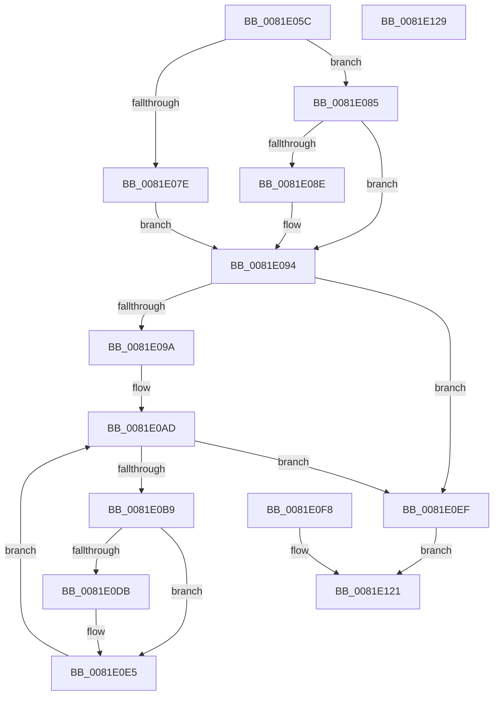

# AslpFileGetChecksum

- RVA: `0x0081E05C`–`0x0081E12A` (길이 `206` bytes)
- VA: `0x000000014081E05C`
- 실행 섹션: `PAGE`
- PDB 이름 있음: `예`; PDB Function 태그: `아니요`
- unwind 정보 RVA: `0x000D9EB8`
- 디코드: `59`개 명령, `206/206` bytes 표시
- 미해석 바이트: `0` (있으면 어셈블리에 `.byte`로 보존)

> 이 문서는 커널 이미지의 기계어와 PDB 기호를 분석해 생성했습니다. 4번과 5번은 함수 원형과 자료형을 바이너리 사용 방식에서 추정한 C 해석이며 원본 소스 복구 결과는 아닙니다.

## 1. Dependencies

- 직접 호출 지점: **1**; 고유 호출 대상: **1**
- 직접 호출자로 확인된 함수: **1**
- RIP 상대 이미지 참조: **2**

### Outgoing calls
- `0x0081E11B` → [AslLogCallPrintf](../95/AslLogCallPrintf_function_0095E4EC.md) (function, `0x0095E4EC`)

### Direct callers
- [AslpFileGetChecksumAttributes](AslpFileGetChecksumAttributes_function_0081E130.md) at `0x0081E244`

### Static image references
- `0x0081E102` → RVA `0x0003EF20` (`.rdata`; read)
- `0x0081E10F` → RVA `0x00040C20` (`.rdata`; read)

## 2. Other-region calls and transfers

- 다른 실행 섹션으로 향하는 call: **0**
- 별도 외부 분기/꼬리 이동을 확인하지 못했습니다.

## 3. Assembly (complete function range)

```asm
0081E05C  40 53                           push rbx
0081E05E  48 83 EC 50                     sub rsp, 0x50
0081E062  4C 8B D9                        mov r11, rcx
0081E065  B8 00 02 00 00                  mov eax, 0x200
0081E06A  33 DB                           xor ebx, ebx
0081E06C  41 B9 00 10 00 00               mov r9d, 0x1000
0081E072  44 8B C3                        mov r8d, ebx
0081E075  4C 8B 52 10                     mov r10, qword ptr [rdx + 0x10]
0081E079  4D 3B D1                        cmp r10, r9
0081E07C  73 07                           jae 0x14081e085
0081E07E  8B C3                           mov eax, ebx
0081E080  45 8B CA                        mov r9d, r10d
0081E083  EB 0F                           jmp 0x14081e094
0081E085  49 81 FA 00 12 00 00            cmp r10, 0x1200
0081E08C  73 06                           jae 0x14081e094
0081E08E  8B 42 10                        mov eax, dword ptr [rdx + 0x10]
0081E091  41 2B C1                        sub eax, r9d
0081E094  41 83 F9 04                     cmp r9d, 4
0081E098  72 55                           jb 0x14081e0ef
0081E09A  8B C8                           mov ecx, eax
0081E09C  48 03 4A 18                     add rcx, qword ptr [rdx + 0x18]
0081E0A0  48 89 4C 24 68                  mov qword ptr [rsp + 0x68], rcx
0081E0A5  48 8B D3                        mov rdx, rbx
0081E0A8  48 89 5C 24 38                  mov qword ptr [rsp + 0x38], rbx
0081E0AD  41 8B C1                        mov eax, r9d
0081E0B0  48 C1 E8 02                     shr rax, 2
0081E0B4  48 3B D0                        cmp rdx, rax
0081E0B7  73 36                           jae 0x14081e0ef
0081E0B9  44 03 01                        add r8d, dword ptr [rcx]
0081E0BC  44 89 44 24 30                  mov dword ptr [rsp + 0x30], r8d
0081E0C1  48 83 C1 04                     add rcx, 4
0081E0C5  48 89 4C 24 68                  mov qword ptr [rsp + 0x68], rcx
0081E0CA  41 8B C0                        mov eax, r8d
0081E0CD  41 D1 E8                        shr r8d, 1
0081E0D0  44 89 44 24 30                  mov dword ptr [rsp + 0x30], r8d
0081E0D5  0F BA E0 00                     bt eax, 0
0081E0D9  73 0A                           jae 0x14081e0e5
0081E0DB  41 0F BA E8 1F                  bts r8d, 0x1f
0081E0E0  44 89 44 24 30                  mov dword ptr [rsp + 0x30], r8d
0081E0E5  48 FF C2                        inc rdx
0081E0E8  48 89 54 24 38                  mov qword ptr [rsp + 0x38], rdx
0081E0ED  EB BE                           jmp 0x14081e0ad
0081E0EF  45 89 03                        mov dword ptr [r11], r8d
0081E0F2  89 5C 24 34                     mov dword ptr [rsp + 0x34], ebx
0081E0F6  EB 29                           jmp 0x14081e121
0081E0F8  8B D8                           mov ebx, eax
0081E0FA  89 44 24 34                     mov dword ptr [rsp + 0x34], eax
0081E0FE  89 44 24 20                     mov dword ptr [rsp + 0x20], eax
0081E102  4C 8D 0D 17 0E 82 FF            lea r9, [rip - 0x7df1e9]
0081E109  41 B8 59 13 00 00               mov r8d, 0x1359
0081E10F  48 8D 15 0A 2B 82 FF            lea rdx, [rip - 0x7dd4f6]
0081E116  B9 01 00 00 00                  mov ecx, 1
0081E11B  E8 CC 03 14 00                  call 0x14095e4ec
0081E120  90                              nop
0081E121  8B C3                           mov eax, ebx
0081E123  48 83 C4 50                     add rsp, 0x50
0081E127  5B                              pop rbx
0081E128  C3                              ret
0081E129  CC                              int3
```

## 4. C-style interpretation (structured pseudocode)

```c
__int64 __fastcall AslpFileGetChecksum(__int64 a1, __int64 a2)
{
    __int64 result;
    __int64 v_rbx;
    __int64 v_rsp;
    unsigned __int64 v_stack_m20;
    unsigned int v_stack_m24;
    unsigned int v_stack_m28;
    unsigned int v_stack_m38;
    unsigned __int64 v_stack_p10;

    v_rsp = (v_rsp) - (80);
    v_rbx = 0;
    if ((*(unsigned __int64 *)(a2 + 16)) >= ((unsigned int)(0x1000ULL))) goto loc_0081E085;
    goto loc_0081E094;
loc_0081E085:
    result = 0;
    if ((*(unsigned __int64 *)(a2 + 16)) < 0x1200ULL) {
        result = *(unsigned int *)(a2 + 16);
        result = (unsigned int)((result) - ((unsigned int)((unsigned int)((unsigned int)(*(unsigned __int64 *)(a2 + 16))))));
    }
    if (((unsigned int)((unsigned int)((unsigned int)(*(unsigned __int64 *)(a2 + 16))))) < 4) goto loc_0081E0EF;
    a1 = ((unsigned int)((unsigned int)(result))) + (*(unsigned __int64 *)(a2 + 24));
    v_stack_p10 = a1;
    v_stack_m20 = 0;
loc_0081E0AD:
    result = ((unsigned int)((unsigned int)((unsigned int)((unsigned int)(*(unsigned __int64 *)(a2 + 16)))))) >> (2);
    if (0 >= result) goto loc_0081E0EF;
    a3 = (unsigned int)((0) + (*(unsigned int *)(a1)));
    v_stack_m28 = (unsigned int)(a3);
    a1 = (a1) + (4);
    v_stack_p10 = a1;
    a3 = (unsigned int)((a3) >> (1));
    v_stack_m28 = (unsigned int)(a3);
    if (!(condition_is_above_or_equal)) {
        v_stack_m28 = (unsigned int)(a3);
    }
    a2 = (0) + 1;
    v_stack_m20 = a2;
    goto loc_0081E0AD;
loc_0081E0EF:
    *(unsigned int *)(a1) = (unsigned int)(a3);
    v_stack_m24 = 0;
    goto loc_0081E121;
loc_0081E121:
    v_rsp = (v_rsp) + (80);
    return 0;
}
```

## 5. (Beta) C Style

```c
int64_t AslpFileGetChecksum(void *Arg1, void *Arg2)
{
    uint8_t *arg1 = (uint8_t *)Arg1;
    uint8_t *arg2 = (uint8_t *)Arg2;

    int64_t result;
    int64_t local_rbx;
    int64_t local_rsp;
    uint64_t v_stack_m20;
    uint32_t v_stack_m24;
    uint32_t v_stack_m28;
    uint32_t v_stack_m38;
    uint64_t v_stack_p10;

    local_rsp = (local_rsp) - (80);
    local_rbx = 0;
    if ((*(uint64_t *)(arg2 + 0x10)) >= ((uint32_t)(0x1000ULL))) goto loc_0081E085;
    goto loc_0081E094;
loc_0081E085:
    result = 0;
    if ((*(uint64_t *)(arg2 + 0x10)) < 0x1200ULL) {
        result = *(uint32_t *)(arg2 + 0x10);
        result = (uint32_t)((result) - ((uint32_t)((uint32_t)((uint32_t)(*(uint64_t *)(arg2 + 0x10))))));
    }
    if (((uint32_t)((uint32_t)((uint32_t)(*(uint64_t *)(arg2 + 0x10))))) < 4) goto loc_0081E0EF;
    Arg1 = ((uint32_t)((uint32_t)(result))) + (*(uint64_t *)(arg2 + 0x18));
    v_stack_p10 = Arg1;
    v_stack_m20 = 0;
loc_0081E0AD:
    result = ((uint32_t)((uint32_t)((uint32_t)((uint32_t)(*(uint64_t *)(arg2 + 0x10)))))) >> (2);
    if (0 >= result) goto loc_0081E0EF;
    a3 = (uint32_t)((0) + (*(uint32_t *)(arg1)));
    v_stack_m28 = (uint32_t)(a3);
    Arg1 = (Arg1) + (4);
    v_stack_p10 = Arg1;
    a3 = (uint32_t)((a3) >> (1));
    v_stack_m28 = (uint32_t)(a3);
    if (!(condition_is_above_or_equal)) {
        v_stack_m28 = (uint32_t)(a3);
    }
    Arg2 = (0) + 1;
    v_stack_m20 = Arg2;
    goto loc_0081E0AD;
loc_0081E0EF:
    *(uint32_t *)(arg1) = (uint32_t)(a3);
    v_stack_m24 = 0;
    goto loc_0081E121;
loc_0081E121:
    local_rsp = (local_rsp) + (80);
    return 0;
}
```

### 관측된 메모리 오프셋

구조체 형식이 확인되지 않은 접근은 인자 기준의 오프셋으로만 기록했습니다.

| 기준 인자 | 오프셋 표현 | 폭 (bit) | 접근 |
|---|---:|---:|---|
| `Arg1` | `+ 0x0` | `32` | `W` |
| `Arg2` | `+ 0x10` | `32` | `R` |
| `Arg2` | `+ 0x10` | `64` | `R` |
| `Arg2` | `+ 0x18` | `64` | `R` |

## 6. Execution-region graph

[열기: 2D/3D 그래프와 함수 탐색 컨트롤 패널](../../../control-panel.html?section=page&rva=0x0081E05C&view=graph)

- 2D 그래프는 위에서 아래로 흐르고, 3D 그래프는 빈 공간을 드래그해 회전합니다. Shift+드래그는 이동, 휠은 확대·축소, 함수 노드 선택은 대상 보고서 이동입니다.

### Static fallback


