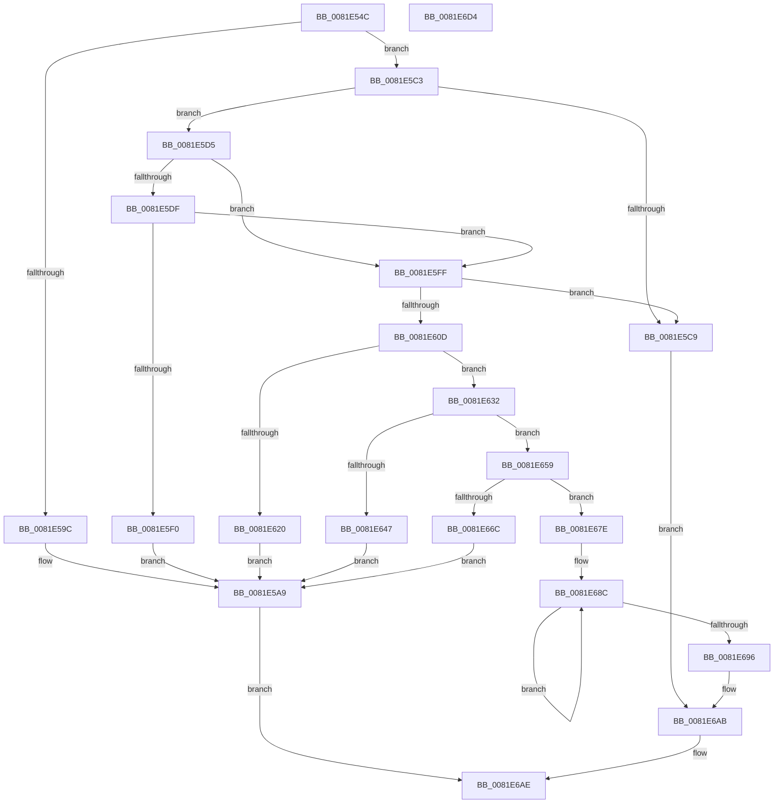

# AslpFileGetClrVersionAttribute

- RVA: `0x0081E54C`–`0x0081E6D5` (길이 `393` bytes)
- VA: `0x000000014081E54C`
- 실행 섹션: `PAGE`
- PDB 이름 있음: `예`; PDB Function 태그: `아니요`
- unwind 정보 RVA: `0x000D9E3C`
- 디코드: `95`개 명령, `393/393` bytes 표시
- 미해석 바이트: `0` (있으면 어셈블리에 `.byte`로 보존)

> 이 문서는 커널 이미지의 기계어와 PDB 기호를 분석해 생성했습니다. 4번과 5번은 함수 원형과 자료형을 바이너리 사용 방식에서 추정한 C 해석이며 원본 소스 복구 결과는 아닙니다.

## 1. Dependencies

- 직접 호출 지점: **8**; 고유 호출 대상: **8**
- 직접 호출자로 확인된 함수: **1**
- RIP 상대 이미지 참조: **7**

### Outgoing calls
- `0x0081E581` → [memset](../../text/6C/memset_function_006C6C40.md) (function, `0x006C6C40`)
- `0x0081E591` → [AslFileMappingEnsure](AslFileMappingEnsure_function_0081A5EC.md) (function, `0x0081A5EC`)
- `0x0081E5B9` → [AslLogCallPrintf](../95/AslLogCallPrintf_function_0095E4EC.md) (function, `0x0095E4EC`)
- `0x0081E5E5` → [AslpFileGetFileKindDetailAttribute](AslpFileGetFileKindDetailAttribute_function_0081EDFC.md) (function, `0x0081EDFC`)
- `0x0081E615` → [AslpFileGetClrVersion](AslpFileGetClrVersion_function_0081E388.md) (function, `0x0081E388`)
- `0x0081E63C` → [AslStringAnsiToUnicode](AslStringAnsiToUnicode_function_00819824.md) (function, `0x00819824`)
- `0x0081E661` → [AslStringXmlSanitize](../AC/AslStringXmlSanitize_function_00ACB4B8.md) (function, `0x00ACB4B8`)
- `0x0081E6BB` → [_security_check_cookie](../../text/6A/_security_check_cookie_function_006AC640.md) (function, `0x006AC640`)

### Direct callers
- [AslFileAllocAndGetAttributes](AslFileAllocAndGetAttributes_function_0081D8EC.md) at `0x0081DC87`

### Static image references
- `0x0081E55C` → RVA `0x00E0A740` (`.data`; read)
- `0x0081E59C` → RVA `0x0003EE90` (`.rdata`; read)
- `0x0081E5A9` → RVA `0x00040DD8` (`.rdata`; read)
- `0x0081E5F0` → RVA `0x0003F8C8` (`.rdata`; read)
- `0x0081E620` → RVA `0x00040DF8` (`.rdata`; read)
- `0x0081E647` → RVA `0x000408F8` (`.rdata`; read)
- `0x0081E66C` → RVA `0x0003FD78` (`.rdata`; read)

## 2. Other-region calls and transfers

- 다른 실행 섹션으로 향하는 call: **2**
  - `0x0081E581` → [memset](../../text/6C/memset_function_006C6C40.md) (`PAGE` → `.text`)
  - `0x0081E6BB` → [_security_check_cookie](../../text/6A/_security_check_cookie_function_006AC640.md) (`PAGE` → `.text`)
- 별도 외부 분기/꼬리 이동을 확인하지 못했습니다.

## 3. Assembly (complete function range)

```asm
0081E54C  48 89 5C 24 18                  mov qword ptr [rsp + 0x18], rbx
0081E551  55                              push rbp
0081E552  57                              push rdi
0081E553  41 56                           push r14
0081E555  48 81 EC 50 01 00 00            sub rsp, 0x150
0081E55C  48 8B 05 DD C1 5E 00            mov rax, qword ptr [rip + 0x5ec1dd]
0081E563  48 33 C4                        xor rax, rsp
0081E566  48 89 84 24 40 01 00 00         mov qword ptr [rsp + 0x140], rax
0081E56E  48 8B EA                        mov rbp, rdx
0081E571  48 8B F9                        mov rdi, rcx
0081E574  33 D2                           xor edx, edx
0081E576  48 8D 4C 24 40                  lea rcx, [rsp + 0x40]
0081E57B  41 B8 00 01 00 00               mov r8d, 0x100
0081E581  E8 BA 86 EA FF                  call 0x1406c6c40
0081E586  45 33 F6                        xor r14d, r14d
0081E589  48 8B CD                        mov rcx, rbp
0081E58C  4C 89 74 24 30                  mov qword ptr [rsp + 0x30], r14
0081E591  E8 56 C0 FF FF                  call 0x14081a5ec
0081E596  8B D8                           mov ebx, eax
0081E598  85 C0                           test eax, eax
0081E59A  79 27                           jns 0x14081e5c3
0081E59C  4C 8D 0D ED 08 82 FF            lea r9, [rip - 0x7df713]
0081E5A3  41 B8 27 15 00 00               mov r8d, 0x1527
0081E5A9  48 8D 15 28 28 82 FF            lea rdx, [rip - 0x7dd7d8]
0081E5B0  89 44 24 20                     mov dword ptr [rsp + 0x20], eax
0081E5B4  B9 01 00 00 00                  mov ecx, 1
0081E5B9  E8 2E FF 13 00                  call 0x14095e4ec
0081E5BE  E9 EB 00 00 00                  jmp 0x14081e6ae
0081E5C3  83 7D 40 06                     cmp dword ptr [rbp + 0x40], 6
0081E5C7  74 0C                           je 0x14081e5d5
0081E5C9  83 8F 78 03 00 00 02            or dword ptr [rdi + 0x378], 2
0081E5D0  E9 D6 00 00 00                  jmp 0x14081e6ab
0081E5D5  8B 87 98 03 00 00               mov eax, dword ptr [rdi + 0x398]
0081E5DB  A8 01                           test al, 1
0081E5DD  75 20                           jne 0x14081e5ff
0081E5DF  48 8B D5                        mov rdx, rbp
0081E5E2  48 8B CF                        mov rcx, rdi
0081E5E5  E8 12 08 00 00                  call 0x14081edfc
0081E5EA  8B D8                           mov ebx, eax
0081E5EC  85 C0                           test eax, eax
0081E5EE  79 0F                           jns 0x14081e5ff
0081E5F0  4C 8D 0D D1 12 82 FF            lea r9, [rip - 0x7ded2f]
0081E5F7  41 B8 38 15 00 00               mov r8d, 0x1538
0081E5FD  EB AA                           jmp 0x14081e5a9
0081E5FF  8B 87 90 03 00 00               mov eax, dword ptr [rdi + 0x390]
0081E605  83 C0 F4                        add eax, -0xc
0081E608  83 F8 03                        cmp eax, 3
0081E60B  77 BC                           ja 0x14081e5c9
0081E60D  48 8B D5                        mov rdx, rbp
0081E610  48 8D 4C 24 40                  lea rcx, [rsp + 0x40]
0081E615  E8 6E FD FF FF                  call 0x14081e388
0081E61A  8B D8                           mov ebx, eax
0081E61C  85 C0                           test eax, eax
0081E61E  79 12                           jns 0x14081e632
0081E620  4C 8D 0D D1 27 82 FF            lea r9, [rip - 0x7dd82f]
0081E627  41 B8 4B 15 00 00               mov r8d, 0x154b
0081E62D  E9 77 FF FF FF                  jmp 0x14081e5a9
0081E632  48 8D 54 24 40                  lea rdx, [rsp + 0x40]
0081E637  48 8D 4C 24 30                  lea rcx, [rsp + 0x30]
0081E63C  E8 E3 B1 FF FF                  call 0x140819824
0081E641  8B D8                           mov ebx, eax
0081E643  85 C0                           test eax, eax
0081E645  79 12                           jns 0x14081e659
0081E647  4C 8D 0D AA 22 82 FF            lea r9, [rip - 0x7ddd56]
0081E64E  41 B8 51 15 00 00               mov r8d, 0x1551
0081E654  E9 50 FF FF FF                  jmp 0x14081e5a9
0081E659  4C 8B 5C 24 30                  mov r11, qword ptr [rsp + 0x30]
0081E65E  49 8B CB                        mov rcx, r11
0081E661  E8 52 CE 2A 00                  call 0x140acb4b8
0081E666  8B D8                           mov ebx, eax
0081E668  85 C0                           test eax, eax
0081E66A  79 12                           jns 0x14081e67e
0081E66C  4C 8D 0D 05 17 82 FF            lea r9, [rip - 0x7de8fb]
0081E673  41 B8 57 15 00 00               mov r8d, 0x1557
0081E679  E9 2B FF FF FF                  jmp 0x14081e5a9
0081E67E  C7 87 60 03 00 00 04 00 00 00   mov dword ptr [rdi + 0x360], 4
0081E688  48 83 C8 FF                     or rax, 0xffffffffffffffff
0081E68C  48 FF C0                        inc rax
0081E68F  66 45 39 34 43                  cmp word ptr [r11 + rax*2], r14w
0081E694  75 F6                           jne 0x14081e68c
0081E696  83 8F 78 03 00 00 05            or dword ptr [rdi + 0x378], 5
0081E69D  48 89 87 68 03 00 00            mov qword ptr [rdi + 0x368], rax
0081E6A4  4C 89 9F 70 03 00 00            mov qword ptr [rdi + 0x370], r11
0081E6AB  41 8B DE                        mov ebx, r14d
0081E6AE  8B C3                           mov eax, ebx
0081E6B0  48 8B 8C 24 40 01 00 00         mov rcx, qword ptr [rsp + 0x140]
0081E6B8  48 33 CC                        xor rcx, rsp
0081E6BB  E8 80 DF E8 FF                  call 0x1406ac640
0081E6C0  48 8B 9C 24 80 01 00 00         mov rbx, qword ptr [rsp + 0x180]
0081E6C8  48 81 C4 50 01 00 00            add rsp, 0x150
0081E6CF  41 5E                           pop r14
0081E6D1  5F                              pop rdi
0081E6D2  5D                              pop rbp
0081E6D3  C3                              ret
0081E6D4  CC                              int3
```

## 4. C-style interpretation (structured pseudocode)

```c
__int64 __fastcall AslpFileGetClrVersionAttribute(__int64 a1, __int64 a2)
{
    __int64 result;
    __int64 v_r14;
    __int64 v_rsp;
    unsigned __int64 v_stack_m128;
    unsigned __int64 v_stack_m138;
    unsigned int v_stack_m148;
    unsigned __int64 v_stack_m28;
    unsigned __int64 v_stack_p18;

    v_stack_p18 = v_rbx;
    v_rsp = (v_rsp) - (336);
    result = (*(unsigned __int64 *)(v_rip + 6210013)) ^ (v_rsp);
    v_stack_m28 = result;
    a2 = 0;
    result = memset(v_stack_m128, a2, 256, a4);
    v_r14 = 0;
    v_stack_m138 = 0;
    result = AslFileMappingEnsure(0, a2, 256, a4);
    if (!sign_flag) goto loc_0081E5C3;
loc_0081E5A9:
    v_stack_m148 = (unsigned int)(result);
    result = AslLogCallPrintf(1, v_rip - 8247256, (unsigned int)(0x1527ULL), v_rip - 8255251);
    goto loc_0081E6AE;
loc_0081E5C3:
    if ((*(unsigned int *)(a2 + 64)) == 6) goto loc_0081E5D5;
loc_0081E5C9:
    goto loc_0081E6AB;
loc_0081E5D5:
    if ((((unsigned __int8)((unsigned int)(*(unsigned int *)(a1 + 920)))) & (1)) != 0) goto loc_0081E5FF;
    result = AslpFileGetFileKindDetailAttribute(a1, 0, (unsigned int)(0x1527ULL), v_rip - 8255251);
    if (!sign_flag) goto loc_0081E5FF;
    goto loc_0081E5A9;
loc_0081E5FF:
    result = (unsigned int)(((unsigned int)(*(unsigned int *)(a1 + 912))) + (-12));
    if (((unsigned int)(result)) > 3) goto loc_0081E5C9;
    result = AslpFileGetClrVersion(v_stack_m128, 0, (unsigned int)(0x1538ULL), v_rip - 8252719);
    if (!sign_flag) goto loc_0081E632;
    goto loc_0081E5A9;
loc_0081E632:
    result = AslStringAnsiToUnicode(v_stack_m138, v_stack_m128, (unsigned int)(0x154BULL), v_rip - 8247343);
    if (!sign_flag) goto loc_0081E659;
    goto loc_0081E5A9;
loc_0081E659:
    result = AslStringXmlSanitize(v_stack_m138, v_stack_m128, (unsigned int)(0x1551ULL), v_rip - 8248662);
    if (!sign_flag) goto loc_0081E67E;
    goto loc_0081E5A9;
loc_0081E67E:
    *(unsigned int *)(a1 + 864) = 4;
    result = (result) | (-1);
loc_0081E68C:
    result = (result) + 1;
    if ((*(unsigned __int16 *)(v_stack_m138 + result * 2)) != 0) goto loc_0081E68C;
    *(unsigned __int64 *)(a1 + 872) = result;
    *(unsigned __int64 *)(a1 + 880) = v_stack_m138;
loc_0081E6AB:
loc_0081E6AE:
    a1 = (v_stack_m28) ^ (v_rsp);
    result = _security_check_cookie(a1, v_stack_m128, (unsigned int)(0x1557ULL), v_rip - 8251643);
    v_rsp = (v_rsp) + (336);
    return result;
}
```

## 5. (Beta) C Style

```c
int64_t AslpFileGetClrVersionAttribute(void *Arg1, void *Arg2)
{
    uint8_t *arg1 = (uint8_t *)Arg1;
    uint8_t *arg2 = (uint8_t *)Arg2;

    int64_t result;
    int64_t local_r14;
    int64_t local_rsp;
    uint64_t v_stack_m128;
    uint64_t v_stack_m138;
    uint32_t v_stack_m148;
    uint64_t v_stack_m28;
    uint64_t v_stack_p18;

    v_stack_p18 = local_rbx;
    local_rsp = (local_rsp) - (336);
    result = (*(uint64_t *)(v_rip + 0x5EC1DD)) ^ (local_rsp);
    v_stack_m28 = result;
    Arg2 = 0;
    result = memset(v_stack_m128, Arg2, 256, a4);
    local_r14 = 0;
    v_stack_m138 = 0;
    result = AslFileMappingEnsure(0, Arg2, 256, a4);
    if (!sign_flag) goto loc_0081E5C3;
loc_0081E5A9:
    v_stack_m148 = (uint32_t)(result);
    result = AslLogCallPrintf(1, v_rip - 8247256, (uint32_t)(0x1527ULL), v_rip - 8255251);
    goto loc_0081E6AE;
loc_0081E5C3:
    if ((*(uint32_t *)(arg2 + 0x40)) == 6) goto loc_0081E5D5;
loc_0081E5C9:
    goto loc_0081E6AB;
loc_0081E5D5:
    if ((((uint8_t)((uint32_t)(*(uint32_t *)(arg1 + 0x398)))) & (1)) != 0) goto loc_0081E5FF;
    result = AslpFileGetFileKindDetailAttribute(Arg1, 0, (uint32_t)(0x1527ULL), v_rip - 8255251);
    if (!sign_flag) goto loc_0081E5FF;
    goto loc_0081E5A9;
loc_0081E5FF:
    result = (uint32_t)(((uint32_t)(*(uint32_t *)(arg1 + 0x390))) + (-12));
    if (((uint32_t)(result)) > 3) goto loc_0081E5C9;
    result = AslpFileGetClrVersion(v_stack_m128, 0, (uint32_t)(0x1538ULL), v_rip - 8252719);
    if (!sign_flag) goto loc_0081E632;
    goto loc_0081E5A9;
loc_0081E632:
    result = AslStringAnsiToUnicode(v_stack_m138, v_stack_m128, (uint32_t)(0x154BULL), v_rip - 8247343);
    if (!sign_flag) goto loc_0081E659;
    goto loc_0081E5A9;
loc_0081E659:
    result = AslStringXmlSanitize(v_stack_m138, v_stack_m128, (uint32_t)(0x1551ULL), v_rip - 8248662);
    if (!sign_flag) goto loc_0081E67E;
    goto loc_0081E5A9;
loc_0081E67E:
    *(uint32_t *)(arg1 + 0x360) = 4;
    result = (result) | (-1);
loc_0081E68C:
    result = (result) + 1;
    if ((*(uint16_t *)(v_stack_m138 + result * 2)) != 0) goto loc_0081E68C;
    *(uint64_t *)(arg1 + 0x368) = result;
    *(uint64_t *)(arg1 + 0x370) = v_stack_m138;
loc_0081E6AB:
loc_0081E6AE:
    Arg1 = (v_stack_m28) ^ (local_rsp);
    result = _security_check_cookie(Arg1, v_stack_m128, (uint32_t)(0x1557ULL), v_rip - 8251643);
    local_rsp = (local_rsp) + (336);
    return result;
}
```

### 관측된 메모리 오프셋

구조체 형식이 확인되지 않은 접근은 인자 기준의 오프셋으로만 기록했습니다.

| 기준 인자 | 오프셋 표현 | 폭 (bit) | 접근 |
|---|---:|---:|---|
| `Arg1` | `+ 0x360` | `32` | `W` |
| `Arg1` | `+ 0x368` | `64` | `W` |
| `Arg1` | `+ 0x370` | `64` | `W` |
| `Arg1` | `+ 0x378` | `32` | `R/W` |
| `Arg1` | `+ 0x390` | `32` | `R` |
| `Arg1` | `+ 0x398` | `32` | `R` |
| `Arg2` | `+ 0x40` | `32` | `R` |

## 6. Execution-region graph

[열기: 2D/3D 그래프와 함수 탐색 컨트롤 패널](../../../control-panel.html?section=page&rva=0x0081E54C&view=graph)

- 2D 그래프는 위에서 아래로 흐르고, 3D 그래프는 빈 공간을 드래그해 회전합니다. Shift+드래그는 이동, 휠은 확대·축소, 함수 노드 선택은 대상 보고서 이동입니다.

### Static fallback


