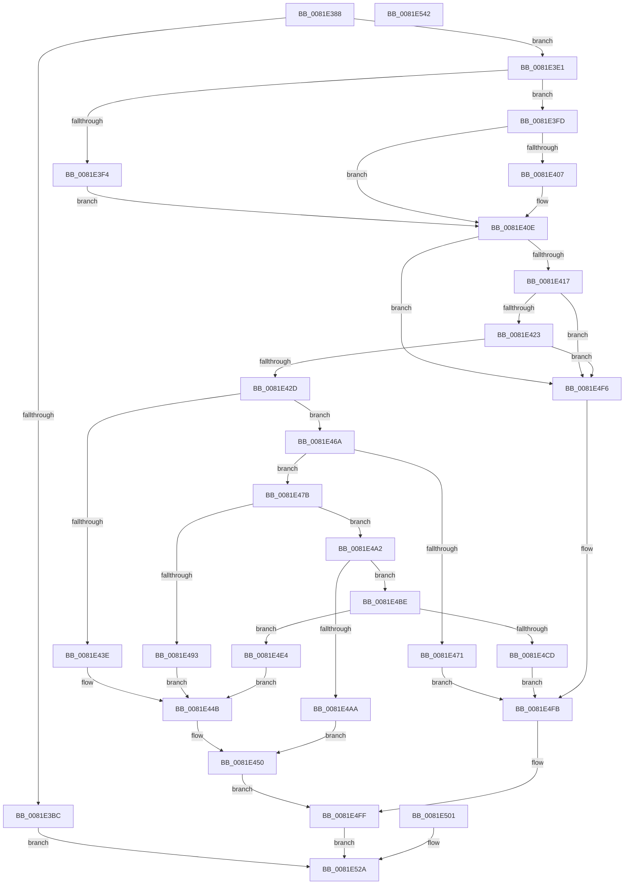

# AslpFileGetClrVersion

- RVA: `0x0081E388`–`0x0081E543` (길이 `443` bytes)
- VA: `0x000000014081E388`
- 실행 섹션: `PAGE`
- PDB 이름 있음: `예`; PDB Function 태그: `아니요`
- unwind 정보 RVA: `0x000D9E0C`
- 디코드: `108`개 명령, `443/443` bytes 표시
- 미해석 바이트: `0` (있으면 어셈블리에 `.byte`로 보존)

> 이 문서는 커널 이미지의 기계어와 PDB 기호를 분석해 생성했습니다. 4번과 5번은 함수 원형과 자료형을 바이너리 사용 방식에서 추정한 C 해석이며 원본 소스 복구 결과는 아닙니다.

## 1. Dependencies

- 직접 호출 지점: **7**; 고유 호출 대상: **4**
- 직접 호출자로 확인된 함수: **1**
- RIP 상대 이미지 참조: **7**

### Outgoing calls
- `0x0081E3B1` → [AslpFileGetImageNtHeader](AslpFileGetImageNtHeader_function_0081F434.md) (function, `0x0081F434`)
- `0x0081E3D7` → [AslLogCallPrintf](../95/AslLogCallPrintf_function_0095E4EC.md) (function, `0x0095E4EC`)
- `0x0081E434` → [AslpImageRvaToVa](../82/AslpImageRvaToVa_function_008214BC.md) (function, `0x008214BC`)
- `0x0081E460` → [AslLogCallPrintf](../95/AslLogCallPrintf_function_0095E4EC.md) (function, `0x0095E4EC`)
- `0x0081E486` → [AslpImageRvaToVa](../82/AslpImageRvaToVa_function_008214BC.md) (function, `0x008214BC`)
- `0x0081E4D7` → [memcpy](../../text/6C/memcpy_function_006C6840.md) (function, `0x006C6840`)
- `0x0081E524` → [AslLogCallPrintf](../95/AslLogCallPrintf_function_0095E4EC.md) (function, `0x0095E4EC`)

### Direct callers
- [AslpFileGetClrVersionAttribute](AslpFileGetClrVersionAttribute_function_0081E54C.md) at `0x0081E615`

### Static image references
- `0x0081E3C0` → RVA `0x0003EED8` (`.rdata`; read)
- `0x0081E3CD` → RVA `0x00040E20` (`.rdata`; read)
- `0x0081E43E` → RVA `0x00040E38` (`.rdata`; read)
- `0x0081E493` → RVA `0x00040798` (`.rdata`; read)
- `0x0081E4AF` → RVA `0x000407D0` (`.rdata`; read)
- `0x0081E4E4` → RVA `0x00040800` (`.rdata`; read)
- `0x0081E50B` → RVA `0x0003EF20` (`.rdata`; read)

## 2. Other-region calls and transfers

- 다른 실행 섹션으로 향하는 call: **1**
  - `0x0081E4D7` → [memcpy](../../text/6C/memcpy_function_006C6840.md) (`PAGE` → `.text`)
- 별도 외부 분기/꼬리 이동을 확인하지 못했습니다.

## 3. Assembly (complete function range)

```asm
0081E388  48 8B C4                        mov rax, rsp
0081E38B  48 89 58 10                     mov qword ptr [rax + 0x10], rbx
0081E38F  48 89 70 18                     mov qword ptr [rax + 0x18], rsi
0081E393  48 89 78 20                     mov qword ptr [rax + 0x20], rdi
0081E397  41 56                           push r14
0081E399  48 83 EC 40                     sub rsp, 0x40
0081E39D  4C 8B F2                        mov r14, rdx
0081E3A0  48 8B F1                        mov rsi, rcx
0081E3A3  48 83 60 08 00                  and qword ptr [rax + 8], 0
0081E3A8  33 FF                           xor edi, edi
0081E3AA  40 88 39                        mov byte ptr [rcx], dil
0081E3AD  48 8D 48 08                     lea rcx, [rax + 8]
0081E3B1  E8 7E 10 00 00                  call 0x14081f434
0081E3B6  8B D8                           mov ebx, eax
0081E3B8  85 C0                           test eax, eax
0081E3BA  79 25                           jns 0x14081e3e1
0081E3BC  89 44 24 20                     mov dword ptr [rsp + 0x20], eax
0081E3C0  4C 8D 0D 11 0B 82 FF            lea r9, [rip - 0x7df4ef]
0081E3C7  41 B8 85 15 00 00               mov r8d, 0x1585
0081E3CD  48 8D 15 4C 2A 82 FF            lea rdx, [rip - 0x7dd5b4]
0081E3D4  8D 4F 01                        lea ecx, [rdi + 1]
0081E3D7  E8 10 01 14 00                  call 0x14095e4ec
0081E3DC  E9 49 01 00 00                  jmp 0x14081e52a
0081E3E1  48 8B 5C 24 50                  mov rbx, qword ptr [rsp + 0x50]
0081E3E6  0F B7 43 18                     movzx eax, word ptr [rbx + 0x18]
0081E3EA  B9 0B 01 00 00                  mov ecx, 0x10b
0081E3EF  66 3B C1                        cmp ax, cx
0081E3F2  75 09                           jne 0x14081e3fd
0081E3F4  48 8D BB E8 00 00 00            lea rdi, [rbx + 0xe8]
0081E3FB  EB 11                           jmp 0x14081e40e
0081E3FD  B9 0B 02 00 00                  mov ecx, 0x20b
0081E402  66 3B C1                        cmp ax, cx
0081E405  75 07                           jne 0x14081e40e
0081E407  48 8D BB F8 00 00 00            lea rdi, [rbx + 0xf8]
0081E40E  48 85 FF                        test rdi, rdi
0081E411  0F 84 DF 00 00 00               je 0x14081e4f6
0081E417  44 8B 07                        mov r8d, dword ptr [rdi]
0081E41A  45 85 C0                        test r8d, r8d
0081E41D  0F 84 D3 00 00 00               je 0x14081e4f6
0081E423  83 7F 04 48                     cmp dword ptr [rdi + 4], 0x48
0081E427  0F 82 C9 00 00 00               jb 0x14081e4f6
0081E42D  49 8D 56 08                     lea rdx, [r14 + 8]
0081E431  48 8B CB                        mov rcx, rbx
0081E434  E8 83 30 00 00                  call 0x1408214bc
0081E439  48 85 C0                        test rax, rax
0081E43C  75 2C                           jne 0x14081e46a
0081E43E  4C 8D 0D F3 29 82 FF            lea r9, [rip - 0x7dd60d]
0081E445  41 B8 A2 15 00 00               mov r8d, 0x15a2
0081E44B  BB 7B 00 00 C0                  mov ebx, 0xc000007b
0081E450  89 5C 24 30                     mov dword ptr [rsp + 0x30], ebx
0081E454  48 8D 15 C5 29 82 FF            lea rdx, [rip - 0x7dd63b]
0081E45B  B9 01 00 00 00                  mov ecx, 1
0081E460  E8 87 00 14 00                  call 0x14095e4ec
0081E465  E9 95 00 00 00                  jmp 0x14081e4ff
0081E46A  66 83 78 04 02                  cmp word ptr [rax + 4], 2
0081E46F  74 0A                           je 0x14081e47b
0081E471  BB BB 00 00 C0                  mov ebx, 0xc00000bb
0081E476  E9 80 00 00 00                  jmp 0x14081e4fb
0081E47B  44 8B 40 08                     mov r8d, dword ptr [rax + 8]
0081E47F  49 8D 56 08                     lea rdx, [r14 + 8]
0081E483  48 8B CB                        mov rcx, rbx
0081E486  E8 31 30 00 00                  call 0x1408214bc
0081E48B  48 8B D0                        mov rdx, rax
0081E48E  48 85 C0                        test rax, rax
0081E491  75 0F                           jne 0x14081e4a2
0081E493  4C 8D 0D FE 22 82 FF            lea r9, [rip - 0x7ddd02]
0081E49A  41 B8 B6 15 00 00               mov r8d, 0x15b6
0081E4A0  EB A9                           jmp 0x14081e44b
0081E4A2  81 38 42 53 4A 42               cmp dword ptr [rax], 0x424a5342
0081E4A8  74 14                           je 0x14081e4be
0081E4AA  BB BB 00 00 C0                  mov ebx, 0xc00000bb
0081E4AF  4C 8D 0D 1A 23 82 FF            lea r9, [rip - 0x7ddce6]
0081E4B6  41 B8 C0 15 00 00               mov r8d, 0x15c0
0081E4BC  EB 92                           jmp 0x14081e450
0081E4BE  8B 58 0C                        mov ebx, dword ptr [rax + 0xc]
0081E4C1  48 8D 43 FF                     lea rax, [rbx - 1]
0081E4C5  48 3D FE 00 00 00               cmp rax, 0xfe
0081E4CB  77 17                           ja 0x14081e4e4
0081E4CD  48 83 C2 10                     add rdx, 0x10
0081E4D1  44 8B C3                        mov r8d, ebx
0081E4D4  48 8B CE                        mov rcx, rsi
0081E4D7  E8 64 83 EA FF                  call 0x1406c6840
0081E4DC  C6 04 33 00                     mov byte ptr [rbx + rsi], 0
0081E4E0  33 DB                           xor ebx, ebx
0081E4E2  EB 17                           jmp 0x14081e4fb
0081E4E4  4C 8D 0D 15 23 82 FF            lea r9, [rip - 0x7ddceb]
0081E4EB  41 B8 CC 15 00 00               mov r8d, 0x15cc
0081E4F1  E9 55 FF FF FF                  jmp 0x14081e44b
0081E4F6  BB 7B 00 00 C0                  mov ebx, 0xc000007b
0081E4FB  89 5C 24 30                     mov dword ptr [rsp + 0x30], ebx
0081E4FF  EB 29                           jmp 0x14081e52a
0081E501  8B D8                           mov ebx, eax
0081E503  89 44 24 30                     mov dword ptr [rsp + 0x30], eax
0081E507  89 44 24 20                     mov dword ptr [rsp + 0x20], eax
0081E50B  4C 8D 0D 0E 0A 82 FF            lea r9, [rip - 0x7df5f2]
0081E512  41 B8 E3 15 00 00               mov r8d, 0x15e3
0081E518  48 8D 15 01 29 82 FF            lea rdx, [rip - 0x7dd6ff]
0081E51F  B9 01 00 00 00                  mov ecx, 1
0081E524  E8 C3 FF 13 00                  call 0x14095e4ec
0081E529  90                              nop
0081E52A  8B C3                           mov eax, ebx
0081E52C  48 8B 5C 24 58                  mov rbx, qword ptr [rsp + 0x58]
0081E531  48 8B 74 24 60                  mov rsi, qword ptr [rsp + 0x60]
0081E536  48 8B 7C 24 68                  mov rdi, qword ptr [rsp + 0x68]
0081E53B  48 83 C4 40                     add rsp, 0x40
0081E53F  41 5E                           pop r14
0081E541  C3                              ret
0081E542  CC                              int3
```

## 4. C-style interpretation (structured pseudocode)

```c
__int64 __fastcall AslpFileGetClrVersion(__int64 a1, __int64 a2)
{
    __int64 result;
    __int64 v_rbx;
    __int64 v_rdi;
    __int64 v_rsp;
    unsigned int v_stack_m18;
    unsigned int v_stack_m28;
    unsigned __int64 v_stack_p10;
    unsigned __int64 v_stack_p18;
    unsigned __int64 v_stack_p20;
    unsigned __int64 v_stack_p8;

    *(unsigned __int64 *)(v_rsp + 16) = v_rbx;
    *(unsigned __int64 *)(v_rsp + 24) = v_rsi;
    *(unsigned __int64 *)(v_rsp + 32) = v_rdi;
    v_rsp = (v_rsp) - (64);
    v_rdi = 0;
    *(unsigned __int8 *)(a1) = 0;
    result = AslpFileGetImageNtHeader(v_rsp + 8, a2, a3, a4);
    if (!sign_flag) goto loc_0081E3E1;
    v_stack_m28 = (unsigned int)(result);
    result = AslLogCallPrintf(v_rdi + 1, v_rip - 8246708, (unsigned int)(0x1585ULL), v_rip - 8254703);
    goto loc_0081E52A;
loc_0081E3E1:
    if (((unsigned __int16)(*(unsigned __int16 *)(v_stack_p8 + 24))) != 267) goto loc_0081E3FD;
    goto loc_0081E40E;
loc_0081E3FD:
    v_rdi = v_stack_p8 + 232;
    if (((unsigned __int16)(*(unsigned __int16 *)(v_stack_p8 + 24))) == 523) {
        v_rdi = v_stack_p8 + 248;
    }
    if (v_rdi == 0) goto loc_0081E4F6;
    if ((unsigned int)((unsigned int)(*(unsigned int *)(v_rdi))) == 0) goto loc_0081E4F6;
    if ((*(unsigned int *)(v_rdi + 4)) < 72) goto loc_0081E4F6;
    result = AslpImageRvaToVa(v_stack_p8, a2 + 8, (unsigned int)(*(unsigned int *)(v_rdi)), v_rip - 8254703);
    if (result != 0) goto loc_0081E46A;
loc_0081E44B:
loc_0081E450:
    v_stack_m18 = (unsigned int)((unsigned int)(0xC000007BULL));
    result = AslLogCallPrintf(1, v_rip - 8246843, (unsigned int)(0x15A2ULL), v_rip - 8246797);
    goto loc_0081E4FF;
loc_0081E46A:
    if ((*(unsigned __int16 *)(result + 4)) == 2) goto loc_0081E47B;
    goto loc_0081E4FB;
loc_0081E47B:
    result = AslpImageRvaToVa((unsigned int)(0xC00000BBULL), a2 + 8, (unsigned int)(*(unsigned int *)(result + 8)), v_rip - 8246797);
    if (result != 0) goto loc_0081E4A2;
    goto loc_0081E44B;
loc_0081E4A2:
    if ((*(unsigned int *)(result)) == 0x424A5342ULL) goto loc_0081E4BE;
    goto loc_0081E450;
loc_0081E4BE:
    if (((unsigned int)(*(unsigned int *)(result + 12)) - 1) > 254) goto loc_0081E4E4;
    a2 = (result) + (16);
    result = memcpy(a1, a2, (unsigned int)((unsigned int)((unsigned int)(*(unsigned int *)(result + 12)))), v_rip - 8248550);
    *(unsigned __int8 *)((unsigned int)(*(unsigned int *)(result + 12)) + a1 * 1) = 0;
    v_rbx = 0;
    goto loc_0081E4FB;
loc_0081E4E4:
    goto loc_0081E44B;
loc_0081E4F6:
loc_0081E4FB:
    v_stack_m18 = (unsigned int)((unsigned int)(0xC000007BULL));
loc_0081E4FF:
    goto loc_0081E52A;
loc_0081E52A:
    v_rsp = (v_rsp) + (64);
    return (unsigned int)((unsigned int)((unsigned int)(0xC000007BULL)));
}
```

## 5. (Beta) C Style

```c
int64_t AslpFileGetClrVersion(void *Arg1, void *Arg2)
{
    uint8_t *arg1 = (uint8_t *)Arg1;
    uint8_t *arg2 = (uint8_t *)Arg2;

    int64_t result;
    int64_t local_rbx;
    int64_t local_rdi;
    int64_t local_rsp;
    uint32_t v_stack_m18;
    uint32_t v_stack_m28;
    uint64_t v_stack_p10;
    uint64_t v_stack_p18;
    uint64_t v_stack_p20;
    uint64_t v_stack_p8;

    *(uint64_t *)(local_rsp + 0x10) = local_rbx;
    *(uint64_t *)(local_rsp + 0x18) = local_rsi;
    *(uint64_t *)(local_rsp + 0x20) = local_rdi;
    local_rsp = (local_rsp) - (64);
    local_rdi = 0;
    *(uint8_t *)(arg1) = 0;
    result = AslpFileGetImageNtHeader(local_rsp + 8, Arg2, a3, a4);
    if (!sign_flag) goto loc_0081E3E1;
    v_stack_m28 = (uint32_t)(result);
    result = AslLogCallPrintf(local_rdi + 1, v_rip - 8246708, (uint32_t)(0x1585ULL), v_rip - 8254703);
    goto loc_0081E52A;
loc_0081E3E1:
    if (((uint16_t)(*(uint16_t *)(v_stack_p8 + 0x18))) != 267) goto loc_0081E3FD;
    goto loc_0081E40E;
loc_0081E3FD:
    local_rdi = v_stack_p8 + 232;
    if (((uint16_t)(*(uint16_t *)(v_stack_p8 + 0x18))) == 523) {
        local_rdi = v_stack_p8 + 248;
    }
    if (local_rdi == 0) goto loc_0081E4F6;
    if ((uint32_t)((uint32_t)(*(uint32_t *)(local_rdi))) == 0) goto loc_0081E4F6;
    if ((*(uint32_t *)(local_rdi + 0x4)) < 72) goto loc_0081E4F6;
    result = AslpImageRvaToVa(v_stack_p8, Arg2 + 8, (uint32_t)(*(uint32_t *)(local_rdi)), v_rip - 8254703);
    if (result != 0) goto loc_0081E46A;
loc_0081E44B:
loc_0081E450:
    v_stack_m18 = (uint32_t)((uint32_t)(0xC000007BULL));
    result = AslLogCallPrintf(1, v_rip - 8246843, (uint32_t)(0x15A2ULL), v_rip - 8246797);
    goto loc_0081E4FF;
loc_0081E46A:
    if ((*(uint16_t *)(result + 0x4)) == 2) goto loc_0081E47B;
    goto loc_0081E4FB;
loc_0081E47B:
    result = AslpImageRvaToVa((uint32_t)(0xC00000BBULL), Arg2 + 8, (uint32_t)(*(uint32_t *)(result + 0x8)), v_rip - 8246797);
    if (result != 0) goto loc_0081E4A2;
    goto loc_0081E44B;
loc_0081E4A2:
    if ((*(uint32_t *)(result)) == 0x424A5342ULL) goto loc_0081E4BE;
    goto loc_0081E450;
loc_0081E4BE:
    if (((uint32_t)(*(uint32_t *)(result + 0xC)) - 1) > 254) goto loc_0081E4E4;
    Arg2 = (result) + (16);
    result = memcpy(Arg1, Arg2, (uint32_t)((uint32_t)((uint32_t)(*(uint32_t *)(result + 0xC)))), v_rip - 8248550);
    *(uint8_t *)((uint32_t)(*(uint32_t *)(result + 0xC)) + arg1 * 1) = 0;
    local_rbx = 0;
    goto loc_0081E4FB;
loc_0081E4E4:
    goto loc_0081E44B;
loc_0081E4F6:
loc_0081E4FB:
    v_stack_m18 = (uint32_t)((uint32_t)(0xC000007BULL));
loc_0081E4FF:
    goto loc_0081E52A;
loc_0081E52A:
    local_rsp = (local_rsp) + (64);
    return (uint32_t)((uint32_t)((uint32_t)(0xC000007BULL)));
}
```

### 관측된 메모리 오프셋

구조체 형식이 확인되지 않은 접근은 인자 기준의 오프셋으로만 기록했습니다.

| 기준 인자 | 오프셋 표현 | 폭 (bit) | 접근 |
|---|---:|---:|---|
| `Arg1` | `+ 0x0` | `8` | `W` |
| `Arg2` | `+ 0x8` | `64` | `R` |

## 6. Execution-region graph

[열기: 2D/3D 그래프와 함수 탐색 컨트롤 패널](../../../control-panel.html?section=page&rva=0x0081E388&view=graph)

- 2D 그래프는 위에서 아래로 흐르고, 3D 그래프는 빈 공간을 드래그해 회전합니다. Shift+드래그는 이동, 휠은 확대·축소, 함수 노드 선택은 대상 보고서 이동입니다.

### Static fallback


