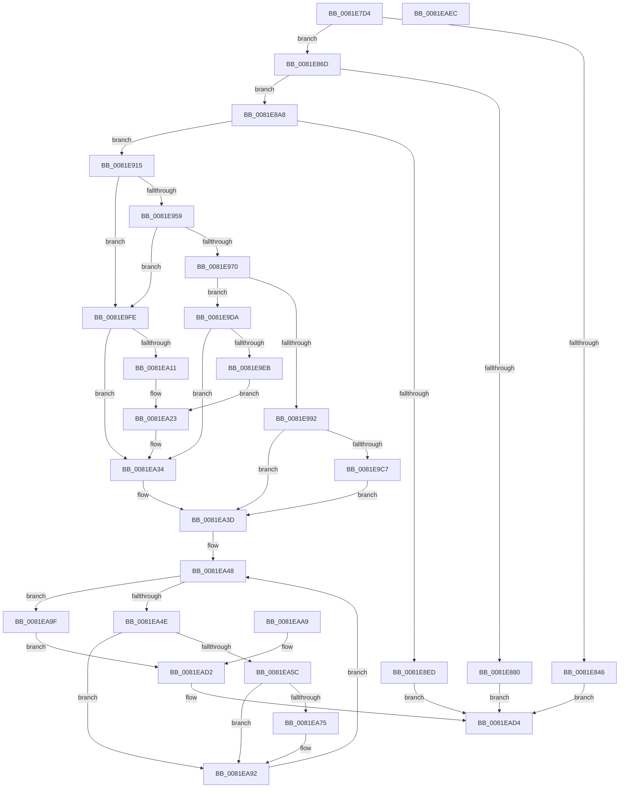

# AslpFileGetCrcChecksumBoot

- RVA: `0x0081E7D4`–`0x0081EAED` (길이 `793` bytes)
- VA: `0x000000014081E7D4`
- 실행 섹션: `PAGE`
- PDB 이름 있음: `예`; PDB Function 태그: `아니요`
- unwind 정보 RVA: `0x000D9E5C`
- 디코드: `193`개 명령, `793/793` bytes 표시
- 미해석 바이트: `0` (있으면 어셈블리에 `.byte`로 보존)

> 이 문서는 커널 이미지의 기계어와 PDB 기호를 분석해 생성했습니다. 4번과 5번은 함수 원형과 자료형을 바이너리 사용 방식에서 추정한 C 해석이며 원본 소스 복구 결과는 아닙니다.

## 1. Dependencies

- 직접 호출 지점: **15**; 고유 호출 대상: **7**
- 직접 호출자로 확인된 함수: **1**
- RIP 상대 이미지 참조: **7**

### Outgoing calls
- `0x0081E837` → [AslpFileGetImageCodeSectionHeader](AslpFileGetImageCodeSectionHeader_function_0081F298.md) (function, `0x0081F298`)
- `0x0081E861` → [AslLogCallPrintf](../95/AslLogCallPrintf_function_0095E4EC.md) (function, `0x0095E4EC`)
- `0x0081E877` → [AslpMemoryRangeCheckBounds](../../text/69/AslpMemoryRangeCheckBounds_function_0069D3E8.md) (function, `0x0069D3E8`)
- `0x0081E899` → [AslLogCallPrintf](../95/AslLogCallPrintf_function_0095E4EC.md) (function, `0x0095E4EC`)
- `0x0081E8B8` → [AslpImageRvaToVa](../82/AslpImageRvaToVa_function_008214BC.md) (function, `0x008214BC`)
- `0x0081E8E4` → [AslpMemoryRangeCheckBounds](../../text/69/AslpMemoryRangeCheckBounds_function_0069D3E8.md) (function, `0x0069D3E8`)
- `0x0081E906` → [AslLogCallPrintf](../95/AslLogCallPrintf_function_0095E4EC.md) (function, `0x0095E4EC`)
- `0x0081E928` → [AslpFileGetImageResourceDirectoryRoot](AslpFileGetImageResourceDirectoryRoot_function_0081F53C.md) (function, `0x0081F53C`)
- `0x0081E963` → [AslpMemoryRangeCheckBounds](../../text/69/AslpMemoryRangeCheckBounds_function_0069D3E8.md) (function, `0x0069D3E8`)
- `0x0081E983` → [AslpFileGetVersionBlockFromResourceRoot](AslpFileGetVersionBlockFromResourceRoot_function_0081FF98.md) (function, `0x0081FF98`)
- `0x0081E9BE` → [AslpMemoryRangeCheckBounds](../../text/69/AslpMemoryRangeCheckBounds_function_0069D3E8.md) (function, `0x0069D3E8`)
- `0x0081EA2F` → [AslLogCallPrintf](../95/AslLogCallPrintf_function_0095E4EC.md) (function, `0x0095E4EC`)
- `0x0081EA6C` → [AslpMemoryRangeCheckBounds](../../text/69/AslpMemoryRangeCheckBounds_function_0069D3E8.md) (function, `0x0069D3E8`)
- `0x0081EA83` → [AslComputeCrc32](AslComputeCrc32_function_00819AFC.md) (function, `0x00819AFC`)
- `0x0081EACC` → [AslLogCallPrintf](../95/AslLogCallPrintf_function_0095E4EC.md) (function, `0x0095E4EC`)

### Direct callers
- [AslpFileGetChecksumAttributes](AslpFileGetChecksumAttributes_function_0081E130.md) at `0x0081E311`

### Static image references
- `0x0081E84A` → RVA `0x00040CA0` (`.rdata`; read)
- `0x0081E857` → RVA `0x00040D00` (`.rdata`; read)
- `0x0081E880` → RVA `0x00040D20` (`.rdata`; read)
- `0x0081E8ED` → RVA `0x00040D68` (`.rdata`; read)
- `0x0081E9EF` → RVA `0x00040DA0` (`.rdata`; read)
- `0x0081EA16` → RVA `0x0003FA50` (`.rdata`; read)
- `0x0081EAB3` → RVA `0x0003EF20` (`.rdata`; read)

## 2. Other-region calls and transfers

- 다른 실행 섹션으로 향하는 call: **5**
  - `0x0081E877` → [AslpMemoryRangeCheckBounds](../../text/69/AslpMemoryRangeCheckBounds_function_0069D3E8.md) (`PAGE` → `.text`)
  - `0x0081E8E4` → [AslpMemoryRangeCheckBounds](../../text/69/AslpMemoryRangeCheckBounds_function_0069D3E8.md) (`PAGE` → `.text`)
  - `0x0081E963` → [AslpMemoryRangeCheckBounds](../../text/69/AslpMemoryRangeCheckBounds_function_0069D3E8.md) (`PAGE` → `.text`)
  - `0x0081E9BE` → [AslpMemoryRangeCheckBounds](../../text/69/AslpMemoryRangeCheckBounds_function_0069D3E8.md) (`PAGE` → `.text`)
  - `0x0081EA6C` → [AslpMemoryRangeCheckBounds](../../text/69/AslpMemoryRangeCheckBounds_function_0069D3E8.md) (`PAGE` → `.text`)
- 별도 외부 분기/꼬리 이동을 확인하지 못했습니다.

## 3. Assembly (complete function range)

```asm
0081E7D4  48 8B C4                        mov rax, rsp
0081E7D7  48 89 58 08                     mov qword ptr [rax + 8], rbx
0081E7DB  56                              push rsi
0081E7DC  57                              push rdi
0081E7DD  41 54                           push r12
0081E7DF  41 56                           push r14
0081E7E1  41 57                           push r15
0081E7E3  48 81 EC A0 00 00 00            sub rsp, 0xa0
0081E7EA  49 8B F0                        mov rsi, r8
0081E7ED  4C 8B FA                        mov r15, rdx
0081E7F0  4C 8B E1                        mov r12, rcx
0081E7F3  33 FF                           xor edi, edi
0081E7F5  44 8B F7                        mov r14d, edi
0081E7F8  0F 57 C0                        xorps xmm0, xmm0
0081E7FB  0F 11 40 80                     movups xmmword ptr [rax - 0x80], xmm0
0081E7FF  0F 11 40 90                     movups xmmword ptr [rax - 0x70], xmm0
0081E803  48 89 78 B0                     mov qword ptr [rax - 0x50], rdi
0081E807  48 89 78 18                     mov qword ptr [rax + 0x18], rdi
0081E80B  48 89 78 20                     mov qword ptr [rax + 0x20], rdi
0081E80F  48 89 78 B8                     mov qword ptr [rax - 0x48], rdi
0081E813  4D 8B 48 20                     mov r9, qword ptr [r8 + 0x20]
0081E817  4C 89 48 A0                     mov qword ptr [rax - 0x60], r9
0081E81B  49 8B 50 28                     mov rdx, qword ptr [r8 + 0x28]
0081E81F  49 03 D1                        add rdx, r9
0081E822  48 89 50 A8                     mov qword ptr [rax - 0x58], rdx
0081E826  0F 11 44 24 38                  movups xmmword ptr [rsp + 0x38], xmm0
0081E82B  4C 8D 40 A0                     lea r8, [rax - 0x60]
0081E82F  49 8B D7                        mov rdx, r15
0081E832  48 8D 4C 24 38                  lea rcx, [rsp + 0x38]
0081E837  E8 5C 0A 00 00                  call 0x14081f298
0081E83C  8B D8                           mov ebx, eax
0081E83E  89 44 24 30                     mov dword ptr [rsp + 0x30], eax
0081E842  85 C0                           test eax, eax
0081E844  79 27                           jns 0x14081e86d
0081E846  89 44 24 20                     mov dword ptr [rsp + 0x20], eax
0081E84A  4C 8D 0D 4F 24 82 FF            lea r9, [rip - 0x7ddbb1]
0081E851  41 B8 C0 13 00 00               mov r8d, 0x13c0
0081E857  48 8D 15 A2 24 82 FF            lea rdx, [rip - 0x7ddb5e]
0081E85E  8D 4F 01                        lea ecx, [rdi + 1]
0081E861  E8 86 FC 13 00                  call 0x14095e4ec
0081E866  8B C3                           mov eax, ebx
0081E868  E9 67 02 00 00                  jmp 0x14081ead4
0081E86D  48 8D 54 24 68                  lea rdx, [rsp + 0x68]
0081E872  48 8D 4C 24 38                  lea rcx, [rsp + 0x38]
0081E877  E8 6C EB E7 FF                  call 0x14069d3e8
0081E87C  84 C0                           test al, al
0081E87E  75 28                           jne 0x14081e8a8
0081E880  4C 8D 0D 99 24 82 FF            lea r9, [rip - 0x7ddb67]
0081E887  41 B8 C5 13 00 00               mov r8d, 0x13c5
0081E88D  48 8D 15 6C 24 82 FF            lea rdx, [rip - 0x7ddb94]
0081E894  B9 01 00 00 00                  mov ecx, 1
0081E899  E8 4E FC 13 00                  call 0x14095e4ec
0081E89E  B8 2E 02 00 C0                  mov eax, 0xc000022e
0081E8A3  E9 2C 02 00 00                  jmp 0x14081ead4
0081E8A8  48 8D 56 08                     lea rdx, [rsi + 8]
0081E8AC  48 8B 5C 24 38                  mov rbx, qword ptr [rsp + 0x38]
0081E8B1  44 8B 43 0C                     mov r8d, dword ptr [rbx + 0xc]
0081E8B5  49 8B CF                        mov rcx, r15
0081E8B8  E8 FF 2B 00 00                  call 0x1408214bc
0081E8BD  4C 8B C0                        mov r8, rax
0081E8C0  48 89 44 24 48                  mov qword ptr [rsp + 0x48], rax
0081E8C5  8B 4B 10                        mov ecx, dword ptr [rbx + 0x10]
0081E8C8  B8 00 10 00 00                  mov eax, 0x1000
0081E8CD  3B C8                           cmp ecx, eax
0081E8CF  0F 42 C1                        cmovb eax, ecx
0081E8D2  49 03 C0                        add rax, r8
0081E8D5  48 89 44 24 50                  mov qword ptr [rsp + 0x50], rax
0081E8DA  48 8D 54 24 68                  lea rdx, [rsp + 0x68]
0081E8DF  48 8D 4C 24 48                  lea rcx, [rsp + 0x48]
0081E8E4  E8 FF EA E7 FF                  call 0x14069d3e8
0081E8E9  84 C0                           test al, al
0081E8EB  75 28                           jne 0x14081e915
0081E8ED  4C 8D 0D 74 24 82 FF            lea r9, [rip - 0x7ddb8c]
0081E8F4  41 B8 CF 13 00 00               mov r8d, 0x13cf
0081E8FA  48 8D 15 FF 23 82 FF            lea rdx, [rip - 0x7ddc01]
0081E901  B9 01 00 00 00                  mov ecx, 1
0081E906  E8 E1 FB 13 00                  call 0x14095e4ec
0081E90B  B8 2E 02 00 C0                  mov eax, 0xc000022e
0081E910  E9 BF 01 00 00                  jmp 0x14081ead4
0081E915  4C 8B C6                        mov r8, rsi
0081E918  48 8D 94 24 E8 00 00 00         lea rdx, [rsp + 0xe8]
0081E920  48 8D 8C 24 E0 00 00 00         lea rcx, [rsp + 0xe0]
0081E928  E8 0F 0C 00 00                  call 0x14081f53c
0081E92D  44 8B D0                        mov r10d, eax
0081E930  89 44 24 30                     mov dword ptr [rsp + 0x30], eax
0081E934  4C 8B 9C 24 E0 00 00 00         mov r11, qword ptr [rsp + 0xe0]
0081E93C  4C 89 5C 24 58                  mov qword ptr [rsp + 0x58], r11
0081E941  48 8B 8C 24 E8 00 00 00         mov rcx, qword ptr [rsp + 0xe8]
0081E949  49 03 CB                        add rcx, r11
0081E94C  48 89 4C 24 60                  mov qword ptr [rsp + 0x60], rcx
0081E951  85 C0                           test eax, eax
0081E953  0F 88 A5 00 00 00               js 0x14081e9fe
0081E959  48 8D 54 24 68                  lea rdx, [rsp + 0x68]
0081E95E  48 8D 4C 24 58                  lea rcx, [rsp + 0x58]
0081E963  E8 80 EA E7 FF                  call 0x14069d3e8
0081E968  84 C0                           test al, al
0081E96A  0F 84 8E 00 00 00               je 0x14081e9fe
0081E970  4C 8B CE                        mov r9, rsi
0081E973  4D 8B C3                        mov r8, r11
0081E976  48 8D 94 24 80 00 00 00         lea rdx, [rsp + 0x80]
0081E97E  48 8D 4C 24 78                  lea rcx, [rsp + 0x78]
0081E983  E8 10 16 00 00                  call 0x14081ff98
0081E988  8B D0                           mov edx, eax
0081E98A  89 44 24 30                     mov dword ptr [rsp + 0x30], eax
0081E98E  85 C0                           test eax, eax
0081E990  78 48                           js 0x14081e9da
0081E992  0F 57 C0                        xorps xmm0, xmm0
0081E995  0F 11 44 24 38                  movups xmmword ptr [rsp + 0x38], xmm0
0081E99A  48 8B 4C 24 78                  mov rcx, qword ptr [rsp + 0x78]
0081E99F  48 89 4C 24 38                  mov qword ptr [rsp + 0x38], rcx
0081E9A4  4C 8B 94 24 80 00 00 00         mov r10, qword ptr [rsp + 0x80]
0081E9AC  4C 03 D1                        add r10, rcx
0081E9AF  4C 89 54 24 40                  mov qword ptr [rsp + 0x40], r10
0081E9B4  48 8D 54 24 58                  lea rdx, [rsp + 0x58]
0081E9B9  48 8D 4C 24 38                  lea rcx, [rsp + 0x38]
0081E9BE  E8 25 EA E7 FF                  call 0x14069d3e8
0081E9C3  84 C0                           test al, al
0081E9C5  75 76                           jne 0x14081ea3d
0081E9C7  4C 89 54 24 60                  mov qword ptr [rsp + 0x60], r10
0081E9CC  49 8D 82 00 F0 FF FF            lea rax, [r10 - 0x1000]
0081E9D3  48 89 44 24 58                  mov qword ptr [rsp + 0x58], rax
0081E9D8  EB 63                           jmp 0x14081ea3d
0081E9DA  05 77 FF FF 3F                  add eax, 0x3fffff77
0081E9DF  8B CF                           mov ecx, edi
0081E9E1  83 F8 02                        cmp eax, 2
0081E9E4  0F 96 C1                        setbe cl
0081E9E7  85 C9                           test ecx, ecx
0081E9E9  75 49                           jne 0x14081ea34
0081E9EB  89 54 24 20                     mov dword ptr [rsp + 0x20], edx
0081E9EF  4C 8D 0D AA 23 82 FF            lea r9, [rip - 0x7ddc56]
0081E9F6  41 B8 F3 13 00 00               mov r8d, 0x13f3
0081E9FC  EB 25                           jmp 0x14081ea23
0081E9FE  41 8D 82 77 FF FF 3F            lea eax, [r10 + 0x3fffff77]
0081EA05  8B CF                           mov ecx, edi
0081EA07  83 F8 02                        cmp eax, 2
0081EA0A  0F 96 C1                        setbe cl
0081EA0D  85 C9                           test ecx, ecx
0081EA0F  75 23                           jne 0x14081ea34
0081EA11  44 89 54 24 20                  mov dword ptr [rsp + 0x20], r10d
0081EA16  4C 8D 0D 33 10 82 FF            lea r9, [rip - 0x7defcd]
0081EA1D  41 B8 01 14 00 00               mov r8d, 0x1401
0081EA23  48 8D 15 D6 22 82 FF            lea rdx, [rip - 0x7ddd2a]
0081EA2A  B9 01 00 00 00                  mov ecx, 1
0081EA2F  E8 B8 FA 13 00                  call 0x14095e4ec
0081EA34  0F 57 C0                        xorps xmm0, xmm0
0081EA37  F3 0F 7F 44 24 58               movdqu xmmword ptr [rsp + 0x58], xmm0
0081EA3D  4C 8B DF                        mov r11, rdi
0081EA40  48 89 BC 24 90 00 00 00         mov qword ptr [rsp + 0x90], rdi
0081EA48  49 83 FB 02                     cmp r11, 2
0081EA4C  73 51                           jae 0x14081ea9f
0081EA4E  4D 8B D3                        mov r10, r11
0081EA51  49 C1 E2 04                     shl r10, 4
0081EA55  4A 39 7C 14 50                  cmp qword ptr [rsp + r10 + 0x50], rdi
0081EA5A  74 36                           je 0x14081ea92
0081EA5C  48 8D 5C 24 48                  lea rbx, [rsp + 0x48]
0081EA61  49 03 DA                        add rbx, r10
0081EA64  48 8D 54 24 68                  lea rdx, [rsp + 0x68]
0081EA69  48 8B CB                        mov rcx, rbx
0081EA6C  E8 77 E9 E7 FF                  call 0x14069d3e8
0081EA71  84 C0                           test al, al
0081EA73  74 1D                           je 0x14081ea92
0081EA75  46 8B 44 14 50                  mov r8d, dword ptr [rsp + r10 + 0x50]
0081EA7A  44 2B 03                        sub r8d, dword ptr [rbx]
0081EA7D  48 8B 13                        mov rdx, qword ptr [rbx]
0081EA80  41 8B CE                        mov ecx, r14d
0081EA83  E8 74 B0 FF FF                  call 0x140819afc
0081EA88  44 8B F0                        mov r14d, eax
0081EA8B  89 84 24 88 00 00 00            mov dword ptr [rsp + 0x88], eax
0081EA92  49 FF C3                        inc r11
0081EA95  4C 89 9C 24 90 00 00 00         mov qword ptr [rsp + 0x90], r11
0081EA9D  EB A9                           jmp 0x14081ea48
0081EA9F  45 89 34 24                     mov dword ptr [r12], r14d
0081EAA3  89 7C 24 30                     mov dword ptr [rsp + 0x30], edi
0081EAA7  EB 29                           jmp 0x14081ead2
0081EAA9  8B F8                           mov edi, eax
0081EAAB  89 44 24 30                     mov dword ptr [rsp + 0x30], eax
0081EAAF  89 44 24 20                     mov dword ptr [rsp + 0x20], eax
0081EAB3  4C 8D 0D 66 04 82 FF            lea r9, [rip - 0x7dfb9a]
0081EABA  41 B8 17 14 00 00               mov r8d, 0x1417
0081EAC0  48 8D 15 39 22 82 FF            lea rdx, [rip - 0x7dddc7]
0081EAC7  B9 01 00 00 00                  mov ecx, 1
0081EACC  E8 1B FA 13 00                  call 0x14095e4ec
0081EAD1  90                              nop
0081EAD2  8B C7                           mov eax, edi
0081EAD4  48 8B 9C 24 D0 00 00 00         mov rbx, qword ptr [rsp + 0xd0]
0081EADC  48 81 C4 A0 00 00 00            add rsp, 0xa0
0081EAE3  41 5F                           pop r15
0081EAE5  41 5E                           pop r14
0081EAE7  41 5C                           pop r12
0081EAE9  5F                              pop rdi
0081EAEA  5E                              pop rsi
0081EAEB  C3                              ret
0081EAEC  CC                              int3
```

## 4. C-style interpretation (structured pseudocode)

```c
__int64 __fastcall AslpFileGetCrcChecksumBoot(__int64 a1, __int64 a2, __int64 a3)
{
    __int64 result;
    __int64 v_r10;
    __int64 v_r11;
    __int64 v_r14;
    __int64 v_rbx;
    __int64 v_rdi;
    __int64 v_rsp;
    unsigned __int64 v_stack_m38;
    unsigned int v_stack_m40;
    unsigned __int64 v_stack_m48;
    unsigned __int64 v_stack_m50;
    unsigned __int64 v_stack_m60;
    unsigned __int64 v_stack_m68;
    unsigned __int64 v_stack_m70;
    unsigned __int64 v_stack_m78;
    unsigned __int64 v_stack_m80;
    unsigned __int64 v_stack_m88;
    unsigned __int64 v_stack_m90;
    unsigned int v_stack_m98;
    unsigned int v_stack_mA8;
    unsigned __int64 v_stack_p18;
    unsigned __int64 v_stack_p20;
    unsigned __int64 v_stack_p8;

    *(unsigned __int64 *)(v_rsp + 8) = v_rbx;
    v_rsp = (v_rsp) - (160);
    v_rdi = 0;
    *(unsigned __int64 *)(v_rsp - 128) = v_xmm0;
    *(unsigned __int64 *)(v_rsp - 112) = v_xmm0;
    *(unsigned __int64 *)(v_rsp - 80) = 0;
    *(unsigned __int64 *)(v_rsp + 24) = 0;
    *(unsigned __int64 *)(v_rsp + 32) = 0;
    *(unsigned __int64 *)(v_rsp - 72) = 0;
    *(unsigned __int64 *)(v_rsp - 96) = *(unsigned __int64 *)(a3 + 32);
    a2 = (*(unsigned __int64 *)(a3 + 40)) + (*(unsigned __int64 *)(a3 + 32));
    *(unsigned __int64 *)(v_rsp - 88) = a2;
    v_stack_m90 = v_xmm0;
    result = AslpFileGetImageCodeSectionHeader(v_stack_m90, a2, v_rsp - 96, *(unsigned __int64 *)(a3 + 32));
    v_stack_m98 = (unsigned int)(result);
    if (!sign_flag) goto loc_0081E86D;
    v_stack_mA8 = (unsigned int)(result);
    result = AslLogCallPrintf(v_rdi + 1, v_rip - 8248158, (unsigned int)(0x13C0ULL), v_rip - 8248241);
    goto loc_0081EAD4;
loc_0081E86D:
    result = AslpMemoryRangeCheckBounds(v_stack_m90, v_stack_m60, (unsigned int)(0x13C0ULL), v_rip - 8248241);
    if ((unsigned __int8)(result) != 0) goto loc_0081E8A8;
    result = AslLogCallPrintf(1, v_rip - 8248212, (unsigned int)(0x13C5ULL), v_rip - 8248167);
    goto loc_0081EAD4;
loc_0081E8A8:
    result = AslpImageRvaToVa(a2, a3 + 8, (unsigned int)(*(unsigned int *)(v_stack_m90 + 12)), v_rip - 8248167);
    v_stack_m80 = result;
    result = (unsigned int)(0x1000ULL);
    if (((unsigned int)((unsigned int)(*(unsigned int *)(v_stack_m90 + 16)))) < ((unsigned int)((unsigned int)(0x1000ULL)))) { result = (unsigned int)((unsigned int)(*(unsigned int *)(v_stack_m90 + 16))); }
    result = (result) + (result);
    v_stack_m78 = result;
    result = AslpMemoryRangeCheckBounds(v_stack_m80, v_stack_m60, result, v_rip - 8248167);
    if ((unsigned __int8)(result) != 0) goto loc_0081E915;
    result = AslLogCallPrintf(1, v_rip - 8248321, (unsigned int)(0x13CFULL), v_rip - 8248204);
    goto loc_0081EAD4;
loc_0081E915:
    result = AslpFileGetImageResourceDirectoryRoot(v_stack_p18, v_stack_p20, a3, v_rip - 8248204);
    v_stack_m98 = (unsigned int)(result);
    v_stack_m70 = v_stack_p18;
    a1 = (v_stack_p20) + (v_stack_p18);
    v_stack_m68 = a1;
    if (sign_flag) goto loc_0081E9FE;
    result = AslpMemoryRangeCheckBounds(v_stack_m70, v_stack_m60, a3, v_rip - 8248204);
    if ((unsigned __int8)(result) == 0) goto loc_0081E9FE;
    result = AslpFileGetVersionBlockFromResourceRoot(v_stack_m50, v_stack_m48, v_stack_p18, a3);
    v_stack_m98 = (unsigned int)(result);
    if (sign_flag) goto loc_0081E9DA;
    v_stack_m90 = v_xmm0;
    v_stack_m90 = v_stack_m50;
    v_r10 = (v_stack_m48) + (v_stack_m50);
    v_stack_m88 = v_r10;
    result = AslpMemoryRangeCheckBounds(v_stack_m90, v_stack_m70, v_stack_p18, a3);
    if ((unsigned __int8)(result) != 0) goto loc_0081EA3D;
    v_stack_m68 = v_r10;
    v_stack_m70 = v_r10 - 4096;
    goto loc_0081EA3D;
loc_0081E9DA:
    result = (unsigned int)((v_r10 - 4096) + (0x3FFFFF77ULL));
    a1 = (((unsigned int)(result)) <= 2) ? 1 : 0;
    if ((unsigned int)(a1) != 0) goto loc_0081EA34;
    v_stack_mA8 = (unsigned int)(v_stack_m70);
    goto loc_0081EA23;
loc_0081E9FE:
    a1 = (((unsigned int)(v_r10 + 1073741687)) <= 2) ? 1 : 0;
    if ((unsigned int)(a1) != 0) goto loc_0081EA34;
    v_stack_mA8 = (unsigned int)(v_r10);
loc_0081EA23:
    result = AslLogCallPrintf(1, v_rip - 8248618, (unsigned int)(0x1401ULL), v_rip - 8253389);
loc_0081EA34:
    v_stack_m70 = v_xmm0;
loc_0081EA3D:
    v_stack_m38 = 0;
loc_0081EA48:
    if (0 >= 2) goto loc_0081EA9F;
    v_r10 = (0) << (4);
    if ((*(unsigned __int64 *)(v_rsp + v_r10 * 1 + 80)) == 0) goto loc_0081EA92;
    v_rbx = (v_stack_m80) + (v_r10);
    result = AslpMemoryRangeCheckBounds(v_rbx, v_stack_m60, (unsigned int)(0x1401ULL), v_rip - 8253389);
    v_r14 = 0;
    if ((unsigned __int8)(result) != 0) {
        a3 = *(unsigned int *)(v_rsp + v_r10 * 1 + 80);
        a3 = (unsigned int)((a3) - (*(unsigned int *)(v_rbx)));
        a2 = *(unsigned __int64 *)(v_rbx);
        a1 = 0;
        result = AslComputeCrc32(a1, a2, a3, v_rip - 8253389);
        v_r14 = (unsigned int)(result);
        v_stack_m40 = (unsigned int)(result);
    }
    v_r11 = (0) + 1;
    v_stack_m38 = v_r11;
    goto loc_0081EA48;
loc_0081EA9F:
    *(unsigned int *)(a1) = (unsigned int)(v_r14);
    v_stack_m98 = 0;
    goto loc_0081EAD2;
loc_0081EAD2:
loc_0081EAD4:
    v_rsp = (v_rsp) + (160);
    return 0;
}
```

## 5. (Beta) C Style

```c
int64_t AslpFileGetCrcChecksumBoot(void *Arg1, int64_t Arg2, void *Arg3)
{
    uint8_t *arg1 = (uint8_t *)Arg1;
    uint8_t *arg3 = (uint8_t *)Arg3;

    int64_t result;
    int64_t local_r10;
    int64_t local_r11;
    int64_t local_r14;
    int64_t local_rbx;
    int64_t local_rdi;
    int64_t local_rsp;
    uint64_t v_stack_m38;
    uint32_t v_stack_m40;
    uint64_t v_stack_m48;
    uint64_t v_stack_m50;
    uint64_t v_stack_m60;
    uint64_t v_stack_m68;
    uint64_t v_stack_m70;
    uint64_t v_stack_m78;
    uint64_t v_stack_m80;
    uint64_t v_stack_m88;
    uint64_t v_stack_m90;
    uint32_t v_stack_m98;
    uint32_t v_stack_mA8;
    uint64_t v_stack_p18;
    uint64_t v_stack_p20;
    uint64_t v_stack_p8;

    *(uint64_t *)(local_rsp + 0x8) = local_rbx;
    local_rsp = (local_rsp) - (160);
    local_rdi = 0;
    *(uint64_t *)(local_rsp - 0x80) = v_xmm0;
    *(uint64_t *)(local_rsp - 0x70) = v_xmm0;
    *(uint64_t *)(local_rsp - 0x50) = 0;
    *(uint64_t *)(local_rsp + 0x18) = 0;
    *(uint64_t *)(local_rsp + 0x20) = 0;
    *(uint64_t *)(local_rsp - 0x48) = 0;
    *(uint64_t *)(local_rsp - 0x60) = *(uint64_t *)(arg3 + 0x20);
    Arg2 = (*(uint64_t *)(arg3 + 0x28)) + (*(uint64_t *)(arg3 + 0x20));
    *(uint64_t *)(local_rsp - 0x58) = Arg2;
    v_stack_m90 = v_xmm0;
    result = AslpFileGetImageCodeSectionHeader(v_stack_m90, Arg2, local_rsp - 96, *(uint64_t *)(arg3 + 0x20));
    v_stack_m98 = (uint32_t)(result);
    if (!sign_flag) goto loc_0081E86D;
    v_stack_mA8 = (uint32_t)(result);
    result = AslLogCallPrintf(local_rdi + 1, v_rip - 8248158, (uint32_t)(0x13C0ULL), v_rip - 8248241);
    goto loc_0081EAD4;
loc_0081E86D:
    result = AslpMemoryRangeCheckBounds(v_stack_m90, v_stack_m60, (uint32_t)(0x13C0ULL), v_rip - 8248241);
    if ((uint8_t)(result) != 0) goto loc_0081E8A8;
    result = AslLogCallPrintf(1, v_rip - 8248212, (uint32_t)(0x13C5ULL), v_rip - 8248167);
    goto loc_0081EAD4;
loc_0081E8A8:
    result = AslpImageRvaToVa(Arg2, Arg3 + 8, (uint32_t)(*(uint32_t *)(v_stack_m90 + 0xC)), v_rip - 8248167);
    v_stack_m80 = result;
    result = (uint32_t)(0x1000ULL);
    if (((uint32_t)((uint32_t)(*(uint32_t *)(v_stack_m90 + 0x10)))) < ((uint32_t)((uint32_t)(0x1000ULL)))) { result = (uint32_t)((uint32_t)(*(uint32_t *)(v_stack_m90 + 0x10))); }
    result = (result) + (result);
    v_stack_m78 = result;
    result = AslpMemoryRangeCheckBounds(v_stack_m80, v_stack_m60, result, v_rip - 8248167);
    if ((uint8_t)(result) != 0) goto loc_0081E915;
    result = AslLogCallPrintf(1, v_rip - 8248321, (uint32_t)(0x13CFULL), v_rip - 8248204);
    goto loc_0081EAD4;
loc_0081E915:
    result = AslpFileGetImageResourceDirectoryRoot(v_stack_p18, v_stack_p20, Arg3, v_rip - 8248204);
    v_stack_m98 = (uint32_t)(result);
    v_stack_m70 = v_stack_p18;
    Arg1 = (v_stack_p20) + (v_stack_p18);
    v_stack_m68 = Arg1;
    if (sign_flag) goto loc_0081E9FE;
    result = AslpMemoryRangeCheckBounds(v_stack_m70, v_stack_m60, Arg3, v_rip - 8248204);
    if ((uint8_t)(result) == 0) goto loc_0081E9FE;
    result = AslpFileGetVersionBlockFromResourceRoot(v_stack_m50, v_stack_m48, v_stack_p18, Arg3);
    v_stack_m98 = (uint32_t)(result);
    if (sign_flag) goto loc_0081E9DA;
    v_stack_m90 = v_xmm0;
    v_stack_m90 = v_stack_m50;
    local_r10 = (v_stack_m48) + (v_stack_m50);
    v_stack_m88 = local_r10;
    result = AslpMemoryRangeCheckBounds(v_stack_m90, v_stack_m70, v_stack_p18, Arg3);
    if ((uint8_t)(result) != 0) goto loc_0081EA3D;
    v_stack_m68 = local_r10;
    v_stack_m70 = local_r10 - 4096;
    goto loc_0081EA3D;
loc_0081E9DA:
    result = (uint32_t)((local_r10 - 4096) + (0x3FFFFF77ULL));
    Arg1 = (((uint32_t)(result)) <= 2) ? 1 : 0;
    if ((uint32_t)(Arg1) != 0) goto loc_0081EA34;
    v_stack_mA8 = (uint32_t)(v_stack_m70);
    goto loc_0081EA23;
loc_0081E9FE:
    Arg1 = (((uint32_t)(local_r10 + 1073741687)) <= 2) ? 1 : 0;
    if ((uint32_t)(Arg1) != 0) goto loc_0081EA34;
    v_stack_mA8 = (uint32_t)(local_r10);
loc_0081EA23:
    result = AslLogCallPrintf(1, v_rip - 8248618, (uint32_t)(0x1401ULL), v_rip - 8253389);
loc_0081EA34:
    v_stack_m70 = v_xmm0;
loc_0081EA3D:
    v_stack_m38 = 0;
loc_0081EA48:
    if (0 >= 2) goto loc_0081EA9F;
    local_r10 = (0) << (4);
    if ((*(uint64_t *)(local_rsp + local_r10 * 1 + 0x50)) == 0) goto loc_0081EA92;
    local_rbx = (v_stack_m80) + (local_r10);
    result = AslpMemoryRangeCheckBounds(local_rbx, v_stack_m60, (uint32_t)(0x1401ULL), v_rip - 8253389);
    local_r14 = 0;
    if ((uint8_t)(result) != 0) {
        Arg3 = *(uint32_t *)(local_rsp + local_r10 * 1 + 0x50);
        Arg3 = (uint32_t)((Arg3) - (*(uint32_t *)(local_rbx)));
        Arg2 = *(uint64_t *)(local_rbx);
        Arg1 = 0;
        result = AslComputeCrc32(Arg1, Arg2, Arg3, v_rip - 8253389);
        local_r14 = (uint32_t)(result);
        v_stack_m40 = (uint32_t)(result);
    }
    local_r11 = (0) + 1;
    v_stack_m38 = local_r11;
    goto loc_0081EA48;
loc_0081EA9F:
    *(uint32_t *)(arg1) = (uint32_t)(local_r14);
    v_stack_m98 = 0;
    goto loc_0081EAD2;
loc_0081EAD2:
loc_0081EAD4:
    local_rsp = (local_rsp) + (160);
    return 0;
}
```

### 관측된 메모리 오프셋

구조체 형식이 확인되지 않은 접근은 인자 기준의 오프셋으로만 기록했습니다.

| 기준 인자 | 오프셋 표현 | 폭 (bit) | 접근 |
|---|---:|---:|---|
| `Arg1` | `+ 0x0` | `32` | `W` |
| `Arg3` | `+ 0x8` | `64` | `R` |
| `Arg3` | `+ 0x20` | `64` | `R` |
| `Arg3` | `+ 0x28` | `64` | `R` |

## 6. Execution-region graph

[열기: 2D/3D 그래프와 함수 탐색 컨트롤 패널](../../../control-panel.html?section=page&rva=0x0081E7D4&view=graph)

- 2D 그래프는 위에서 아래로 흐르고, 3D 그래프는 빈 공간을 드래그해 회전합니다. Shift+드래그는 이동, 휠은 확대·축소, 함수 노드 선택은 대상 보고서 이동입니다.

### Static fallback


