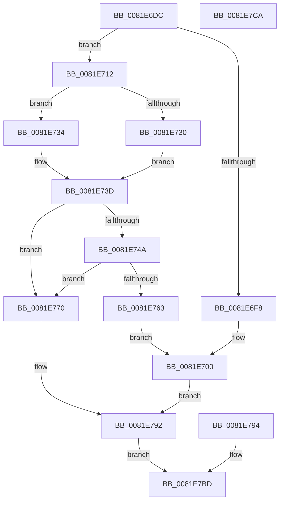

# AslpFileGetCrcChecksum

- RVA: `0x0081E6DC`–`0x0081E7CB` (길이 `239` bytes)
- VA: `0x000000014081E6DC`
- 실행 섹션: `PAGE`
- PDB 이름 있음: `예`; PDB Function 태그: `아니요`
- unwind 정보 RVA: `0x000D9E90`
- 디코드: `64`개 명령, `239/239` bytes 표시
- 미해석 바이트: `0` (있으면 어셈블리에 `.byte`로 보존)

> 이 문서는 커널 이미지의 기계어와 PDB 기호를 분석해 생성했습니다. 4번과 5번은 함수 원형과 자료형을 바이너리 사용 방식에서 추정한 C 해석이며 원본 소스 복구 결과는 아닙니다.

## 1. Dependencies

- 직접 호출 지점: **5**; 고유 호출 대상: **3**
- 직접 호출자로 확인된 함수: **1**
- RIP 상대 이미지 참조: **3**

### Outgoing calls
- `0x0081E700` → [AslComputeCrc32](AslComputeCrc32_function_00819AFC.md) (function, `0x00819AFC`)
- `0x0081E71F` → [AslComputeCrc32](AslComputeCrc32_function_00819AFC.md) (function, `0x00819AFC`)
- `0x0081E754` → [RtlULongLongSub](../../text/48/RtlULongLongSub_function_004831AC.md) (function, `0x004831AC`)
- `0x0081E78D` → [AslLogCallPrintf](../95/AslLogCallPrintf_function_0095E4EC.md) (function, `0x0095E4EC`)
- `0x0081E7B7` → [AslLogCallPrintf](../95/AslLogCallPrintf_function_0095E4EC.md) (function, `0x0095E4EC`)

### Direct callers
- [AslpFileGetChecksumAttributes](AslpFileGetChecksumAttributes_function_0081E130.md) at `0x0081E283`

### Static image references
- `0x0081E774` → RVA `0x00040C40` (`.rdata`; read)
- `0x0081E781` → RVA `0x00040C88` (`.rdata`; read)
- `0x0081E79E` → RVA `0x0003EF20` (`.rdata`; read)

## 2. Other-region calls and transfers

- 다른 실행 섹션으로 향하는 call: **1**
  - `0x0081E754` → [RtlULongLongSub](../../text/48/RtlULongLongSub_function_004831AC.md) (`PAGE` → `.text`)
- 별도 외부 분기/꼬리 이동을 확인하지 못했습니다.

## 3. Assembly (complete function range)

```asm
0081E6DC  48 89 5C 24 08                  mov qword ptr [rsp + 8], rbx
0081E6E1  57                              push rdi
0081E6E2  48 83 EC 40                     sub rsp, 0x40
0081E6E6  48 8B F9                        mov rdi, rcx
0081E6E9  48 8B 5A 10                     mov rbx, qword ptr [rdx + 0x10]
0081E6ED  33 C9                           xor ecx, ecx
0081E6EF  48 81 FB 00 20 00 00            cmp rbx, 0x2000
0081E6F6  73 1A                           jae 0x14081e712
0081E6F8  44 8B 42 20                     mov r8d, dword ptr [rdx + 0x20]
0081E6FC  48 8B 52 18                     mov rdx, qword ptr [rdx + 0x18]
0081E700  E8 F7 B3 FF FF                  call 0x140819afc
0081E705  89 07                           mov dword ptr [rdi], eax
0081E707  33 DB                           xor ebx, ebx
0081E709  89 5C 24 30                     mov dword ptr [rsp + 0x30], ebx
0081E70D  E9 80 00 00 00                  jmp 0x14081e792
0081E712  4C 8B 5A 18                     mov r11, qword ptr [rdx + 0x18]
0081E716  41 B8 00 10 00 00               mov r8d, 0x1000
0081E71C  49 8B D3                        mov rdx, r11
0081E71F  E8 D8 B3 FF FF                  call 0x140819afc
0081E724  44 8B D0                        mov r10d, eax
0081E727  4A 8D 0C 1B                     lea rcx, [rbx + r11]
0081E72B  49 3B CB                        cmp rcx, r11
0081E72E  72 04                           jb 0x14081e734
0081E730  33 DB                           xor ebx, ebx
0081E732  EB 09                           jmp 0x14081e73d
0081E734  48 83 C9 FF                     or rcx, 0xffffffffffffffff
0081E738  BB 95 00 00 C0                  mov ebx, 0xc0000095
0081E73D  48 89 4C 24 60                  mov qword ptr [rsp + 0x60], rcx
0081E742  89 5C 24 30                     mov dword ptr [rsp + 0x30], ebx
0081E746  85 DB                           test ebx, ebx
0081E748  78 26                           js 0x14081e770
0081E74A  4C 8D 44 24 60                  lea r8, [rsp + 0x60]
0081E74F  BA 00 10 00 00                  mov edx, 0x1000
0081E754  E8 53 4A C6 FF                  call 0x1404831ac
0081E759  8B D8                           mov ebx, eax
0081E75B  89 44 24 30                     mov dword ptr [rsp + 0x30], eax
0081E75F  85 C0                           test eax, eax
0081E761  78 0D                           js 0x14081e770
0081E763  44 8B C2                        mov r8d, edx
0081E766  48 8B 54 24 60                  mov rdx, qword ptr [rsp + 0x60]
0081E76B  41 8B CA                        mov ecx, r10d
0081E76E  EB 90                           jmp 0x14081e700
0081E770  89 5C 24 20                     mov dword ptr [rsp + 0x20], ebx
0081E774  4C 8D 0D C5 24 82 FF            lea r9, [rip - 0x7ddb3b]
0081E77B  41 B8 87 13 00 00               mov r8d, 0x1387
0081E781  48 8D 15 00 25 82 FF            lea rdx, [rip - 0x7ddb00]
0081E788  B9 01 00 00 00                  mov ecx, 1
0081E78D  E8 5A FD 13 00                  call 0x14095e4ec
0081E792  EB 29                           jmp 0x14081e7bd
0081E794  8B D8                           mov ebx, eax
0081E796  89 44 24 30                     mov dword ptr [rsp + 0x30], eax
0081E79A  89 44 24 20                     mov dword ptr [rsp + 0x20], eax
0081E79E  4C 8D 0D 7B 07 82 FF            lea r9, [rip - 0x7df885]
0081E7A5  41 B8 94 13 00 00               mov r8d, 0x1394
0081E7AB  48 8D 15 D6 24 82 FF            lea rdx, [rip - 0x7ddb2a]
0081E7B2  B9 01 00 00 00                  mov ecx, 1
0081E7B7  E8 30 FD 13 00                  call 0x14095e4ec
0081E7BC  90                              nop
0081E7BD  8B C3                           mov eax, ebx
0081E7BF  48 8B 5C 24 50                  mov rbx, qword ptr [rsp + 0x50]
0081E7C4  48 83 C4 40                     add rsp, 0x40
0081E7C8  5F                              pop rdi
0081E7C9  C3                              ret
0081E7CA  CC                              int3
```

## 4. C-style interpretation (structured pseudocode)

```c
__int64 __fastcall AslpFileGetCrcChecksum(__int64 a1, __int64 a2)
{
    __int64 result;
    __int64 v_rbx;
    __int64 v_rsp;
    unsigned int v_stack_m18;
    unsigned int v_stack_m28;
    unsigned __int64 v_stack_p18;
    unsigned __int64 v_stack_p8;

    v_stack_p8 = v_rbx;
    v_rsp = (v_rsp) - (64);
    a1 = 0;
    if ((*(unsigned __int64 *)(a2 + 16)) >= 0x2000ULL) goto loc_0081E712;
loc_0081E700:
    result = AslComputeCrc32(a1, *(unsigned __int64 *)(a2 + 24), (unsigned int)(*(unsigned int *)(a2 + 32)), a4);
    *(unsigned int *)(a1) = (unsigned int)(result);
    v_rbx = 0;
    v_stack_m18 = 0;
    goto loc_0081E792;
loc_0081E712:
    result = AslComputeCrc32(a1, *(unsigned __int64 *)(*(unsigned __int64 *)(a2 + 24) + 24), (unsigned int)(0x1000ULL), a4);
    if ((v_rbx + *(unsigned __int64 *)(*(unsigned __int64 *)(a2 + 24) + 24) * 1) < (*(unsigned __int64 *)(*(unsigned __int64 *)(a2 + 24) + 24))) goto loc_0081E734;
    v_rbx = 0;
    goto loc_0081E73D;
loc_0081E734:
    a1 = (v_rbx + *(unsigned __int64 *)(*(unsigned __int64 *)(a2 + 24) + 24) * 1) | (-1);
loc_0081E73D:
    v_stack_p18 = a1;
    v_stack_m18 = (unsigned int)((unsigned int)(0xC0000095ULL));
    if (sign_flag) goto loc_0081E770;
    result = RtlULongLongSub(a1, (unsigned int)(0x1000ULL), v_stack_p18, a4);
    v_stack_m18 = (unsigned int)(result);
    if (sign_flag) goto loc_0081E770;
    goto loc_0081E700;
loc_0081E770:
    v_stack_m28 = (unsigned int)((unsigned int)((unsigned int)(result)));
    result = AslLogCallPrintf(1, v_rip - 8248064, (unsigned int)(0x1387ULL), v_rip - 8248123);
loc_0081E792:
    goto loc_0081E7BD;
loc_0081E7BD:
    v_rsp = (v_rsp) + (64);
    return (unsigned int)((unsigned int)((unsigned int)((unsigned int)(result))));
}
```

## 5. (Beta) C Style

```c
int64_t AslpFileGetCrcChecksum(void *Arg1, void *Arg2)
{
    uint8_t *arg1 = (uint8_t *)Arg1;
    uint8_t *arg2 = (uint8_t *)Arg2;

    int64_t result;
    int64_t local_rbx;
    int64_t local_rsp;
    uint32_t v_stack_m18;
    uint32_t v_stack_m28;
    uint64_t v_stack_p18;
    uint64_t v_stack_p8;

    v_stack_p8 = local_rbx;
    local_rsp = (local_rsp) - (64);
    Arg1 = 0;
    if ((*(uint64_t *)(arg2 + 0x10)) >= 0x2000ULL) goto loc_0081E712;
loc_0081E700:
    result = AslComputeCrc32(Arg1, *(uint64_t *)(arg2 + 0x18), (uint32_t)(*(uint32_t *)(arg2 + 0x20)), a4);
    *(uint32_t *)(arg1) = (uint32_t)(result);
    local_rbx = 0;
    v_stack_m18 = 0;
    goto loc_0081E792;
loc_0081E712:
    result = AslComputeCrc32(Arg1, *(uint64_t *)(*(uint64_t *)(arg2 + 0x18) + 0x18), (uint32_t)(0x1000ULL), a4);
    if ((local_rbx + *(uint64_t *)(*(uint64_t *)(arg2 + 0x18) + 0x18) * 1) < (*(uint64_t *)(*(uint64_t *)(arg2 + 0x18) + 0x18))) goto loc_0081E734;
    local_rbx = 0;
    goto loc_0081E73D;
loc_0081E734:
    Arg1 = (local_rbx + *(uint64_t *)(*(uint64_t *)(arg2 + 0x18) + 0x18) * 1) | (-1);
loc_0081E73D:
    v_stack_p18 = Arg1;
    v_stack_m18 = (uint32_t)((uint32_t)(0xC0000095ULL));
    if (sign_flag) goto loc_0081E770;
    result = RtlULongLongSub(Arg1, (uint32_t)(0x1000ULL), v_stack_p18, a4);
    v_stack_m18 = (uint32_t)(result);
    if (sign_flag) goto loc_0081E770;
    goto loc_0081E700;
loc_0081E770:
    v_stack_m28 = (uint32_t)((uint32_t)((uint32_t)(result)));
    result = AslLogCallPrintf(1, v_rip - 8248064, (uint32_t)(0x1387ULL), v_rip - 8248123);
loc_0081E792:
    goto loc_0081E7BD;
loc_0081E7BD:
    local_rsp = (local_rsp) + (64);
    return (uint32_t)((uint32_t)((uint32_t)((uint32_t)(result))));
}
```

### 관측된 메모리 오프셋

구조체 형식이 확인되지 않은 접근은 인자 기준의 오프셋으로만 기록했습니다.

| 기준 인자 | 오프셋 표현 | 폭 (bit) | 접근 |
|---|---:|---:|---|
| `Arg1` | `+ 0x0` | `32` | `W` |
| `Arg2` | `+ 0x10` | `64` | `R` |
| `Arg2` | `+ 0x18` | `64` | `R` |
| `Arg2` | `+ 0x20` | `32` | `R` |

## 6. Execution-region graph

[열기: 2D/3D 그래프와 함수 탐색 컨트롤 패널](../../../control-panel.html?section=page&rva=0x0081E6DC&view=graph)

- 2D 그래프는 위에서 아래로 흐르고, 3D 그래프는 빈 공간을 드래그해 회전합니다. Shift+드래그는 이동, 휠은 확대·축소, 함수 노드 선택은 대상 보고서 이동입니다.

### Static fallback


