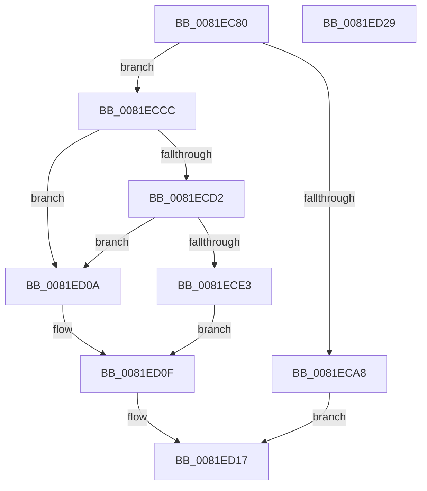

# AslpFileGetExeWrapperAttribute

- RVA: `0x0081EC80`–`0x0081ED2A` (길이 `170` bytes)
- VA: `0x000000014081EC80`
- 실행 섹션: `PAGE`
- PDB 이름 있음: `예`; PDB Function 태그: `아니요`
- unwind 정보 RVA: `0x000794E0`
- 디코드: `42`개 명령, `170/170` bytes 표시
- 미해석 바이트: `0` (있으면 어셈블리에 `.byte`로 보존)

> 이 문서는 커널 이미지의 기계어와 PDB 기호를 분석해 생성했습니다. 4번과 5번은 함수 원형과 자료형을 바이너리 사용 방식에서 추정한 C 해석이며 원본 소스 복구 결과는 아닙니다.

## 1. Dependencies

- 직접 호출 지점: **3**; 고유 호출 대상: **3**
- 직접 호출자로 확인된 함수: **1**
- RIP 상대 이미지 참조: **2**

### Outgoing calls
- `0x0081EC9D` → [AslFileMappingEnsure](AslFileMappingEnsure_function_0081A5EC.md) (function, `0x0081A5EC`)
- `0x0081ECC5` → [AslLogCallPrintf](../95/AslLogCallPrintf_function_0095E4EC.md) (function, `0x0095E4EC`)
- `0x0081ECDA` → [AslpFileGetExeWrapper](AslpFileGetExeWrapper_function_0081EAF4.md) (function, `0x0081EAF4`)

### Direct callers
- [AslFileAllocAndGetAttributes](AslFileAllocAndGetAttributes_function_0081D8EC.md) at `0x0081DC12`

### Static image references
- `0x0081ECA8` → RVA `0x0003EE90` (`.rdata`; read)
- `0x0081ECB9` → RVA `0x0003FF58` (`.rdata`; read)

## 2. Other-region calls and transfers

- 다른 실행 섹션으로 향하는 call: **0**
- 별도 외부 분기/꼬리 이동을 확인하지 못했습니다.

## 3. Assembly (complete function range)

```asm
0081EC80  48 89 5C 24 08                  mov qword ptr [rsp + 8], rbx
0081EC85  48 89 74 24 10                  mov qword ptr [rsp + 0x10], rsi
0081EC8A  57                              push rdi
0081EC8B  48 83 EC 30                     sub rsp, 0x30
0081EC8F  83 64 24 50 00                  and dword ptr [rsp + 0x50], 0
0081EC94  48 8B D9                        mov rbx, rcx
0081EC97  48 8B CA                        mov rcx, rdx
0081EC9A  48 8B F2                        mov rsi, rdx
0081EC9D  E8 4A B9 FF FF                  call 0x14081a5ec
0081ECA2  8B F8                           mov edi, eax
0081ECA4  85 C0                           test eax, eax
0081ECA6  79 24                           jns 0x14081eccc
0081ECA8  4C 8D 0D E1 01 82 FF            lea r9, [rip - 0x7dfe1f]
0081ECAF  89 44 24 20                     mov dword ptr [rsp + 0x20], eax
0081ECB3  41 B8 53 0D 00 00               mov r8d, 0xd53
0081ECB9  48 8D 15 98 12 82 FF            lea rdx, [rip - 0x7ded68]
0081ECC0  B9 01 00 00 00                  mov ecx, 1
0081ECC5  E8 22 F8 13 00                  call 0x14095e4ec
0081ECCA  EB 4B                           jmp 0x14081ed17
0081ECCC  83 7E 40 06                     cmp dword ptr [rsi + 0x40], 6
0081ECD0  75 38                           jne 0x14081ed0a
0081ECD2  48 8B D6                        mov rdx, rsi
0081ECD5  48 8D 4C 24 50                  lea rcx, [rsp + 0x50]
0081ECDA  E8 15 FE FF FF                  call 0x14081eaf4
0081ECDF  85 C0                           test eax, eax
0081ECE1  78 27                           js 0x14081ed0a
0081ECE3  8B 44 24 50                     mov eax, dword ptr [rsp + 0x50]
0081ECE7  B9 01 00 00 00                  mov ecx, 1
0081ECEC  48 89 83 30 03 00 00            mov qword ptr [rbx + 0x330], rax
0081ECF3  C7 83 20 03 00 00 02 00 00 00   mov dword ptr [rbx + 0x320], 2
0081ECFD  48 C7 83 28 03 00 00 04 00 00 00  mov qword ptr [rbx + 0x328], 4
0081ED08  EB 05                           jmp 0x14081ed0f
0081ED0A  B9 02 00 00 00                  mov ecx, 2
0081ED0F  09 8B 38 03 00 00               or dword ptr [rbx + 0x338], ecx
0081ED15  33 FF                           xor edi, edi
0081ED17  48 8B 5C 24 40                  mov rbx, qword ptr [rsp + 0x40]
0081ED1C  8B C7                           mov eax, edi
0081ED1E  48 8B 74 24 48                  mov rsi, qword ptr [rsp + 0x48]
0081ED23  48 83 C4 30                     add rsp, 0x30
0081ED27  5F                              pop rdi
0081ED28  C3                              ret
0081ED29  CC                              int3
```

## 4. C-style interpretation (structured pseudocode)

```c
__int64 __fastcall AslpFileGetExeWrapperAttribute(__int64 a1, __int64 a2)
{
    __int64 result;
    __int64 v_rdi;
    __int64 v_rsp;
    unsigned int v_stack_m18;
    unsigned __int64 v_stack_p10;
    unsigned int v_stack_p18;
    unsigned __int64 v_stack_p8;

    v_stack_p8 = v_rbx;
    v_stack_p10 = v_rsi;
    v_rsp = (v_rsp) - (48);
    result = AslFileMappingEnsure(a2, a2, a3, a4);
    if (!sign_flag) goto loc_0081ECCC;
    v_stack_m18 = (unsigned int)(result);
    result = AslLogCallPrintf(1, v_rip - 8252776, (unsigned int)(0xD53ULL), v_rip - 8257055);
    goto loc_0081ED17;
loc_0081ECCC:
    if ((*(unsigned int *)(a2 + 64)) != 6) goto loc_0081ED0A;
    result = AslpFileGetExeWrapper(v_stack_p18, a2, (unsigned int)(0xD53ULL), v_rip - 8257055);
    if (sign_flag) goto loc_0081ED0A;
    *(unsigned __int64 *)(a1 + 816) = (unsigned int)(v_stack_p18);
    *(unsigned int *)(a1 + 800) = 2;
    *(unsigned __int64 *)(a1 + 808) = 4;
    goto loc_0081ED0F;
loc_0081ED0A:
loc_0081ED0F:
    v_rdi = 0;
loc_0081ED17:
    v_rsp = (v_rsp) + (48);
    return 0;
}
```

## 5. (Beta) C Style

```c
int64_t AslpFileGetExeWrapperAttribute(void *Arg1, void *Arg2)
{
    uint8_t *arg1 = (uint8_t *)Arg1;
    uint8_t *arg2 = (uint8_t *)Arg2;

    int64_t result;
    int64_t local_rdi;
    int64_t local_rsp;
    uint32_t v_stack_m18;
    uint64_t v_stack_p10;
    uint32_t v_stack_p18;
    uint64_t v_stack_p8;

    v_stack_p8 = local_rbx;
    v_stack_p10 = local_rsi;
    local_rsp = (local_rsp) - (48);
    result = AslFileMappingEnsure(Arg2, Arg2, a3, a4);
    if (!sign_flag) goto loc_0081ECCC;
    v_stack_m18 = (uint32_t)(result);
    result = AslLogCallPrintf(1, v_rip - 8252776, (uint32_t)(0xD53ULL), v_rip - 8257055);
    goto loc_0081ED17;
loc_0081ECCC:
    if ((*(uint32_t *)(arg2 + 0x40)) != 6) goto loc_0081ED0A;
    result = AslpFileGetExeWrapper(v_stack_p18, Arg2, (uint32_t)(0xD53ULL), v_rip - 8257055);
    if (sign_flag) goto loc_0081ED0A;
    *(uint64_t *)(arg1 + 0x330) = (uint32_t)(v_stack_p18);
    *(uint32_t *)(arg1 + 0x320) = 2;
    *(uint64_t *)(arg1 + 0x328) = 4;
    goto loc_0081ED0F;
loc_0081ED0A:
loc_0081ED0F:
    local_rdi = 0;
loc_0081ED17:
    local_rsp = (local_rsp) + (48);
    return 0;
}
```

### 관측된 메모리 오프셋

구조체 형식이 확인되지 않은 접근은 인자 기준의 오프셋으로만 기록했습니다.

| 기준 인자 | 오프셋 표현 | 폭 (bit) | 접근 |
|---|---:|---:|---|
| `Arg1` | `+ 0x320` | `32` | `W` |
| `Arg1` | `+ 0x328` | `64` | `W` |
| `Arg1` | `+ 0x330` | `64` | `W` |
| `Arg1` | `+ 0x338` | `32` | `R/W` |
| `Arg2` | `+ 0x40` | `32` | `R` |

## 6. Execution-region graph

[열기: 2D/3D 그래프와 함수 탐색 컨트롤 패널](../../../control-panel.html?section=page&rva=0x0081EC80&view=graph)

- 2D 그래프는 위에서 아래로 흐르고, 3D 그래프는 빈 공간을 드래그해 회전합니다. Shift+드래그는 이동, 휠은 확대·축소, 함수 노드 선택은 대상 보고서 이동입니다.

### Static fallback


