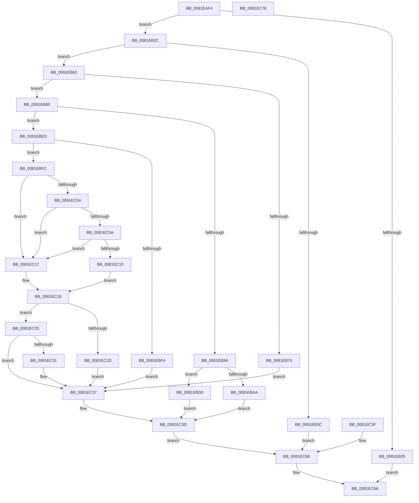

# AslpFileGetExeWrapper

- RVA: `0x0081EAF4`–`0x0081EC79` (길이 `389` bytes)
- VA: `0x000000014081EAF4`
- 실행 섹션: `PAGE`
- PDB 이름 있음: `예`; PDB Function 태그: `아니요`
- unwind 정보 RVA: `0x000D9FD4`
- 디코드: `103`개 명령, `389/389` bytes 표시
- 미해석 바이트: `0` (있으면 어셈블리에 `.byte`로 보존)

> 이 문서는 커널 이미지의 기계어와 PDB 기호를 분석해 생성했습니다. 4번과 5번은 함수 원형과 자료형을 바이너리 사용 방식에서 추정한 C 해석이며 원본 소스 복구 결과는 아닙니다.

## 1. Dependencies

- 직접 호출 지점: **8**; 고유 호출 대상: **5**
- 직접 호출자로 확인된 함수: **1**
- RIP 상대 이미지 참조: **5**

### Outgoing calls
- `0x0081EB31` → [AslpFileGetImageNtHeader](AslpFileGetImageNtHeader_function_0081F434.md) (function, `0x0081F434`)
- `0x0081EB59` → [AslLogCallPrintf](../95/AslLogCallPrintf_function_0095E4EC.md) (function, `0x0095E4EC`)
- `0x0081EB6B` → [AslpFileHasSecuromWrapper](../82/AslpFileHasSecuromWrapper_function_00820634.md) (function, `0x00820634`)
- `0x0081EB8B` → [AslpFileHasActiveMarkWrapper](../82/AslpFileHasActiveMarkWrapper_function_00820504.md) (function, `0x00820504`)
- `0x0081EBC9` → [AslLogCallPrintf](../95/AslLogCallPrintf_function_0095E4EC.md) (function, `0x0095E4EC`)
- `0x0081EBE6` → [AslLogCallPrintf](../95/AslLogCallPrintf_function_0095E4EC.md) (function, `0x0095E4EC`)
- `0x0081EC28` → [AslpHasStarForceWrapper](../82/AslpHasStarForceWrapper_function_00821440.md) (function, `0x00821440`)
- `0x0081EC62` → [AslLogCallPrintf](../95/AslLogCallPrintf_function_0095E4EC.md) (function, `0x0095E4EC`)

### Direct callers
- [AslpFileGetExeWrapperAttribute](AslpFileGetExeWrapperAttribute_function_0081EC80.md) at `0x0081ECDA`

### Static image references
- `0x0081EB40` → RVA `0x0003EED8` (`.rdata`; read)
- `0x0081EB4D` → RVA `0x00040040` (`.rdata`; read)
- `0x0081EBB7` → RVA `0x00040058` (`.rdata`; read)
- `0x0081EBD4` → RVA `0x00040098` (`.rdata`; read)
- `0x0081EC49` → RVA `0x0003EF20` (`.rdata`; read)

## 2. Other-region calls and transfers

- 다른 실행 섹션으로 향하는 call: **0**
- 별도 외부 분기/꼬리 이동을 확인하지 못했습니다.

## 3. Assembly (complete function range)

```asm
0081EAF4  48 89 5C 24 18                  mov qword ptr [rsp + 0x18], rbx
0081EAF9  56                              push rsi
0081EAFA  57                              push rdi
0081EAFB  41 56                           push r14
0081EAFD  48 83 EC 40                     sub rsp, 0x40
0081EB01  4C 8B F2                        mov r14, rdx
0081EB04  48 8B F1                        mov rsi, rcx
0081EB07  83 64 24 60 00                  and dword ptr [rsp + 0x60], 0
0081EB0C  83 21 00                        and dword ptr [rcx], 0
0081EB0F  48 83 64 24 68 00               and qword ptr [rsp + 0x68], 0
0081EB15  48 B8 00 00 00 00 01 00 00 00   movabs rax, 0x100000000
0081EB1F  48 39 42 18                     cmp qword ptr [rdx + 0x18], rax
0081EB23  72 07                           jb 0x14081eb2c
0081EB25  33 C0                           xor eax, eax
0081EB27  E9 3E 01 00 00                  jmp 0x14081ec6a
0081EB2C  48 8D 4C 24 68                  lea rcx, [rsp + 0x68]
0081EB31  E8 FE 08 00 00                  call 0x14081f434
0081EB36  8B D8                           mov ebx, eax
0081EB38  85 C0                           test eax, eax
0081EB3A  79 27                           jns 0x14081eb63
0081EB3C  89 44 24 20                     mov dword ptr [rsp + 0x20], eax
0081EB40  4C 8D 0D 91 03 82 FF            lea r9, [rip - 0x7dfc6f]
0081EB47  41 B8 99 0F 00 00               mov r8d, 0xf99
0081EB4D  48 8D 15 EC 14 82 FF            lea rdx, [rip - 0x7deb14]
0081EB54  B9 01 00 00 00                  mov ecx, 1
0081EB59  E8 8E F9 13 00                  call 0x14095e4ec
0081EB5E  E9 05 01 00 00                  jmp 0x14081ec68
0081EB63  48 8B 7C 24 68                  mov rdi, qword ptr [rsp + 0x68]
0081EB68  48 8B CF                        mov rcx, rdi
0081EB6B  E8 C4 1A 00 00                  call 0x140820634
0081EB70  85 C0                           test eax, eax
0081EB72  74 0C                           je 0x14081eb80
0081EB74  B8 01 00 00 00                  mov eax, 1
0081EB79  89 06                           mov dword ptr [rsi], eax
0081EB7B  E9 B7 00 00 00                  jmp 0x14081ec37
0081EB80  4D 8B C6                        mov r8, r14
0081EB83  48 8B D7                        mov rdx, rdi
0081EB86  48 8D 4C 24 60                  lea rcx, [rsp + 0x60]
0081EB8B  E8 74 19 00 00                  call 0x140820504
0081EB90  8B D8                           mov ebx, eax
0081EB92  89 44 24 30                     mov dword ptr [rsp + 0x30], eax
0081EB96  85 C0                           test eax, eax
0081EB98  79 53                           jns 0x14081ebed
0081EB9A  B8 25 02 00 C0                  mov eax, 0xc0000225
0081EB9F  48 8D 15 9A 14 82 FF            lea rdx, [rip - 0x7deb66]
0081EBA6  3B D8                           cmp ebx, eax
0081EBA8  75 26                           jne 0x14081ebd0
0081EBAA  89 44 24 28                     mov dword ptr [rsp + 0x28], eax
0081EBAE  49 8B 46 18                     mov rax, qword ptr [r14 + 0x18]
0081EBB2  48 89 44 24 20                  mov qword ptr [rsp + 0x20], rax
0081EBB7  4C 8D 0D 9A 14 82 FF            lea r9, [rip - 0x7deb66]
0081EBBE  41 B8 B2 0F 00 00               mov r8d, 0xfb2
0081EBC4  B9 02 00 00 00                  mov ecx, 2
0081EBC9  E8 1E F9 13 00                  call 0x14095e4ec
0081EBCE  EB 6D                           jmp 0x14081ec3d
0081EBD0  89 5C 24 20                     mov dword ptr [rsp + 0x20], ebx
0081EBD4  4C 8D 0D BD 14 82 FF            lea r9, [rip - 0x7deb43]
0081EBDB  41 B8 B4 0F 00 00               mov r8d, 0xfb4
0081EBE1  B9 01 00 00 00                  mov ecx, 1
0081EBE6  E8 01 F9 13 00                  call 0x14095e4ec
0081EBEB  EB 50                           jmp 0x14081ec3d
0081EBED  83 7C 24 60 00                  cmp dword ptr [rsp + 0x60], 0
0081EBF2  74 08                           je 0x14081ebfc
0081EBF4  C7 06 02 00 00 00               mov dword ptr [rsi], 2
0081EBFA  EB 3B                           jmp 0x14081ec37
0081EBFC  81 3F 50 45 00 00               cmp dword ptr [rdi], 0x4550
0081EC02  75 13                           jne 0x14081ec17
0081EC04  80 7F 1A 53                     cmp byte ptr [rdi + 0x1a], 0x53
0081EC08  75 0D                           jne 0x14081ec17
0081EC0A  80 7F 1B 52                     cmp byte ptr [rdi + 0x1b], 0x52
0081EC0E  75 07                           jne 0x14081ec17
0081EC10  B8 01 00 00 00                  mov eax, 1
0081EC15  EB 02                           jmp 0x14081ec19
0081EC17  33 C0                           xor eax, eax
0081EC19  85 C0                           test eax, eax
0081EC1B  74 08                           je 0x14081ec25
0081EC1D  C7 06 03 00 00 00               mov dword ptr [rsi], 3
0081EC23  EB 12                           jmp 0x14081ec37
0081EC25  48 8B CF                        mov rcx, rdi
0081EC28  E8 13 28 00 00                  call 0x140821440
0081EC2D  85 C0                           test eax, eax
0081EC2F  74 06                           je 0x14081ec37
0081EC31  C7 06 04 00 00 00               mov dword ptr [rsi], 4
0081EC37  33 DB                           xor ebx, ebx
0081EC39  89 5C 24 30                     mov dword ptr [rsp + 0x30], ebx
0081EC3D  EB 29                           jmp 0x14081ec68
0081EC3F  8B D8                           mov ebx, eax
0081EC41  89 44 24 30                     mov dword ptr [rsp + 0x30], eax
0081EC45  89 44 24 20                     mov dword ptr [rsp + 0x20], eax
0081EC49  4C 8D 0D D0 02 82 FF            lea r9, [rip - 0x7dfd30]
0081EC50  41 B8 C8 0F 00 00               mov r8d, 0xfc8
0081EC56  48 8D 15 E3 13 82 FF            lea rdx, [rip - 0x7dec1d]
0081EC5D  B9 01 00 00 00                  mov ecx, 1
0081EC62  E8 85 F8 13 00                  call 0x14095e4ec
0081EC67  90                              nop
0081EC68  8B C3                           mov eax, ebx
0081EC6A  48 8B 5C 24 70                  mov rbx, qword ptr [rsp + 0x70]
0081EC6F  48 83 C4 40                     add rsp, 0x40
0081EC73  41 5E                           pop r14
0081EC75  5F                              pop rdi
0081EC76  5E                              pop rsi
0081EC77  C3                              ret
0081EC78  CC                              int3
```

## 4. C-style interpretation (structured pseudocode)

```c
__int64 __fastcall AslpFileGetExeWrapper(__int64 a1, __int64 a2)
{
    __int64 result;
    __int64 v_rbx;
    __int64 v_rsp;
    unsigned int v_stack_m28;
    unsigned int v_stack_m30;
    unsigned int v_stack_m38;
    unsigned __int64 v_stack_p10;
    unsigned __int64 v_stack_p18;
    unsigned int v_stack_p8;

    v_stack_p18 = v_rbx;
    v_rsp = (v_rsp) - (64);
    if ((*(unsigned __int64 *)(a2 + 24)) < result) goto loc_0081EB2C;
    result = 0;
    goto loc_0081EC6A;
loc_0081EB2C:
    result = AslpFileGetImageNtHeader(v_stack_p10, a2, a3, a4);
    if (!sign_flag) goto loc_0081EB63;
    v_stack_m38 = (unsigned int)(result);
    result = AslLogCallPrintf(1, v_rip - 8252180, (unsigned int)(0xF99ULL), v_rip - 8256623);
    goto loc_0081EC68;
loc_0081EB63:
    result = AslpFileHasSecuromWrapper(v_stack_p10, v_rip - 8252180, (unsigned int)(0xF99ULL), v_rip - 8256623);
    if ((unsigned int)(result) == 0) goto loc_0081EB80;
    *(unsigned int *)(a1) = 1;
    goto loc_0081EC37;
loc_0081EB80:
    result = AslpFileHasActiveMarkWrapper(v_stack_p8, v_stack_p10, a2, v_rip - 8256623);
    v_stack_m28 = (unsigned int)(result);
    if (!sign_flag) goto loc_0081EBED;
    if (((unsigned int)((unsigned int)((unsigned int)(result)))) != ((unsigned int)((unsigned int)(0xC0000225ULL)))) goto loc_0081EBD0;
    v_stack_m30 = (unsigned int)((unsigned int)(0xC0000225ULL));
    v_stack_m38 = *(unsigned __int64 *)(a2 + 24);
    result = AslLogCallPrintf(2, v_rip - 8252262, (unsigned int)(0xFB2ULL), v_rip - 8252262);
    goto loc_0081EC3D;
loc_0081EBD0:
    v_stack_m38 = (unsigned int)((unsigned int)((unsigned int)(result)));
    result = AslLogCallPrintf(1, v_rip - 8252262, (unsigned int)(0xFB4ULL), v_rip - 8252227);
    goto loc_0081EC3D;
loc_0081EBED:
    if (v_stack_p8 == 0) goto loc_0081EBFC;
    *(unsigned int *)(a1) = 2;
    goto loc_0081EC37;
loc_0081EBFC:
    if ((*(unsigned int *)(v_stack_p10)) != 0x4550ULL) goto loc_0081EC17;
    if ((*(unsigned __int8 *)(v_stack_p10 + 26)) != 83) goto loc_0081EC17;
    if ((*(unsigned __int8 *)(v_stack_p10 + 27)) != 82) goto loc_0081EC17;
    goto loc_0081EC19;
loc_0081EC17:
    result = 0;
loc_0081EC19:
    if (0 == 0) goto loc_0081EC25;
    *(unsigned int *)(a1) = 3;
    goto loc_0081EC37;
loc_0081EC25:
    result = AslpHasStarForceWrapper(v_stack_p10, v_rip - 8252262, (unsigned int)(0xFB4ULL), v_rip - 8252227);
    if ((unsigned int)(result) != 0) {
        *(unsigned int *)(a1) = 4;
    }
    v_rbx = 0;
    v_stack_m28 = 0;
loc_0081EC3D:
    goto loc_0081EC68;
loc_0081EC68:
loc_0081EC6A:
    v_rsp = (v_rsp) + (64);
    return 0;
}
```

## 5. (Beta) C Style

```c
int64_t AslpFileGetExeWrapper(void *Arg1, void *Arg2)
{
    uint8_t *arg1 = (uint8_t *)Arg1;
    uint8_t *arg2 = (uint8_t *)Arg2;

    int64_t result;
    int64_t local_rbx;
    int64_t local_rsp;
    uint32_t v_stack_m28;
    uint32_t v_stack_m30;
    uint32_t v_stack_m38;
    uint64_t v_stack_p10;
    uint64_t v_stack_p18;
    uint32_t v_stack_p8;

    v_stack_p18 = local_rbx;
    local_rsp = (local_rsp) - (64);
    if ((*(uint64_t *)(arg2 + 0x18)) < result) goto loc_0081EB2C;
    result = 0;
    goto loc_0081EC6A;
loc_0081EB2C:
    result = AslpFileGetImageNtHeader(v_stack_p10, Arg2, a3, a4);
    if (!sign_flag) goto loc_0081EB63;
    v_stack_m38 = (uint32_t)(result);
    result = AslLogCallPrintf(1, v_rip - 8252180, (uint32_t)(0xF99ULL), v_rip - 8256623);
    goto loc_0081EC68;
loc_0081EB63:
    result = AslpFileHasSecuromWrapper(v_stack_p10, v_rip - 8252180, (uint32_t)(0xF99ULL), v_rip - 8256623);
    if ((uint32_t)(result) == 0) goto loc_0081EB80;
    *(uint32_t *)(arg1) = 1;
    goto loc_0081EC37;
loc_0081EB80:
    result = AslpFileHasActiveMarkWrapper(v_stack_p8, v_stack_p10, Arg2, v_rip - 8256623);
    v_stack_m28 = (uint32_t)(result);
    if (!sign_flag) goto loc_0081EBED;
    if (((uint32_t)((uint32_t)((uint32_t)(result)))) != ((uint32_t)((uint32_t)(0xC0000225ULL)))) goto loc_0081EBD0;
    v_stack_m30 = (uint32_t)((uint32_t)(0xC0000225ULL));
    v_stack_m38 = *(uint64_t *)(arg2 + 0x18);
    result = AslLogCallPrintf(2, v_rip - 8252262, (uint32_t)(0xFB2ULL), v_rip - 8252262);
    goto loc_0081EC3D;
loc_0081EBD0:
    v_stack_m38 = (uint32_t)((uint32_t)((uint32_t)(result)));
    result = AslLogCallPrintf(1, v_rip - 8252262, (uint32_t)(0xFB4ULL), v_rip - 8252227);
    goto loc_0081EC3D;
loc_0081EBED:
    if (v_stack_p8 == 0) goto loc_0081EBFC;
    *(uint32_t *)(arg1) = 2;
    goto loc_0081EC37;
loc_0081EBFC:
    if ((*(uint32_t *)(v_stack_p10)) != 0x4550ULL) goto loc_0081EC17;
    if ((*(uint8_t *)(v_stack_p10 + 0x1A)) != 83) goto loc_0081EC17;
    if ((*(uint8_t *)(v_stack_p10 + 0x1B)) != 82) goto loc_0081EC17;
    goto loc_0081EC19;
loc_0081EC17:
    result = 0;
loc_0081EC19:
    if (0 == 0) goto loc_0081EC25;
    *(uint32_t *)(arg1) = 3;
    goto loc_0081EC37;
loc_0081EC25:
    result = AslpHasStarForceWrapper(v_stack_p10, v_rip - 8252262, (uint32_t)(0xFB4ULL), v_rip - 8252227);
    if ((uint32_t)(result) != 0) {
        *(uint32_t *)(arg1) = 4;
    }
    local_rbx = 0;
    v_stack_m28 = 0;
loc_0081EC3D:
    goto loc_0081EC68;
loc_0081EC68:
loc_0081EC6A:
    local_rsp = (local_rsp) + (64);
    return 0;
}
```

### 관측된 메모리 오프셋

구조체 형식이 확인되지 않은 접근은 인자 기준의 오프셋으로만 기록했습니다.

| 기준 인자 | 오프셋 표현 | 폭 (bit) | 접근 |
|---|---:|---:|---|
| `Arg1` | `+ 0x0` | `32` | `R/W` |
| `Arg1` | `+ 0x0` | `32` | `W` |
| `Arg2` | `+ 0x18` | `64` | `R` |

## 6. Execution-region graph

[열기: 2D/3D 그래프와 함수 탐색 컨트롤 패널](../../../control-panel.html?section=page&rva=0x0081EAF4&view=graph)

- 2D 그래프는 위에서 아래로 흐르고, 3D 그래프는 빈 공간을 드래그해 회전합니다. Shift+드래그는 이동, 휠은 확대·축소, 함수 노드 선택은 대상 보고서 이동입니다.

### Static fallback


