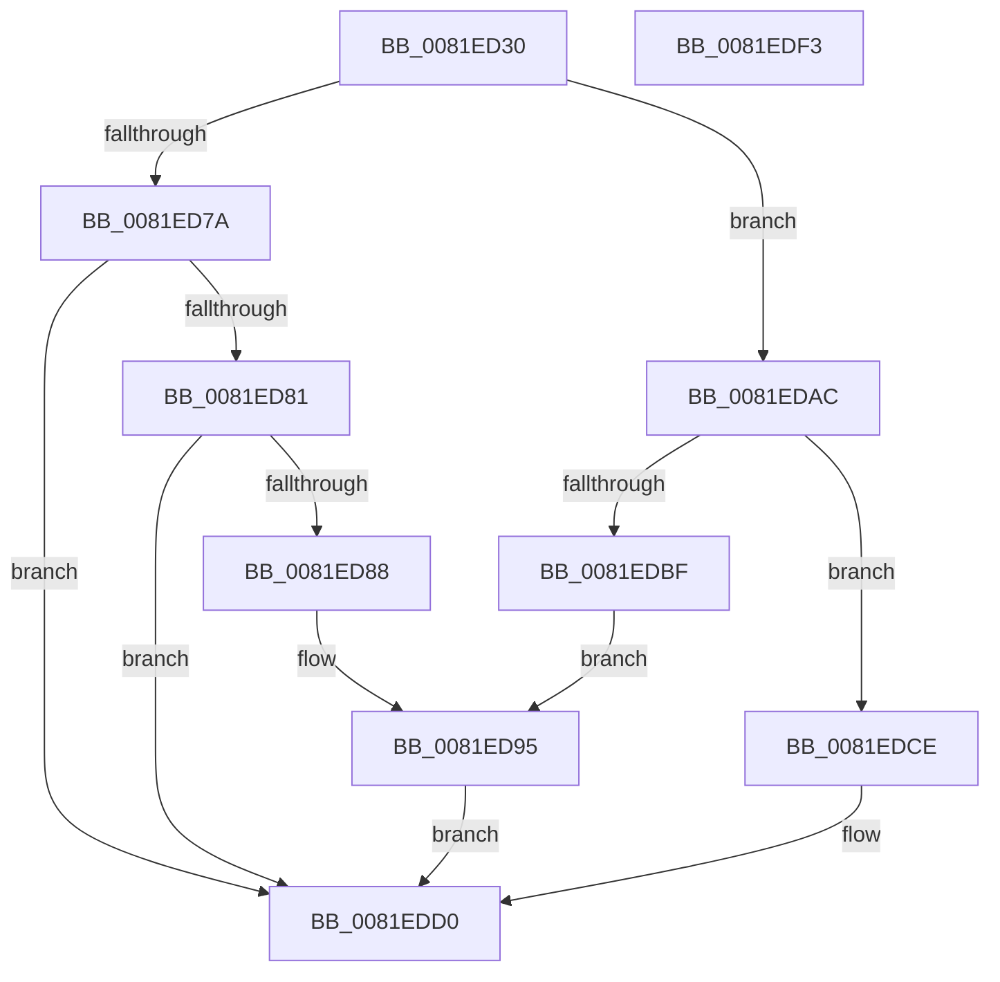

# AslpFileGetExportName

- RVA: `0x0081ED30`–`0x0081EDF4` (길이 `196` bytes)
- VA: `0x000000014081ED30`
- 실행 섹션: `PAGE`
- PDB 이름 있음: `예`; PDB Function 태그: `아니요`
- unwind 정보 RVA: `0x000D9F60`
- 디코드: `48`개 명령, `196/196` bytes 표시
- 미해석 바이트: `0` (있으면 어셈블리에 `.byte`로 보존)

> 이 문서는 커널 이미지의 기계어와 PDB 기호를 분석해 생성했습니다. 4번과 5번은 함수 원형과 자료형을 바이너리 사용 방식에서 추정한 C 해석이며 원본 소스 복구 결과는 아닙니다.

## 1. Dependencies

- 직접 호출 지점: **5**; 고유 호출 대상: **5**
- 직접 호출자로 확인된 함수: **1**
- RIP 상대 이미지 참조: **4**

### Outgoing calls
- `0x0081ED62` → [memset](../../text/6C/memset_function_006C6C40.md) (function, `0x006C6C40`)
- `0x0081ED6F` → [AslpFileQueryExportName](../82/AslpFileQueryExportName_function_00820EF8.md) (function, `0x00820EF8`)
- `0x0081EDA5` → [AslLogCallPrintf](../95/AslLogCallPrintf_function_0095E4EC.md) (function, `0x0095E4EC`)
- `0x0081EDB4` → [AslStringAnsiToUnicode](AslStringAnsiToUnicode_function_00819824.md) (function, `0x00819824`)
- `0x0081EDDD` → [_security_check_cookie](../../text/6A/_security_check_cookie_function_006AC640.md) (function, `0x006AC640`)

### Direct callers
- [AslpFileGetPeExportNameAttribute](AslpFileGetPeExportNameAttribute_function_0081F884.md) at `0x0081F8E4`

### Static image references
- `0x0081ED3D` → RVA `0x00E0A740` (`.data`; read)
- `0x0081ED88` → RVA `0x00040100` (`.rdata`; read)
- `0x0081ED95` → RVA `0x000408E0` (`.rdata`; read)
- `0x0081EDBF` → RVA `0x000408F8` (`.rdata`; read)

## 2. Other-region calls and transfers

- 다른 실행 섹션으로 향하는 call: **2**
  - `0x0081ED62` → [memset](../../text/6C/memset_function_006C6C40.md) (`PAGE` → `.text`)
  - `0x0081EDDD` → [_security_check_cookie](../../text/6A/_security_check_cookie_function_006AC640.md) (`PAGE` → `.text`)
- 별도 외부 분기/꼬리 이동을 확인하지 못했습니다.

## 3. Assembly (complete function range)

```asm
0081ED30  48 89 5C 24 18                  mov qword ptr [rsp + 0x18], rbx
0081ED35  57                              push rdi
0081ED36  48 81 EC 40 01 00 00            sub rsp, 0x140
0081ED3D  48 8B 05 FC B9 5E 00            mov rax, qword ptr [rip + 0x5eb9fc]
0081ED44  48 33 C4                        xor rax, rsp
0081ED47  48 89 84 24 30 01 00 00         mov qword ptr [rsp + 0x130], rax
0081ED4F  48 8B DA                        mov rbx, rdx
0081ED52  48 8B F9                        mov rdi, rcx
0081ED55  33 D2                           xor edx, edx
0081ED57  48 8D 4C 24 30                  lea rcx, [rsp + 0x30]
0081ED5C  41 B8 00 01 00 00               mov r8d, 0x100
0081ED62  E8 D9 7E EA FF                  call 0x1406c6c40
0081ED67  48 8B D3                        mov rdx, rbx
0081ED6A  48 8D 4C 24 30                  lea rcx, [rsp + 0x30]
0081ED6F  E8 84 21 00 00                  call 0x140820ef8
0081ED74  8B D8                           mov ebx, eax
0081ED76  85 C0                           test eax, eax
0081ED78  79 32                           jns 0x14081edac
0081ED7A  3D 25 02 00 C0                  cmp eax, 0xc0000225
0081ED7F  74 4F                           je 0x14081edd0
0081ED81  3D 7B 00 00 C0                  cmp eax, 0xc000007b
0081ED86  74 48                           je 0x14081edd0
0081ED88  4C 8D 0D 71 13 82 FF            lea r9, [rip - 0x7dec8f]
0081ED8F  41 B8 CF 10 00 00               mov r8d, 0x10cf
0081ED95  48 8D 15 44 1B 82 FF            lea rdx, [rip - 0x7de4bc]
0081ED9C  89 44 24 20                     mov dword ptr [rsp + 0x20], eax
0081EDA0  B9 01 00 00 00                  mov ecx, 1
0081EDA5  E8 42 F7 13 00                  call 0x14095e4ec
0081EDAA  EB 24                           jmp 0x14081edd0
0081EDAC  48 8D 54 24 30                  lea rdx, [rsp + 0x30]
0081EDB1  48 8B CF                        mov rcx, rdi
0081EDB4  E8 6B AA FF FF                  call 0x140819824
0081EDB9  8B D8                           mov ebx, eax
0081EDBB  85 C0                           test eax, eax
0081EDBD  79 0F                           jns 0x14081edce
0081EDBF  4C 8D 0D 32 1B 82 FF            lea r9, [rip - 0x7de4ce]
0081EDC6  41 B8 D6 10 00 00               mov r8d, 0x10d6
0081EDCC  EB C7                           jmp 0x14081ed95
0081EDCE  33 DB                           xor ebx, ebx
0081EDD0  8B C3                           mov eax, ebx
0081EDD2  48 8B 8C 24 30 01 00 00         mov rcx, qword ptr [rsp + 0x130]
0081EDDA  48 33 CC                        xor rcx, rsp
0081EDDD  E8 5E D8 E8 FF                  call 0x1406ac640
0081EDE2  48 8B 9C 24 60 01 00 00         mov rbx, qword ptr [rsp + 0x160]
0081EDEA  48 81 C4 40 01 00 00            add rsp, 0x140
0081EDF1  5F                              pop rdi
0081EDF2  C3                              ret
0081EDF3  CC                              int3
```

## 4. C-style interpretation (structured pseudocode)

```c
__int64 __fastcall AslpFileGetExportName(__int64 a1, __int64 a2)
{
    __int64 result;
    __int64 v_rbx;
    __int64 v_rsp;
    unsigned __int64 v_stack_m118;
    unsigned int v_stack_m128;
    unsigned __int64 v_stack_m18;
    unsigned __int64 v_stack_p18;

    v_stack_p18 = v_rbx;
    v_rsp = (v_rsp) - (320);
    result = (*(unsigned __int64 *)(v_rip + 6207996)) ^ (v_rsp);
    v_stack_m18 = result;
    a2 = 0;
    result = memset(v_stack_m118, a2, 256, a4);
    result = AslpFileQueryExportName(v_stack_m118, 0, 256, a4);
    if (!sign_flag) goto loc_0081EDAC;
    if (((unsigned int)(result)) == 0xC0000225ULL) goto loc_0081EDD0;
    if (((unsigned int)(result)) == 0xC000007BULL) goto loc_0081EDD0;
loc_0081ED95:
    v_stack_m128 = (unsigned int)(result);
    result = AslLogCallPrintf(1, v_rip - 8250556, (unsigned int)(0x10CFULL), v_rip - 8252559);
    goto loc_0081EDD0;
loc_0081EDAC:
    result = AslStringAnsiToUnicode(a1, v_stack_m118, (unsigned int)(0x10CFULL), v_rip - 8252559);
    if (!sign_flag) goto loc_0081EDCE;
    goto loc_0081ED95;
loc_0081EDCE:
    v_rbx = 0;
loc_0081EDD0:
    a1 = (v_stack_m18) ^ (v_rsp);
    result = _security_check_cookie(a1, v_stack_m118, (unsigned int)(0x10D6ULL), v_rip - 8250574);
    v_rsp = (v_rsp) + (320);
    return result;
}
```

## 5. (Beta) C Style

```c
int64_t AslpFileGetExportName(int64_t Arg1, int64_t Arg2)
{
    int64_t result;
    int64_t local_rbx;
    int64_t local_rsp;
    uint64_t v_stack_m118;
    uint32_t v_stack_m128;
    uint64_t v_stack_m18;
    uint64_t v_stack_p18;

    v_stack_p18 = local_rbx;
    local_rsp = (local_rsp) - (320);
    result = (*(uint64_t *)(v_rip + 0x5EB9FC)) ^ (local_rsp);
    v_stack_m18 = result;
    Arg2 = 0;
    result = memset(v_stack_m118, Arg2, 256, a4);
    result = AslpFileQueryExportName(v_stack_m118, 0, 256, a4);
    if (!sign_flag) goto loc_0081EDAC;
    if (((uint32_t)(result)) == 0xC0000225ULL) goto loc_0081EDD0;
    if (((uint32_t)(result)) == 0xC000007BULL) goto loc_0081EDD0;
loc_0081ED95:
    v_stack_m128 = (uint32_t)(result);
    result = AslLogCallPrintf(1, v_rip - 8250556, (uint32_t)(0x10CFULL), v_rip - 8252559);
    goto loc_0081EDD0;
loc_0081EDAC:
    result = AslStringAnsiToUnicode(Arg1, v_stack_m118, (uint32_t)(0x10CFULL), v_rip - 8252559);
    if (!sign_flag) goto loc_0081EDCE;
    goto loc_0081ED95;
loc_0081EDCE:
    local_rbx = 0;
loc_0081EDD0:
    Arg1 = (v_stack_m18) ^ (local_rsp);
    result = _security_check_cookie(Arg1, v_stack_m118, (uint32_t)(0x10D6ULL), v_rip - 8250574);
    local_rsp = (local_rsp) + (320);
    return result;
}
```

## 6. Execution-region graph

[열기: 2D/3D 그래프와 함수 탐색 컨트롤 패널](../../../control-panel.html?section=page&rva=0x0081ED30&view=graph)

- 2D 그래프는 위에서 아래로 흐르고, 3D 그래프는 빈 공간을 드래그해 회전합니다. Shift+드래그는 이동, 휠은 확대·축소, 함수 노드 선택은 대상 보고서 이동입니다.

### Static fallback


