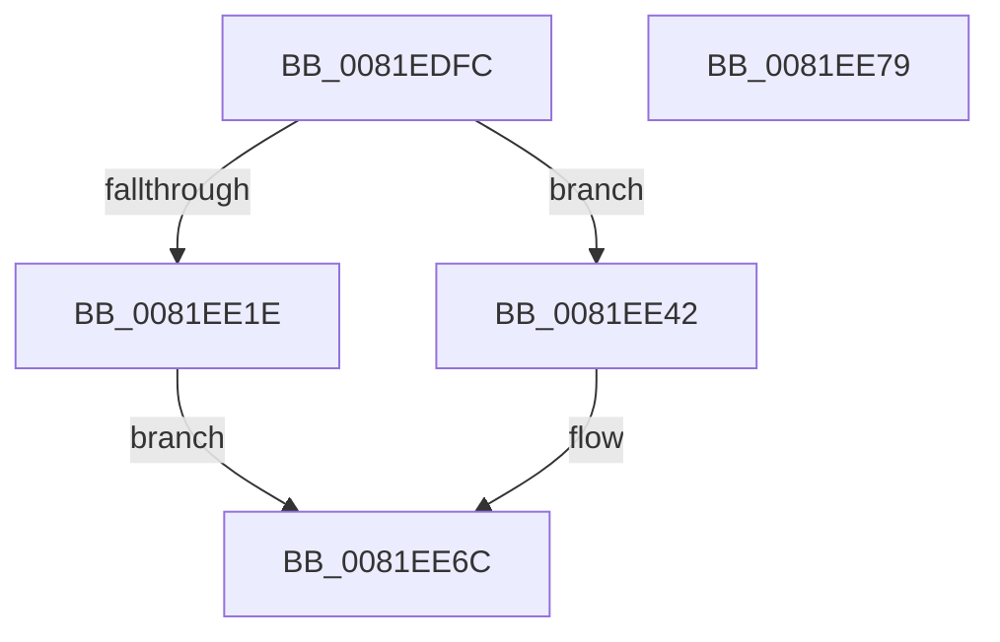

# AslpFileGetFileKindDetailAttribute

- RVA: `0x0081EDFC`–`0x0081EE7A` (길이 `126` bytes)
- VA: `0x000000014081EDFC`
- 실행 섹션: `PAGE`
- PDB 이름 있음: `예`; PDB Function 태그: `아니요`
- unwind 정보 RVA: `0x0006E5F8`
- 디코드: `29`개 명령, `126/126` bytes 표시
- 미해석 바이트: `0` (있으면 어셈블리에 `.byte`로 보존)

> 이 문서는 커널 이미지의 기계어와 PDB 기호를 분석해 생성했습니다. 4번과 5번은 함수 원형과 자료형을 바이너리 사용 방식에서 추정한 C 해석이며 원본 소스 복구 결과는 아닙니다.

## 1. Dependencies

- 직접 호출 지점: **2**; 고유 호출 대상: **2**
- 직접 호출자로 확인된 함수: **2**
- RIP 상대 이미지 참조: **2**

### Outgoing calls
- `0x0081EE13` → [AslFileMappingGetFileKindDetail](AslFileMappingGetFileKindDetail_function_0081A78C.md) (function, `0x0081A78C`)
- `0x0081EE3B` → [AslLogCallPrintf](../95/AslLogCallPrintf_function_0095E4EC.md) (function, `0x0095E4EC`)

### Direct callers
- [AslFileAllocAndGetAttributes](AslFileAllocAndGetAttributes_function_0081D8EC.md) at `0x0081DDD1`
- [AslpFileGetClrVersionAttribute](AslpFileGetClrVersionAttribute_function_0081E54C.md) at `0x0081E5E5`

### Static image references
- `0x0081EE1E` → RVA `0x00040828` (`.rdata`; read)
- `0x0081EE2F` → RVA `0x00040858` (`.rdata`; read)

## 2. Other-region calls and transfers

- 다른 실행 섹션으로 향하는 call: **0**
- 별도 외부 분기/꼬리 이동을 확인하지 못했습니다.

## 3. Assembly (complete function range)

```asm
0081EDFC  48 89 5C 24 08                  mov qword ptr [rsp + 8], rbx
0081EE01  57                              push rdi
0081EE02  48 83 EC 30                     sub rsp, 0x30
0081EE06  83 64 24 50 00                  and dword ptr [rsp + 0x50], 0
0081EE0B  48 8B D9                        mov rbx, rcx
0081EE0E  48 8D 4C 24 50                  lea rcx, [rsp + 0x50]
0081EE13  E8 74 B9 FF FF                  call 0x14081a78c
0081EE18  8B F8                           mov edi, eax
0081EE1A  85 C0                           test eax, eax
0081EE1C  79 24                           jns 0x14081ee42
0081EE1E  4C 8D 0D 03 1A 82 FF            lea r9, [rip - 0x7de5fd]
0081EE25  89 44 24 20                     mov dword ptr [rsp + 0x20], eax
0081EE29  41 B8 06 16 00 00               mov r8d, 0x1606
0081EE2F  48 8D 15 22 1A 82 FF            lea rdx, [rip - 0x7de5de]
0081EE36  B9 01 00 00 00                  mov ecx, 1
0081EE3B  E8 AC F6 13 00                  call 0x14095e4ec
0081EE40  EB 2A                           jmp 0x14081ee6c
0081EE42  48 63 44 24 50                  movsxd rax, dword ptr [rsp + 0x50]
0081EE47  83 8B 98 03 00 00 01            or dword ptr [rbx + 0x398], 1
0081EE4E  48 89 83 90 03 00 00            mov qword ptr [rbx + 0x390], rax
0081EE55  33 FF                           xor edi, edi
0081EE57  C7 83 80 03 00 00 02 00 00 00   mov dword ptr [rbx + 0x380], 2
0081EE61  48 C7 83 88 03 00 00 04 00 00 00  mov qword ptr [rbx + 0x388], 4
0081EE6C  48 8B 5C 24 40                  mov rbx, qword ptr [rsp + 0x40]
0081EE71  8B C7                           mov eax, edi
0081EE73  48 83 C4 30                     add rsp, 0x30
0081EE77  5F                              pop rdi
0081EE78  C3                              ret
0081EE79  CC                              int3
```

## 4. C-style interpretation (structured pseudocode)

```c
__int64 __fastcall AslpFileGetFileKindDetailAttribute(__int64 a1)
{
    __int64 result;
    __int64 v_rdi;
    __int64 v_rsp;
    unsigned int v_stack_m18;
    unsigned int v_stack_p18;
    unsigned __int64 v_stack_p8;

    v_stack_p8 = v_rbx;
    v_rsp = (v_rsp) - (48);
    result = AslFileMappingGetFileKindDetail(v_stack_p18, a2, a3, a4);
    if (!sign_flag) goto loc_0081EE42;
    v_stack_m18 = (unsigned int)(result);
    result = AslLogCallPrintf(1, v_rip - 8250846, (unsigned int)(0x1606ULL), v_rip - 8250877);
    goto loc_0081EE6C;
loc_0081EE42:
    *(unsigned __int64 *)(a1 + 912) = (int)(v_stack_p18);
    v_rdi = 0;
    *(unsigned int *)(a1 + 896) = 2;
    *(unsigned __int64 *)(a1 + 904) = 4;
loc_0081EE6C:
    v_rsp = (v_rsp) + (48);
    return 0;
}
```

## 5. (Beta) C Style

```c
int64_t AslpFileGetFileKindDetailAttribute(void *Arg1)
{
    uint8_t *arg1 = (uint8_t *)Arg1;

    int64_t result;
    int64_t local_rdi;
    int64_t local_rsp;
    uint32_t v_stack_m18;
    uint32_t v_stack_p18;
    uint64_t v_stack_p8;

    v_stack_p8 = local_rbx;
    local_rsp = (local_rsp) - (48);
    result = AslFileMappingGetFileKindDetail(v_stack_p18, a2, a3, a4);
    if (!sign_flag) goto loc_0081EE42;
    v_stack_m18 = (uint32_t)(result);
    result = AslLogCallPrintf(1, v_rip - 8250846, (uint32_t)(0x1606ULL), v_rip - 8250877);
    goto loc_0081EE6C;
loc_0081EE42:
    *(uint64_t *)(arg1 + 0x390) = (int32_t)(v_stack_p18);
    local_rdi = 0;
    *(uint32_t *)(arg1 + 0x380) = 2;
    *(uint64_t *)(arg1 + 0x388) = 4;
loc_0081EE6C:
    local_rsp = (local_rsp) + (48);
    return 0;
}
```

### 관측된 메모리 오프셋

구조체 형식이 확인되지 않은 접근은 인자 기준의 오프셋으로만 기록했습니다.

| 기준 인자 | 오프셋 표현 | 폭 (bit) | 접근 |
|---|---:|---:|---|
| `Arg1` | `+ 0x380` | `32` | `W` |
| `Arg1` | `+ 0x388` | `64` | `W` |
| `Arg1` | `+ 0x390` | `64` | `W` |
| `Arg1` | `+ 0x398` | `32` | `R/W` |

## 6. Execution-region graph

[열기: 2D/3D 그래프와 함수 탐색 컨트롤 패널](../../../control-panel.html?section=page&rva=0x0081EDFC&view=graph)

- 2D 그래프는 위에서 아래로 흐르고, 3D 그래프는 빈 공간을 드래그해 회전합니다. Shift+드래그는 이동, 휠은 확대·축소, 함수 노드 선택은 대상 보고서 이동입니다.

### Static fallback


