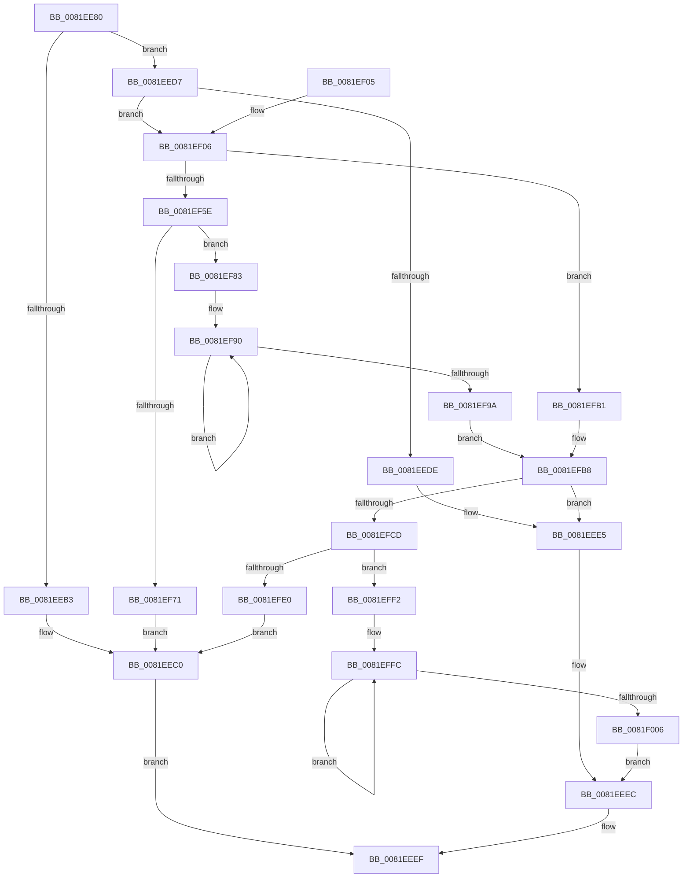

# AslpFileGetHeaderAttributesNE

- RVA: `0x0081EE80`–`0x0081F020` (길이 `416` bytes)
- VA: `0x000000014081EE80`
- 실행 섹션: `PAGE`
- PDB 이름 있음: `예`; PDB Function 태그: `아니요`
- unwind 정보 RVA: `0x000DA034`
- 디코드: `95`개 명령, `416/416` bytes 표시
- 미해석 바이트: `0` (있으면 어셈블리에 `.byte`로 보존)

> 이 문서는 커널 이미지의 기계어와 PDB 기호를 분석해 생성했습니다. 4번과 5번은 함수 원형과 자료형을 바이너리 사용 방식에서 추정한 C 해석이며 원본 소스 복구 결과는 아닙니다.

## 1. Dependencies

- 직접 호출 지점: **6**; 고유 호출 대상: **5**
- 직접 호출자로 확인된 함수: **1**
- RIP 상대 이미지 참조: **3**

### Outgoing calls
- `0x0081EEA8` → [AslFileMappingEnsure](AslFileMappingEnsure_function_0081A5EC.md) (function, `0x0081A5EC`)
- `0x0081EED0` → [AslLogCallPrintf](../95/AslLogCallPrintf_function_0095E4EC.md) (function, `0x0095E4EC`)
- `0x0081EF51` → [AslpFileGet16BitDescription](AslpFileGet16BitDescription_function_0081DE94.md) (function, `0x0081DE94`)
- `0x0081EF66` → [AslStringXmlSanitize](../AC/AslStringXmlSanitize_function_00ACB4B8.md) (function, `0x00ACB4B8`)
- `0x0081EFC0` → [AslpFileGet16BitModuleName](AslpFileGet16BitModuleName_function_0081DF78.md) (function, `0x0081DF78`)
- `0x0081EFD5` → [AslStringXmlSanitize](../AC/AslStringXmlSanitize_function_00ACB4B8.md) (function, `0x00ACB4B8`)

### Direct callers
- [AslFileAllocAndGetAttributes](AslFileAllocAndGetAttributes_function_0081D8EC.md) at `0x0081DC60`

### Static image references
- `0x0081EEB3` → RVA `0x0003EE90` (`.rdata`; read)
- `0x0081EEC0` → RVA `0x0003FFC0` (`.rdata`; read)
- `0x0081EF71` → RVA `0x0003FD78` (`.rdata`; read)

## 2. Other-region calls and transfers

- 다른 실행 섹션으로 향하는 call: **0**
- 별도 외부 분기/꼬리 이동을 확인하지 못했습니다.

## 3. Assembly (complete function range)

```asm
0081EE80  48 8B C4                        mov rax, rsp
0081EE83  48 89 58 08                     mov qword ptr [rax + 8], rbx
0081EE87  48 89 68 10                     mov qword ptr [rax + 0x10], rbp
0081EE8B  57                              push rdi
0081EE8C  41 56                           push r14
0081EE8E  41 57                           push r15
0081EE90  48 83 EC 30                     sub rsp, 0x30
0081EE94  48 8B D9                        mov rbx, rcx
0081EE97  45 33 FF                        xor r15d, r15d
0081EE9A  48 8B CA                        mov rcx, rdx
0081EE9D  4C 89 78 18                     mov qword ptr [rax + 0x18], r15
0081EEA1  4C 89 78 20                     mov qword ptr [rax + 0x20], r15
0081EEA5  4C 8B F2                        mov r14, rdx
0081EEA8  E8 3F B7 FF FF                  call 0x14081a5ec
0081EEAD  8B F8                           mov edi, eax
0081EEAF  85 C0                           test eax, eax
0081EEB1  79 24                           jns 0x14081eed7
0081EEB3  4C 8D 0D D6 FF 81 FF            lea r9, [rip - 0x7e002a]
0081EEBA  41 B8 60 0E 00 00               mov r8d, 0xe60
0081EEC0  48 8D 15 F9 10 82 FF            lea rdx, [rip - 0x7def07]
0081EEC7  89 44 24 20                     mov dword ptr [rsp + 0x20], eax
0081EECB  B9 01 00 00 00                  mov ecx, 1
0081EED0  E8 17 F6 13 00                  call 0x14095e4ec
0081EED5  EB 18                           jmp 0x14081eeef
0081EED7  41 83 7E 40 05                  cmp dword ptr [r14 + 0x40], 5
0081EEDC  74 28                           je 0x14081ef06
0081EEDE  83 8B 98 02 00 00 02            or dword ptr [rbx + 0x298], 2
0081EEE5  83 8B B8 02 00 00 02            or dword ptr [rbx + 0x2b8], 2
0081EEEC  41 8B FF                        mov edi, r15d
0081EEEF  48 8B 5C 24 50                  mov rbx, qword ptr [rsp + 0x50]
0081EEF4  8B C7                           mov eax, edi
0081EEF6  48 8B 6C 24 58                  mov rbp, qword ptr [rsp + 0x58]
0081EEFB  48 83 C4 30                     add rsp, 0x30
0081EEFF  41 5F                           pop r15
0081EF01  41 5E                           pop r14
0081EF03  5F                              pop rdi
0081EF04  C3                              ret
0081EF05  CC                              int3
0081EF06  83 8B 58 02 00 00 02            or dword ptr [rbx + 0x258], 2
0081EF0D  48 8D 4C 24 60                  lea rcx, [rsp + 0x60]
0081EF12  83 8B 78 02 00 00 02            or dword ptr [rbx + 0x278], 2
0081EF19  49 8B D6                        mov rdx, r14
0081EF1C  83 8B D8 02 00 00 02            or dword ptr [rbx + 0x2d8], 2
0081EF23  83 4B 38 02                     or dword ptr [rbx + 0x38], 2
0081EF27  83 8B 38 03 00 00 02            or dword ptr [rbx + 0x338], 2
0081EF2E  83 8B F8 02 00 00 02            or dword ptr [rbx + 0x2f8], 2
0081EF35  83 8B B8 03 00 00 02            or dword ptr [rbx + 0x3b8], 2
0081EF3C  83 8B D8 03 00 00 02            or dword ptr [rbx + 0x3d8], 2
0081EF43  83 8B F8 03 00 00 02            or dword ptr [rbx + 0x3f8], 2
0081EF4A  83 8B 38 04 00 00 02            or dword ptr [rbx + 0x438], 2
0081EF51  E8 3E EF FF FF                  call 0x14081de94
0081EF56  48 83 CD FF                     or rbp, 0xffffffffffffffff
0081EF5A  85 C0                           test eax, eax
0081EF5C  78 53                           js 0x14081efb1
0081EF5E  4C 8B 5C 24 60                  mov r11, qword ptr [rsp + 0x60]
0081EF63  49 8B CB                        mov rcx, r11
0081EF66  E8 4D C5 2A 00                  call 0x140acb4b8
0081EF6B  8B F8                           mov edi, eax
0081EF6D  85 C0                           test eax, eax
0081EF6F  79 12                           jns 0x14081ef83
0081EF71  4C 8D 0D 00 0E 82 FF            lea r9, [rip - 0x7df200]
0081EF78  41 B8 84 0E 00 00               mov r8d, 0xe84
0081EF7E  E9 3D FF FF FF                  jmp 0x14081eec0
0081EF83  C7 83 80 02 00 00 04 00 00 00   mov dword ptr [rbx + 0x280], 4
0081EF8D  48 8B C5                        mov rax, rbp
0081EF90  48 FF C0                        inc rax
0081EF93  66 45 39 3C 43                  cmp word ptr [r11 + rax*2], r15w
0081EF98  75 F6                           jne 0x14081ef90
0081EF9A  83 8B 98 02 00 00 05            or dword ptr [rbx + 0x298], 5
0081EFA1  48 89 83 88 02 00 00            mov qword ptr [rbx + 0x288], rax
0081EFA8  4C 89 9B 90 02 00 00            mov qword ptr [rbx + 0x290], r11
0081EFAF  EB 07                           jmp 0x14081efb8
0081EFB1  83 8B 98 02 00 00 02            or dword ptr [rbx + 0x298], 2
0081EFB8  49 8B D6                        mov rdx, r14
0081EFBB  48 8D 4C 24 68                  lea rcx, [rsp + 0x68]
0081EFC0  E8 B3 EF FF FF                  call 0x14081df78
0081EFC5  85 C0                           test eax, eax
0081EFC7  0F 88 18 FF FF FF               js 0x14081eee5
0081EFCD  4C 8B 5C 24 68                  mov r11, qword ptr [rsp + 0x68]
0081EFD2  49 8B CB                        mov rcx, r11
0081EFD5  E8 DE C4 2A 00                  call 0x140acb4b8
0081EFDA  8B F8                           mov edi, eax
0081EFDC  85 C0                           test eax, eax
0081EFDE  79 12                           jns 0x14081eff2
0081EFE0  4C 8D 0D 91 0D 82 FF            lea r9, [rip - 0x7df26f]
0081EFE7  41 B8 99 0E 00 00               mov r8d, 0xe99
0081EFED  E9 CE FE FF FF                  jmp 0x14081eec0
0081EFF2  C7 83 A0 02 00 00 04 00 00 00   mov dword ptr [rbx + 0x2a0], 4
0081EFFC  48 FF C5                        inc rbp
0081EFFF  66 45 39 3C 6B                  cmp word ptr [r11 + rbp*2], r15w
0081F004  75 F6                           jne 0x14081effc
0081F006  83 8B B8 02 00 00 05            or dword ptr [rbx + 0x2b8], 5
0081F00D  48 89 AB A8 02 00 00            mov qword ptr [rbx + 0x2a8], rbp
0081F014  4C 89 9B B0 02 00 00            mov qword ptr [rbx + 0x2b0], r11
0081F01B  E9 CC FE FF FF                  jmp 0x14081eeec
```

## 4. C-style interpretation (structured pseudocode)

```c
__int64 __fastcall AslpFileGetHeaderAttributesNE(__int64 a1, __int64 a2)
{
    __int64 result;
    __int64 v_r15;
    __int64 v_rbp;
    __int64 v_rsp;
    unsigned int v_stack_m28;
    unsigned __int64 v_stack_p10;
    unsigned __int64 v_stack_p60;
    unsigned __int64 v_stack_p68;
    unsigned __int64 v_stack_p8;

    *(unsigned __int64 *)(v_rsp + 8) = v_rbx;
    *(unsigned __int64 *)(v_rsp + 16) = v_rbp;
    v_rsp = (v_rsp) - (48);
    v_r15 = 0;
    *(unsigned __int64 *)(v_rsp + 24) = 0;
    *(unsigned __int64 *)(v_rsp + 32) = 0;
    result = AslFileMappingEnsure(a2, a2, a3, a4);
    if (!sign_flag) goto loc_0081EED7;
loc_0081EEC0:
    v_stack_m28 = (unsigned int)(result);
    result = AslLogCallPrintf(1, v_rip - 8253191, (unsigned int)(0xE60ULL), v_rip - 8257578);
    goto loc_0081EEEF;
loc_0081EED7:
    if ((*(unsigned int *)(a2 + 64)) == 5) goto loc_0081EF06;
loc_0081EEE5:
loc_0081EEEC:
loc_0081EEEF:
    v_rsp = (v_rsp) + (48);
    return 0;
loc_0081EF06:
    result = AslpFileGet16BitDescription(v_stack_p60, a2, (unsigned int)(0xE60ULL), v_rip - 8257578);
    v_rbp = (v_stack_p10) | (-1);
    if (sign_flag) goto loc_0081EFB1;
    result = AslStringXmlSanitize(v_stack_p60, a2, (unsigned int)(0xE60ULL), v_rip - 8257578);
    if (!sign_flag) goto loc_0081EF83;
    goto loc_0081EEC0;
loc_0081EF83:
    *(unsigned int *)(v_stack_p8 + 640) = 4;
loc_0081EF90:
    result = (v_rbp) + 1;
    if ((*(unsigned __int16 *)(v_stack_p60 + result * 2)) != 0) goto loc_0081EF90;
    *(unsigned __int64 *)(v_stack_p8 + 648) = result;
    *(unsigned __int64 *)(v_stack_p8 + 656) = v_stack_p60;
    goto loc_0081EFB8;
loc_0081EFB1:
loc_0081EFB8:
    result = AslpFileGet16BitModuleName(v_stack_p68, a2, (unsigned int)(0xE84ULL), v_rip - 8253952);
    if (sign_flag) goto loc_0081EEE5;
    result = AslStringXmlSanitize(v_stack_p68, a2, (unsigned int)(0xE84ULL), v_rip - 8253952);
    if (!sign_flag) goto loc_0081EFF2;
    goto loc_0081EEC0;
loc_0081EFF2:
    *(unsigned int *)(v_stack_p8 + 672) = 4;
loc_0081EFFC:
    v_rbp = (v_rbp) + 1;
    if ((*(unsigned __int16 *)(v_stack_p68 + v_rbp * 2)) != 0) goto loc_0081EFFC;
    *(unsigned __int64 *)(v_stack_p8 + 680) = v_rbp;
    *(unsigned __int64 *)(v_stack_p8 + 688) = v_stack_p68;
    goto loc_0081EEEC;
}
```

## 5. (Beta) C Style

```c
int64_t AslpFileGetHeaderAttributesNE(void *Arg1, void *Arg2)
{
    uint8_t *arg1 = (uint8_t *)Arg1;
    uint8_t *arg2 = (uint8_t *)Arg2;

    int64_t result;
    int64_t local_r15;
    int64_t local_rbp;
    int64_t local_rsp;
    uint32_t v_stack_m28;
    uint64_t v_stack_p10;
    uint64_t v_stack_p60;
    uint64_t v_stack_p68;
    uint64_t v_stack_p8;

    *(uint64_t *)(local_rsp + 0x8) = local_rbx;
    *(uint64_t *)(local_rsp + 0x10) = local_rbp;
    local_rsp = (local_rsp) - (48);
    local_r15 = 0;
    *(uint64_t *)(local_rsp + 0x18) = 0;
    *(uint64_t *)(local_rsp + 0x20) = 0;
    result = AslFileMappingEnsure(Arg2, Arg2, a3, a4);
    if (!sign_flag) goto loc_0081EED7;
loc_0081EEC0:
    v_stack_m28 = (uint32_t)(result);
    result = AslLogCallPrintf(1, v_rip - 8253191, (uint32_t)(0xE60ULL), v_rip - 8257578);
    goto loc_0081EEEF;
loc_0081EED7:
    if ((*(uint32_t *)(arg2 + 0x40)) == 5) goto loc_0081EF06;
loc_0081EEE5:
loc_0081EEEC:
loc_0081EEEF:
    local_rsp = (local_rsp) + (48);
    return 0;
loc_0081EF06:
    result = AslpFileGet16BitDescription(v_stack_p60, Arg2, (uint32_t)(0xE60ULL), v_rip - 8257578);
    local_rbp = (v_stack_p10) | (-1);
    if (sign_flag) goto loc_0081EFB1;
    result = AslStringXmlSanitize(v_stack_p60, Arg2, (uint32_t)(0xE60ULL), v_rip - 8257578);
    if (!sign_flag) goto loc_0081EF83;
    goto loc_0081EEC0;
loc_0081EF83:
    *(uint32_t *)(v_stack_p8 + 0x280) = 4;
loc_0081EF90:
    result = (local_rbp) + 1;
    if ((*(uint16_t *)(v_stack_p60 + result * 2)) != 0) goto loc_0081EF90;
    *(uint64_t *)(v_stack_p8 + 0x288) = result;
    *(uint64_t *)(v_stack_p8 + 0x290) = v_stack_p60;
    goto loc_0081EFB8;
loc_0081EFB1:
loc_0081EFB8:
    result = AslpFileGet16BitModuleName(v_stack_p68, Arg2, (uint32_t)(0xE84ULL), v_rip - 8253952);
    if (sign_flag) goto loc_0081EEE5;
    result = AslStringXmlSanitize(v_stack_p68, Arg2, (uint32_t)(0xE84ULL), v_rip - 8253952);
    if (!sign_flag) goto loc_0081EFF2;
    goto loc_0081EEC0;
loc_0081EFF2:
    *(uint32_t *)(v_stack_p8 + 0x2A0) = 4;
loc_0081EFFC:
    local_rbp = (local_rbp) + 1;
    if ((*(uint16_t *)(v_stack_p68 + local_rbp * 2)) != 0) goto loc_0081EFFC;
    *(uint64_t *)(v_stack_p8 + 0x2A8) = local_rbp;
    *(uint64_t *)(v_stack_p8 + 0x2B0) = v_stack_p68;
    goto loc_0081EEEC;
}
```

### 관측된 메모리 오프셋

구조체 형식이 확인되지 않은 접근은 인자 기준의 오프셋으로만 기록했습니다.

| 기준 인자 | 오프셋 표현 | 폭 (bit) | 접근 |
|---|---:|---:|---|
| `Arg1` | `+ 0x38` | `32` | `R/W` |
| `Arg1` | `+ 0x258` | `32` | `R/W` |
| `Arg1` | `+ 0x278` | `32` | `R/W` |
| `Arg1` | `+ 0x280` | `32` | `W` |
| `Arg1` | `+ 0x288` | `64` | `W` |
| `Arg1` | `+ 0x290` | `64` | `W` |
| `Arg1` | `+ 0x298` | `32` | `R/W` |
| `Arg1` | `+ 0x2A0` | `32` | `W` |
| `Arg1` | `+ 0x2A8` | `64` | `W` |
| `Arg1` | `+ 0x2B0` | `64` | `W` |
| `Arg1` | `+ 0x2B8` | `32` | `R/W` |
| `Arg1` | `+ 0x2D8` | `32` | `R/W` |
| `Arg1` | `+ 0x2F8` | `32` | `R/W` |
| `Arg1` | `+ 0x338` | `32` | `R/W` |
| `Arg1` | `+ 0x3B8` | `32` | `R/W` |
| `Arg1` | `+ 0x3D8` | `32` | `R/W` |
| `Arg1` | `+ 0x3F8` | `32` | `R/W` |
| `Arg1` | `+ 0x438` | `32` | `R/W` |
| `Arg2` | `+ 0x40` | `32` | `R` |

## 6. Execution-region graph

[열기: 2D/3D 그래프와 함수 탐색 컨트롤 패널](../../../control-panel.html?section=page&rva=0x0081EE80&view=graph)

- 2D 그래프는 위에서 아래로 흐르고, 3D 그래프는 빈 공간을 드래그해 회전합니다. Shift+드래그는 이동, 휠은 확대·축소, 함수 노드 선택은 대상 보고서 이동입니다.

### Static fallback


