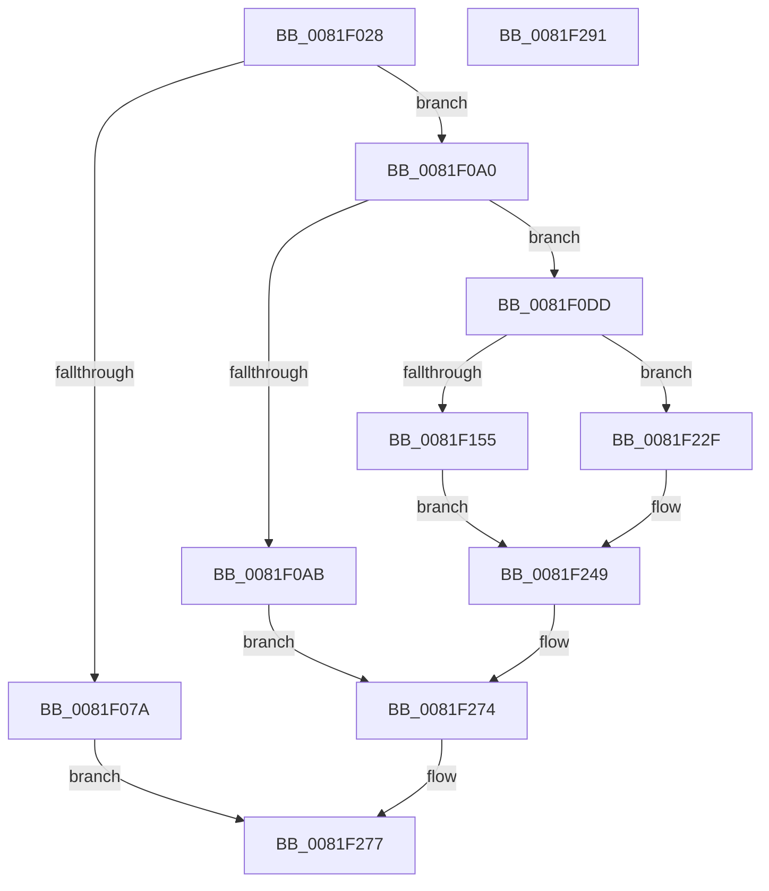

# AslpFileGetHeaderAttributesPE

- RVA: `0x0081F028`–`0x0081F292` (길이 `618` bytes)
- VA: `0x000000014081F028`
- 실행 섹션: `PAGE`
- PDB 이름 있음: `예`; PDB Function 태그: `아니요`
- unwind 정보 RVA: `0x000C4D9C`
- 디코드: `140`개 명령, `618/618` bytes 표시
- 미해석 바이트: `0` (있으면 어셈블리에 `.byte`로 보존)

> 이 문서는 커널 이미지의 기계어와 PDB 기호를 분석해 생성했습니다. 4번과 5번은 함수 원형과 자료형을 바이너리 사용 방식에서 추정한 C 해석이며 원본 소스 복구 결과는 아닙니다.

## 1. Dependencies

- 직접 호출 지점: **3**; 고유 호출 대상: **3**
- 직접 호출자로 확인된 함수: **1**
- RIP 상대 이미지 참조: **2**

### Outgoing calls
- `0x0081F06F` → [AslFileMappingEnsure](AslFileMappingEnsure_function_0081A5EC.md) (function, `0x0081A5EC`)
- `0x0081F096` → [AslLogCallPrintf](../95/AslLogCallPrintf_function_0095E4EC.md) (function, `0x0095E4EC`)
- `0x0081F122` → [AslpFileGetNtHeaderAttributes](AslpFileGetNtHeaderAttributes_function_0081F724.md) (function, `0x0081F724`)

### Direct callers
- [AslFileAllocAndGetAttributes](AslFileAllocAndGetAttributes_function_0081D8EC.md) at `0x0081DDB1`

### Static image references
- `0x0081F07A` → RVA `0x0003EE90` (`.rdata`; read)
- `0x0081F08B` → RVA `0x0003FFA0` (`.rdata`; read)

## 2. Other-region calls and transfers

- 다른 실행 섹션으로 향하는 call: **0**
- 별도 외부 분기/꼬리 이동을 확인하지 못했습니다.

## 3. Assembly (complete function range)

```asm
0081F028  48 89 5C 24 08                  mov qword ptr [rsp + 8], rbx
0081F02D  55                              push rbp
0081F02E  56                              push rsi
0081F02F  57                              push rdi
0081F030  41 54                           push r12
0081F032  41 55                           push r13
0081F034  41 56                           push r14
0081F036  41 57                           push r15
0081F038  48 8B EC                        mov rbp, rsp
0081F03B  48 83 EC 70                     sub rsp, 0x70
0081F03F  45 33 ED                        xor r13d, r13d
0081F042  48 8B D9                        mov rbx, rcx
0081F045  48 8B CA                        mov rcx, rdx
0081F048  44 89 6D E8                     mov dword ptr [rbp - 0x18], r13d
0081F04C  44 89 6D EC                     mov dword ptr [rbp - 0x14], r13d
0081F050  48 8B F2                        mov rsi, rdx
0081F053  44 89 6D F0                     mov dword ptr [rbp - 0x10], r13d
0081F057  44 89 6D F4                     mov dword ptr [rbp - 0xc], r13d
0081F05B  66 44 89 6D 50                  mov word ptr [rbp + 0x50], r13w
0081F060  66 44 89 6D 58                  mov word ptr [rbp + 0x58], r13w
0081F065  66 44 89 6D E0                  mov word ptr [rbp - 0x20], r13w
0081F06A  66 44 89 6D E4                  mov word ptr [rbp - 0x1c], r13w
0081F06F  E8 78 B5 FF FF                  call 0x14081a5ec
0081F074  8B F8                           mov edi, eax
0081F076  85 C0                           test eax, eax
0081F078  79 26                           jns 0x14081f0a0
0081F07A  4C 8D 0D 0F FE 81 FF            lea r9, [rip - 0x7e01f1]
0081F081  89 44 24 20                     mov dword ptr [rsp + 0x20], eax
0081F085  41 B8 E0 0D 00 00               mov r8d, 0xde0
0081F08B  48 8D 15 0E 0F 82 FF            lea rdx, [rip - 0x7df0f2]
0081F092  41 8D 4D 01                     lea ecx, [r13 + 1]
0081F096  E8 51 F4 13 00                  call 0x14095e4ec
0081F09B  E9 D7 01 00 00                  jmp 0x14081f277
0081F0A0  83 7E 40 06                     cmp dword ptr [rsi + 0x40], 6
0081F0A4  BF 02 00 00 00                  mov edi, 2
0081F0A9  74 32                           je 0x14081f0dd
0081F0AB  09 BB 58 02 00 00               or dword ptr [rbx + 0x258], edi
0081F0B1  09 BB 78 02 00 00               or dword ptr [rbx + 0x278], edi
0081F0B7  09 BB D8 02 00 00               or dword ptr [rbx + 0x2d8], edi
0081F0BD  09 7B 38                        or dword ptr [rbx + 0x38], edi
0081F0C0  09 BB F8 03 00 00               or dword ptr [rbx + 0x3f8], edi
0081F0C6  09 BB B8 03 00 00               or dword ptr [rbx + 0x3b8], edi
0081F0CC  09 BB D8 03 00 00               or dword ptr [rbx + 0x3d8], edi
0081F0D2  09 BB 38 04 00 00               or dword ptr [rbx + 0x438], edi
0081F0D8  E9 97 01 00 00                  jmp 0x14081f274
0081F0DD  09 BB 98 02 00 00               or dword ptr [rbx + 0x298], edi
0081F0E3  48 8D 45 E4                     lea rax, [rbp - 0x1c]
0081F0E7  09 BB B8 02 00 00               or dword ptr [rbx + 0x2b8], edi
0081F0ED  4C 8D 4D F4                     lea r9, [rbp - 0xc]
0081F0F1  48 89 74 24 40                  mov qword ptr [rsp + 0x40], rsi
0081F0F6  4C 8D 45 F0                     lea r8, [rbp - 0x10]
0081F0FA  48 89 44 24 38                  mov qword ptr [rsp + 0x38], rax
0081F0FF  48 8D 55 EC                     lea rdx, [rbp - 0x14]
0081F103  48 8D 45 E0                     lea rax, [rbp - 0x20]
0081F107  48 89 44 24 30                  mov qword ptr [rsp + 0x30], rax
0081F10C  48 8D 4D E8                     lea rcx, [rbp - 0x18]
0081F110  48 8D 45 58                     lea rax, [rbp + 0x58]
0081F114  48 89 44 24 28                  mov qword ptr [rsp + 0x28], rax
0081F119  48 8D 45 50                     lea rax, [rbp + 0x50]
0081F11D  48 89 44 24 20                  mov qword ptr [rsp + 0x20], rax
0081F122  E8 FD 05 00 00                  call 0x14081f724
0081F127  44 8B 8B 58 02 00 00            mov r9d, dword ptr [rbx + 0x258]
0081F12E  44 8B 93 78 02 00 00            mov r10d, dword ptr [rbx + 0x278]
0081F135  44 8B 9B D8 02 00 00            mov r11d, dword ptr [rbx + 0x2d8]
0081F13C  8B 73 38                        mov esi, dword ptr [rbx + 0x38]
0081F13F  44 8B B3 B8 03 00 00            mov r14d, dword ptr [rbx + 0x3b8]
0081F146  44 8B BB D8 03 00 00            mov r15d, dword ptr [rbx + 0x3d8]
0081F14D  85 C0                           test eax, eax
0081F14F  0F 88 DA 00 00 00               js 0x14081f22f
0081F155  8B 45 E8                        mov eax, dword ptr [rbp - 0x18]
0081F158  41 BC 04 00 00 00               mov r12d, 4
0081F15E  48 89 83 50 02 00 00            mov qword ptr [rbx + 0x250], rax
0081F165  8B 45 EC                        mov eax, dword ptr [rbp - 0x14]
0081F168  48 89 83 70 02 00 00            mov qword ptr [rbx + 0x270], rax
0081F16F  8B 45 F0                        mov eax, dword ptr [rbp - 0x10]
0081F172  41 8D 4C 24 FD                  lea ecx, [r12 - 3]
0081F177  48 89 83 D0 02 00 00            mov qword ptr [rbx + 0x2d0], rax
0081F17E  44 0B C9                        or r9d, ecx
0081F181  8B 45 F4                        mov eax, dword ptr [rbp - 0xc]
0081F184  44 0B D1                        or r10d, ecx
0081F187  48 89 43 30                     mov qword ptr [rbx + 0x30], rax
0081F18B  44 0B D9                        or r11d, ecx
0081F18E  0F B7 45 50                     movzx eax, word ptr [rbp + 0x50]
0081F192  0B F1                           or esi, ecx
0081F194  48 89 83 B0 03 00 00            mov qword ptr [rbx + 0x3b0], rax
0081F19B  44 0B F1                        or r14d, ecx
0081F19E  0F B7 45 58                     movzx eax, word ptr [rbp + 0x58]
0081F1A2  44 0B F9                        or r15d, ecx
0081F1A5  48 89 83 D0 03 00 00            mov qword ptr [rbx + 0x3d0], rax
0081F1AC  0F B7 45 E0                     movzx eax, word ptr [rbp - 0x20]
0081F1B0  48 89 83 F0 03 00 00            mov qword ptr [rbx + 0x3f0], rax
0081F1B7  0F B7 45 E4                     movzx eax, word ptr [rbp - 0x1c]
0081F1BB  89 BB 40 02 00 00               mov dword ptr [rbx + 0x240], edi
0081F1C1  89 BB 60 02 00 00               mov dword ptr [rbx + 0x260], edi
0081F1C7  89 BB C0 02 00 00               mov dword ptr [rbx + 0x2c0], edi
0081F1CD  89 7B 20                        mov dword ptr [rbx + 0x20], edi
0081F1D0  48 89 BB A8 03 00 00            mov qword ptr [rbx + 0x3a8], rdi
0081F1D7  48 89 BB C8 03 00 00            mov qword ptr [rbx + 0x3c8], rdi
0081F1DE  48 89 BB E8 03 00 00            mov qword ptr [rbx + 0x3e8], rdi
0081F1E5  48 89 BB 28 04 00 00            mov qword ptr [rbx + 0x428], rdi
0081F1EC  8B F9                           mov edi, ecx
0081F1EE  48 89 83 30 04 00 00            mov qword ptr [rbx + 0x430], rax
0081F1F5  4C 89 A3 48 02 00 00            mov qword ptr [rbx + 0x248], r12
0081F1FC  44 89 8B 58 02 00 00            mov dword ptr [rbx + 0x258], r9d
0081F203  4C 89 A3 68 02 00 00            mov qword ptr [rbx + 0x268], r12
0081F20A  4C 89 A3 C8 02 00 00            mov qword ptr [rbx + 0x2c8], r12
0081F211  4C 89 63 28                     mov qword ptr [rbx + 0x28], r12
0081F215  89 8B A0 03 00 00               mov dword ptr [rbx + 0x3a0], ecx
0081F21B  89 8B C0 03 00 00               mov dword ptr [rbx + 0x3c0], ecx
0081F221  89 8B E0 03 00 00               mov dword ptr [rbx + 0x3e0], ecx
0081F227  89 8B 20 04 00 00               mov dword ptr [rbx + 0x420], ecx
0081F22D  EB 1A                           jmp 0x14081f249
0081F22F  44 0B CF                        or r9d, edi
0081F232  44 0B D7                        or r10d, edi
0081F235  44 0B DF                        or r11d, edi
0081F238  44 89 8B 58 02 00 00            mov dword ptr [rbx + 0x258], r9d
0081F23F  0B F7                           or esi, edi
0081F241  44 0B F7                        or r14d, edi
0081F244  44 0B FF                        or r15d, edi
0081F247  8B CF                           mov ecx, edi
0081F249  44 89 93 78 02 00 00            mov dword ptr [rbx + 0x278], r10d
0081F250  44 89 BB D8 03 00 00            mov dword ptr [rbx + 0x3d8], r15d
0081F257  44 89 B3 B8 03 00 00            mov dword ptr [rbx + 0x3b8], r14d
0081F25E  89 73 38                        mov dword ptr [rbx + 0x38], esi
0081F261  44 89 9B D8 02 00 00            mov dword ptr [rbx + 0x2d8], r11d
0081F268  09 BB F8 03 00 00               or dword ptr [rbx + 0x3f8], edi
0081F26E  09 8B 38 04 00 00               or dword ptr [rbx + 0x438], ecx
0081F274  41 8B FD                        mov edi, r13d
0081F277  48 8B 9C 24 B0 00 00 00         mov rbx, qword ptr [rsp + 0xb0]
0081F27F  8B C7                           mov eax, edi
0081F281  48 83 C4 70                     add rsp, 0x70
0081F285  41 5F                           pop r15
0081F287  41 5E                           pop r14
0081F289  41 5D                           pop r13
0081F28B  41 5C                           pop r12
0081F28D  5F                              pop rdi
0081F28E  5E                              pop rsi
0081F28F  5D                              pop rbp
0081F290  C3                              ret
0081F291  CC                              int3
```

## 4. C-style interpretation (structured pseudocode)

```c
__int64 __fastcall AslpFileGetHeaderAttributesPE(__int64 a1, __int64 a2)
{
    __int64 result;
    __int64 v_r10;
    __int64 v_r11;
    __int64 v_r13;
    __int64 v_r14;
    __int64 v_r15;
    __int64 v_rsi;
    __int64 v_rsp;
    unsigned int v_stack_m44;
    unsigned int v_stack_m48;
    unsigned int v_stack_m4C;
    unsigned int v_stack_m50;
    unsigned __int16 v_stack_m54;
    unsigned __int16 v_stack_m58;
    unsigned __int64 v_stack_m68;
    unsigned __int64 v_stack_m70;
    unsigned __int64 v_stack_m78;
    unsigned __int64 v_stack_m80;
    unsigned int v_stack_m88;
    unsigned __int16 v_stack_p18;
    unsigned __int16 v_stack_p20;
    unsigned __int64 v_stack_p8;

    v_stack_p8 = v_rbx;
    v_rsp = (v_rsp) - (112);
    v_r13 = 0;
    v_stack_m50 = 0;
    v_stack_m4C = 0;
    v_stack_m48 = 0;
    v_stack_m44 = 0;
    v_stack_p18 = 0;
    v_stack_p20 = 0;
    v_stack_m58 = 0;
    v_stack_m54 = 0;
    result = AslFileMappingEnsure(a2, a2, a3, a4);
    if (!sign_flag) goto loc_0081F0A0;
    v_stack_m88 = (unsigned int)(result);
    result = AslLogCallPrintf(v_r13 + 1, v_rip - 8253682, (unsigned int)(0xDE0ULL), v_rip - 8258033);
    goto loc_0081F277;
loc_0081F0A0:
    if ((*(unsigned int *)(a2 + 64)) == 6) goto loc_0081F0DD;
    goto loc_0081F274;
loc_0081F0DD:
    v_stack_m68 = a2;
    v_stack_m70 = v_stack_m54;
    v_stack_m78 = v_stack_m58;
    v_stack_m80 = v_stack_p20;
    v_stack_m88 = v_stack_p18;
    result = AslpFileGetNtHeaderAttributes(v_stack_m50, v_stack_m4C, v_stack_m48, v_stack_m44);
    if (sign_flag) goto loc_0081F22F;
    *(unsigned __int64 *)(a1 + 592) = (unsigned int)(v_stack_m50);
    *(unsigned __int64 *)(a1 + 624) = (unsigned int)(v_stack_m4C);
    *(unsigned __int64 *)(a1 + 720) = (unsigned int)(v_stack_m48);
    a4 = (unsigned int)(((unsigned int)(*(unsigned int *)(a1 + 600))) | ((unsigned int)(4 - 3)));
    v_r10 = (unsigned int)(((unsigned int)(*(unsigned int *)(a1 + 632))) | ((unsigned int)(4 - 3)));
    *(unsigned __int64 *)(a1 + 48) = (unsigned int)(v_stack_m44);
    v_r11 = (unsigned int)(((unsigned int)(*(unsigned int *)(a1 + 728))) | ((unsigned int)(4 - 3)));
    v_rsi = (unsigned int)(((unsigned int)(*(unsigned int *)(a1 + 56))) | ((unsigned int)(4 - 3)));
    *(unsigned __int64 *)(a1 + 944) = v_stack_p18;
    v_r14 = (unsigned int)(((unsigned int)(*(unsigned int *)(a1 + 952))) | ((unsigned int)(4 - 3)));
    v_r15 = (unsigned int)(((unsigned int)(*(unsigned int *)(a1 + 984))) | ((unsigned int)(4 - 3)));
    *(unsigned __int64 *)(a1 + 976) = v_stack_p20;
    *(unsigned __int64 *)(a1 + 1008) = v_stack_m58;
    *(unsigned int *)(a1 + 576) = 2;
    *(unsigned int *)(a1 + 608) = 2;
    *(unsigned int *)(a1 + 704) = 2;
    *(unsigned int *)(a1 + 32) = 2;
    *(unsigned __int64 *)(a1 + 936) = 2;
    *(unsigned __int64 *)(a1 + 968) = 2;
    *(unsigned __int64 *)(a1 + 1000) = 2;
    *(unsigned __int64 *)(a1 + 1064) = 2;
    *(unsigned __int64 *)(a1 + 1072) = v_stack_m54;
    *(unsigned __int64 *)(a1 + 584) = 4;
    *(unsigned int *)(a1 + 600) = (unsigned int)(a4);
    *(unsigned __int64 *)(a1 + 616) = 4;
    *(unsigned __int64 *)(a1 + 712) = 4;
    *(unsigned __int64 *)(a1 + 40) = 4;
    *(unsigned int *)(a1 + 928) = (unsigned int)(4 - 3);
    *(unsigned int *)(a1 + 960) = (unsigned int)(4 - 3);
    *(unsigned int *)(a1 + 992) = (unsigned int)(4 - 3);
    *(unsigned int *)(a1 + 1056) = (unsigned int)(4 - 3);
    goto loc_0081F249;
loc_0081F22F:
    a4 = (unsigned int)((a4) | ((unsigned int)((unsigned int)((unsigned int)(4 - 3)))));
    v_r10 = (unsigned int)((v_r10) | ((unsigned int)((unsigned int)((unsigned int)(4 - 3)))));
    v_r11 = (unsigned int)((v_r11) | ((unsigned int)((unsigned int)((unsigned int)(4 - 3)))));
    *(unsigned int *)(a1 + 600) = (unsigned int)(a4);
    v_rsi = (unsigned int)((v_rsi) | ((unsigned int)((unsigned int)((unsigned int)(4 - 3)))));
    v_r14 = (unsigned int)((v_r14) | ((unsigned int)((unsigned int)((unsigned int)(4 - 3)))));
    v_r15 = (unsigned int)((v_r15) | ((unsigned int)((unsigned int)((unsigned int)(4 - 3)))));
loc_0081F249:
    *(unsigned int *)(a1 + 632) = (unsigned int)(v_r10);
    *(unsigned int *)(a1 + 984) = (unsigned int)(v_r15);
    *(unsigned int *)(a1 + 952) = (unsigned int)(v_r14);
    *(unsigned int *)(a1 + 56) = (unsigned int)(v_rsi);
    *(unsigned int *)(a1 + 728) = (unsigned int)(v_r11);
loc_0081F274:
loc_0081F277:
    v_rsp = (v_rsp) + (112);
    return 0;
}
```

## 5. (Beta) C Style

```c
int64_t AslpFileGetHeaderAttributesPE(void *Arg1, void *Arg2)
{
    uint8_t *arg1 = (uint8_t *)Arg1;
    uint8_t *arg2 = (uint8_t *)Arg2;

    int64_t result;
    int64_t local_r10;
    int64_t local_r11;
    int64_t local_r13;
    int64_t local_r14;
    int64_t local_r15;
    int64_t local_rsi;
    int64_t local_rsp;
    uint32_t v_stack_m44;
    uint32_t v_stack_m48;
    uint32_t v_stack_m4C;
    uint32_t v_stack_m50;
    uint16_t v_stack_m54;
    uint16_t v_stack_m58;
    uint64_t v_stack_m68;
    uint64_t v_stack_m70;
    uint64_t v_stack_m78;
    uint64_t v_stack_m80;
    uint32_t v_stack_m88;
    uint16_t v_stack_p18;
    uint16_t v_stack_p20;
    uint64_t v_stack_p8;

    v_stack_p8 = local_rbx;
    local_rsp = (local_rsp) - (112);
    local_r13 = 0;
    v_stack_m50 = 0;
    v_stack_m4C = 0;
    v_stack_m48 = 0;
    v_stack_m44 = 0;
    v_stack_p18 = 0;
    v_stack_p20 = 0;
    v_stack_m58 = 0;
    v_stack_m54 = 0;
    result = AslFileMappingEnsure(Arg2, Arg2, a3, a4);
    if (!sign_flag) goto loc_0081F0A0;
    v_stack_m88 = (uint32_t)(result);
    result = AslLogCallPrintf(local_r13 + 1, v_rip - 8253682, (uint32_t)(0xDE0ULL), v_rip - 8258033);
    goto loc_0081F277;
loc_0081F0A0:
    if ((*(uint32_t *)(arg2 + 0x40)) == 6) goto loc_0081F0DD;
    goto loc_0081F274;
loc_0081F0DD:
    v_stack_m68 = Arg2;
    v_stack_m70 = v_stack_m54;
    v_stack_m78 = v_stack_m58;
    v_stack_m80 = v_stack_p20;
    v_stack_m88 = v_stack_p18;
    result = AslpFileGetNtHeaderAttributes(v_stack_m50, v_stack_m4C, v_stack_m48, v_stack_m44);
    if (sign_flag) goto loc_0081F22F;
    *(uint64_t *)(arg1 + 0x250) = (uint32_t)(v_stack_m50);
    *(uint64_t *)(arg1 + 0x270) = (uint32_t)(v_stack_m4C);
    *(uint64_t *)(arg1 + 0x2D0) = (uint32_t)(v_stack_m48);
    a4 = (uint32_t)(((uint32_t)(*(uint32_t *)(arg1 + 0x258))) | ((uint32_t)(4 - 3)));
    local_r10 = (uint32_t)(((uint32_t)(*(uint32_t *)(arg1 + 0x278))) | ((uint32_t)(4 - 3)));
    *(uint64_t *)(arg1 + 0x30) = (uint32_t)(v_stack_m44);
    local_r11 = (uint32_t)(((uint32_t)(*(uint32_t *)(arg1 + 0x2D8))) | ((uint32_t)(4 - 3)));
    local_rsi = (uint32_t)(((uint32_t)(*(uint32_t *)(arg1 + 0x38))) | ((uint32_t)(4 - 3)));
    *(uint64_t *)(arg1 + 0x3B0) = v_stack_p18;
    local_r14 = (uint32_t)(((uint32_t)(*(uint32_t *)(arg1 + 0x3B8))) | ((uint32_t)(4 - 3)));
    local_r15 = (uint32_t)(((uint32_t)(*(uint32_t *)(arg1 + 0x3D8))) | ((uint32_t)(4 - 3)));
    *(uint64_t *)(arg1 + 0x3D0) = v_stack_p20;
    *(uint64_t *)(arg1 + 0x3F0) = v_stack_m58;
    *(uint32_t *)(arg1 + 0x240) = 2;
    *(uint32_t *)(arg1 + 0x260) = 2;
    *(uint32_t *)(arg1 + 0x2C0) = 2;
    *(uint32_t *)(arg1 + 0x20) = 2;
    *(uint64_t *)(arg1 + 0x3A8) = 2;
    *(uint64_t *)(arg1 + 0x3C8) = 2;
    *(uint64_t *)(arg1 + 0x3E8) = 2;
    *(uint64_t *)(arg1 + 0x428) = 2;
    *(uint64_t *)(arg1 + 0x430) = v_stack_m54;
    *(uint64_t *)(arg1 + 0x248) = 4;
    *(uint32_t *)(arg1 + 0x258) = (uint32_t)(a4);
    *(uint64_t *)(arg1 + 0x268) = 4;
    *(uint64_t *)(arg1 + 0x2C8) = 4;
    *(uint64_t *)(arg1 + 0x28) = 4;
    *(uint32_t *)(arg1 + 0x3A0) = (uint32_t)(4 - 3);
    *(uint32_t *)(arg1 + 0x3C0) = (uint32_t)(4 - 3);
    *(uint32_t *)(arg1 + 0x3E0) = (uint32_t)(4 - 3);
    *(uint32_t *)(arg1 + 0x420) = (uint32_t)(4 - 3);
    goto loc_0081F249;
loc_0081F22F:
    a4 = (uint32_t)((a4) | ((uint32_t)((uint32_t)((uint32_t)(4 - 3)))));
    local_r10 = (uint32_t)((local_r10) | ((uint32_t)((uint32_t)((uint32_t)(4 - 3)))));
    local_r11 = (uint32_t)((local_r11) | ((uint32_t)((uint32_t)((uint32_t)(4 - 3)))));
    *(uint32_t *)(arg1 + 0x258) = (uint32_t)(a4);
    local_rsi = (uint32_t)((local_rsi) | ((uint32_t)((uint32_t)((uint32_t)(4 - 3)))));
    local_r14 = (uint32_t)((local_r14) | ((uint32_t)((uint32_t)((uint32_t)(4 - 3)))));
    local_r15 = (uint32_t)((local_r15) | ((uint32_t)((uint32_t)((uint32_t)(4 - 3)))));
loc_0081F249:
    *(uint32_t *)(arg1 + 0x278) = (uint32_t)(local_r10);
    *(uint32_t *)(arg1 + 0x3D8) = (uint32_t)(local_r15);
    *(uint32_t *)(arg1 + 0x3B8) = (uint32_t)(local_r14);
    *(uint32_t *)(arg1 + 0x38) = (uint32_t)(local_rsi);
    *(uint32_t *)(arg1 + 0x2D8) = (uint32_t)(local_r11);
loc_0081F274:
loc_0081F277:
    local_rsp = (local_rsp) + (112);
    return 0;
}
```

### 관측된 메모리 오프셋

구조체 형식이 확인되지 않은 접근은 인자 기준의 오프셋으로만 기록했습니다.

| 기준 인자 | 오프셋 표현 | 폭 (bit) | 접근 |
|---|---:|---:|---|
| `Arg1` | `+ 0x20` | `32` | `W` |
| `Arg1` | `+ 0x28` | `64` | `W` |
| `Arg1` | `+ 0x30` | `64` | `W` |
| `Arg1` | `+ 0x38` | `32` | `R` |
| `Arg1` | `+ 0x38` | `32` | `R/W` |
| `Arg1` | `+ 0x38` | `32` | `W` |
| `Arg1` | `+ 0x240` | `32` | `W` |
| `Arg1` | `+ 0x248` | `64` | `W` |
| `Arg1` | `+ 0x250` | `64` | `W` |
| `Arg1` | `+ 0x258` | `32` | `R` |
| `Arg1` | `+ 0x258` | `32` | `R/W` |
| `Arg1` | `+ 0x258` | `32` | `W` |
| `Arg1` | `+ 0x260` | `32` | `W` |
| `Arg1` | `+ 0x268` | `64` | `W` |
| `Arg1` | `+ 0x270` | `64` | `W` |
| `Arg1` | `+ 0x278` | `32` | `R` |
| `Arg1` | `+ 0x278` | `32` | `R/W` |
| `Arg1` | `+ 0x278` | `32` | `W` |
| `Arg1` | `+ 0x298` | `32` | `R/W` |
| `Arg1` | `+ 0x2B8` | `32` | `R/W` |
| `Arg1` | `+ 0x2C0` | `32` | `W` |
| `Arg1` | `+ 0x2C8` | `64` | `W` |
| `Arg1` | `+ 0x2D0` | `64` | `W` |
| `Arg1` | `+ 0x2D8` | `32` | `R` |
| `Arg1` | `+ 0x2D8` | `32` | `R/W` |
| `Arg1` | `+ 0x2D8` | `32` | `W` |
| `Arg1` | `+ 0x3A0` | `32` | `W` |
| `Arg1` | `+ 0x3A8` | `64` | `W` |
| `Arg1` | `+ 0x3B0` | `64` | `W` |
| `Arg1` | `+ 0x3B8` | `32` | `R` |
| `Arg1` | `+ 0x3B8` | `32` | `R/W` |
| `Arg1` | `+ 0x3B8` | `32` | `W` |

추가 오프셋 15개는 표에서 생략했습니다.

## 6. Execution-region graph

[열기: 2D/3D 그래프와 함수 탐색 컨트롤 패널](../../../control-panel.html?section=page&rva=0x0081F028&view=graph)

- 2D 그래프는 위에서 아래로 흐르고, 3D 그래프는 빈 공간을 드래그해 회전합니다. Shift+드래그는 이동, 휠은 확대·축소, 함수 노드 선택은 대상 보고서 이동입니다.

### Static fallback


