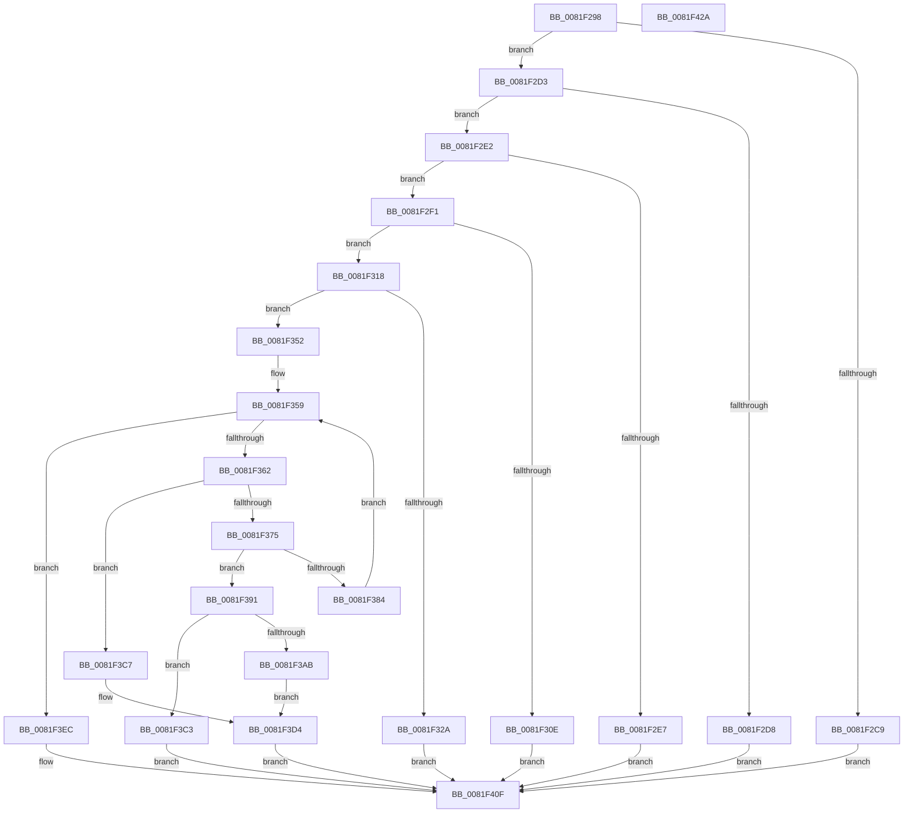

# AslpFileGetImageCodeSectionHeader

- RVA: `0x0081F298`–`0x0081F42B` (길이 `403` bytes)
- VA: `0x000000014081F298`
- 실행 섹션: `PAGE`
- PDB 이름 있음: `예`; PDB Function 태그: `아니요`
- unwind 정보 RVA: `0x00060130`
- 디코드: `96`개 명령, `403/403` bytes 표시
- 미해석 바이트: `0` (있으면 어셈블리에 `.byte`로 보존)

> 이 문서는 커널 이미지의 기계어와 PDB 기호를 분석해 생성했습니다. 4번과 5번은 함수 원형과 자료형을 바이너리 사용 방식에서 추정한 C 해석이며 원본 소스 복구 결과는 아닙니다.

## 1. Dependencies

- 직접 호출 지점: **5**; 고유 호출 대상: **3**
- 직접 호출자로 확인된 함수: **1**
- RIP 상대 이미지 참조: **5**

### Outgoing calls
- `0x0081F343` → [AslLogCallPrintf](../95/AslLogCallPrintf_function_0095E4EC.md) (function, `0x0095E4EC`)
- `0x0081F36C` → [AslpMemorySpanCheckBounds](../../text/69/AslpMemorySpanCheckBounds_function_0069D424.md) (function, `0x0069D424`)
- `0x0081F3A2` → [AslpMemoryRangeCheckBounds](../../text/69/AslpMemoryRangeCheckBounds_function_0069D3E8.md) (function, `0x0069D3E8`)
- `0x0081F3E0` → [AslLogCallPrintf](../95/AslLogCallPrintf_function_0095E4EC.md) (function, `0x0095E4EC`)
- `0x0081F405` → [AslLogCallPrintf](../95/AslLogCallPrintf_function_0095E4EC.md) (function, `0x0095E4EC`)

### Direct callers
- [AslpFileGetCrcChecksumBoot](AslpFileGetCrcChecksumBoot_function_0081E7D4.md) at `0x0081E837`

### Static image references
- `0x0081F32A` → RVA `0x00040248` (`.rdata`; read)
- `0x0081F337` → RVA `0x00040288` (`.rdata`; read)
- `0x0081F3AF` → RVA `0x000402E0` (`.rdata`; read)
- `0x0081F3C7` → RVA `0x000402B0` (`.rdata`; read)
- `0x0081F3EC` → RVA `0x00040320` (`.rdata`; read)

## 2. Other-region calls and transfers

- 다른 실행 섹션으로 향하는 call: **2**
  - `0x0081F36C` → [AslpMemorySpanCheckBounds](../../text/69/AslpMemorySpanCheckBounds_function_0069D424.md) (`PAGE` → `.text`)
  - `0x0081F3A2` → [AslpMemoryRangeCheckBounds](../../text/69/AslpMemoryRangeCheckBounds_function_0069D3E8.md) (`PAGE` → `.text`)
- 별도 외부 분기/꼬리 이동을 확인하지 못했습니다.

## 3. Assembly (complete function range)

```asm
0081F298  48 8B C4                        mov rax, rsp
0081F29B  48 89 58 08                     mov qword ptr [rax + 8], rbx
0081F29F  48 89 68 10                     mov qword ptr [rax + 0x10], rbp
0081F2A3  48 89 70 18                     mov qword ptr [rax + 0x18], rsi
0081F2A7  48 89 78 20                     mov qword ptr [rax + 0x20], rdi
0081F2AB  41 56                           push r14
0081F2AD  48 83 EC 40                     sub rsp, 0x40
0081F2B1  48 83 60 D8 00                  and qword ptr [rax - 0x28], 0
0081F2B6  49 8B F8                        mov rdi, r8
0081F2B9  48 C7 40 E0 28 00 00 00         mov qword ptr [rax - 0x20], 0x28
0081F2C1  48 8B F1                        mov rsi, rcx
0081F2C4  48 85 C9                        test rcx, rcx
0081F2C7  75 0A                           jne 0x14081f2d3
0081F2C9  B8 EF 00 00 C0                  mov eax, 0xc00000ef
0081F2CE  E9 3C 01 00 00                  jmp 0x14081f40f
0081F2D3  48 85 D2                        test rdx, rdx
0081F2D6  75 0A                           jne 0x14081f2e2
0081F2D8  B8 F0 00 00 C0                  mov eax, 0xc00000f0
0081F2DD  E9 2D 01 00 00                  jmp 0x14081f40f
0081F2E2  48 85 FF                        test rdi, rdi
0081F2E5  75 0A                           jne 0x14081f2f1
0081F2E7  B8 F1 00 00 C0                  mov eax, 0xc00000f1
0081F2EC  E9 1E 01 00 00                  jmp 0x14081f40f
0081F2F1  49 8B 00                        mov rax, qword ptr [r8]
0081F2F4  49 8B 48 08                     mov rcx, qword ptr [r8 + 8]
0081F2F8  48 2B C8                        sub rcx, rax
0081F2FB  48 89 44 24 30                  mov qword ptr [rsp + 0x30], rax
0081F300  48 89 4C 24 38                  mov qword ptr [rsp + 0x38], rcx
0081F305  48 81 F9 F0 00 00 00            cmp rcx, 0xf0
0081F30C  73 0A                           jae 0x14081f318
0081F30E  B8 F2 00 00 C0                  mov eax, 0xc00000f2
0081F313  E9 F7 00 00 00                  jmp 0x14081f40f
0081F318  0F B7 5A 14                     movzx ebx, word ptr [rdx + 0x14]
0081F31C  48 83 C3 18                     add rbx, 0x18
0081F320  48 03 DA                        add rbx, rdx
0081F323  48 89 5C 24 20                  mov qword ptr [rsp + 0x20], rbx
0081F328  75 28                           jne 0x14081f352
0081F32A  4C 8D 0D 17 0F 82 FF            lea r9, [rip - 0x7df0e9]
0081F331  41 B8 D2 07 00 00               mov r8d, 0x7d2
0081F337  48 8D 15 4A 0F 82 FF            lea rdx, [rip - 0x7df0b6]
0081F33E  B9 01 00 00 00                  mov ecx, 1
0081F343  E8 A4 F1 13 00                  call 0x14095e4ec
0081F348  B8 7B 00 00 C0                  mov eax, 0xc000007b
0081F34D  E9 BD 00 00 00                  jmp 0x14081f40f
0081F352  44 0F B7 72 06                  movzx r14d, word ptr [rdx + 6]
0081F357  33 ED                           xor ebp, ebp
0081F359  41 3B EE                        cmp ebp, r14d
0081F35C  0F 8D 8A 00 00 00               jge 0x14081f3ec
0081F362  48 8D 54 24 30                  lea rdx, [rsp + 0x30]
0081F367  48 8D 4C 24 20                  lea rcx, [rsp + 0x20]
0081F36C  E8 B3 E0 E7 FF                  call 0x14069d424
0081F371  84 C0                           test al, al
0081F373  74 52                           je 0x14081f3c7
0081F375  48 B8 2E 74 65 78 74 00 00 00   movabs rax, 0x747865742e
0081F37F  48 39 03                        cmp qword ptr [rbx], rax
0081F382  74 0D                           je 0x14081f391
0081F384  48 83 C3 28                     add rbx, 0x28
0081F388  48 89 5C 24 20                  mov qword ptr [rsp + 0x20], rbx
0081F38D  FF C5                           inc ebp
0081F38F  EB C8                           jmp 0x14081f359
0081F391  48 8D 43 28                     lea rax, [rbx + 0x28]
0081F395  48 89 1E                        mov qword ptr [rsi], rbx
0081F398  48 8B D7                        mov rdx, rdi
0081F39B  48 89 46 08                     mov qword ptr [rsi + 8], rax
0081F39F  48 8B CE                        mov rcx, rsi
0081F3A2  E8 41 E0 E7 FF                  call 0x14069d3e8
0081F3A7  84 C0                           test al, al
0081F3A9  75 18                           jne 0x14081f3c3
0081F3AB  48 83 26 00                     and qword ptr [rsi], 0
0081F3AF  4C 8D 0D 2A 0F 82 FF            lea r9, [rip - 0x7df0d6]
0081F3B6  48 83 66 08 00                  and qword ptr [rsi + 8], 0
0081F3BB  41 B8 E7 07 00 00               mov r8d, 0x7e7
0081F3C1  EB 11                           jmp 0x14081f3d4
0081F3C3  33 C0                           xor eax, eax
0081F3C5  EB 48                           jmp 0x14081f40f
0081F3C7  4C 8D 0D E2 0E 82 FF            lea r9, [rip - 0x7df11e]
0081F3CE  41 B8 DB 07 00 00               mov r8d, 0x7db
0081F3D4  48 8D 15 AD 0E 82 FF            lea rdx, [rip - 0x7df153]
0081F3DB  B9 01 00 00 00                  mov ecx, 1
0081F3E0  E8 07 F1 13 00                  call 0x14095e4ec
0081F3E5  B8 2E 02 00 C0                  mov eax, 0xc000022e
0081F3EA  EB 23                           jmp 0x14081f40f
0081F3EC  4C 8D 0D 2D 0F 82 FF            lea r9, [rip - 0x7df0d3]
0081F3F3  41 B8 F1 07 00 00               mov r8d, 0x7f1
0081F3F9  48 8D 15 88 0E 82 FF            lea rdx, [rip - 0x7df178]
0081F400  B9 02 00 00 00                  mov ecx, 2
0081F405  E8 E2 F0 13 00                  call 0x14095e4ec
0081F40A  B8 25 02 00 C0                  mov eax, 0xc0000225
0081F40F  48 8B 5C 24 50                  mov rbx, qword ptr [rsp + 0x50]
0081F414  48 8B 6C 24 58                  mov rbp, qword ptr [rsp + 0x58]
0081F419  48 8B 74 24 60                  mov rsi, qword ptr [rsp + 0x60]
0081F41E  48 8B 7C 24 68                  mov rdi, qword ptr [rsp + 0x68]
0081F423  48 83 C4 40                     add rsp, 0x40
0081F427  41 5E                           pop r14
0081F429  C3                              ret
0081F42A  CC                              int3
```

## 4. C-style interpretation (structured pseudocode)

```c
__int64 __fastcall AslpFileGetImageCodeSectionHeader(__int64 a1, __int64 a2, __int64 a3)
{
    __int64 result;
    __int64 v_rbp;
    __int64 v_rbx;
    __int64 v_rsp;
    unsigned __int64 v_stack_m10;
    unsigned __int64 v_stack_m18;
    unsigned __int64 v_stack_m28;
    unsigned __int64 v_stack_p10;
    unsigned __int64 v_stack_p18;
    unsigned __int64 v_stack_p20;
    unsigned __int64 v_stack_p8;

    *(unsigned __int64 *)(v_rsp + 8) = v_rbx;
    *(unsigned __int64 *)(v_rsp + 16) = v_rbp;
    *(unsigned __int64 *)(v_rsp + 24) = v_rsi;
    *(unsigned __int64 *)(v_rsp + 32) = v_rdi;
    v_rsp = (v_rsp) - (64);
    *(unsigned __int64 *)(v_rsp - 32) = 40;
    if (a1 != 0) goto loc_0081F2D3;
    goto loc_0081F40F;
loc_0081F2D3:
    if (a2 != 0) goto loc_0081F2E2;
    goto loc_0081F40F;
loc_0081F2E2:
    if (a3 != 0) goto loc_0081F2F1;
    goto loc_0081F40F;
loc_0081F2F1:
    a1 = (*(unsigned __int64 *)(a3 + 8)) - (*(unsigned __int64 *)(a3));
    v_stack_m18 = *(unsigned __int64 *)(a3);
    v_stack_m10 = a1;
    if (a1 >= 240) goto loc_0081F318;
    goto loc_0081F40F;
loc_0081F318:
    v_rbx = (*(unsigned __int16 *)(a2 + 20)) + (24);
    v_rbx = (v_rbx) + (a2);
    v_stack_m28 = v_rbx;
    if (condition_is_not_equal) goto loc_0081F352;
    result = AslLogCallPrintf(1, v_rip - 8253622, (unsigned int)(0x7D2ULL), v_rip - 8253673);
    goto loc_0081F40F;
loc_0081F352:
    v_rbp = 0;
loc_0081F359:
    if (0 >= ((unsigned int)(*(unsigned __int16 *)(v_rip - 8253622 + 6)))) goto loc_0081F3EC;
    result = AslpMemorySpanCheckBounds(v_stack_m28, v_stack_m18, (unsigned int)(0x7D2ULL), v_rip - 8253673);
    if ((unsigned __int8)(result) == 0) goto loc_0081F3C7;
    if ((*(unsigned __int64 *)(v_rbx)) == result) goto loc_0081F391;
    v_rbx = (v_rbx) + (40);
    v_stack_m28 = v_rbx;
    v_rbp = (unsigned int)((v_rbp) + 1);
    goto loc_0081F359;
loc_0081F391:
    *(unsigned __int64 *)(a1) = v_rbx;
    *(unsigned __int64 *)(a1 + 8) = v_rbx + 40;
    result = AslpMemoryRangeCheckBounds(a1, a3, (unsigned int)(0x7D2ULL), v_rip - 8253673);
    if ((unsigned __int8)(result) != 0) goto loc_0081F3C3;
    goto loc_0081F3D4;
loc_0081F3C3:
    result = 0;
    goto loc_0081F40F;
loc_0081F3C7:
loc_0081F3D4:
    result = AslLogCallPrintf(1, v_rip - 8253779, (unsigned int)(0x7DBULL), v_rip - 8253726);
    goto loc_0081F40F;
loc_0081F3EC:
    result = AslLogCallPrintf(2, v_rip - 8253816, (unsigned int)(0x7F1ULL), v_rip - 8253651);
loc_0081F40F:
    v_rsp = (v_rsp) + (64);
    return (unsigned int)(0xC0000225ULL);
}
```

## 5. (Beta) C Style

```c
int64_t AslpFileGetImageCodeSectionHeader(void *Arg1, int64_t Arg2, void *Arg3)
{
    uint8_t *arg1 = (uint8_t *)Arg1;
    uint8_t *arg3 = (uint8_t *)Arg3;

    int64_t result;
    int64_t local_rbp;
    int64_t local_rbx;
    int64_t local_rsp;
    uint64_t v_stack_m10;
    uint64_t v_stack_m18;
    uint64_t v_stack_m28;
    uint64_t v_stack_p10;
    uint64_t v_stack_p18;
    uint64_t v_stack_p20;
    uint64_t v_stack_p8;

    *(uint64_t *)(local_rsp + 0x8) = local_rbx;
    *(uint64_t *)(local_rsp + 0x10) = local_rbp;
    *(uint64_t *)(local_rsp + 0x18) = local_rsi;
    *(uint64_t *)(local_rsp + 0x20) = local_rdi;
    local_rsp = (local_rsp) - (64);
    *(uint64_t *)(local_rsp - 0x20) = 40;
    if (Arg1 != NULL) goto loc_0081F2D3;
    goto loc_0081F40F;
loc_0081F2D3:
    if (Arg2 != 0) goto loc_0081F2E2;
    goto loc_0081F40F;
loc_0081F2E2:
    if (Arg3 != NULL) goto loc_0081F2F1;
    goto loc_0081F40F;
loc_0081F2F1:
    Arg1 = (*(uint64_t *)(arg3 + 0x8)) - (*(uint64_t *)(arg3));
    v_stack_m18 = *(uint64_t *)(arg3);
    v_stack_m10 = Arg1;
    if (Arg1 >= 240) goto loc_0081F318;
    goto loc_0081F40F;
loc_0081F318:
    local_rbx = (*(uint16_t *)(Arg2 + 0x14)) + (24);
    local_rbx = (local_rbx) + (Arg2);
    v_stack_m28 = local_rbx;
    if (condition_is_not_equal) goto loc_0081F352;
    result = AslLogCallPrintf(1, v_rip - 8253622, (uint32_t)(0x7D2ULL), v_rip - 8253673);
    goto loc_0081F40F;
loc_0081F352:
    local_rbp = 0;
loc_0081F359:
    if (0 >= ((uint32_t)(*(uint16_t *)(v_rip - 0x7DF0B6 + 0x6)))) goto loc_0081F3EC;
    result = AslpMemorySpanCheckBounds(v_stack_m28, v_stack_m18, (uint32_t)(0x7D2ULL), v_rip - 8253673);
    if ((uint8_t)(result) == 0) goto loc_0081F3C7;
    if ((*(uint64_t *)(local_rbx)) == result) goto loc_0081F391;
    local_rbx = (local_rbx) + (40);
    v_stack_m28 = local_rbx;
    local_rbp = (uint32_t)((local_rbp) + 1);
    goto loc_0081F359;
loc_0081F391:
    *(uint64_t *)(arg1) = local_rbx;
    *(uint64_t *)(arg1 + 0x8) = local_rbx + 40;
    result = AslpMemoryRangeCheckBounds(Arg1, Arg3, (uint32_t)(0x7D2ULL), v_rip - 8253673);
    if ((uint8_t)(result) != 0) goto loc_0081F3C3;
    goto loc_0081F3D4;
loc_0081F3C3:
    result = 0;
    goto loc_0081F40F;
loc_0081F3C7:
loc_0081F3D4:
    result = AslLogCallPrintf(1, v_rip - 8253779, (uint32_t)(0x7DBULL), v_rip - 8253726);
    goto loc_0081F40F;
loc_0081F3EC:
    result = AslLogCallPrintf(2, v_rip - 8253816, (uint32_t)(0x7F1ULL), v_rip - 8253651);
loc_0081F40F:
    local_rsp = (local_rsp) + (64);
    return (uint32_t)(0xC0000225ULL);
}
```

### 관측된 메모리 오프셋

구조체 형식이 확인되지 않은 접근은 인자 기준의 오프셋으로만 기록했습니다.

| 기준 인자 | 오프셋 표현 | 폭 (bit) | 접근 |
|---|---:|---:|---|
| `Arg1` | `+ 0x0` | `64` | `R/W` |
| `Arg1` | `+ 0x0` | `64` | `W` |
| `Arg1` | `+ 0x8` | `64` | `R/W` |
| `Arg1` | `+ 0x8` | `64` | `W` |
| `Arg3` | `+ 0x0` | `64` | `R` |
| `Arg3` | `+ 0x8` | `64` | `R` |

## 6. Execution-region graph

[열기: 2D/3D 그래프와 함수 탐색 컨트롤 패널](../../../control-panel.html?section=page&rva=0x0081F298&view=graph)

- 2D 그래프는 위에서 아래로 흐르고, 3D 그래프는 빈 공간을 드래그해 회전합니다. Shift+드래그는 이동, 휠은 확대·축소, 함수 노드 선택은 대상 보고서 이동입니다.

### Static fallback


