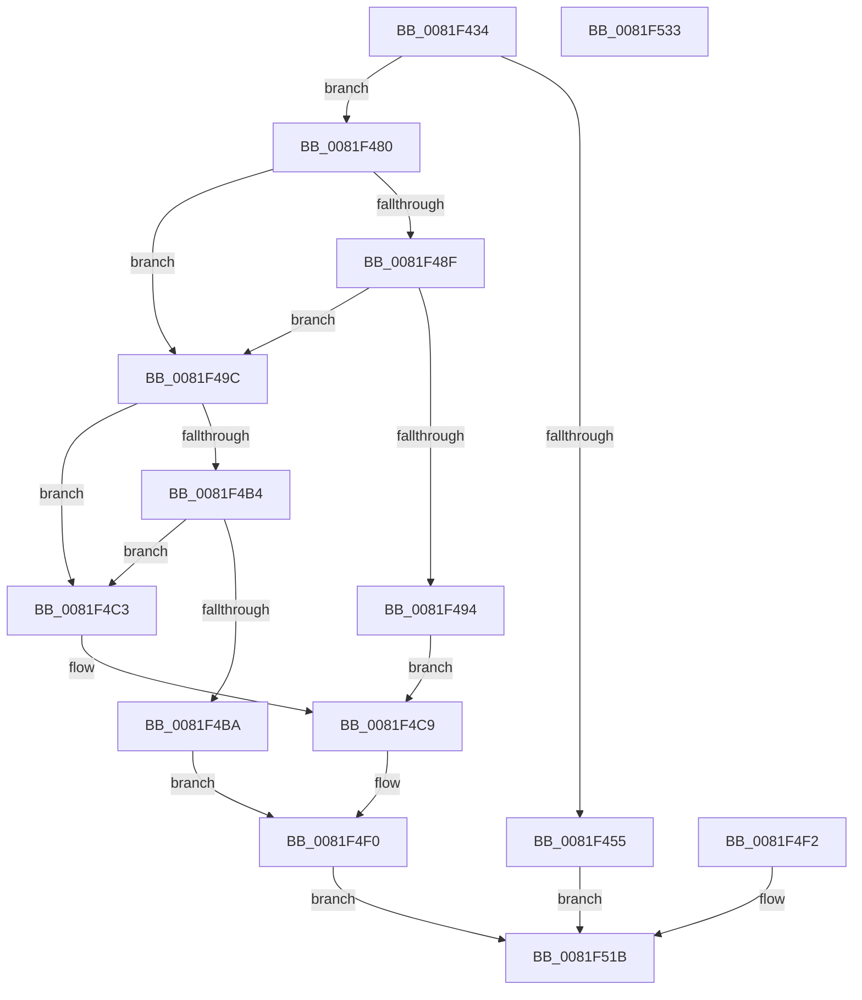

# AslpFileGetImageNtHeader

- RVA: `0x0081F434`–`0x0081F534` (길이 `256` bytes)
- VA: `0x000000014081F434`
- 실행 섹션: `PAGE`
- PDB 이름 있음: `예`; PDB Function 태그: `아니요`
- unwind 정보 RVA: `0x000DA0E0`
- 디코드: `65`개 명령, `256/256` bytes 표시
- 미해석 바이트: `0` (있으면 어셈블리에 `.byte`로 보존)

> 이 문서는 커널 이미지의 기계어와 PDB 기호를 분석해 생성했습니다. 4번과 5번은 함수 원형과 자료형을 바이너리 사용 방식에서 추정한 C 해석이며 원본 소스 복구 결과는 아닙니다.

## 1. Dependencies

- 직접 호출 지점: **4**; 고유 호출 대상: **2**
- 직접 호출자로 확인된 함수: **9**
- RIP 상대 이미지 참조: **4**

### Outgoing calls
- `0x0081F476` → [AslLogCallPrintf](../95/AslLogCallPrintf_function_0095E4EC.md) (function, `0x0095E4EC`)
- `0x0081F484` → [Feature_Servicing_MSRC131691__private_IsEnabledDeviceUsageNoInline](../../text/69/Feature_Servicing_MSRC131691__private_IsEnabledDeviceUsageNoInline_function_0069CFF4.md) (function, `0x0069CFF4`)
- `0x0081F4EB` → [AslLogCallPrintf](../95/AslLogCallPrintf_function_0095E4EC.md) (function, `0x0095E4EC`)
- `0x0081F515` → [AslLogCallPrintf](../95/AslLogCallPrintf_function_0095E4EC.md) (function, `0x0095E4EC`)

### Direct callers
- [AslFileMappingGetImageTypeEx](AslFileMappingGetImageTypeEx_function_0081A950.md) at `0x0081AA0B`
- [AslpFileGetChecksumAttributes](AslpFileGetChecksumAttributes_function_0081E130.md) at `0x0081E2E1`
- [AslpFileGetClrVersion](AslpFileGetClrVersion_function_0081E388.md) at `0x0081E3B1`
- [AslpFileGetExeWrapper](AslpFileGetExeWrapper_function_0081EAF4.md) at `0x0081EB31`
- [AslpFileGetImageResourceDirectoryRoot](AslpFileGetImageResourceDirectoryRoot_function_0081F53C.md) at `0x0081F5A1`
- [AslpFileGetNtHeaderAttributes](AslpFileGetNtHeaderAttributes_function_0081F724.md) at `0x0081F75C`
- [AslpFileGetVersionBlockFromResourceRoot](AslpFileGetVersionBlockFromResourceRoot_function_0081FF98.md) at `0x00820145`
- [AslpFileIsArm64XBinary](../82/AslpFileIsArm64XBinary_function_008206B0.md) at `0x0082076B`
- [AslpFileQueryExportName](../82/AslpFileQueryExportName_function_00820EF8.md) at `0x00820F54`

### Static image references
- `0x0081F45D` → RVA `0x00040000` (`.rdata`; read)
- `0x0081F46A` → RVA `0x00040020` (`.rdata`; read)
- `0x0081F4D8` → RVA `0x0003EF40` (`.rdata`; read)
- `0x0081F4FC` → RVA `0x0003EF20` (`.rdata`; read)

## 2. Other-region calls and transfers

- 다른 실행 섹션으로 향하는 call: **1**
  - `0x0081F484` → [Feature_Servicing_MSRC131691__private_IsEnabledDeviceUsageNoInline](../../text/69/Feature_Servicing_MSRC131691__private_IsEnabledDeviceUsageNoInline_function_0069CFF4.md) (`PAGE` → `.text`)
- 별도 외부 분기/꼬리 이동을 확인하지 못했습니다.

## 3. Assembly (complete function range)

```asm
0081F434  48 8B C4                        mov rax, rsp
0081F437  48 89 58 08                     mov qword ptr [rax + 8], rbx
0081F43B  48 89 70 10                     mov qword ptr [rax + 0x10], rsi
0081F43F  48 89 78 18                     mov qword ptr [rax + 0x18], rdi
0081F443  41 56                           push r14
0081F445  48 83 EC 40                     sub rsp, 0x40
0081F449  48 8B FA                        mov rdi, rdx
0081F44C  4C 8B F1                        mov r14, rcx
0081F44F  83 7A 40 06                     cmp dword ptr [rdx + 0x40], 6
0081F453  74 2B                           je 0x14081f480
0081F455  BB BB 00 00 C0                  mov ebx, 0xc00000bb
0081F45A  89 58 D8                        mov dword ptr [rax - 0x28], ebx
0081F45D  4C 8D 0D 9C 0B 82 FF            lea r9, [rip - 0x7df464]
0081F464  41 B8 51 0F 00 00               mov r8d, 0xf51
0081F46A  48 8D 15 AF 0B 82 FF            lea rdx, [rip - 0x7df451]
0081F471  B9 01 00 00 00                  mov ecx, 1
0081F476  E8 71 F0 13 00                  call 0x14095e4ec
0081F47B  E9 9B 00 00 00                  jmp 0x14081f51b
0081F480  48 8B 72 20                     mov rsi, qword ptr [rdx + 0x20]
0081F484  E8 6B DB E7 FF                  call 0x14069cff4
0081F489  33 DB                           xor ebx, ebx
0081F48B  85 C0                           test eax, eax
0081F48D  74 0D                           je 0x14081f49c
0081F48F  39 5E 3C                        cmp dword ptr [rsi + 0x3c], ebx
0081F492  7F 08                           jg 0x14081f49c
0081F494  41 B8 5C 0F 00 00               mov r8d, 0xf5c
0081F49A  EB 2D                           jmp 0x14081f4c9
0081F49C  48 63 4E 3C                     movsxd rcx, dword ptr [rsi + 0x3c]
0081F4A0  48 8B 57 20                     mov rdx, qword ptr [rdi + 0x20]
0081F4A4  48 03 D1                        add rdx, rcx
0081F4A7  48 81 C1 08 01 00 00            add rcx, 0x108
0081F4AE  48 39 4F 18                     cmp qword ptr [rdi + 0x18], rcx
0081F4B2  72 0F                           jb 0x14081f4c3
0081F4B4  48 39 4F 28                     cmp qword ptr [rdi + 0x28], rcx
0081F4B8  72 09                           jb 0x14081f4c3
0081F4BA  49 89 16                        mov qword ptr [r14], rdx
0081F4BD  89 5C 24 30                     mov dword ptr [rsp + 0x30], ebx
0081F4C1  EB 2D                           jmp 0x14081f4f0
0081F4C3  41 B8 65 0F 00 00               mov r8d, 0xf65
0081F4C9  B8 7B 00 00 C0                  mov eax, 0xc000007b
0081F4CE  8B D8                           mov ebx, eax
0081F4D0  89 44 24 20                     mov dword ptr [rsp + 0x20], eax
0081F4D4  89 44 24 30                     mov dword ptr [rsp + 0x30], eax
0081F4D8  4C 8D 0D 61 FA 81 FF            lea r9, [rip - 0x7e059f]
0081F4DF  48 8D 15 3A 0B 82 FF            lea rdx, [rip - 0x7df4c6]
0081F4E6  B9 01 00 00 00                  mov ecx, 1
0081F4EB  E8 FC EF 13 00                  call 0x14095e4ec
0081F4F0  EB 29                           jmp 0x14081f51b
0081F4F2  8B D8                           mov ebx, eax
0081F4F4  89 44 24 30                     mov dword ptr [rsp + 0x30], eax
0081F4F8  89 44 24 20                     mov dword ptr [rsp + 0x20], eax
0081F4FC  4C 8D 0D 1D FA 81 FF            lea r9, [rip - 0x7e05e3]
0081F503  41 B8 6E 0F 00 00               mov r8d, 0xf6e
0081F509  48 8D 15 10 0B 82 FF            lea rdx, [rip - 0x7df4f0]
0081F510  B9 01 00 00 00                  mov ecx, 1
0081F515  E8 D2 EF 13 00                  call 0x14095e4ec
0081F51A  90                              nop
0081F51B  8B C3                           mov eax, ebx
0081F51D  48 8B 5C 24 50                  mov rbx, qword ptr [rsp + 0x50]
0081F522  48 8B 74 24 58                  mov rsi, qword ptr [rsp + 0x58]
0081F527  48 8B 7C 24 60                  mov rdi, qword ptr [rsp + 0x60]
0081F52C  48 83 C4 40                     add rsp, 0x40
0081F530  41 5E                           pop r14
0081F532  C3                              ret
0081F533  CC                              int3
```

## 4. C-style interpretation (structured pseudocode)

```c
__int64 __fastcall AslpFileGetImageNtHeader(__int64 a1, __int64 a2)
{
    __int64 result;
    __int64 v_rbx;
    __int64 v_rsp;
    unsigned int v_stack_m18;
    unsigned int v_stack_m28;
    unsigned __int64 v_stack_p10;
    unsigned __int64 v_stack_p18;
    unsigned __int64 v_stack_p8;

    *(unsigned __int64 *)(v_rsp + 8) = v_rbx;
    *(unsigned __int64 *)(v_rsp + 16) = v_rsi;
    *(unsigned __int64 *)(v_rsp + 24) = v_rdi;
    v_rsp = (v_rsp) - (64);
    if ((*(unsigned int *)(a2 + 64)) == 6) goto loc_0081F480;
    *(unsigned int *)(v_rsp - 40) = (unsigned int)((unsigned int)(0xC00000BBULL));
    result = AslLogCallPrintf(1, v_rip - 8254545, (unsigned int)(0xF51ULL), v_rip - 8254564);
    goto loc_0081F51B;
loc_0081F480:
    result = Feature_Servicing_MSRC131691__private_IsEnabledDeviceUsageNoInline(1, v_rip - 8254545, (unsigned int)(0xF51ULL), v_rip - 8254564);
    v_rbx = 0;
    if ((unsigned int)(result) == 0) goto loc_0081F49C;
    if ((*(unsigned int *)(*(unsigned __int64 *)(v_rip - 8254545 + 32) + 60)) > 0) goto loc_0081F49C;
    goto loc_0081F4C9;
loc_0081F49C:
    a2 = (*(unsigned __int64 *)(a2 + 32)) + ((int)(*(unsigned int *)(*(unsigned __int64 *)(v_rip - 8254545 + 32) + 60)));
    a1 = ((int)(*(unsigned int *)(*(unsigned __int64 *)(v_rip - 8254545 + 32) + 60))) + (264);
    if ((*(unsigned __int64 *)(a2 + 24)) < a1) goto loc_0081F4C3;
    if ((*(unsigned __int64 *)(a2 + 40)) < a1) goto loc_0081F4C3;
    *(unsigned __int64 *)(a1) = a2;
    v_stack_m18 = 0;
    goto loc_0081F4F0;
loc_0081F4C3:
loc_0081F4C9:
    v_stack_m28 = (unsigned int)((unsigned int)(0xC000007BULL));
    v_stack_m18 = (unsigned int)((unsigned int)(0xC000007BULL));
    result = AslLogCallPrintf(1, v_rip - 8254662, (unsigned int)(0xF65ULL), v_rip - 8258975);
loc_0081F4F0:
    goto loc_0081F51B;
loc_0081F51B:
    v_rsp = (v_rsp) + (64);
    return (unsigned int)((unsigned int)((unsigned int)((unsigned int)((unsigned int)(0xC000007BULL)))));
}
```

## 5. (Beta) C Style

```c
int64_t AslpFileGetImageNtHeader(void *Arg1, void *Arg2)
{
    uint8_t *arg1 = (uint8_t *)Arg1;
    uint8_t *arg2 = (uint8_t *)Arg2;

    int64_t result;
    int64_t local_rbx;
    int64_t local_rsp;
    uint32_t v_stack_m18;
    uint32_t v_stack_m28;
    uint64_t v_stack_p10;
    uint64_t v_stack_p18;
    uint64_t v_stack_p8;

    *(uint64_t *)(local_rsp + 0x8) = local_rbx;
    *(uint64_t *)(local_rsp + 0x10) = local_rsi;
    *(uint64_t *)(local_rsp + 0x18) = local_rdi;
    local_rsp = (local_rsp) - (64);
    if ((*(uint32_t *)(arg2 + 0x40)) == 6) goto loc_0081F480;
    *(uint32_t *)(local_rsp - 0x28) = (uint32_t)((uint32_t)(0xC00000BBULL));
    result = AslLogCallPrintf(1, v_rip - 8254545, (uint32_t)(0xF51ULL), v_rip - 8254564);
    goto loc_0081F51B;
loc_0081F480:
    result = Feature_Servicing_MSRC131691__private_IsEnabledDeviceUsageNoInline(1, v_rip - 8254545, (uint32_t)(0xF51ULL), v_rip - 8254564);
    local_rbx = 0;
    if ((uint32_t)(result) == 0) goto loc_0081F49C;
    if ((*(uint32_t *)(*(uint64_t *)(v_rip - 0x7DF451 + 0x20) + 0x3C)) > 0) goto loc_0081F49C;
    goto loc_0081F4C9;
loc_0081F49C:
    Arg2 = (*(uint64_t *)(arg2 + 0x20)) + ((int32_t)(*(uint32_t *)(*(uint64_t *)(v_rip - 0x7DF451 + 0x20) + 0x3C)));
    Arg1 = ((int32_t)(*(uint32_t *)(*(uint64_t *)(v_rip - 0x7DF451 + 0x20) + 0x3C))) + (264);
    if ((*(uint64_t *)(arg2 + 0x18)) < Arg1) goto loc_0081F4C3;
    if ((*(uint64_t *)(arg2 + 0x28)) < Arg1) goto loc_0081F4C3;
    *(void **)(arg1) = Arg2;
    v_stack_m18 = 0;
    goto loc_0081F4F0;
loc_0081F4C3:
loc_0081F4C9:
    v_stack_m28 = (uint32_t)((uint32_t)(0xC000007BULL));
    v_stack_m18 = (uint32_t)((uint32_t)(0xC000007BULL));
    result = AslLogCallPrintf(1, v_rip - 8254662, (uint32_t)(0xF65ULL), v_rip - 8258975);
loc_0081F4F0:
    goto loc_0081F51B;
loc_0081F51B:
    local_rsp = (local_rsp) + (64);
    return (uint32_t)((uint32_t)((uint32_t)((uint32_t)((uint32_t)(0xC000007BULL)))));
}
```

### 관측된 메모리 오프셋

구조체 형식이 확인되지 않은 접근은 인자 기준의 오프셋으로만 기록했습니다.

| 기준 인자 | 오프셋 표현 | 폭 (bit) | 접근 |
|---|---:|---:|---|
| `Arg1` | `+ 0x0` | `64` | `W` |
| `Arg2` | `+ 0x18` | `64` | `R` |
| `Arg2` | `+ 0x20` | `64` | `R` |
| `Arg2` | `+ 0x28` | `64` | `R` |
| `Arg2` | `+ 0x40` | `32` | `R` |

## 6. Execution-region graph

[열기: 2D/3D 그래프와 함수 탐색 컨트롤 패널](../../../control-panel.html?section=page&rva=0x0081F434&view=graph)

- 2D 그래프는 위에서 아래로 흐르고, 3D 그래프는 빈 공간을 드래그해 회전합니다. Shift+드래그는 이동, 휠은 확대·축소, 함수 노드 선택은 대상 보고서 이동입니다.

### Static fallback


