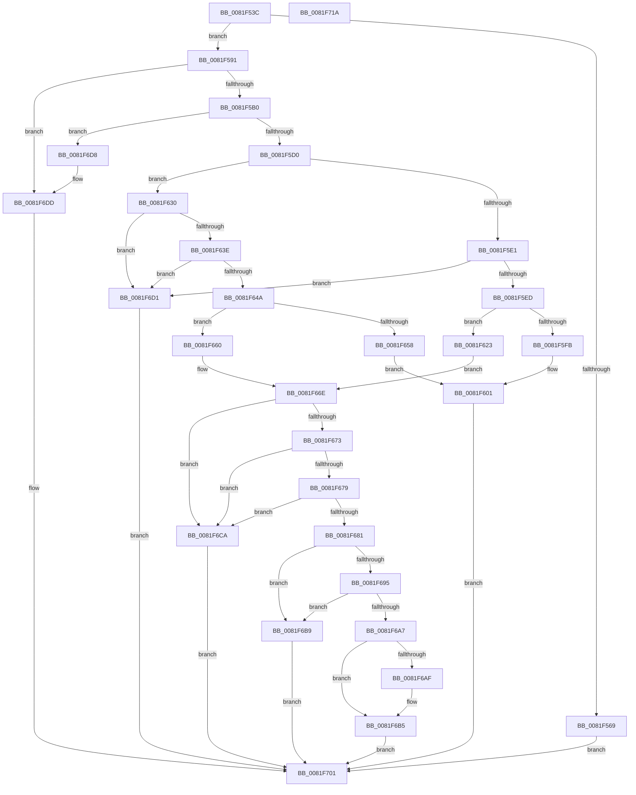

# AslpFileGetImageResourceDirectoryRoot

- RVA: `0x0081F53C`–`0x0081F71B` (길이 `479` bytes)
- VA: `0x000000014081F53C`
- 실행 섹션: `PAGE`
- PDB 이름 있음: `예`; PDB Function 태그: `아니요`
- unwind 정보 RVA: `0x000BDA48`
- 디코드: `123`개 명령, `479/479` bytes 표시
- 미해석 바이트: `0` (있으면 어셈블리에 `.byte`로 보존)

> 이 문서는 커널 이미지의 기계어와 PDB 기호를 분석해 생성했습니다. 4번과 5번은 함수 원형과 자료형을 바이너리 사용 방식에서 추정한 C 해석이며 원본 소스 복구 결과는 아닙니다.

## 1. Dependencies

- 직접 호출 지점: **9**; 고유 호출 대상: **4**
- 직접 호출자로 확인된 함수: **2**
- RIP 상대 이미지 참조: **4**

### Outgoing calls
- `0x0081F582` → [AslLogCallPrintf](../95/AslLogCallPrintf_function_0095E4EC.md) (function, `0x0095E4EC`)
- `0x0081F5A1` → [AslpFileGetImageNtHeader](AslpFileGetImageNtHeader_function_0081F434.md) (function, `0x0081F434`)
- `0x0081F5C3` → [AslpMemoryCheckBounds](../../text/69/AslpMemoryCheckBounds_function_0069D3AC.md) (function, `0x0069D3AC`)
- `0x0081F5F2` → [AslpMemoryCheckBounds](../../text/69/AslpMemoryCheckBounds_function_0069D3AC.md) (function, `0x0069D3AC`)
- `0x0081F614` → [AslLogCallPrintf](../95/AslLogCallPrintf_function_0095E4EC.md) (function, `0x0095E4EC`)
- `0x0081F64F` → [AslpMemoryCheckBounds](../../text/69/AslpMemoryCheckBounds_function_0069D3AC.md) (function, `0x0069D3AC`)
- `0x0081F688` → [AslpImageRvaToVa](../82/AslpImageRvaToVa_function_008214BC.md) (function, `0x008214BC`)
- `0x0081F69E` → [AslpMemoryCheckBounds](../../text/69/AslpMemoryCheckBounds_function_0069D3AC.md) (function, `0x0069D3AC`)
- `0x0081F6FA` → [AslLogCallPrintf](../95/AslLogCallPrintf_function_0095E4EC.md) (function, `0x0095E4EC`)

### Direct callers
- [AslpFileGetCrcChecksumBoot](AslpFileGetCrcChecksumBoot_function_0081E7D4.md) at `0x0081E928`
- [AslpFileGetVersionBlockImageOnly](../82/AslpFileGetVersionBlockImageOnly_function_00820260.md) at `0x00820318`

### Static image references
- `0x0081F569` → RVA `0x00040350` (`.rdata`; read)
- `0x0081F576` → RVA `0x00040368` (`.rdata`; read)
- `0x0081F601` → RVA `0x000403E8` (`.rdata`; read)
- `0x0081F6DD` → RVA `0x00040390` (`.rdata`; read)

## 2. Other-region calls and transfers

- 다른 실행 섹션으로 향하는 call: **4**
  - `0x0081F5C3` → [AslpMemoryCheckBounds](../../text/69/AslpMemoryCheckBounds_function_0069D3AC.md) (`PAGE` → `.text`)
  - `0x0081F5F2` → [AslpMemoryCheckBounds](../../text/69/AslpMemoryCheckBounds_function_0069D3AC.md) (`PAGE` → `.text`)
  - `0x0081F64F` → [AslpMemoryCheckBounds](../../text/69/AslpMemoryCheckBounds_function_0069D3AC.md) (`PAGE` → `.text`)
  - `0x0081F69E` → [AslpMemoryCheckBounds](../../text/69/AslpMemoryCheckBounds_function_0069D3AC.md) (`PAGE` → `.text`)
- 별도 외부 분기/꼬리 이동을 확인하지 못했습니다.

## 3. Assembly (complete function range)

```asm
0081F53C  48 8B C4                        mov rax, rsp
0081F53F  48 89 58 08                     mov qword ptr [rax + 8], rbx
0081F543  48 89 68 10                     mov qword ptr [rax + 0x10], rbp
0081F547  48 89 70 20                     mov qword ptr [rax + 0x20], rsi
0081F54B  57                              push rdi
0081F54C  41 56                           push r14
0081F54E  41 57                           push r15
0081F550  48 83 EC 30                     sub rsp, 0x30
0081F554  48 83 60 18 00                  and qword ptr [rax + 0x18], 0
0081F559  49 8B F8                        mov rdi, r8
0081F55C  41 83 78 40 06                  cmp dword ptr [r8 + 0x40], 6
0081F561  48 8B F2                        mov rsi, rdx
0081F564  4C 8B F9                        mov r15, rcx
0081F567  74 28                           je 0x14081f591
0081F569  4C 8D 0D E0 0D 82 FF            lea r9, [rip - 0x7df220]
0081F570  41 B8 27 08 00 00               mov r8d, 0x827
0081F576  48 8D 15 EB 0D 82 FF            lea rdx, [rip - 0x7df215]
0081F57D  B9 01 00 00 00                  mov ecx, 1
0081F582  E8 65 EF 13 00                  call 0x14095e4ec
0081F587  B8 BB 00 00 C0                  mov eax, 0xc00000bb
0081F58C  E9 70 01 00 00                  jmp 0x14081f701
0081F591  49 8B 68 20                     mov rbp, qword ptr [r8 + 0x20]
0081F595  48 8D 4C 24 60                  lea rcx, [rsp + 0x60]
0081F59A  4D 8B 70 28                     mov r14, qword ptr [r8 + 0x28]
0081F59E  48 8B D7                        mov rdx, rdi
0081F5A1  E8 8E FE FF FF                  call 0x14081f434
0081F5A6  8B D8                           mov ebx, eax
0081F5A8  85 C0                           test eax, eax
0081F5AA  0F 88 2D 01 00 00               js 0x14081f6dd
0081F5B0  4C 8B 5C 24 60                  mov r11, qword ptr [rsp + 0x60]
0081F5B5  4D 8B CE                        mov r9, r14
0081F5B8  49 8B CB                        mov rcx, r11
0081F5BB  4C 8B C5                        mov r8, rbp
0081F5BE  BA 08 00 00 00                  mov edx, 8
0081F5C3  E8 E4 DD E7 FF                  call 0x14069d3ac
0081F5C8  84 C0                           test al, al
0081F5CA  0F 84 08 01 00 00               je 0x14081f6d8
0081F5D0  49 8D 4B 18                     lea rcx, [r11 + 0x18]
0081F5D4  BA 0B 01 00 00                  mov edx, 0x10b
0081F5D9  0F B7 01                        movzx eax, word ptr [rcx]
0081F5DC  66 3B C2                        cmp ax, dx
0081F5DF  75 4F                           jne 0x14081f630
0081F5E1  66 41 83 7B 14 60               cmp word ptr [r11 + 0x14], 0x60
0081F5E7  0F 82 E4 00 00 00               jb 0x14081f6d1
0081F5ED  BA E0 00 00 00                  mov edx, 0xe0
0081F5F2  E8 B5 DD E7 FF                  call 0x14069d3ac
0081F5F7  84 C0                           test al, al
0081F5F9  75 28                           jne 0x14081f623
0081F5FB  41 B8 46 08 00 00               mov r8d, 0x846
0081F601  4C 8D 0D E0 0D 82 FF            lea r9, [rip - 0x7df220]
0081F608  B9 01 00 00 00                  mov ecx, 1
0081F60D  48 8D 15 54 0D 82 FF            lea rdx, [rip - 0x7df2ac]
0081F614  E8 D3 EE 13 00                  call 0x14095e4ec
0081F619  B8 2E 02 00 C0                  mov eax, 0xc000022e
0081F61E  E9 DE 00 00 00                  jmp 0x14081f701
0081F623  41 8B 43 74                     mov eax, dword ptr [r11 + 0x74]
0081F627  49 8D 9B 88 00 00 00            lea rbx, [r11 + 0x88]
0081F62E  EB 3E                           jmp 0x14081f66e
0081F630  BA 0B 02 00 00                  mov edx, 0x20b
0081F635  66 3B C2                        cmp ax, dx
0081F638  0F 85 93 00 00 00               jne 0x14081f6d1
0081F63E  66 41 83 7B 14 70               cmp word ptr [r11 + 0x14], 0x70
0081F644  0F 82 87 00 00 00               jb 0x14081f6d1
0081F64A  BA F0 00 00 00                  mov edx, 0xf0
0081F64F  E8 58 DD E7 FF                  call 0x14069d3ac
0081F654  84 C0                           test al, al
0081F656  75 08                           jne 0x14081f660
0081F658  41 B8 56 08 00 00               mov r8d, 0x856
0081F65E  EB A1                           jmp 0x14081f601
0081F660  41 8B 83 84 00 00 00            mov eax, dword ptr [r11 + 0x84]
0081F667  49 8D 9B 98 00 00 00            lea rbx, [r11 + 0x98]
0081F66E  83 F8 02                        cmp eax, 2
0081F671  76 57                           jbe 0x14081f6ca
0081F673  83 7B 04 10                     cmp dword ptr [rbx + 4], 0x10
0081F677  72 51                           jb 0x14081f6ca
0081F679  44 8B 03                        mov r8d, dword ptr [rbx]
0081F67C  45 85 C0                        test r8d, r8d
0081F67F  74 49                           je 0x14081f6ca
0081F681  48 8D 57 08                     lea rdx, [rdi + 8]
0081F685  49 8B CB                        mov rcx, r11
0081F688  E8 2F 1E 00 00                  call 0x1408214bc
0081F68D  48 8B C8                        mov rcx, rax
0081F690  48 85 C0                        test rax, rax
0081F693  74 24                           je 0x14081f6b9
0081F695  8B 53 04                        mov edx, dword ptr [rbx + 4]
0081F698  4D 8B CE                        mov r9, r14
0081F69B  4C 8B C5                        mov r8, rbp
0081F69E  E8 09 DD E7 FF                  call 0x14069d3ac
0081F6A3  84 C0                           test al, al
0081F6A5  74 12                           je 0x14081f6b9
0081F6A7  49 89 0F                        mov qword ptr [r15], rcx
0081F6AA  48 85 F6                        test rsi, rsi
0081F6AD  74 06                           je 0x14081f6b5
0081F6AF  8B 43 04                        mov eax, dword ptr [rbx + 4]
0081F6B2  48 89 06                        mov qword ptr [rsi], rax
0081F6B5  33 C0                           xor eax, eax
0081F6B7  EB 48                           jmp 0x14081f701
0081F6B9  48 F7 D9                        neg rcx
0081F6BC  1B C0                           sbb eax, eax
0081F6BE  25 A5 01 00 00                  and eax, 0x1a5
0081F6C3  05 89 00 00 C0                  add eax, 0xc0000089
0081F6C8  EB 37                           jmp 0x14081f701
0081F6CA  B8 89 00 00 C0                  mov eax, 0xc0000089
0081F6CF  EB 30                           jmp 0x14081f701
0081F6D1  B8 7B 00 00 C0                  mov eax, 0xc000007b
0081F6D6  EB 29                           jmp 0x14081f701
0081F6D8  BB 2E 02 00 C0                  mov ebx, 0xc000022e
0081F6DD  4C 8D 0D AC 0C 82 FF            lea r9, [rip - 0x7df354]
0081F6E4  89 5C 24 20                     mov dword ptr [rsp + 0x20], ebx
0081F6E8  41 B8 34 08 00 00               mov r8d, 0x834
0081F6EE  48 8D 15 73 0C 82 FF            lea rdx, [rip - 0x7df38d]
0081F6F5  B9 01 00 00 00                  mov ecx, 1
0081F6FA  E8 ED ED 13 00                  call 0x14095e4ec
0081F6FF  8B C3                           mov eax, ebx
0081F701  48 8B 5C 24 50                  mov rbx, qword ptr [rsp + 0x50]
0081F706  48 8B 6C 24 58                  mov rbp, qword ptr [rsp + 0x58]
0081F70B  48 8B 74 24 68                  mov rsi, qword ptr [rsp + 0x68]
0081F710  48 83 C4 30                     add rsp, 0x30
0081F714  41 5F                           pop r15
0081F716  41 5E                           pop r14
0081F718  5F                              pop rdi
0081F719  C3                              ret
0081F71A  CC                              int3
```

## 4. C-style interpretation (structured pseudocode)

```c
__int64 __fastcall AslpFileGetImageResourceDirectoryRoot(__int64 a1, __int64 a2, __int64 a3)
{
    __int64 result;
    __int64 v_rsp;
    unsigned int v_stack_m28;
    unsigned __int64 v_stack_p10;
    unsigned __int64 v_stack_p18;
    unsigned __int64 v_stack_p20;
    unsigned __int64 v_stack_p8;

    *(unsigned __int64 *)(v_rsp + 8) = v_rbx;
    *(unsigned __int64 *)(v_rsp + 16) = v_rbp;
    *(unsigned __int64 *)(v_rsp + 32) = v_rsi;
    v_rsp = (v_rsp) - (48);
    if ((*(unsigned int *)(a3 + 64)) == 6) goto loc_0081F591;
    result = AslLogCallPrintf(1, v_rip - 8253973, (unsigned int)(0x827ULL), v_rip - 8253984);
    goto loc_0081F701;
loc_0081F591:
    result = AslpFileGetImageNtHeader(v_stack_p18, a3, (unsigned int)(0x827ULL), v_rip - 8253984);
    if (sign_flag) goto loc_0081F6DD;
    result = AslpMemoryCheckBounds(v_stack_p18, 8, *(unsigned __int64 *)((unsigned int)(0x827ULL) + 32), *(unsigned __int64 *)((unsigned int)(0x827ULL) + 40));
    if ((unsigned __int8)(result) == 0) goto loc_0081F6D8;
    if (((unsigned __int16)(*(unsigned __int16 *)(v_stack_p18 + 24))) != 267) goto loc_0081F630;
    if ((*(unsigned __int16 *)(v_stack_p18 + 20)) < 96) goto loc_0081F6D1;
    result = AslpMemoryCheckBounds(v_stack_p18 + 24, 224, *(unsigned __int64 *)((unsigned int)(0x827ULL) + 32), *(unsigned __int64 *)((unsigned int)(0x827ULL) + 40));
    if ((unsigned __int8)(result) != 0) goto loc_0081F623;
loc_0081F601:
    result = AslLogCallPrintf(1, v_rip - 8254124, (unsigned int)(0x846ULL), v_rip - 8253984);
    goto loc_0081F701;
loc_0081F623:
    goto loc_0081F66E;
loc_0081F630:
    if (((unsigned __int16)((unsigned int)(*(unsigned int *)(v_stack_p18 + 116)))) != 523) goto loc_0081F6D1;
    if ((*(unsigned __int16 *)(v_stack_p18 + 20)) < 112) goto loc_0081F6D1;
    result = AslpMemoryCheckBounds(1, 240, (unsigned int)(0x846ULL), v_rip - 8253984);
    if ((unsigned __int8)(result) != 0) goto loc_0081F660;
    goto loc_0081F601;
loc_0081F660:
loc_0081F66E:
    if (((unsigned int)((unsigned int)(*(unsigned int *)(v_stack_p18 + 132)))) <= 2) goto loc_0081F6CA;
    if ((*(unsigned int *)(v_stack_p18 + 152 + 4)) < 16) goto loc_0081F6CA;
    if ((unsigned int)((unsigned int)(*(unsigned int *)(v_stack_p18 + 152))) == 0) goto loc_0081F6CA;
    result = AslpImageRvaToVa(v_stack_p18, a3 + 8, (unsigned int)(*(unsigned int *)(v_stack_p18 + 152)), v_rip - 8253984);
    if (result == 0) goto loc_0081F6B9;
    result = AslpMemoryCheckBounds(result, (unsigned int)(*(unsigned int *)(v_stack_p18 + 152 + 4)), *(unsigned __int64 *)((unsigned int)(0x827ULL) + 32), *(unsigned __int64 *)((unsigned int)(0x827ULL) + 40));
    if ((unsigned __int8)(result) == 0) goto loc_0081F6B9;
    *(unsigned __int64 *)(a1) = result;
    if (a2 != 0) {
        result = *(unsigned int *)(v_stack_p18 + 152 + 4);
        *(unsigned __int64 *)(a2) = result;
    }
    result = 0;
    goto loc_0081F701;
loc_0081F6B9:
    a1 = -(result);
    result = (unsigned int)((result) & (421));
    result = (unsigned int)((result) + (0xC0000089ULL));
    goto loc_0081F701;
loc_0081F6CA:
    goto loc_0081F701;
loc_0081F6D1:
    goto loc_0081F701;
loc_0081F6D8:
loc_0081F6DD:
    v_stack_m28 = (unsigned int)((unsigned int)(0xC000022EULL));
    result = AslLogCallPrintf(1, v_rip - 8254349, (unsigned int)(0x834ULL), v_rip - 8254292);
loc_0081F701:
    v_rsp = (v_rsp) + (48);
    return (unsigned int)((unsigned int)((unsigned int)(0xC000022EULL)));
}
```

## 5. (Beta) C Style

```c
int64_t AslpFileGetImageResourceDirectoryRoot(void *Arg1, int64_t Arg2, void *Arg3)
{
    uint8_t *arg1 = (uint8_t *)Arg1;
    uint8_t *arg3 = (uint8_t *)Arg3;

    int64_t result;
    int64_t local_rsp;
    uint32_t v_stack_m28;
    uint64_t v_stack_p10;
    uint64_t v_stack_p18;
    uint64_t v_stack_p20;
    uint64_t v_stack_p8;

    *(uint64_t *)(local_rsp + 0x8) = local_rbx;
    *(uint64_t *)(local_rsp + 0x10) = local_rbp;
    *(uint64_t *)(local_rsp + 0x20) = local_rsi;
    local_rsp = (local_rsp) - (48);
    if ((*(uint32_t *)(arg3 + 0x40)) == 6) goto loc_0081F591;
    result = AslLogCallPrintf(1, v_rip - 8253973, (uint32_t)(0x827ULL), v_rip - 8253984);
    goto loc_0081F701;
loc_0081F591:
    result = AslpFileGetImageNtHeader(v_stack_p18, Arg3, (uint32_t)(0x827ULL), v_rip - 8253984);
    if (sign_flag) goto loc_0081F6DD;
    result = AslpMemoryCheckBounds(v_stack_p18, 8, *(uint64_t *)((uint32_t)(0x827ULL) + 0x20), *(uint64_t *)((uint32_t)(0x827ULL) + 0x28));
    if ((uint8_t)(result) == 0) goto loc_0081F6D8;
    if (((uint16_t)(*(uint16_t *)(v_stack_p18 + 0x18))) != 267) goto loc_0081F630;
    if ((*(uint16_t *)(v_stack_p18 + 0x14)) < 96) goto loc_0081F6D1;
    result = AslpMemoryCheckBounds(v_stack_p18 + 24, 224, *(uint64_t *)((uint32_t)(0x827ULL) + 0x20), *(uint64_t *)((uint32_t)(0x827ULL) + 0x28));
    if ((uint8_t)(result) != 0) goto loc_0081F623;
loc_0081F601:
    result = AslLogCallPrintf(1, v_rip - 8254124, (uint32_t)(0x846ULL), v_rip - 8253984);
    goto loc_0081F701;
loc_0081F623:
    goto loc_0081F66E;
loc_0081F630:
    if (((uint16_t)((uint32_t)(*(uint32_t *)(v_stack_p18 + 0x74)))) != 523) goto loc_0081F6D1;
    if ((*(uint16_t *)(v_stack_p18 + 0x14)) < 112) goto loc_0081F6D1;
    result = AslpMemoryCheckBounds(1, 240, (uint32_t)(0x846ULL), v_rip - 8253984);
    if ((uint8_t)(result) != 0) goto loc_0081F660;
    goto loc_0081F601;
loc_0081F660:
loc_0081F66E:
    if (((uint32_t)((uint32_t)(*(uint32_t *)(v_stack_p18 + 0x84)))) <= 2) goto loc_0081F6CA;
    if ((*(uint32_t *)(v_stack_p18 + 0x98 + 0x4)) < 16) goto loc_0081F6CA;
    if ((uint32_t)((uint32_t)(*(uint32_t *)(v_stack_p18 + 0x98))) == 0) goto loc_0081F6CA;
    result = AslpImageRvaToVa(v_stack_p18, Arg3 + 8, (uint32_t)(*(uint32_t *)(v_stack_p18 + 0x98)), v_rip - 8253984);
    if (result == 0) goto loc_0081F6B9;
    result = AslpMemoryCheckBounds(result, (uint32_t)(*(uint32_t *)(v_stack_p18 + 0x98 + 0x4)), *(uint64_t *)((uint32_t)(0x827ULL) + 0x20), *(uint64_t *)((uint32_t)(0x827ULL) + 0x28));
    if ((uint8_t)(result) == 0) goto loc_0081F6B9;
    *(uint64_t *)(arg1) = result;
    if (Arg2 != 0) {
        result = *(uint32_t *)(v_stack_p18 + 0x98 + 0x4);
        *(uint64_t *)(Arg2) = result;
    }
    result = 0;
    goto loc_0081F701;
loc_0081F6B9:
    Arg1 = -(result);
    result = (uint32_t)((result) & (421));
    result = (uint32_t)((result) + (0xC0000089ULL));
    goto loc_0081F701;
loc_0081F6CA:
    goto loc_0081F701;
loc_0081F6D1:
    goto loc_0081F701;
loc_0081F6D8:
loc_0081F6DD:
    v_stack_m28 = (uint32_t)((uint32_t)(0xC000022EULL));
    result = AslLogCallPrintf(1, v_rip - 8254349, (uint32_t)(0x834ULL), v_rip - 8254292);
loc_0081F701:
    local_rsp = (local_rsp) + (48);
    return (uint32_t)((uint32_t)((uint32_t)(0xC000022EULL)));
}
```

### 관측된 메모리 오프셋

구조체 형식이 확인되지 않은 접근은 인자 기준의 오프셋으로만 기록했습니다.

| 기준 인자 | 오프셋 표현 | 폭 (bit) | 접근 |
|---|---:|---:|---|
| `Arg1` | `+ 0x0` | `64` | `W` |
| `Arg3` | `+ 0x8` | `64` | `R` |
| `Arg3` | `+ 0x20` | `64` | `R` |
| `Arg3` | `+ 0x28` | `64` | `R` |
| `Arg3` | `+ 0x40` | `32` | `R` |

## 6. Execution-region graph

[열기: 2D/3D 그래프와 함수 탐색 컨트롤 패널](../../../control-panel.html?section=page&rva=0x0081F53C&view=graph)

- 2D 그래프는 위에서 아래로 흐르고, 3D 그래프는 빈 공간을 드래그해 회전합니다. Shift+드래그는 이동, 휠은 확대·축소, 함수 노드 선택은 대상 보고서 이동입니다.

### Static fallback


