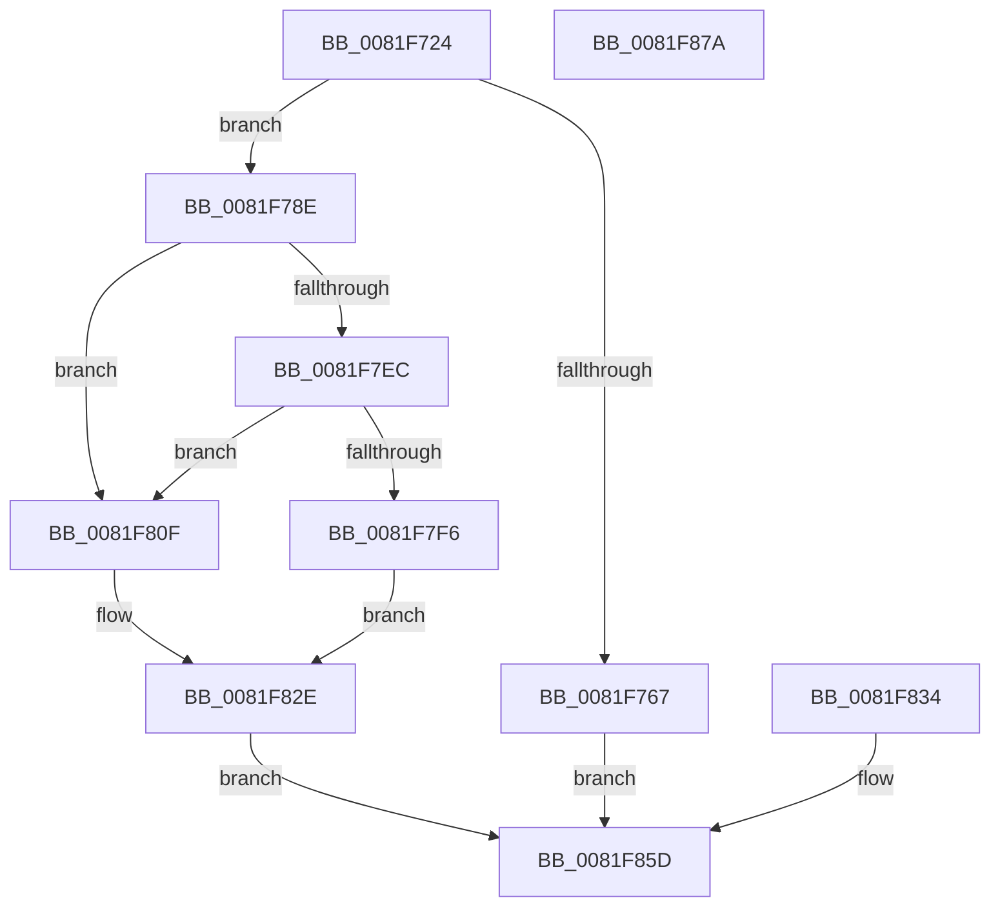

# AslpFileGetNtHeaderAttributes

- RVA: `0x0081F724`–`0x0081F87B` (길이 `343` bytes)
- VA: `0x000000014081F724`
- 실행 섹션: `PAGE`
- PDB 이름 있음: `예`; PDB Function 태그: `아니요`
- unwind 정보 RVA: `0x000DA000`
- 디코드: `88`개 명령, `343/343` bytes 표시
- 미해석 바이트: `0` (있으면 어셈블리에 `.byte`로 보존)

> 이 문서는 커널 이미지의 기계어와 PDB 기호를 분석해 생성했습니다. 4번과 5번은 함수 원형과 자료형을 바이너리 사용 방식에서 추정한 C 해석이며 원본 소스 복구 결과는 아닙니다.

## 1. Dependencies

- 직접 호출 지점: **3**; 고유 호출 대상: **2**
- 직접 호출자로 확인된 함수: **1**
- RIP 상대 이미지 참조: **3**

### Outgoing calls
- `0x0081F75C` → [AslpFileGetImageNtHeader](AslpFileGetImageNtHeader_function_0081F434.md) (function, `0x0081F434`)
- `0x0081F784` → [AslLogCallPrintf](../95/AslLogCallPrintf_function_0095E4EC.md) (function, `0x0095E4EC`)
- `0x0081F857` → [AslLogCallPrintf](../95/AslLogCallPrintf_function_0095E4EC.md) (function, `0x0095E4EC`)

### Direct callers
- [AslpFileGetHeaderAttributesPE](AslpFileGetHeaderAttributesPE_function_0081F028.md) at `0x0081F122`

### Static image references
- `0x0081F76B` → RVA `0x0003EED8` (`.rdata`; read)
- `0x0081F778` → RVA `0x0003FFE0` (`.rdata`; read)
- `0x0081F83E` → RVA `0x0003EF20` (`.rdata`; read)

## 2. Other-region calls and transfers

- 다른 실행 섹션으로 향하는 call: **0**
- 별도 외부 분기/꼬리 이동을 확인하지 못했습니다.

## 3. Assembly (complete function range)

```asm
0081F724  48 8B C4                        mov rax, rsp
0081F727  48 89 58 08                     mov qword ptr [rax + 8], rbx
0081F72B  48 89 70 10                     mov qword ptr [rax + 0x10], rsi
0081F72F  48 89 78 18                     mov qword ptr [rax + 0x18], rdi
0081F733  41 54                           push r12
0081F735  41 56                           push r14
0081F737  41 57                           push r15
0081F739  48 83 EC 50                     sub rsp, 0x50
0081F73D  49 8B F9                        mov rdi, r9
0081F740  4D 8B F0                        mov r14, r8
0081F743  4C 8B FA                        mov r15, rdx
0081F746  48 8B F1                        mov rsi, rcx
0081F749  45 33 E4                        xor r12d, r12d
0081F74C  4C 89 60 D0                     mov qword ptr [rax - 0x30], r12
0081F750  48 8B 94 24 B0 00 00 00         mov rdx, qword ptr [rsp + 0xb0]
0081F758  48 8D 48 D0                     lea rcx, [rax - 0x30]
0081F75C  E8 D3 FC FF FF                  call 0x14081f434
0081F761  8B D8                           mov ebx, eax
0081F763  85 C0                           test eax, eax
0081F765  79 27                           jns 0x14081f78e
0081F767  89 44 24 20                     mov dword ptr [rsp + 0x20], eax
0081F76B  4C 8D 0D 66 F7 81 FF            lea r9, [rip - 0x7e089a]
0081F772  41 B8 E5 0E 00 00               mov r8d, 0xee5
0081F778  48 8D 15 61 08 82 FF            lea rdx, [rip - 0x7df79f]
0081F77F  41 8D 4C 24 01                  lea ecx, [r12 + 1]
0081F784  E8 63 ED 13 00                  call 0x14095e4ec
0081F789  E9 CF 00 00 00                  jmp 0x14081f85d
0081F78E  4C 8B 44 24 38                  mov r8, qword ptr [rsp + 0x38]
0081F793  41 0F B7 40 44                  movzx eax, word ptr [r8 + 0x44]
0081F798  0F B6 D0                        movzx edx, al
0081F79B  C1 E2 10                        shl edx, 0x10
0081F79E  41 0F B7 40 46                  movzx eax, word ptr [r8 + 0x46]
0081F7A3  0F B6 C8                        movzx ecx, al
0081F7A6  03 D1                           add edx, ecx
0081F7A8  41 89 17                        mov dword ptr [r15], edx
0081F7AB  41 8B 40 08                     mov eax, dword ptr [r8 + 8]
0081F7AF  41 89 06                        mov dword ptr [r14], eax
0081F7B2  41 0F B7 50 18                  movzx edx, word ptr [r8 + 0x18]
0081F7B7  48 8B 84 24 A0 00 00 00         mov rax, qword ptr [rsp + 0xa0]
0081F7BF  66 89 10                        mov word ptr [rax], dx
0081F7C2  41 0F B7 48 04                  movzx ecx, word ptr [r8 + 4]
0081F7C7  48 8B 84 24 90 00 00 00         mov rax, qword ptr [rsp + 0x90]
0081F7CF  66 89 08                        mov word ptr [rax], cx
0081F7D2  41 0F B7 48 16                  movzx ecx, word ptr [r8 + 0x16]
0081F7D7  48 8B 84 24 A8 00 00 00         mov rax, qword ptr [rsp + 0xa8]
0081F7DF  66 89 08                        mov word ptr [rax], cx
0081F7E2  B8 0B 01 00 00                  mov eax, 0x10b
0081F7E7  66 3B D0                        cmp dx, ax
0081F7EA  74 23                           je 0x14081f80f
0081F7EC  B8 0B 02 00 00                  mov eax, 0x20b
0081F7F1  66 3B D0                        cmp dx, ax
0081F7F4  74 19                           je 0x14081f80f
0081F7F6  44 89 26                        mov dword ptr [rsi], r12d
0081F7F9  44 89 27                        mov dword ptr [rdi], r12d
0081F7FC  48 8B 84 24 98 00 00 00         mov rax, qword ptr [rsp + 0x98]
0081F804  66 44 89 20                     mov word ptr [rax], r12w
0081F808  BB BB 00 00 C0                  mov ebx, 0xc00000bb
0081F80D  EB 1F                           jmp 0x14081f82e
0081F80F  41 8B 40 58                     mov eax, dword ptr [r8 + 0x58]
0081F813  89 06                           mov dword ptr [rsi], eax
0081F815  41 8B 40 50                     mov eax, dword ptr [r8 + 0x50]
0081F819  89 07                           mov dword ptr [rdi], eax
0081F81B  48 8B 84 24 98 00 00 00         mov rax, qword ptr [rsp + 0x98]
0081F823  41 0F B7 48 5C                  movzx ecx, word ptr [r8 + 0x5c]
0081F828  66 89 08                        mov word ptr [rax], cx
0081F82B  41 8B DC                        mov ebx, r12d
0081F82E  89 5C 24 30                     mov dword ptr [rsp + 0x30], ebx
0081F832  EB 29                           jmp 0x14081f85d
0081F834  8B D8                           mov ebx, eax
0081F836  89 44 24 30                     mov dword ptr [rsp + 0x30], eax
0081F83A  89 44 24 20                     mov dword ptr [rsp + 0x20], eax
0081F83E  4C 8D 0D DB F6 81 FF            lea r9, [rip - 0x7e0925]
0081F845  41 B8 33 0F 00 00               mov r8d, 0xf33
0081F84B  48 8D 15 8E 07 82 FF            lea rdx, [rip - 0x7df872]
0081F852  B9 01 00 00 00                  mov ecx, 1
0081F857  E8 90 EC 13 00                  call 0x14095e4ec
0081F85C  90                              nop
0081F85D  8B C3                           mov eax, ebx
0081F85F  4C 8D 5C 24 50                  lea r11, [rsp + 0x50]
0081F864  49 8B 5B 20                     mov rbx, qword ptr [r11 + 0x20]
0081F868  49 8B 73 28                     mov rsi, qword ptr [r11 + 0x28]
0081F86C  49 8B 7B 30                     mov rdi, qword ptr [r11 + 0x30]
0081F870  49 8B E3                        mov rsp, r11
0081F873  41 5F                           pop r15
0081F875  41 5E                           pop r14
0081F877  41 5C                           pop r12
0081F879  C3                              ret
0081F87A  CC                              int3
```

## 4. C-style interpretation (structured pseudocode)

```c
__int64 __fastcall AslpFileGetNtHeaderAttributes(__int64 a1, __int64 a2, __int64 a3, __int64 a4, __int64 a5, __int64 a6, __int64 a7, __int64 a8, __int64 a9)
{
    __int64 result;
    __int64 v_r12;
    __int64 v_rsp;
    unsigned __int64 v_stack_m18;
    unsigned __int64 v_stack_m30;
    unsigned int v_stack_m38;
    unsigned int v_stack_m48;

    *(unsigned __int64 *)(v_rsp + 8) = v_rbx;
    *(unsigned __int64 *)(v_rsp + 16) = v_rsi;
    *(unsigned __int64 *)(v_rsp + 24) = v_rdi;
    v_rsp = (v_rsp) - (80);
    v_r12 = 0;
    *(unsigned __int64 *)(v_rsp - 48) = 0;
    result = AslpFileGetImageNtHeader(v_rsp - 48, a9, a3, a4);
    if (!sign_flag) goto loc_0081F78E;
    v_stack_m48 = (unsigned int)(result);
    result = AslLogCallPrintf(v_r12 + 1, v_rip - 8255391, (unsigned int)(0xEE5ULL), v_rip - 8259738);
    goto loc_0081F85D;
loc_0081F78E:
    a2 = (unsigned int)(((unsigned __int8)(*(unsigned __int16 *)(v_stack_m30 + 68))) << (16));
    a2 = (unsigned int)((a2) + ((unsigned int)((unsigned __int8)(*(unsigned __int16 *)(v_stack_m30 + 70)))));
    *(unsigned int *)(a2) = (unsigned int)(a2);
    *(unsigned int *)(a3) = (unsigned int)((unsigned int)(*(unsigned int *)(v_stack_m30 + 8)));
    *(unsigned __int16 *)(a7) = (unsigned __int16)(*(unsigned __int16 *)(v_stack_m30 + 24));
    *(unsigned __int16 *)(a5) = (unsigned __int16)(*(unsigned __int16 *)(v_stack_m30 + 4));
    *(unsigned __int16 *)(a8) = (unsigned __int16)(*(unsigned __int16 *)(v_stack_m30 + 22));
    if (((unsigned __int16)(*(unsigned __int16 *)(v_stack_m30 + 24))) == 267) goto loc_0081F80F;
    if (((unsigned __int16)(*(unsigned __int16 *)(v_stack_m30 + 24))) == 523) goto loc_0081F80F;
    *(unsigned int *)(a1) = 0;
    *(unsigned int *)(a4) = 0;
    *(unsigned __int16 *)(a6) = 0;
    goto loc_0081F82E;
loc_0081F80F:
    *(unsigned int *)(a1) = (unsigned int)((unsigned int)(*(unsigned int *)(v_stack_m30 + 88)));
    *(unsigned int *)(a4) = (unsigned int)((unsigned int)(*(unsigned int *)(v_stack_m30 + 80)));
    *(unsigned __int16 *)(a6) = (unsigned __int16)(*(unsigned __int16 *)(v_stack_m30 + 92));
loc_0081F82E:
    v_stack_m38 = 0;
    goto loc_0081F85D;
loc_0081F85D:
    return 0;
}
```

## 5. (Beta) C Style

```c
int64_t AslpFileGetNtHeaderAttributes(void *Arg1, void *Arg2, void *Arg3, void *Arg4, void *Arg5, void *Arg6, void *Arg7, void *Arg8, int64_t Arg9)
{
    uint8_t *arg1 = (uint8_t *)Arg1;
    uint8_t *arg2 = (uint8_t *)Arg2;
    uint8_t *arg3 = (uint8_t *)Arg3;
    uint8_t *arg4 = (uint8_t *)Arg4;
    uint8_t *arg5 = (uint8_t *)Arg5;
    uint8_t *arg6 = (uint8_t *)Arg6;
    uint8_t *arg7 = (uint8_t *)Arg7;
    uint8_t *arg8 = (uint8_t *)Arg8;

    int64_t result;
    int64_t local_r12;
    int64_t local_rsp;
    uint64_t v_stack_m18;
    uint64_t v_stack_m30;
    uint32_t v_stack_m38;
    uint32_t v_stack_m48;

    *(uint64_t *)(local_rsp + 0x8) = local_rbx;
    *(uint64_t *)(local_rsp + 0x10) = local_rsi;
    *(uint64_t *)(local_rsp + 0x18) = local_rdi;
    local_rsp = (local_rsp) - (80);
    local_r12 = 0;
    *(uint64_t *)(local_rsp - 0x30) = 0;
    result = AslpFileGetImageNtHeader(local_rsp - 48, Arg9, Arg3, Arg4);
    if (!sign_flag) goto loc_0081F78E;
    v_stack_m48 = (uint32_t)(result);
    result = AslLogCallPrintf(local_r12 + 1, v_rip - 8255391, (uint32_t)(0xEE5ULL), v_rip - 8259738);
    goto loc_0081F85D;
loc_0081F78E:
    Arg2 = (uint32_t)(((uint8_t)(*(uint16_t *)(v_stack_m30 + 0x44))) << (16));
    Arg2 = (uint32_t)((Arg2) + ((uint32_t)((uint8_t)(*(uint16_t *)(v_stack_m30 + 0x46)))));
    *(uint32_t *)(arg2) = (uint32_t)(Arg2);
    *(uint32_t *)(arg3) = (uint32_t)((uint32_t)(*(uint32_t *)(v_stack_m30 + 0x8)));
    *(uint16_t *)(arg7) = (uint16_t)(*(uint16_t *)(v_stack_m30 + 0x18));
    *(uint16_t *)(arg5) = (uint16_t)(*(uint16_t *)(v_stack_m30 + 0x4));
    *(uint16_t *)(arg8) = (uint16_t)(*(uint16_t *)(v_stack_m30 + 0x16));
    if (((uint16_t)(*(uint16_t *)(v_stack_m30 + 0x18))) == 267) goto loc_0081F80F;
    if (((uint16_t)(*(uint16_t *)(v_stack_m30 + 0x18))) == 523) goto loc_0081F80F;
    *(uint32_t *)(arg1) = 0;
    *(uint32_t *)(arg4) = 0;
    *(uint16_t *)(arg6) = 0;
    goto loc_0081F82E;
loc_0081F80F:
    *(uint32_t *)(arg1) = (uint32_t)((uint32_t)(*(uint32_t *)(v_stack_m30 + 0x58)));
    *(uint32_t *)(arg4) = (uint32_t)((uint32_t)(*(uint32_t *)(v_stack_m30 + 0x50)));
    *(uint16_t *)(arg6) = (uint16_t)(*(uint16_t *)(v_stack_m30 + 0x5C));
loc_0081F82E:
    v_stack_m38 = 0;
    goto loc_0081F85D;
loc_0081F85D:
    return 0;
}
```

### 관측된 메모리 오프셋

구조체 형식이 확인되지 않은 접근은 인자 기준의 오프셋으로만 기록했습니다.

| 기준 인자 | 오프셋 표현 | 폭 (bit) | 접근 |
|---|---:|---:|---|
| `Arg1` | `+ 0x0` | `32` | `W` |
| `Arg2` | `+ 0x0` | `32` | `W` |
| `Arg3` | `+ 0x0` | `32` | `W` |
| `Arg4` | `+ 0x0` | `32` | `W` |
| `Arg5` | `+ 0x0` | `16` | `W` |
| `Arg6` | `+ 0x0` | `16` | `W` |
| `Arg7` | `+ 0x0` | `16` | `W` |
| `Arg8` | `+ 0x0` | `16` | `W` |

## 6. Execution-region graph

[열기: 2D/3D 그래프와 함수 탐색 컨트롤 패널](../../../control-panel.html?section=page&rva=0x0081F724&view=graph)

- 2D 그래프는 위에서 아래로 흐르고, 3D 그래프는 빈 공간을 드래그해 회전합니다. Shift+드래그는 이동, 휠은 확대·축소, 함수 노드 선택은 대상 보고서 이동입니다.

### Static fallback


