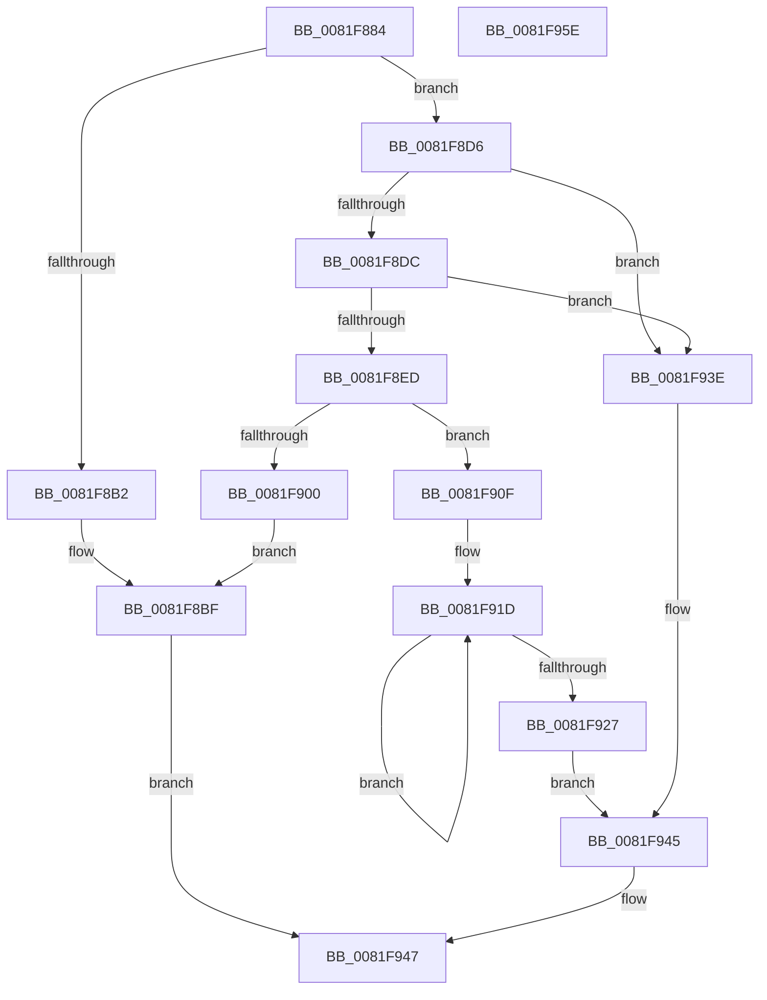

# AslpFileGetPeExportNameAttribute

- RVA: `0x0081F884`–`0x0081F95F` (길이 `219` bytes)
- VA: `0x000000014081F884`
- 실행 섹션: `PAGE`
- PDB 이름 있음: `예`; PDB Function 태그: `아니요`
- unwind 정보 RVA: `0x000C826C`
- 디코드: `57`개 명령, `219/219` bytes 표시
- 미해석 바이트: `0` (있으면 어셈블리에 `.byte`로 보존)

> 이 문서는 커널 이미지의 기계어와 PDB 기호를 분석해 생성했습니다. 4번과 5번은 함수 원형과 자료형을 바이너리 사용 방식에서 추정한 C 해석이며 원본 소스 복구 결과는 아닙니다.

## 1. Dependencies

- 직접 호출 지점: **4**; 고유 호출 대상: **4**
- 직접 호출자로 확인된 함수: **1**
- RIP 상대 이미지 참조: **3**

### Outgoing calls
- `0x0081F8A7` → [AslFileMappingEnsure](AslFileMappingEnsure_function_0081A5EC.md) (function, `0x0081A5EC`)
- `0x0081F8CF` → [AslLogCallPrintf](../95/AslLogCallPrintf_function_0095E4EC.md) (function, `0x0095E4EC`)
- `0x0081F8E4` → [AslpFileGetExportName](AslpFileGetExportName_function_0081ED30.md) (function, `0x0081ED30`)
- `0x0081F8F5` → [AslStringXmlSanitize](../AC/AslStringXmlSanitize_function_00ACB4B8.md) (function, `0x00ACB4B8`)

### Direct callers
- [AslFileAllocAndGetAttributes](AslFileAllocAndGetAttributes_function_0081D8EC.md) at `0x0081DC39`

### Static image references
- `0x0081F8B2` → RVA `0x0003EE90` (`.rdata`; read)
- `0x0081F8BF` → RVA `0x0003FF78` (`.rdata`; read)
- `0x0081F900` → RVA `0x0003FD78` (`.rdata`; read)

## 2. Other-region calls and transfers

- 다른 실행 섹션으로 향하는 call: **0**
- 별도 외부 분기/꼬리 이동을 확인하지 못했습니다.

## 3. Assembly (complete function range)

```asm
0081F884  48 8B C4                        mov rax, rsp
0081F887  48 89 58 08                     mov qword ptr [rax + 8], rbx
0081F88B  48 89 68 10                     mov qword ptr [rax + 0x10], rbp
0081F88F  48 89 70 20                     mov qword ptr [rax + 0x20], rsi
0081F893  57                              push rdi
0081F894  48 83 EC 30                     sub rsp, 0x30
0081F898  48 8B F9                        mov rdi, rcx
0081F89B  33 ED                           xor ebp, ebp
0081F89D  48 8B CA                        mov rcx, rdx
0081F8A0  48 89 68 18                     mov qword ptr [rax + 0x18], rbp
0081F8A4  48 8B F2                        mov rsi, rdx
0081F8A7  E8 40 AD FF FF                  call 0x14081a5ec
0081F8AC  8B D8                           mov ebx, eax
0081F8AE  85 C0                           test eax, eax
0081F8B0  79 24                           jns 0x14081f8d6
0081F8B2  4C 8D 0D D7 F5 81 FF            lea r9, [rip - 0x7e0a29]
0081F8B9  41 B8 8F 0D 00 00               mov r8d, 0xd8f
0081F8BF  48 8D 15 B2 06 82 FF            lea rdx, [rip - 0x7df94e]
0081F8C6  89 44 24 20                     mov dword ptr [rsp + 0x20], eax
0081F8CA  B9 01 00 00 00                  mov ecx, 1
0081F8CF  E8 18 EC 13 00                  call 0x14095e4ec
0081F8D4  EB 71                           jmp 0x14081f947
0081F8D6  83 7E 40 06                     cmp dword ptr [rsi + 0x40], 6
0081F8DA  75 62                           jne 0x14081f93e
0081F8DC  48 8B D6                        mov rdx, rsi
0081F8DF  48 8D 4C 24 50                  lea rcx, [rsp + 0x50]
0081F8E4  E8 47 F4 FF FF                  call 0x14081ed30
0081F8E9  85 C0                           test eax, eax
0081F8EB  78 51                           js 0x14081f93e
0081F8ED  4C 8B 5C 24 50                  mov r11, qword ptr [rsp + 0x50]
0081F8F2  49 8B CB                        mov rcx, r11
0081F8F5  E8 BE BB 2A 00                  call 0x140acb4b8
0081F8FA  8B D8                           mov ebx, eax
0081F8FC  85 C0                           test eax, eax
0081F8FE  79 0F                           jns 0x14081f90f
0081F900  4C 8D 0D 71 04 82 FF            lea r9, [rip - 0x7dfb8f]
0081F907  41 B8 A2 0D 00 00               mov r8d, 0xda2
0081F90D  EB B0                           jmp 0x14081f8bf
0081F90F  C7 87 E0 02 00 00 04 00 00 00   mov dword ptr [rdi + 0x2e0], 4
0081F919  48 83 C8 FF                     or rax, 0xffffffffffffffff
0081F91D  48 FF C0                        inc rax
0081F920  66 41 39 2C 43                  cmp word ptr [r11 + rax*2], bp
0081F925  75 F6                           jne 0x14081f91d
0081F927  83 8F F8 02 00 00 05            or dword ptr [rdi + 0x2f8], 5
0081F92E  48 89 87 E8 02 00 00            mov qword ptr [rdi + 0x2e8], rax
0081F935  4C 89 9F F0 02 00 00            mov qword ptr [rdi + 0x2f0], r11
0081F93C  EB 07                           jmp 0x14081f945
0081F93E  83 8F F8 02 00 00 02            or dword ptr [rdi + 0x2f8], 2
0081F945  8B DD                           mov ebx, ebp
0081F947  48 8B 6C 24 48                  mov rbp, qword ptr [rsp + 0x48]
0081F94C  8B C3                           mov eax, ebx
0081F94E  48 8B 5C 24 40                  mov rbx, qword ptr [rsp + 0x40]
0081F953  48 8B 74 24 58                  mov rsi, qword ptr [rsp + 0x58]
0081F958  48 83 C4 30                     add rsp, 0x30
0081F95C  5F                              pop rdi
0081F95D  C3                              ret
0081F95E  CC                              int3
```

## 4. C-style interpretation (structured pseudocode)

```c
__int64 __fastcall AslpFileGetPeExportNameAttribute(__int64 a1, __int64 a2)
{
    __int64 result;
    __int64 v_rbp;
    __int64 v_rsp;
    unsigned int v_stack_m18;
    unsigned __int64 v_stack_p10;
    unsigned __int64 v_stack_p18;
    unsigned __int64 v_stack_p20;
    unsigned __int64 v_stack_p8;

    *(unsigned __int64 *)(v_rsp + 8) = v_rbx;
    *(unsigned __int64 *)(v_rsp + 16) = v_rbp;
    *(unsigned __int64 *)(v_rsp + 32) = v_rsi;
    v_rsp = (v_rsp) - (48);
    v_rbp = 0;
    *(unsigned __int64 *)(v_rsp + 24) = 0;
    result = AslFileMappingEnsure(a2, a2, a3, a4);
    if (!sign_flag) goto loc_0081F8D6;
loc_0081F8BF:
    v_stack_m18 = (unsigned int)(result);
    result = AslLogCallPrintf(1, v_rip - 8255822, (unsigned int)(0xD8FULL), v_rip - 8260137);
    goto loc_0081F947;
loc_0081F8D6:
    if ((*(unsigned int *)(a2 + 64)) != 6) goto loc_0081F93E;
    result = AslpFileGetExportName(v_stack_p18, a2, (unsigned int)(0xD8FULL), v_rip - 8260137);
    if (sign_flag) goto loc_0081F93E;
    result = AslStringXmlSanitize(v_stack_p18, a2, (unsigned int)(0xD8FULL), v_rip - 8260137);
    if (!sign_flag) goto loc_0081F90F;
    goto loc_0081F8BF;
loc_0081F90F:
    *(unsigned int *)(a1 + 736) = 4;
    result = (result) | (-1);
loc_0081F91D:
    result = (result) + 1;
    if ((*(unsigned __int16 *)(v_stack_p18 + result * 2)) != 0) goto loc_0081F91D;
    *(unsigned __int64 *)(a1 + 744) = result;
    *(unsigned __int64 *)(a1 + 752) = v_stack_p18;
    goto loc_0081F945;
loc_0081F93E:
loc_0081F945:
loc_0081F947:
    v_rsp = (v_rsp) + (48);
    return 0;
}
```

## 5. (Beta) C Style

```c
int64_t AslpFileGetPeExportNameAttribute(void *Arg1, void *Arg2)
{
    uint8_t *arg1 = (uint8_t *)Arg1;
    uint8_t *arg2 = (uint8_t *)Arg2;

    int64_t result;
    int64_t local_rbp;
    int64_t local_rsp;
    uint32_t v_stack_m18;
    uint64_t v_stack_p10;
    uint64_t v_stack_p18;
    uint64_t v_stack_p20;
    uint64_t v_stack_p8;

    *(uint64_t *)(local_rsp + 0x8) = local_rbx;
    *(uint64_t *)(local_rsp + 0x10) = local_rbp;
    *(uint64_t *)(local_rsp + 0x20) = local_rsi;
    local_rsp = (local_rsp) - (48);
    local_rbp = 0;
    *(uint64_t *)(local_rsp + 0x18) = 0;
    result = AslFileMappingEnsure(Arg2, Arg2, a3, a4);
    if (!sign_flag) goto loc_0081F8D6;
loc_0081F8BF:
    v_stack_m18 = (uint32_t)(result);
    result = AslLogCallPrintf(1, v_rip - 8255822, (uint32_t)(0xD8FULL), v_rip - 8260137);
    goto loc_0081F947;
loc_0081F8D6:
    if ((*(uint32_t *)(arg2 + 0x40)) != 6) goto loc_0081F93E;
    result = AslpFileGetExportName(v_stack_p18, Arg2, (uint32_t)(0xD8FULL), v_rip - 8260137);
    if (sign_flag) goto loc_0081F93E;
    result = AslStringXmlSanitize(v_stack_p18, Arg2, (uint32_t)(0xD8FULL), v_rip - 8260137);
    if (!sign_flag) goto loc_0081F90F;
    goto loc_0081F8BF;
loc_0081F90F:
    *(uint32_t *)(arg1 + 0x2E0) = 4;
    result = (result) | (-1);
loc_0081F91D:
    result = (result) + 1;
    if ((*(uint16_t *)(v_stack_p18 + result * 2)) != 0) goto loc_0081F91D;
    *(uint64_t *)(arg1 + 0x2E8) = result;
    *(uint64_t *)(arg1 + 0x2F0) = v_stack_p18;
    goto loc_0081F945;
loc_0081F93E:
loc_0081F945:
loc_0081F947:
    local_rsp = (local_rsp) + (48);
    return 0;
}
```

### 관측된 메모리 오프셋

구조체 형식이 확인되지 않은 접근은 인자 기준의 오프셋으로만 기록했습니다.

| 기준 인자 | 오프셋 표현 | 폭 (bit) | 접근 |
|---|---:|---:|---|
| `Arg1` | `+ 0x2E0` | `32` | `W` |
| `Arg1` | `+ 0x2E8` | `64` | `W` |
| `Arg1` | `+ 0x2F0` | `64` | `W` |
| `Arg1` | `+ 0x2F8` | `32` | `R/W` |
| `Arg2` | `+ 0x40` | `32` | `R` |

## 6. Execution-region graph

[열기: 2D/3D 그래프와 함수 탐색 컨트롤 패널](../../../control-panel.html?section=page&rva=0x0081F884&view=graph)

- 2D 그래프는 위에서 아래로 흐르고, 3D 그래프는 빈 공간을 드래그해 회전합니다. Shift+드래그는 이동, 휠은 확대·축소, 함수 노드 선택은 대상 보고서 이동입니다.

### Static fallback


