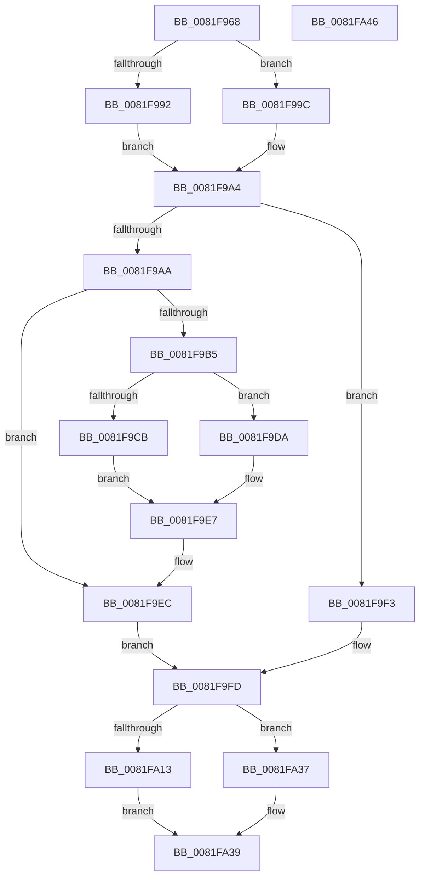

# AslpFileGetVersionAttributes

- RVA: `0x0081F968`–`0x0081FA47` (길이 `223` bytes)
- VA: `0x000000014081F968`
- 실행 섹션: `PAGE`
- PDB 이름 있음: `예`; PDB Function 태그: `아니요`
- unwind 정보 RVA: `0x00084AC0`
- 디코드: `60`개 명령, `223/223` bytes 표시
- 미해석 바이트: `0` (있으면 어셈블리에 `.byte`로 보존)

> 이 문서는 커널 이미지의 기계어와 PDB 기호를 분석해 생성했습니다. 4번과 5번은 함수 원형과 자료형을 바이너리 사용 방식에서 추정한 C 해석이며 원본 소스 복구 결과는 아닙니다.

## 1. Dependencies

- 직접 호출 지점: **6**; 고유 호출 대상: **5**
- 직접 호출자로 확인된 함수: **1**
- RIP 상대 이미지 참조: **4**

### Outgoing calls
- `0x0081F995` → [AslpFileGetVersionBlockImageOnly](../82/AslpFileGetVersionBlockImageOnly_function_00820260.md) (function, `0x00820260`)
- `0x0081F99F` → [AslpFileGetVersionBlock](AslpFileGetVersionBlock_function_0081FA50.md) (function, `0x0081FA50`)
- `0x0081F9E7` → [AslLogCallPrintf](../95/AslLogCallPrintf_function_0095E4EC.md) (function, `0x0095E4EC`)
- `0x0081FA00` → [AslpFileMakeBinVersionAttributes](../82/AslpFileMakeBinVersionAttributes_function_00820850.md) (function, `0x00820850`)
- `0x0081FA08` → [AslpFileMakeStringVersionAttributes](../82/AslpFileMakeStringVersionAttributes_function_00820964.md) (function, `0x00820964`)
- `0x0081FA30` → [AslLogCallPrintf](../95/AslLogCallPrintf_function_0095E4EC.md) (function, `0x0095E4EC`)

### Direct callers
- [AslFileAllocAndGetAttributes](AslFileAllocAndGetAttributes_function_0081D8EC.md) at `0x0081DAE2`

### Static image references
- `0x0081F9C2` → RVA `0x0003FA80` (`.rdata`; read)
- `0x0081F9CB` → RVA `0x0003FA50` (`.rdata`; read)
- `0x0081F9DA` → RVA `0x0003FAA0` (`.rdata`; read)
- `0x0081FA13` → RVA `0x0003FAC8` (`.rdata`; read)

## 2. Other-region calls and transfers

- 다른 실행 섹션으로 향하는 call: **0**
- 별도 외부 분기/꼬리 이동을 확인하지 못했습니다.

## 3. Assembly (complete function range)

```asm
0081F968  48 8B C4                        mov rax, rsp
0081F96B  48 89 58 08                     mov qword ptr [rax + 8], rbx
0081F96F  57                              push rdi
0081F970  48 83 EC 30                     sub rsp, 0x30
0081F974  48 83 60 10 00                  and qword ptr [rax + 0x10], 0
0081F979  48 8B DA                        mov rbx, rdx
0081F97C  48 83 60 18 00                  and qword ptr [rax + 0x18], 0
0081F981  48 8B F9                        mov rdi, rcx
0081F984  83 7A 50 00                     cmp dword ptr [rdx + 0x50], 0
0081F988  48 8D 48 10                     lea rcx, [rax + 0x10]
0081F98C  48 8D 50 18                     lea rdx, [rax + 0x18]
0081F990  74 0A                           je 0x14081f99c
0081F992  4C 8B CB                        mov r9, rbx
0081F995  E8 C6 08 00 00                  call 0x140820260
0081F99A  EB 08                           jmp 0x14081f9a4
0081F99C  4C 8B C3                        mov r8, rbx
0081F99F  E8 AC 00 00 00                  call 0x14081fa50
0081F9A4  8B D0                           mov edx, eax
0081F9A6  85 C0                           test eax, eax
0081F9A8  79 49                           jns 0x14081f9f3
0081F9AA  8D 80 77 FF FF 3F               lea eax, [rax + 0x3fffff77]
0081F9B0  83 F8 02                        cmp eax, 2
0081F9B3  76 37                           jbe 0x14081f9ec
0081F9B5  83 7B 50 00                     cmp dword ptr [rbx + 0x50], 0
0081F9B9  B9 03 00 00 00                  mov ecx, 3
0081F9BE  89 54 24 20                     mov dword ptr [rsp + 0x20], edx
0081F9C2  48 8D 15 B7 00 82 FF            lea rdx, [rip - 0x7dff49]
0081F9C9  74 0F                           je 0x14081f9da
0081F9CB  4C 8D 0D 7E 00 82 FF            lea r9, [rip - 0x7dff82]
0081F9D2  41 B8 57 06 00 00               mov r8d, 0x657
0081F9D8  EB 0D                           jmp 0x14081f9e7
0081F9DA  4C 8D 0D BF 00 82 FF            lea r9, [rip - 0x7dff41]
0081F9E1  41 B8 5A 06 00 00               mov r8d, 0x65a
0081F9E7  E8 00 EB 13 00                  call 0x14095e4ec
0081F9EC  45 33 DB                        xor r11d, r11d
0081F9EF  33 D2                           xor edx, edx
0081F9F1  EB 0A                           jmp 0x14081f9fd
0081F9F3  4C 8B 5C 24 48                  mov r11, qword ptr [rsp + 0x48]
0081F9F8  48 8B 54 24 50                  mov rdx, qword ptr [rsp + 0x50]
0081F9FD  48 8B CF                        mov rcx, rdi
0081FA00  E8 4B 0E 00 00                  call 0x140820850
0081FA05  49 8B D3                        mov rdx, r11
0081FA08  E8 57 0F 00 00                  call 0x140820964
0081FA0D  8B D8                           mov ebx, eax
0081FA0F  85 C0                           test eax, eax
0081FA11  79 24                           jns 0x14081fa37
0081FA13  4C 8D 0D AE 00 82 FF            lea r9, [rip - 0x7dff52]
0081FA1A  89 44 24 20                     mov dword ptr [rsp + 0x20], eax
0081FA1E  41 B8 72 06 00 00               mov r8d, 0x672
0081FA24  48 8D 15 55 00 82 FF            lea rdx, [rip - 0x7dffab]
0081FA2B  B9 01 00 00 00                  mov ecx, 1
0081FA30  E8 B7 EA 13 00                  call 0x14095e4ec
0081FA35  EB 02                           jmp 0x14081fa39
0081FA37  33 DB                           xor ebx, ebx
0081FA39  8B C3                           mov eax, ebx
0081FA3B  48 8B 5C 24 40                  mov rbx, qword ptr [rsp + 0x40]
0081FA40  48 83 C4 30                     add rsp, 0x30
0081FA44  5F                              pop rdi
0081FA45  C3                              ret
0081FA46  CC                              int3
```

## 4. C-style interpretation (structured pseudocode)

```c
__int64 __fastcall AslpFileGetVersionAttributes(__int64 a1, __int64 a2)
{
    __int64 result;
    __int64 v_r11;
    __int64 v_rbx;
    __int64 v_rsp;
    unsigned int v_stack_m18;
    unsigned __int64 v_stack_p10;
    unsigned __int64 v_stack_p18;
    unsigned __int64 v_stack_p8;

    *(unsigned __int64 *)(v_rsp + 8) = v_rbx;
    v_rsp = (v_rsp) - (48);
    if ((*(unsigned int *)(a2 + 80)) == 0) goto loc_0081F99C;
    result = AslpFileGetVersionBlockImageOnly(v_rsp + 16, v_rsp + 24, a3, a2);
    goto loc_0081F9A4;
loc_0081F99C:
    result = AslpFileGetVersionBlock(v_rsp + 16, v_rsp + 24, a2, a2);
loc_0081F9A4:
    if (!sign_flag) goto loc_0081F9F3;
    if (((unsigned int)(result + 1073741687)) <= 2) goto loc_0081F9EC;
    v_stack_m18 = (unsigned int)((unsigned int)((unsigned int)(result)));
    if ((*(unsigned int *)(a2 + 80)) == 0) goto loc_0081F9DA;
    goto loc_0081F9E7;
loc_0081F9DA:
loc_0081F9E7:
    result = AslLogCallPrintf(3, v_rip - 8257353, (unsigned int)(0x65AULL), v_rip - 8257345);
loc_0081F9EC:
    v_r11 = 0;
    a2 = 0;
    goto loc_0081F9FD;
loc_0081F9F3:
loc_0081F9FD:
    result = AslpFileMakeBinVersionAttributes(a1, v_stack_p18, (unsigned int)(0x65AULL), v_rip - 8257345);
    result = AslpFileMakeStringVersionAttributes(a1, v_stack_p10, (unsigned int)(0x65AULL), v_rip - 8257345);
    if (!sign_flag) goto loc_0081FA37;
    v_stack_m18 = (unsigned int)(result);
    result = AslLogCallPrintf(1, v_rip - 8257451, (unsigned int)(0x672ULL), v_rip - 8257362);
    goto loc_0081FA39;
loc_0081FA37:
    v_rbx = 0;
loc_0081FA39:
    v_rsp = (v_rsp) + (48);
    return 0;
}
```

## 5. (Beta) C Style

```c
int64_t AslpFileGetVersionAttributes(int64_t Arg1, void *Arg2)
{
    uint8_t *arg2 = (uint8_t *)Arg2;

    int64_t result;
    int64_t local_r11;
    int64_t local_rbx;
    int64_t local_rsp;
    uint32_t v_stack_m18;
    uint64_t v_stack_p10;
    uint64_t v_stack_p18;
    uint64_t v_stack_p8;

    *(uint64_t *)(local_rsp + 0x8) = local_rbx;
    local_rsp = (local_rsp) - (48);
    if ((*(uint32_t *)(arg2 + 0x50)) == 0) goto loc_0081F99C;
    result = AslpFileGetVersionBlockImageOnly(local_rsp + 16, local_rsp + 24, a3, Arg2);
    goto loc_0081F9A4;
loc_0081F99C:
    result = AslpFileGetVersionBlock(local_rsp + 16, local_rsp + 24, Arg2, Arg2);
loc_0081F9A4:
    if (!sign_flag) goto loc_0081F9F3;
    if (((uint32_t)(result + 1073741687)) <= 2) goto loc_0081F9EC;
    v_stack_m18 = (uint32_t)((uint32_t)((uint32_t)(result)));
    if ((*(uint32_t *)(arg2 + 0x50)) == 0) goto loc_0081F9DA;
    goto loc_0081F9E7;
loc_0081F9DA:
loc_0081F9E7:
    result = AslLogCallPrintf(3, v_rip - 8257353, (uint32_t)(0x65AULL), v_rip - 8257345);
loc_0081F9EC:
    local_r11 = 0;
    Arg2 = 0;
    goto loc_0081F9FD;
loc_0081F9F3:
loc_0081F9FD:
    result = AslpFileMakeBinVersionAttributes(Arg1, v_stack_p18, (uint32_t)(0x65AULL), v_rip - 8257345);
    result = AslpFileMakeStringVersionAttributes(Arg1, v_stack_p10, (uint32_t)(0x65AULL), v_rip - 8257345);
    if (!sign_flag) goto loc_0081FA37;
    v_stack_m18 = (uint32_t)(result);
    result = AslLogCallPrintf(1, v_rip - 8257451, (uint32_t)(0x672ULL), v_rip - 8257362);
    goto loc_0081FA39;
loc_0081FA37:
    local_rbx = 0;
loc_0081FA39:
    local_rsp = (local_rsp) + (48);
    return 0;
}
```

### 관측된 메모리 오프셋

구조체 형식이 확인되지 않은 접근은 인자 기준의 오프셋으로만 기록했습니다.

| 기준 인자 | 오프셋 표현 | 폭 (bit) | 접근 |
|---|---:|---:|---|
| `Arg2` | `+ 0x50` | `32` | `R` |

## 6. Execution-region graph

[열기: 2D/3D 그래프와 함수 탐색 컨트롤 패널](../../../control-panel.html?section=page&rva=0x0081F968&view=graph)

- 2D 그래프는 위에서 아래로 흐르고, 3D 그래프는 빈 공간을 드래그해 회전합니다. Shift+드래그는 이동, 휠은 확대·축소, 함수 노드 선택은 대상 보고서 이동입니다.

### Static fallback


