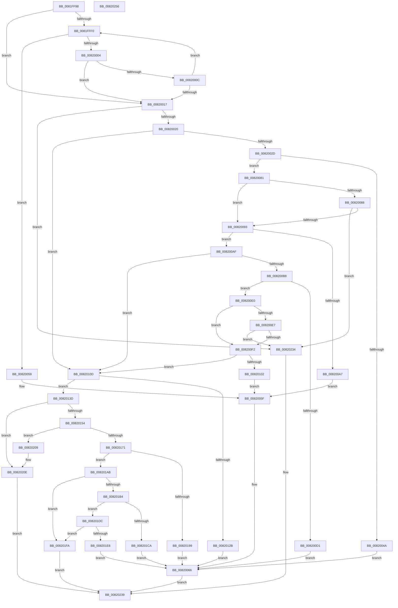

# AslpFileGetVersionBlockFromResourceRoot

- RVA: `0x0081FF98`–`0x00820257` (길이 `703` bytes)
- VA: `0x000000014081FF98`
- 실행 섹션: `PAGE`
- PDB 이름 있음: `예`; PDB Function 태그: `아니요`
- unwind 정보 RVA: `0x000CD76C`
- 디코드: `185`개 명령, `703/703` bytes 표시
- 미해석 바이트: `0` (있으면 어셈블리에 `.byte`로 보존)

> 이 문서는 커널 이미지의 기계어와 PDB 기호를 분석해 생성했습니다. 4번과 5번은 함수 원형과 자료형을 바이너리 사용 방식에서 추정한 C 해석이며 원본 소스 복구 결과는 아닙니다.

## 1. Dependencies

- 직접 호출 지점: **15**; 고유 호출 대상: **5**
- 직접 호출자로 확인된 함수: **2**
- RIP 상대 이미지 참조: **8**

### Outgoing calls
- `0x0081FFFB` → [AslpMemoryCheckBounds](../../text/69/AslpMemoryCheckBounds_function_0069D3AC.md) (function, `0x0069D3AC`)
- `0x00820041` → [AslpMemoryCheckBounds](../../text/69/AslpMemoryCheckBounds_function_0069D3AC.md) (function, `0x0069D3AC`)
- `0x00820072` → [AslLogCallPrintf](../95/AslLogCallPrintf_function_0095E4EC.md) (function, `0x0095E4EC`)
- `0x0082009E` → [AslpMemoryCheckBounds](../../text/69/AslpMemoryCheckBounds_function_0069D3AC.md) (function, `0x0069D3AC`)
- `0x008200C8` → [AslpMemoryCheckBounds](../../text/69/AslpMemoryCheckBounds_function_0069D3AC.md) (function, `0x0069D3AC`)
- `0x008200F9` → [AslpMemoryCheckBounds](../../text/69/AslpMemoryCheckBounds_function_0069D3AC.md) (function, `0x0069D3AC`)
- `0x00820122` → [AslpMemoryCheckBounds](../../text/69/AslpMemoryCheckBounds_function_0069D3AC.md) (function, `0x0069D3AC`)
- `0x00820145` → [AslpFileGetImageNtHeader](AslpFileGetImageNtHeader_function_0081F434.md) (function, `0x0081F434`)
- `0x00820164` → [AslpMemoryCheckBounds](../../text/69/AslpMemoryCheckBounds_function_0069D3AC.md) (function, `0x0069D3AC`)
- `0x00820178` → [AslpImageRvaToVa](../82/AslpImageRvaToVa_function_008214BC.md) (function, `0x008214BC`)
- `0x00820190` → [AslpMemoryCheckBounds](../../text/69/AslpMemoryCheckBounds_function_0069D3AC.md) (function, `0x0069D3AC`)
- `0x008201AB` → [Feature_261863737__private_IsEnabledDeviceUsageNoInline](../../text/69/Feature_261863737__private_IsEnabledDeviceUsageNoInline_function_0069D46C.md) (function, `0x0069D46C`)
- `0x008201C1` → [AslpMemoryCheckBounds](../../text/69/AslpMemoryCheckBounds_function_0069D3AC.md) (function, `0x0069D3AC`)
- `0x008201DF` → [AslpMemoryCheckBounds](../../text/69/AslpMemoryCheckBounds_function_0069D3AC.md) (function, `0x0069D3AC`)
- `0x0082022B` → [AslLogCallPrintf](../95/AslLogCallPrintf_function_0095E4EC.md) (function, `0x0095E4EC`)

### Direct callers
- [AslpFileGetCrcChecksumBoot](AslpFileGetCrcChecksumBoot_function_0081E7D4.md) at `0x0081E983`
- [AslpFileGetVersionBlockImageOnly](../82/AslpFileGetVersionBlockImageOnly_function_00820260.md) at `0x0082037B`

### Static image references
- `0x0082004A` → RVA `0x00040470` (`.rdata`; read)
- `0x0082005F` → RVA `0x00040410` (`.rdata`; read)
- `0x00820066` → RVA `0x00040448` (`.rdata`; read)
- `0x0082012B` → RVA `0x000404A0` (`.rdata`; read)
- `0x00820199` → RVA `0x000404D0` (`.rdata`; read)
- `0x008201CA` → RVA `0x00040508` (`.rdata`; read)
- `0x008201E8` → RVA `0x00040548` (`.rdata`; read)
- `0x0082020E` → RVA `0x00040390` (`.rdata`; read)

## 2. Other-region calls and transfers

- 다른 실행 섹션으로 향하는 call: **11**
  - `0x0081FFFB` → [AslpMemoryCheckBounds](../../text/69/AslpMemoryCheckBounds_function_0069D3AC.md) (`PAGE` → `.text`)
  - `0x00820041` → [AslpMemoryCheckBounds](../../text/69/AslpMemoryCheckBounds_function_0069D3AC.md) (`PAGE` → `.text`)
  - `0x0082009E` → [AslpMemoryCheckBounds](../../text/69/AslpMemoryCheckBounds_function_0069D3AC.md) (`PAGE` → `.text`)
  - `0x008200C8` → [AslpMemoryCheckBounds](../../text/69/AslpMemoryCheckBounds_function_0069D3AC.md) (`PAGE` → `.text`)
  - `0x008200F9` → [AslpMemoryCheckBounds](../../text/69/AslpMemoryCheckBounds_function_0069D3AC.md) (`PAGE` → `.text`)
  - `0x00820122` → [AslpMemoryCheckBounds](../../text/69/AslpMemoryCheckBounds_function_0069D3AC.md) (`PAGE` → `.text`)
  - `0x00820164` → [AslpMemoryCheckBounds](../../text/69/AslpMemoryCheckBounds_function_0069D3AC.md) (`PAGE` → `.text`)
  - `0x00820190` → [AslpMemoryCheckBounds](../../text/69/AslpMemoryCheckBounds_function_0069D3AC.md) (`PAGE` → `.text`)
  - `0x008201AB` → [Feature_261863737__private_IsEnabledDeviceUsageNoInline](../../text/69/Feature_261863737__private_IsEnabledDeviceUsageNoInline_function_0069D46C.md) (`PAGE` → `.text`)
  - `0x008201C1` → [AslpMemoryCheckBounds](../../text/69/AslpMemoryCheckBounds_function_0069D3AC.md) (`PAGE` → `.text`)
  - `0x008201DF` → [AslpMemoryCheckBounds](../../text/69/AslpMemoryCheckBounds_function_0069D3AC.md) (`PAGE` → `.text`)
- 별도 외부 분기/꼬리 이동을 확인하지 못했습니다.

## 3. Assembly (complete function range)

```asm
0081FF98  48 8B C4                        mov rax, rsp
0081FF9B  48 89 58 08                     mov qword ptr [rax + 8], rbx
0081FF9F  48 89 68 10                     mov qword ptr [rax + 0x10], rbp
0081FFA3  48 89 70 20                     mov qword ptr [rax + 0x20], rsi
0081FFA7  57                              push rdi
0081FFA8  41 54                           push r12
0081FFAA  41 55                           push r13
0081FFAC  41 56                           push r14
0081FFAE  41 57                           push r15
0081FFB0  48 83 EC 30                     sub rsp, 0x30
0081FFB4  41 0F B7 58 0E                  movzx ebx, word ptr [r8 + 0xe]
0081FFB9  45 33 F6                        xor r14d, r14d
0081FFBC  49 8B 79 20                     mov rdi, qword ptr [r9 + 0x20]
0081FFC0  4C 8B E9                        mov r13, rcx
0081FFC3  49 8B 71 28                     mov rsi, qword ptr [r9 + 0x28]
0081FFC7  4D 8B F9                        mov r15, r9
0081FFCA  4C 89 70 18                     mov qword ptr [rax + 0x18], r14
0081FFCE  49 8B E8                        mov rbp, r8
0081FFD1  41 0F B7 40 0C                  movzx eax, word ptr [r8 + 0xc]
0081FFD6  4C 8B E2                        mov r12, rdx
0081FFD9  45 8B DE                        mov r11d, r14d
0081FFDC  48 8D 0C C5 10 00 00 00         lea rcx, [rax*8 + 0x10]
0081FFE4  49 03 C8                        add rcx, r8
0081FFE7  41 8D 46 10                     lea eax, [r14 + 0x10]
0081FFEB  48 85 DB                        test rbx, rbx
0081FFEE  74 27                           je 0x140820017
0081FFF0  4C 8B CE                        mov r9, rsi
0081FFF3  4C 8B C7                        mov r8, rdi
0081FFF6  BA 08 00 00 00                  mov edx, 8
0081FFFB  E8 AC D3 E7 FF                  call 0x14069d3ac
00820000  84 C0                           test al, al
00820002  74 55                           je 0x140820059
00820004  8D 42 08                        lea eax, [rdx + 8]
00820007  66 39 01                        cmp word ptr [rcx], ax
0082000A  74 0B                           je 0x140820017
0082000C  48 03 CA                        add rcx, rdx
0082000F  49 FF C3                        inc r11
00820012  4C 3B DB                        cmp r11, rbx
00820015  72 D9                           jb 0x14081fff0
00820017  4C 3B DB                        cmp r11, rbx
0082001A  0F 84 14 02 00 00               je 0x140820234
00820020  44 8B 59 04                     mov r11d, dword ptr [rcx + 4]
00820024  45 85 DB                        test r11d, r11d
00820027  0F 89 E0 00 00 00               jns 0x14082010d
0082002D  41 0F BA F3 1F                  btr r11d, 0x1f
00820032  4C 8B CE                        mov r9, rsi
00820035  4C 03 DD                        add r11, rbp
00820038  4C 8B C7                        mov r8, rdi
0082003B  49 8B CB                        mov rcx, r11
0082003E  48 8B D0                        mov rdx, rax
00820041  E8 66 D3 E7 FF                  call 0x14069d3ac
00820046  84 C0                           test al, al
00820048  75 37                           jne 0x140820081
0082004A  4C 8D 0D 1F 04 82 FF            lea r9, [rip - 0x7dfbe1]
00820051  41 B8 EF 08 00 00               mov r8d, 0x8ef
00820057  EB 0D                           jmp 0x140820066
00820059  41 B8 D4 08 00 00               mov r8d, 0x8d4
0082005F  4C 8D 0D AA 03 82 FF            lea r9, [rip - 0x7dfc56]
00820066  48 8D 15 DB 03 82 FF            lea rdx, [rip - 0x7dfc25]
0082006D  B9 01 00 00 00                  mov ecx, 1
00820072  E8 75 E4 13 00                  call 0x14095e4ec
00820077  B8 2E 02 00 C0                  mov eax, 0xc000022e
0082007C  E9 B8 01 00 00                  jmp 0x140820239
00820081  66 45 39 73 0E                  cmp word ptr [r11 + 0xe], r14w
00820086  75 0B                           jne 0x140820093
00820088  66 45 39 73 0C                  cmp word ptr [r11 + 0xc], r14w
0082008D  0F 84 A1 01 00 00               je 0x140820234
00820093  BB 08 00 00 00                  mov ebx, 8
00820098  49 8D 4B 10                     lea rcx, [r11 + 0x10]
0082009C  8B D3                           mov edx, ebx
0082009E  E8 09 D3 E7 FF                  call 0x14069d3ac
008200A3  84 C0                           test al, al
008200A5  75 08                           jne 0x1408200af
008200A7  41 B8 F9 08 00 00               mov r8d, 0x8f9
008200AD  EB B0                           jmp 0x14082005f
008200AF  44 8B 59 04                     mov r11d, dword ptr [rcx + 4]
008200B3  45 85 DB                        test r11d, r11d
008200B6  79 55                           jns 0x14082010d
008200B8  41 0F BA F3 1F                  btr r11d, 0x1f
008200BD  BA 10 00 00 00                  mov edx, 0x10
008200C2  4C 03 DD                        add r11, rbp
008200C5  49 8B CB                        mov rcx, r11
008200C8  E8 DF D2 E7 FF                  call 0x14069d3ac
008200CD  84 C0                           test al, al
008200CF  75 0F                           jne 0x1408200e0
008200D1  4C 8D 0D 98 03 82 FF            lea r9, [rip - 0x7dfc68]
008200D8  41 B8 04 09 00 00               mov r8d, 0x904
008200DE  EB 86                           jmp 0x140820066
008200E0  66 45 39 73 0E                  cmp word ptr [r11 + 0xe], r14w
008200E5  75 0B                           jne 0x1408200f2
008200E7  66 45 39 73 0C                  cmp word ptr [r11 + 0xc], r14w
008200EC  0F 84 42 01 00 00               je 0x140820234
008200F2  49 8D 4B 10                     lea rcx, [r11 + 0x10]
008200F6  48 8B D3                        mov rdx, rbx
008200F9  E8 AE D2 E7 FF                  call 0x14069d3ac
008200FE  84 C0                           test al, al
00820100  75 0B                           jne 0x14082010d
00820102  41 B8 0E 09 00 00               mov r8d, 0x90e
00820108  E9 52 FF FF FF                  jmp 0x14082005f
0082010D  44 8B 71 04                     mov r14d, dword ptr [rcx + 4]
00820111  4C 8B CE                        mov r9, rsi
00820114  4C 03 F5                        add r14, rbp
00820117  4C 8B C7                        mov r8, rdi
0082011A  49 8B CE                        mov rcx, r14
0082011D  BA 10 00 00 00                  mov edx, 0x10
00820122  E8 85 D2 E7 FF                  call 0x14069d3ac
00820127  84 C0                           test al, al
00820129  75 12                           jne 0x14082013d
0082012B  4C 8D 0D 6E 03 82 FF            lea r9, [rip - 0x7dfc92]
00820132  41 B8 1C 09 00 00               mov r8d, 0x91c
00820138  E9 29 FF FF FF                  jmp 0x140820066
0082013D  49 8B D7                        mov rdx, r15
00820140  48 8D 4C 24 70                  lea rcx, [rsp + 0x70]
00820145  E8 EA F2 FF FF                  call 0x14081f434
0082014A  8B D8                           mov ebx, eax
0082014C  85 C0                           test eax, eax
0082014E  0F 88 BA 00 00 00               js 0x14082020e
00820154  48 8B 4C 24 70                  mov rcx, qword ptr [rsp + 0x70]
00820159  4C 8B CE                        mov r9, rsi
0082015C  4C 8B C7                        mov r8, rdi
0082015F  BA 08 00 00 00                  mov edx, 8
00820164  E8 43 D2 E7 FF                  call 0x14069d3ac
00820169  84 C0                           test al, al
0082016B  0F 84 98 00 00 00               je 0x140820209
00820171  45 8B 06                        mov r8d, dword ptr [r14]
00820174  49 8D 57 08                     lea rdx, [r15 + 8]
00820178  E8 3F 13 00 00                  call 0x1408214bc
0082017D  4C 8B C7                        mov r8, rdi
00820180  4C 8B CE                        mov r9, rsi
00820183  BF 26 00 00 00                  mov edi, 0x26
00820188  48 8B C8                        mov rcx, rax
0082018B  8B D7                           mov edx, edi
0082018D  48 8B D8                        mov rbx, rax
00820190  E8 17 D2 E7 FF                  call 0x14069d3ac
00820195  84 C0                           test al, al
00820197  75 12                           jne 0x1408201ab
00820199  4C 8D 0D 30 03 82 FF            lea r9, [rip - 0x7dfcd0]
008201A0  41 B8 2C 09 00 00               mov r8d, 0x92c
008201A6  E9 BB FE FF FF                  jmp 0x140820066
008201AB  E8 BC D2 E7 FF                  call 0x14069d46c
008201B0  85 C0                           test eax, eax
008201B2  74 46                           je 0x1408201fa
008201B4  45 8B 4E 04                     mov r9d, dword ptr [r14 + 4]
008201B8  4C 8B C3                        mov r8, rbx
008201BB  48 8B D7                        mov rdx, rdi
008201BE  48 8B CB                        mov rcx, rbx
008201C1  E8 E6 D1 E7 FF                  call 0x14069d3ac
008201C6  84 C0                           test al, al
008201C8  75 12                           jne 0x1408201dc
008201CA  4C 8D 0D 37 03 82 FF            lea r9, [rip - 0x7dfcc9]
008201D1  41 B8 32 09 00 00               mov r8d, 0x932
008201D7  E9 8A FE FF FF                  jmp 0x140820066
008201DC  0F B7 13                        movzx edx, word ptr [rbx]
008201DF  E8 C8 D1 E7 FF                  call 0x14069d3ac
008201E4  84 C0                           test al, al
008201E6  75 12                           jne 0x1408201fa
008201E8  4C 8D 0D 59 03 82 FF            lea r9, [rip - 0x7dfca7]
008201EF  41 B8 37 09 00 00               mov r8d, 0x937
008201F5  E9 6C FE FF FF                  jmp 0x140820066
008201FA  49 89 5D 00                     mov qword ptr [r13], rbx
008201FE  0F B7 03                        movzx eax, word ptr [rbx]
00820201  49 89 04 24                     mov qword ptr [r12], rax
00820205  33 C0                           xor eax, eax
00820207  EB 30                           jmp 0x140820239
00820209  BB 2E 02 00 C0                  mov ebx, 0xc000022e
0082020E  4C 8D 0D 7B 01 82 FF            lea r9, [rip - 0x7dfe85]
00820215  89 5C 24 20                     mov dword ptr [rsp + 0x20], ebx
00820219  41 B8 26 09 00 00               mov r8d, 0x926
0082021F  48 8D 15 22 02 82 FF            lea rdx, [rip - 0x7dfdde]
00820226  B9 01 00 00 00                  mov ecx, 1
0082022B  E8 BC E2 13 00                  call 0x14095e4ec
00820230  8B C3                           mov eax, ebx
00820232  EB 05                           jmp 0x140820239
00820234  B8 89 00 00 C0                  mov eax, 0xc0000089
00820239  48 8B 5C 24 60                  mov rbx, qword ptr [rsp + 0x60]
0082023E  48 8B 6C 24 68                  mov rbp, qword ptr [rsp + 0x68]
00820243  48 8B 74 24 78                  mov rsi, qword ptr [rsp + 0x78]
00820248  48 83 C4 30                     add rsp, 0x30
0082024C  41 5F                           pop r15
0082024E  41 5E                           pop r14
00820250  41 5D                           pop r13
00820252  41 5C                           pop r12
00820254  5F                              pop rdi
00820255  C3                              ret
00820256  CC                              int3
```

## 4. C-style interpretation (structured pseudocode)

```c
__int64 __fastcall AslpFileGetVersionBlockFromResourceRoot(__int64 a1, __int64 a2, __int64 a3, __int64 a4)
{
    __int64 result;
    __int64 v_r11;
    __int64 v_r14;
    __int64 v_rsp;
    unsigned int v_stack_m38;
    unsigned __int64 v_stack_p10;
    unsigned __int64 v_stack_p18;
    unsigned __int64 v_stack_p20;
    unsigned __int64 v_stack_p8;

    *(unsigned __int64 *)(v_rsp + 8) = v_rbx;
    *(unsigned __int64 *)(v_rsp + 16) = v_rbp;
    *(unsigned __int64 *)(v_rsp + 32) = v_rsi;
    v_rsp = (v_rsp) - (48);
    v_r14 = 0;
    *(unsigned __int64 *)(v_rsp + 24) = 0;
    a1 = (*(unsigned __int16 *)(a3 + 12) * 8 + 16) + (a3);
    if (*(unsigned __int16 *)(a3 + 14) == 0) goto loc_00820017;
loc_0081FFF0:
    result = AslpMemoryCheckBounds(a1, 8, *(unsigned __int64 *)(a4 + 32), *(unsigned __int64 *)(a4 + 40));
    if ((unsigned __int8)(result) == 0) goto loc_00820059;
    if ((*(unsigned __int16 *)(a1)) == ((unsigned __int16)(8 + 8))) goto loc_00820017;
    a1 = (a1) + (8);
    v_r11 = (0) + 1;
    if (v_r11 < (*(unsigned __int16 *)(a3 + 14))) goto loc_0081FFF0;
loc_00820017:
    if (v_r11 == (*(unsigned __int16 *)(a3 + 14))) goto loc_00820234;
    if (!sign_flag) goto loc_0082010D;
    v_r11 = ((unsigned int)(*(unsigned int *)(a1 + 4))) + (a3);
    result = AslpMemoryCheckBounds(v_r11, 8 + 8, *(unsigned __int64 *)(a4 + 32), *(unsigned __int64 *)(a4 + 40));
    if ((unsigned __int8)(result) != 0) goto loc_00820081;
    goto loc_00820066;
loc_00820059:
loc_0082005F:
loc_00820066:
    result = AslLogCallPrintf(1, v_rip - 8256549, (unsigned int)(0x8D4ULL), v_rip - 8256598);
    goto loc_00820239;
loc_00820081:
    if ((*(unsigned __int16 *)(v_r11 + 14)) != 0) goto loc_00820093;
    if ((*(unsigned __int16 *)(v_r11 + 12)) == 0) goto loc_00820234;
loc_00820093:
    result = AslpMemoryCheckBounds(v_r11 + 16, 8, (unsigned int)(0x8D4ULL), v_rip - 8256598);
    if ((unsigned __int8)(result) != 0) goto loc_008200AF;
    goto loc_0082005F;
loc_008200AF:
    if (!sign_flag) goto loc_0082010D;
    v_r11 = ((unsigned int)(*(unsigned int *)(v_r11 + 16 + 4))) + (a3);
    result = AslpMemoryCheckBounds(v_r11, 16, (unsigned int)(0x8F9ULL), v_rip - 8256598);
    if ((unsigned __int8)(result) != 0) goto loc_008200E0;
    goto loc_00820066;
loc_008200E0:
    if ((*(unsigned __int16 *)(v_r11 + 14)) != 0) goto loc_008200F2;
    if ((*(unsigned __int16 *)(v_r11 + 12)) == 0) goto loc_00820234;
loc_008200F2:
    result = AslpMemoryCheckBounds(v_r11 + 16, 8, (unsigned int)(0x904ULL), v_rip - 8256616);
    if ((unsigned __int8)(result) != 0) goto loc_0082010D;
    goto loc_0082005F;
loc_0082010D:
    v_r14 = ((unsigned int)(*(unsigned int *)(v_r11 + 16 + 4))) + (a3);
    result = AslpMemoryCheckBounds(v_r14, 16, *(unsigned __int64 *)(a4 + 32), *(unsigned __int64 *)(a4 + 40));
    if ((unsigned __int8)(result) != 0) goto loc_0082013D;
    goto loc_00820066;
loc_0082013D:
    result = AslpFileGetImageNtHeader(v_stack_p18, a4, (unsigned int)(0x91CULL), v_rip - 8256658);
    if (sign_flag) goto loc_0082020E;
    result = AslpMemoryCheckBounds(v_stack_p18, 8, *(unsigned __int64 *)(a4 + 32), *(unsigned __int64 *)(a4 + 40));
    if ((unsigned __int8)(result) == 0) goto loc_00820209;
    result = AslpImageRvaToVa(v_stack_p18, a4 + 8, (unsigned int)(*(unsigned int *)(v_r14)), *(unsigned __int64 *)(a4 + 40));
    result = AslpMemoryCheckBounds(result, 38, *(unsigned __int64 *)(a4 + 32), *(unsigned __int64 *)(a4 + 40));
    if ((unsigned __int8)(result) != 0) goto loc_008201AB;
    goto loc_00820066;
loc_008201AB:
    result = Feature_261863737__private_IsEnabledDeviceUsageNoInline(result, 38, (unsigned int)(0x92CULL), v_rip - 8256720);
    if ((unsigned int)(result) == 0) goto loc_008201FA;
    result = AslpMemoryCheckBounds(result, 38, result, (unsigned int)(*(unsigned int *)(v_r14 + 4)));
    if ((unsigned __int8)(result) != 0) goto loc_008201DC;
    goto loc_00820066;
loc_008201DC:
    result = AslpMemoryCheckBounds(result, *(unsigned __int16 *)(result), (unsigned int)(0x932ULL), v_rip - 8256713);
    if ((unsigned __int8)(result) != 0) goto loc_008201FA;
    goto loc_00820066;
loc_008201FA:
    *(unsigned __int64 *)(a1) = result;
    *(unsigned __int64 *)(a2) = *(unsigned __int16 *)(result);
    result = 0;
    goto loc_00820239;
loc_00820209:
loc_0082020E:
    v_stack_m38 = (unsigned int)((unsigned int)(0xC000022EULL));
    result = AslLogCallPrintf(1, v_rip - 8256990, (unsigned int)(0x926ULL), v_rip - 8257157);
    goto loc_00820239;
loc_00820234:
loc_00820239:
    v_rsp = (v_rsp) + (48);
    return (unsigned int)(0xC0000089ULL);
}
```

## 5. (Beta) C Style

```c
int64_t AslpFileGetVersionBlockFromResourceRoot(void *Arg1, void *Arg2, void *Arg3, void *Arg4)
{
    uint8_t *arg1 = (uint8_t *)Arg1;
    uint8_t *arg2 = (uint8_t *)Arg2;
    uint8_t *arg3 = (uint8_t *)Arg3;
    uint8_t *arg4 = (uint8_t *)Arg4;

    int64_t result;
    int64_t local_r11;
    int64_t local_r14;
    int64_t local_rsp;
    uint32_t v_stack_m38;
    uint64_t v_stack_p10;
    uint64_t v_stack_p18;
    uint64_t v_stack_p20;
    uint64_t v_stack_p8;

    *(uint64_t *)(local_rsp + 0x8) = local_rbx;
    *(uint64_t *)(local_rsp + 0x10) = local_rbp;
    *(uint64_t *)(local_rsp + 0x20) = local_rsi;
    local_rsp = (local_rsp) - (48);
    local_r14 = 0;
    *(uint64_t *)(local_rsp + 0x18) = 0;
    Arg1 = (*(uint16_t *)(arg3 + 0xC) * 8 + 16) + (Arg3);
    if (*(uint16_t *)(arg3 + 0xE) == 0) goto loc_00820017;
loc_0081FFF0:
    result = AslpMemoryCheckBounds(Arg1, 8, *(uint64_t *)(arg4 + 0x20), *(uint64_t *)(arg4 + 0x28));
    if ((uint8_t)(result) == 0) goto loc_00820059;
    if ((*(uint16_t *)(arg1)) == ((uint16_t)(8 + 8))) goto loc_00820017;
    Arg1 = (Arg1) + (8);
    local_r11 = (0) + 1;
    if (local_r11 < (*(uint16_t *)(arg3 + 0xE))) goto loc_0081FFF0;
loc_00820017:
    if (local_r11 == (*(uint16_t *)(arg3 + 0xE))) goto loc_00820234;
    if (!sign_flag) goto loc_0082010D;
    local_r11 = ((uint32_t)(*(uint32_t *)(arg1 + 0x4))) + (Arg3);
    result = AslpMemoryCheckBounds(local_r11, 8 + 8, *(uint64_t *)(arg4 + 0x20), *(uint64_t *)(arg4 + 0x28));
    if ((uint8_t)(result) != 0) goto loc_00820081;
    goto loc_00820066;
loc_00820059:
loc_0082005F:
loc_00820066:
    result = AslLogCallPrintf(1, v_rip - 8256549, (uint32_t)(0x8D4ULL), v_rip - 8256598);
    goto loc_00820239;
loc_00820081:
    if ((*(uint16_t *)(local_r11 + 0xE)) != 0) goto loc_00820093;
    if ((*(uint16_t *)(local_r11 + 0xC)) == 0) goto loc_00820234;
loc_00820093:
    result = AslpMemoryCheckBounds(local_r11 + 16, 8, (uint32_t)(0x8D4ULL), v_rip - 8256598);
    if ((uint8_t)(result) != 0) goto loc_008200AF;
    goto loc_0082005F;
loc_008200AF:
    if (!sign_flag) goto loc_0082010D;
    local_r11 = ((uint32_t)(*(uint32_t *)(local_r11 + 0x10 + 0x4))) + (Arg3);
    result = AslpMemoryCheckBounds(local_r11, 16, (uint32_t)(0x8F9ULL), v_rip - 8256598);
    if ((uint8_t)(result) != 0) goto loc_008200E0;
    goto loc_00820066;
loc_008200E0:
    if ((*(uint16_t *)(local_r11 + 0xE)) != 0) goto loc_008200F2;
    if ((*(uint16_t *)(local_r11 + 0xC)) == 0) goto loc_00820234;
loc_008200F2:
    result = AslpMemoryCheckBounds(local_r11 + 16, 8, (uint32_t)(0x904ULL), v_rip - 8256616);
    if ((uint8_t)(result) != 0) goto loc_0082010D;
    goto loc_0082005F;
loc_0082010D:
    local_r14 = ((uint32_t)(*(uint32_t *)(local_r11 + 0x10 + 0x4))) + (Arg3);
    result = AslpMemoryCheckBounds(local_r14, 16, *(uint64_t *)(arg4 + 0x20), *(uint64_t *)(arg4 + 0x28));
    if ((uint8_t)(result) != 0) goto loc_0082013D;
    goto loc_00820066;
loc_0082013D:
    result = AslpFileGetImageNtHeader(v_stack_p18, Arg4, (uint32_t)(0x91CULL), v_rip - 8256658);
    if (sign_flag) goto loc_0082020E;
    result = AslpMemoryCheckBounds(v_stack_p18, 8, *(uint64_t *)(arg4 + 0x20), *(uint64_t *)(arg4 + 0x28));
    if ((uint8_t)(result) == 0) goto loc_00820209;
    result = AslpImageRvaToVa(v_stack_p18, Arg4 + 8, (uint32_t)(*(uint32_t *)(local_r14)), *(uint64_t *)(arg4 + 0x28));
    result = AslpMemoryCheckBounds(result, 38, *(uint64_t *)(arg4 + 0x20), *(uint64_t *)(arg4 + 0x28));
    if ((uint8_t)(result) != 0) goto loc_008201AB;
    goto loc_00820066;
loc_008201AB:
    result = Feature_261863737__private_IsEnabledDeviceUsageNoInline(result, 38, (uint32_t)(0x92CULL), v_rip - 8256720);
    if ((uint32_t)(result) == 0) goto loc_008201FA;
    result = AslpMemoryCheckBounds(result, 38, result, (uint32_t)(*(uint32_t *)(local_r14 + 0x4)));
    if ((uint8_t)(result) != 0) goto loc_008201DC;
    goto loc_00820066;
loc_008201DC:
    result = AslpMemoryCheckBounds(result, *(uint16_t *)(result), (uint32_t)(0x932ULL), v_rip - 8256713);
    if ((uint8_t)(result) != 0) goto loc_008201FA;
    goto loc_00820066;
loc_008201FA:
    *(uint64_t *)(arg1) = result;
    *(uint64_t *)(arg2) = *(uint16_t *)(result);
    result = 0;
    goto loc_00820239;
loc_00820209:
loc_0082020E:
    v_stack_m38 = (uint32_t)((uint32_t)(0xC000022EULL));
    result = AslLogCallPrintf(1, v_rip - 8256990, (uint32_t)(0x926ULL), v_rip - 8257157);
    goto loc_00820239;
loc_00820234:
loc_00820239:
    local_rsp = (local_rsp) + (48);
    return (uint32_t)(0xC0000089ULL);
}
```

### 관측된 메모리 오프셋

구조체 형식이 확인되지 않은 접근은 인자 기준의 오프셋으로만 기록했습니다.

| 기준 인자 | 오프셋 표현 | 폭 (bit) | 접근 |
|---|---:|---:|---|
| `Arg1` | `+ 0x0` | `64` | `W` |
| `Arg2` | `+ 0x0` | `64` | `W` |
| `Arg3` | `+ 0xC` | `16` | `R` |
| `Arg3` | `+ 0xE` | `16` | `R` |
| `Arg4` | `+ 0x8` | `64` | `R` |
| `Arg4` | `+ 0x20` | `64` | `R` |
| `Arg4` | `+ 0x28` | `64` | `R` |

## 6. Execution-region graph

[열기: 2D/3D 그래프와 함수 탐색 컨트롤 패널](../../../control-panel.html?section=page&rva=0x0081FF98&view=graph)

- 2D 그래프는 위에서 아래로 흐르고, 3D 그래프는 빈 공간을 드래그해 회전합니다. Shift+드래그는 이동, 휠은 확대·축소, 함수 노드 선택은 대상 보고서 이동입니다.

### Static fallback


