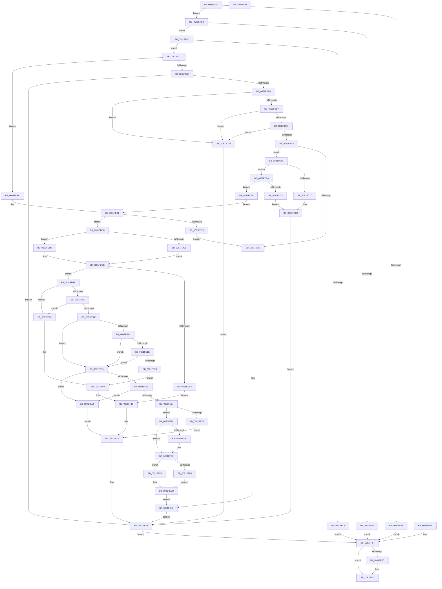

# AslpFileGetVersionBlock

- RVA: `0x0081FA50`–`0x0081FF92` (길이 `1,346` bytes)
- VA: `0x000000014081FA50`
- 실행 섹션: `PAGE`
- PDB 이름 있음: `예`; PDB Function 태그: `아니요`
- unwind 정보 RVA: `0x000DA0B0`
- 디코드: `307`개 명령, `1,346/1,346` bytes 표시
- 미해석 바이트: `0` (있으면 어셈블리에 `.byte`로 보존)

> 이 문서는 커널 이미지의 기계어와 PDB 기호를 분석해 생성했습니다. 4번과 5번은 함수 원형과 자료형을 바이너리 사용 방식에서 추정한 C 해석이며 원본 소스 복구 결과는 아닙니다.

## 1. Dependencies

- 직접 호출 지점: **21**; 고유 호출 대상: **12**
- 직접 호출자로 확인된 함수: **1**
- RIP 상대 이미지 참조: **16**

### Outgoing calls
- `0x0081FADB` → [AslFileMappingEnsure](AslFileMappingEnsure_function_0081A5EC.md) (function, `0x0081A5EC`)
- `0x0081FB03` → [AslLogCallPrintf](../95/AslLogCallPrintf_function_0095E4EC.md) (function, `0x0095E4EC`)
- `0x0081FB83` → [LdrResSearchResource](../98/LdrResSearchResource_function_0098F7A0.md) (function, `0x0098F7A0`)
- `0x0081FBDC` → [memset](../../text/6C/memset_function_006C6C40.md) (function, `0x006C6C40`)
- `0x0081FC0D` → [VerSetConditionMask](../../text/46/VerSetConditionMask_function_0046CC50.md) (function, `0x0046CC50`)
- `0x0081FC1B` → [VerSetConditionMask](../../text/46/VerSetConditionMask_function_0046CC50.md) (function, `0x0046CC50`)
- `0x0081FC2E` → [RtlVerifyVersionInfo](../../text/45/RtlVerifyVersionInfo_function_00457670.md) (function, `0x00457670`)
- `0x0081FC66` → [RtlFileMapMapView](../../text/69/RtlFileMapMapView_function_0069D048.md) (function, `0x0069D048`)
- `0x0081FC90` → [AslLogCallPrintf](../95/AslLogCallPrintf_function_0095E4EC.md) (function, `0x0095E4EC`)
- `0x0081FCB2` → [AslLogCallPrintf](../95/AslLogCallPrintf_function_0095E4EC.md) (function, `0x0095E4EC`)
- `0x0081FCEE` → [LdrResSearchResource](../98/LdrResSearchResource_function_0098F7A0.md) (function, `0x0098F7A0`)
- `0x0081FD2F` → [AslLogCallPrintf](../95/AslLogCallPrintf_function_0095E4EC.md) (function, `0x0095E4EC`)
- `0x0081FD82` → [AslLogCallPrintf](../95/AslLogCallPrintf_function_0095E4EC.md) (function, `0x0095E4EC`)
- `0x0081FDB6` → [AslLogCallPrintf](../95/AslLogCallPrintf_function_0095E4EC.md) (function, `0x0095E4EC`)
- `0x0081FE4A` → [wcsicmp](../../text/50/wcsicmp_function_00500080.md) (function, `0x00500080`)
- `0x0081FE5F` → [AslAlloc](../95/AslAlloc_function_0095BD34.md) (function, `0x0095BD34`)
- `0x0081FE98` → [memcpy](../../text/6C/memcpy_function_006C6840.md) (function, `0x006C6840`)
- `0x0081FF23` → [AslLogCallPrintf](../95/AslLogCallPrintf_function_0095E4EC.md) (function, `0x0095E4EC`)
- `0x0081FF5D` → [AslLogCallPrintf](../95/AslLogCallPrintf_function_0095E4EC.md) (function, `0x0095E4EC`)
- `0x0081FF6F` → [AslFree](../95/AslFree_function_0095B674.md) (function, `0x0095B674`)
- `0x0081FF79` → [RtlFileMapFree](../../text/4B/RtlFileMapFree_function_004BF868.md) (function, `0x004BF868`)

### Direct callers
- [AslpFileGetVersionAttributes](AslpFileGetVersionAttributes_function_0081F968.md) at `0x0081F99F`

### Static image references
- `0x0081FAEA` → RVA `0x0003EE90` (`.rdata`; read)
- `0x0081FAF7` → RVA `0x0003FAF8` (`.rdata`; read)
- `0x0081FC80` → RVA `0x0003FB10` (`.rdata`; read)
- `0x0081FCA2` → RVA `0x0003FB30` (`.rdata`; read)
- `0x0081FCF9` → RVA `0x0003FB68` (`.rdata`; read)
- `0x0081FD00` → RVA `0x0003FB78` (`.rdata`; read)
- `0x0081FD16` → RVA `0x0003FB98` (`.rdata`; read)
- `0x0081FD3C` → RVA `0x0003FBD0` (`.rdata`; read)
- `0x0081FD6B` → RVA `0x00040128` (`.rdata`; read)
- `0x0081FD9F` → RVA `0x00040150` (`.rdata`; read)
- `0x0081FDE6` → RVA `0x00040198` (`.rdata`; read)
- `0x0081FE43` → RVA `0x000401D8` (`.rdata`; read)
- `0x0081FE76` → RVA `0x000129E0` (`.rdata`; read)
- `0x0081FEF4` → RVA `0x000401F8` (`.rdata`; read)
- `0x0081FF09` → RVA `0x000401B8` (`.rdata`; read)
- `0x0081FF44` → RVA `0x00040210` (`.rdata`; read)

## 2. Other-region calls and transfers

- 다른 실행 섹션으로 향하는 call: **8**
  - `0x0081FBDC` → [memset](../../text/6C/memset_function_006C6C40.md) (`PAGE` → `.text`)
  - `0x0081FC0D` → [VerSetConditionMask](../../text/46/VerSetConditionMask_function_0046CC50.md) (`PAGE` → `.text`)
  - `0x0081FC1B` → [VerSetConditionMask](../../text/46/VerSetConditionMask_function_0046CC50.md) (`PAGE` → `.text`)
  - `0x0081FC2E` → [RtlVerifyVersionInfo](../../text/45/RtlVerifyVersionInfo_function_00457670.md) (`PAGE` → `.text`)
  - `0x0081FC66` → [RtlFileMapMapView](../../text/69/RtlFileMapMapView_function_0069D048.md) (`PAGE` → `.text`)
  - `0x0081FE4A` → [wcsicmp](../../text/50/wcsicmp_function_00500080.md) (`PAGE` → `.text`)
  - `0x0081FE98` → [memcpy](../../text/6C/memcpy_function_006C6840.md) (`PAGE` → `.text`)
  - `0x0081FF79` → [RtlFileMapFree](../../text/4B/RtlFileMapFree_function_004BF868.md) (`PAGE` → `.text`)
- 별도 외부 분기/꼬리 이동을 확인하지 못했습니다.

## 3. Assembly (complete function range)

```asm
0081FA50  4C 8B DC                        mov r11, rsp
0081FA53  4D 89 43 18                     mov qword ptr [r11 + 0x18], r8
0081FA57  49 89 53 10                     mov qword ptr [r11 + 0x10], rdx
0081FA5B  49 89 4B 08                     mov qword ptr [r11 + 8], rcx
0081FA5F  53                              push rbx
0081FA60  56                              push rsi
0081FA61  57                              push rdi
0081FA62  41 54                           push r12
0081FA64  41 55                           push r13
0081FA66  41 57                           push r15
0081FA68  48 81 EC E8 01 00 00            sub rsp, 0x1e8
0081FA6F  49 8B F0                        mov rsi, r8
0081FA72  4C 8B C2                        mov r8, rdx
0081FA75  4C 8B C9                        mov r9, rcx
0081FA78  33 FF                           xor edi, edi
0081FA7A  48 89 7C 24 48                  mov qword ptr [rsp + 0x48], rdi
0081FA7F  44 8B FF                        mov r15d, edi
0081FA82  48 89 7C 24 50                  mov qword ptr [rsp + 0x50], rdi
0081FA87  49 89 7B 20                     mov qword ptr [r11 + 0x20], rdi
0081FA8B  0F 57 C0                        xorps xmm0, xmm0
0081FA8E  33 C0                           xor eax, eax
0081FA90  0F 11 44 24 78                  movups xmmword ptr [rsp + 0x78], xmm0
0081FA95  0F 11 84 24 88 00 00 00         movups xmmword ptr [rsp + 0x88], xmm0
0081FA9D  0F 11 84 24 98 00 00 00         movups xmmword ptr [rsp + 0x98], xmm0
0081FAA5  49 89 83 90 FE FF FF            mov qword ptr [r11 - 0x170], rax
0081FAAC  48 8B 4E 48                     mov rcx, qword ptr [rsi + 0x48]
0081FAB0  48 85 C9                        test rcx, rcx
0081FAB3  74 23                           je 0x14081fad8
0081FAB5  0F B7 41 02                     movzx eax, word ptr [rcx + 2]
0081FAB9  48 83 C1 28                     add rcx, 0x28
0081FABD  8B D7                           mov edx, edi
0081FABF  66 83 F8 34                     cmp ax, 0x34
0081FAC3  48 0F 43 D1                     cmovae rdx, rcx
0081FAC7  49 89 10                        mov qword ptr [r8], rdx
0081FACA  48 8B 46 48                     mov rax, qword ptr [rsi + 0x48]
0081FACE  49 89 01                        mov qword ptr [r9], rax
0081FAD1  8B DF                           mov ebx, edi
0081FAD3  E9 8F 04 00 00                  jmp 0x14081ff67
0081FAD8  48 8B CE                        mov rcx, rsi
0081FADB  E8 0C AB FF FF                  call 0x14081a5ec
0081FAE0  8B D8                           mov ebx, eax
0081FAE2  85 C0                           test eax, eax
0081FAE4  79 27                           jns 0x14081fb0d
0081FAE6  89 44 24 20                     mov dword ptr [rsp + 0x20], eax
0081FAEA  4C 8D 0D 9F F3 81 FF            lea r9, [rip - 0x7e0c61]
0081FAF1  41 B8 C0 06 00 00               mov r8d, 0x6c0
0081FAF7  48 8D 15 FA FF 81 FF            lea rdx, [rip - 0x7e0006]
0081FAFE  B9 01 00 00 00                  mov ecx, 1
0081FB03  E8 E4 E9 13 00                  call 0x14095e4ec
0081FB08  E9 5A 04 00 00                  jmp 0x14081ff67
0081FB0D  83 7E 40 06                     cmp dword ptr [rsi + 0x40], 6
0081FB11  74 0A                           je 0x14081fb1d
0081FB13  BB 89 00 00 C0                  mov ebx, 0xc0000089
0081FB18  E9 4A 04 00 00                  jmp 0x14081ff67
0081FB1D  48 C7 44 24 60 10 00 00 00      mov qword ptr [rsp + 0x60], 0x10
0081FB26  41 BC 01 00 00 00               mov r12d, 1
0081FB2C  4C 89 64 24 68                  mov qword ptr [rsp + 0x68], r12
0081FB31  48 89 7C 24 70                  mov qword ptr [rsp + 0x70], rdi
0081FB36  4C 8B 6E 20                     mov r13, qword ptr [rsi + 0x20]
0081FB3A  48 8B 46 28                     mov rax, qword ptr [rsi + 0x28]
0081FB3E  48 89 44 24 58                  mov qword ptr [rsp + 0x58], rax
0081FB43  8A 46 3B                        mov al, byte ptr [rsi + 0x3b]
0081FB46  F6 D8                           neg al
0081FB48  45 1B C9                        sbb r9d, r9d
0081FB4B  41 F7 D1                        not r9d
0081FB4E  41 81 E1 00 02 00 00            and r9d, 0x200
0081FB55  48 89 7C 24 38                  mov qword ptr [rsp + 0x38], rdi
0081FB5A  48 89 7C 24 30                  mov qword ptr [rsp + 0x30], rdi
0081FB5F  48 8D 84 24 38 02 00 00         lea rax, [rsp + 0x238]
0081FB67  48 89 44 24 28                  mov qword ptr [rsp + 0x28], rax
0081FB6C  48 8D 44 24 48                  lea rax, [rsp + 0x48]
0081FB71  48 89 44 24 20                  mov qword ptr [rsp + 0x20], rax
0081FB76  45 8D 44 24 02                  lea r8d, [r12 + 2]
0081FB7B  48 8D 54 24 60                  lea rdx, [rsp + 0x60]
0081FB80  49 8B CD                        mov rcx, r13
0081FB83  E8 18 FC 16 00                  call 0x14098f7a0
0081FB88  8B D8                           mov ebx, eax
0081FB8A  89 44 24 40                     mov dword ptr [rsp + 0x40], eax
0081FB8E  85 C0                           test eax, eax
0081FB90  0F 89 F6 01 00 00               jns 0x14081fd8c
0081FB96  05 77 FF FF 3F                  add eax, 0x3fffff77
0081FB9B  8B CF                           mov ecx, edi
0081FB9D  83 F8 02                        cmp eax, 2
0081FBA0  0F 96 C1                        setbe cl
0081FBA3  85 C9                           test ecx, ecx
0081FBA5  0F 85 7D 03 00 00               jne 0x14081ff28
0081FBAB  81 FB 7B 00 00 C0               cmp ebx, 0xc000007b
0081FBB1  0F 85 A8 01 00 00               jne 0x14081fd5f
0081FBB7  40 38 7E 3B                     cmp byte ptr [rsi + 0x3b], dil
0081FBBB  0F 85 9E 01 00 00               jne 0x14081fd5f
0081FBC1  39 7E 54                        cmp dword ptr [rsi + 0x54], edi
0081FBC4  0F 85 95 01 00 00               jne 0x14081fd5f
0081FBCA  BB 1C 01 00 00                  mov ebx, 0x11c
0081FBCF  44 8B C3                        mov r8d, ebx
0081FBD2  33 D2                           xor edx, edx
0081FBD4  48 8D 8C 24 C0 00 00 00         lea rcx, [rsp + 0xc0]
0081FBDC  E8 5F 70 EA FF                  call 0x1406c6c40
0081FBE1  89 9C 24 C0 00 00 00            mov dword ptr [rsp + 0xc0], ebx
0081FBE8  C7 84 24 C4 00 00 00 06 00 00 00  mov dword ptr [rsp + 0xc4], 6
0081FBF3  C7 84 24 C8 00 00 00 02 00 00 00  mov dword ptr [rsp + 0xc8], 2
0081FBFE  45 8D 6C 24 02                  lea r13d, [r12 + 2]
0081FC03  45 8A C5                        mov r8b, r13b
0081FC06  41 8D 54 24 01                  lea edx, [r12 + 1]
0081FC0B  33 C9                           xor ecx, ecx
0081FC0D  E8 3E D0 C4 FF                  call 0x14046cc50
0081FC12  48 8B C8                        mov rcx, rax
0081FC15  45 8A C5                        mov r8b, r13b
0081FC18  41 8B D4                        mov edx, r12d
0081FC1B  E8 30 D0 C4 FF                  call 0x14046cc50
0081FC20  4C 8B C0                        mov r8, rax
0081FC23  41 8B D5                        mov edx, r13d
0081FC26  48 8D 8C 24 C0 00 00 00         lea rcx, [rsp + 0xc0]
0081FC2E  E8 3D 7A C3 FF                  call 0x140457670
0081FC33  89 44 24 40                     mov dword ptr [rsp + 0x40], eax
0081FC37  85 C0                           test eax, eax
0081FC39  79 0E                           jns 0x14081fc49
0081FC3B  BB 89 00 00 C0                  mov ebx, 0xc0000089
0081FC40  89 5C 24 40                     mov dword ptr [rsp + 0x40], ebx
0081FC44  E9 DF 02 00 00                  jmp 0x14081ff28
0081FC49  48 8B 46 08                     mov rax, qword ptr [rsi + 8]
0081FC4D  40 88 BC 24 A8 00 00 00         mov byte ptr [rsp + 0xa8], dil
0081FC55  48 89 44 24 78                  mov qword ptr [rsp + 0x78], rax
0081FC5A  89 7C 24 40                     mov dword ptr [rsp + 0x40], edi
0081FC5E  41 8A D4                        mov dl, r12b
0081FC61  48 8D 4C 24 78                  lea rcx, [rsp + 0x78]
0081FC66  E8 DD D3 E7 FF                  call 0x14069d048
0081FC6B  8B D8                           mov ebx, eax
0081FC6D  89 44 24 40                     mov dword ptr [rsp + 0x40], eax
0081FC71  48 8D 15 80 FE 81 FF            lea rdx, [rip - 0x7e0180]
0081FC78  85 C0                           test eax, eax
0081FC7A  79 1E                           jns 0x14081fc9a
0081FC7C  89 44 24 20                     mov dword ptr [rsp + 0x20], eax
0081FC80  4C 8D 0D 89 FE 81 FF            lea r9, [rip - 0x7e0177]
0081FC87  41 B8 1C 07 00 00               mov r8d, 0x71c
0081FC8D  41 8B CC                        mov ecx, r12d
0081FC90  E8 57 E8 13 00                  call 0x14095e4ec
0081FC95  E9 8E 02 00 00                  jmp 0x14081ff28
0081FC9A  48 8B 06                        mov rax, qword ptr [rsi]
0081FC9D  48 89 44 24 20                  mov qword ptr [rsp + 0x20], rax
0081FCA2  4C 8D 0D 87 FE 81 FF            lea r9, [rip - 0x7e0179]
0081FCA9  41 B8 25 07 00 00               mov r8d, 0x725
0081FCAF  41 8B CD                        mov ecx, r13d
0081FCB2  E8 35 E8 13 00                  call 0x14095e4ec
0081FCB7  48 89 7C 24 38                  mov qword ptr [rsp + 0x38], rdi
0081FCBC  48 89 7C 24 30                  mov qword ptr [rsp + 0x30], rdi
0081FCC1  48 8D 84 24 38 02 00 00         lea rax, [rsp + 0x238]
0081FCC9  48 89 44 24 28                  mov qword ptr [rsp + 0x28], rax
0081FCCE  48 8D 44 24 48                  lea rax, [rsp + 0x48]
0081FCD3  48 89 44 24 20                  mov qword ptr [rsp + 0x20], rax
0081FCD8  45 33 C9                        xor r9d, r9d
0081FCDB  45 8B C5                        mov r8d, r13d
0081FCDE  48 8D 54 24 60                  lea rdx, [rsp + 0x60]
0081FCE3  4C 8B AC 24 90 00 00 00         mov r13, qword ptr [rsp + 0x90]
0081FCEB  49 8B CD                        mov rcx, r13
0081FCEE  E8 AD FA 16 00                  call 0x14098f7a0
0081FCF3  8B D8                           mov ebx, eax
0081FCF5  89 44 24 40                     mov dword ptr [rsp + 0x40], eax
0081FCF9  48 8D 05 68 FE 81 FF            lea rax, [rip - 0x7e0198]
0081FD00  48 8D 15 71 FE 81 FF            lea rdx, [rip - 0x7e018f]
0081FD07  85 DB                           test ebx, ebx
0081FD09  48 0F 48 C2                     cmovs rax, rdx
0081FD0D  89 5C 24 28                     mov dword ptr [rsp + 0x28], ebx
0081FD11  48 89 44 24 20                  mov qword ptr [rsp + 0x20], rax
0081FD16  4C 8D 0D 7B FE 81 FF            lea r9, [rip - 0x7e0185]
0081FD1D  41 B8 32 07 00 00               mov r8d, 0x732
0081FD23  48 8D 15 CE FD 81 FF            lea rdx, [rip - 0x7e0232]
0081FD2A  B9 02 00 00 00                  mov ecx, 2
0081FD2F  E8 B8 E7 13 00                  call 0x14095e4ec
0081FD34  85 DB                           test ebx, ebx
0081FD36  79 1D                           jns 0x14081fd55
0081FD38  89 5C 24 20                     mov dword ptr [rsp + 0x20], ebx
0081FD3C  4C 8D 0D 8D FE 81 FF            lea r9, [rip - 0x7e0173]
0081FD43  41 B8 35 07 00 00               mov r8d, 0x735
0081FD49  48 8D 15 A8 FD 81 FF            lea rdx, [rip - 0x7e0258]
0081FD50  E9 38 FF FF FF                  jmp 0x14081fc8d
0081FD55  48 8B 8C 24 98 00 00 00         mov rcx, qword ptr [rsp + 0x98]
0081FD5D  EB 32                           jmp 0x14081fd91
0081FD5F  89 5C 24 28                     mov dword ptr [rsp + 0x28], ebx
0081FD63  48 8B 06                        mov rax, qword ptr [rsi]
0081FD66  48 89 44 24 20                  mov qword ptr [rsp + 0x20], rax
0081FD6B  4C 8D 0D B6 03 82 FF            lea r9, [rip - 0x7dfc4a]
0081FD72  41 B8 3D 07 00 00               mov r8d, 0x73d
0081FD78  48 8D 15 79 FD 81 FF            lea rdx, [rip - 0x7e0287]
0081FD7F  41 8B CC                        mov ecx, r12d
0081FD82  E8 65 E7 13 00                  call 0x14095e4ec
0081FD87  E9 9C 01 00 00                  jmp 0x14081ff28
0081FD8C  48 8B 4C 24 58                  mov rcx, qword ptr [rsp + 0x58]
0081FD91  48 8B 54 24 48                  mov rdx, qword ptr [rsp + 0x48]
0081FD96  48 85 D2                        test rdx, rdx
0081FD99  75 25                           jne 0x14081fdc0
0081FD9B  89 5C 24 20                     mov dword ptr [rsp + 0x20], ebx
0081FD9F  4C 8D 0D AA 03 82 FF            lea r9, [rip - 0x7dfc56]
0081FDA6  41 B8 44 07 00 00               mov r8d, 0x744
0081FDAC  48 8D 15 45 FD 81 FF            lea rdx, [rip - 0x7e02bb]
0081FDB3  41 8B CC                        mov ecx, r12d
0081FDB6  E8 31 E7 13 00                  call 0x14095e4ec
0081FDBB  E9 7B FE FF FF                  jmp 0x14081fc3b
0081FDC0  4C 8B 8C 24 38 02 00 00         mov r9, qword ptr [rsp + 0x238]
0081FDC8  4D 8D 04 11                     lea r8, [r9 + rdx]
0081FDCC  4C 3B C2                        cmp r8, rdx
0081FDCF  72 04                           jb 0x14081fdd5
0081FDD1  8B C7                           mov eax, edi
0081FDD3  EB 09                           jmp 0x14081fdde
0081FDD5  49 83 C8 FF                     or r8, 0xffffffffffffffff
0081FDD9  B8 95 00 00 C0                  mov eax, 0xc0000095
0081FDDE  89 44 24 40                     mov dword ptr [rsp + 0x40], eax
0081FDE2  85 C0                           test eax, eax
0081FDE4  79 12                           jns 0x14081fdf8
0081FDE6  4C 8D 0D AB 03 82 FF            lea r9, [rip - 0x7dfc55]
0081FDED  41 B8 52 07 00 00               mov r8d, 0x752
0081FDF3  E9 18 01 00 00                  jmp 0x14081ff10
0081FDF8  49 3B D5                        cmp rdx, r13
0081FDFB  0F 82 02 01 00 00               jb 0x14081ff03
0081FE01  4A 8D 04 29                     lea rax, [rcx + r13]
0081FE05  4C 3B C0                        cmp r8, rax
0081FE08  0F 87 F5 00 00 00               ja 0x14081ff03
0081FE0E  40 38 7E 3B                     cmp byte ptr [rsi + 0x3b], dil
0081FE12  75 21                           jne 0x14081fe35
0081FE14  48 39 BC 24 80 00 00 00         cmp qword ptr [rsp + 0x80], rdi
0081FE1C  75 17                           jne 0x14081fe35
0081FE1E  48 8B 4E 18                     mov rcx, qword ptr [rsi + 0x18]
0081FE22  49 03 CD                        add rcx, r13
0081FE25  4C 3B C1                        cmp r8, rcx
0081FE28  76 0B                           jbe 0x14081fe35
0081FE2A  41 B8 70 07 00 00               mov r8d, 0x770
0081FE30  E9 D4 00 00 00                  jmp 0x14081ff09
0081FE35  49 83 F9 5C                     cmp r9, 0x5c
0081FE39  0F 82 B0 00 00 00               jb 0x14081feef
0081FE3F  48 8D 4A 06                     lea rcx, [rdx + 6]
0081FE43  48 8D 15 8E 03 82 FF            lea rdx, [rip - 0x7dfc72]
0081FE4A  E8 31 02 CE FF                  call 0x140500080
0081FE4F  85 C0                           test eax, eax
0081FE51  0F 85 98 00 00 00               jne 0x14081feef
0081FE57  48 8B 94 24 38 02 00 00         mov rdx, qword ptr [rsp + 0x238]
0081FE5F  E8 D0 BE 13 00                  call 0x14095bd34
0081FE64  4C 8B F8                        mov r15, rax
0081FE67  48 89 44 24 50                  mov qword ptr [rsp + 0x50], rax
0081FE6C  48 85 C0                        test rax, rax
0081FE6F  75 17                           jne 0x14081fe88
0081FE71  BB 17 00 00 C0                  mov ebx, 0xc0000017
0081FE76  4C 8D 0D 63 2B 7F FF            lea r9, [rip - 0x80d49d]
0081FE7D  41 B8 86 07 00 00               mov r8d, 0x786
0081FE83  E9 8D 00 00 00                  jmp 0x14081ff15
0081FE88  4C 8B 84 24 38 02 00 00         mov r8, qword ptr [rsp + 0x238]
0081FE90  48 8B 54 24 48                  mov rdx, qword ptr [rsp + 0x48]
0081FE95  49 8B CF                        mov rcx, r15
0081FE98  E8 A3 69 EA FF                  call 0x1406c6840
0081FE9D  41 0F B7 07                     movzx eax, word ptr [r15]
0081FEA1  48 8B 8C 24 38 02 00 00         mov rcx, qword ptr [rsp + 0x238]
0081FEA9  48 3B C8                        cmp rcx, rax
0081FEAC  73 04                           jae 0x14081feb2
0081FEAE  66 41 89 0F                     mov word ptr [r15], cx
0081FEB2  4C 89 7E 48                     mov qword ptr [rsi + 0x48], r15
0081FEB6  4C 8B FF                        mov r15, rdi
0081FEB9  48 89 7C 24 50                  mov qword ptr [rsp + 0x50], rdi
0081FEBE  48 8B 4E 48                     mov rcx, qword ptr [rsi + 0x48]
0081FEC2  48 8B 94 24 28 02 00 00         mov rdx, qword ptr [rsp + 0x228]
0081FECA  66 83 79 02 34                  cmp word ptr [rcx + 2], 0x34
0081FECF  73 05                           jae 0x14081fed6
0081FED1  48 89 3A                        mov qword ptr [rdx], rdi
0081FED4  EB 07                           jmp 0x14081fedd
0081FED6  48 8D 41 28                     lea rax, [rcx + 0x28]
0081FEDA  48 89 02                        mov qword ptr [rdx], rax
0081FEDD  48 8B 84 24 20 02 00 00         mov rax, qword ptr [rsp + 0x220]
0081FEE5  48 89 08                        mov qword ptr [rax], rcx
0081FEE8  8B DF                           mov ebx, edi
0081FEEA  E9 51 FD FF FF                  jmp 0x14081fc40
0081FEEF  BB E5 00 00 C0                  mov ebx, 0xc00000e5
0081FEF4  4C 8D 0D FD 02 82 FF            lea r9, [rip - 0x7dfd03]
0081FEFB  41 B8 7B 07 00 00               mov r8d, 0x77b
0081FF01  EB 12                           jmp 0x14081ff15
0081FF03  41 B8 5E 07 00 00               mov r8d, 0x75e
0081FF09  4C 8D 0D A8 02 82 FF            lea r9, [rip - 0x7dfd58]
0081FF10  BB 89 00 00 C0                  mov ebx, 0xc0000089
0081FF15  89 5C 24 40                     mov dword ptr [rsp + 0x40], ebx
0081FF19  48 8D 15 D8 FB 81 FF            lea rdx, [rip - 0x7e0428]
0081FF20  41 8B CC                        mov ecx, r12d
0081FF23  E8 C4 E5 13 00                  call 0x14095e4ec
0081FF28  EB 3D                           jmp 0x14081ff67
0081FF2A  8B D8                           mov ebx, eax
0081FF2C  89 44 24 40                     mov dword ptr [rsp + 0x40], eax
0081FF30  48 8B 84 24 30 02 00 00         mov rax, qword ptr [rsp + 0x230]
0081FF38  48 8B 08                        mov rcx, qword ptr [rax]
0081FF3B  48 89 4C 24 28                  mov qword ptr [rsp + 0x28], rcx
0081FF40  89 5C 24 20                     mov dword ptr [rsp + 0x20], ebx
0081FF44  4C 8D 0D C5 02 82 FF            lea r9, [rip - 0x7dfd3b]
0081FF4B  41 B8 AC 07 00 00               mov r8d, 0x7ac
0081FF51  48 8D 15 A0 FB 81 FF            lea rdx, [rip - 0x7e0460]
0081FF58  B9 01 00 00 00                  mov ecx, 1
0081FF5D  E8 8A E5 13 00                  call 0x14095e4ec
0081FF62  4C 8B 7C 24 50                  mov r15, qword ptr [rsp + 0x50]
0081FF67  4D 85 FF                        test r15, r15
0081FF6A  74 08                           je 0x14081ff74
0081FF6C  49 8B D7                        mov rdx, r15
0081FF6F  E8 00 B7 13 00                  call 0x14095b674
0081FF74  48 8D 4C 24 78                  lea rcx, [rsp + 0x78]
0081FF79  E8 EA F8 C9 FF                  call 0x1404bf868
0081FF7E  8B C3                           mov eax, ebx
0081FF80  48 81 C4 E8 01 00 00            add rsp, 0x1e8
0081FF87  41 5F                           pop r15
0081FF89  41 5D                           pop r13
0081FF8B  41 5C                           pop r12
0081FF8D  5F                              pop rdi
0081FF8E  5E                              pop rsi
0081FF8F  5B                              pop rbx
0081FF90  C3                              ret
0081FF91  CC                              int3
```

## 4. C-style interpretation (structured pseudocode)

```c
__int64 __fastcall AslpFileGetVersionBlock(__int64 a1, __int64 a2, __int64 a3)
{
    __int64 result;
    __int64 v_rdi;
    __int64 v_rsp;
    unsigned int v_stack_m150;
    unsigned int v_stack_m154;
    unsigned __int64 v_stack_m158;
    unsigned __int8 v_stack_m170;
    unsigned __int64 v_stack_m180;
    unsigned __int64 v_stack_m188;
    unsigned __int64 v_stack_m190;
    unsigned __int64 v_stack_m198;
    unsigned __int64 v_stack_m1A0;
    unsigned __int64 v_stack_m1A8;
    unsigned __int64 v_stack_m1B0;
    unsigned __int64 v_stack_m1B8;
    unsigned __int64 v_stack_m1C0;
    unsigned __int64 v_stack_m1C8;
    unsigned __int64 v_stack_m1D0;
    unsigned int v_stack_m1D8;
    unsigned __int64 v_stack_m1E0;
    unsigned __int64 v_stack_m1E8;
    unsigned __int64 v_stack_m1F0;
    unsigned int v_stack_m1F8;
    unsigned __int64 v_stack_p10;
    unsigned __int64 v_stack_p18;
    unsigned __int64 v_stack_p20;
    unsigned __int64 v_stack_p8;

    *(unsigned __int64 *)(v_rsp + 24) = a3;
    *(unsigned __int64 *)(v_rsp + 16) = a2;
    *(unsigned __int64 *)(v_rsp + 8) = a1;
    v_rsp = (v_rsp) - (488);
    v_rdi = 0;
    v_stack_m1D0 = 0;
    v_stack_m1C8 = 0;
    *(unsigned __int64 *)(v_rsp + 32) = 0;
    result = 0;
    v_stack_m1A0 = v_xmm0;
    v_stack_m190 = v_xmm0;
    v_stack_m180 = v_xmm0;
    *(unsigned __int64 *)(v_rsp - 368) = 0;
    if (*(unsigned __int64 *)(a3 + 72) == 0) goto loc_0081FAD8;
    a1 = (*(unsigned __int64 *)(a3 + 72)) + (40);
    a2 = 0;
    if (((unsigned __int16)(*(unsigned __int16 *)(*(unsigned __int64 *)(a3 + 72) + 2))) >= 52) { a2 = a1; }
    *(unsigned __int64 *)(a2) = a2;
    *(unsigned __int64 *)(a1) = *(unsigned __int64 *)(a3 + 72);
    goto loc_0081FF67;
loc_0081FAD8:
    result = AslFileMappingEnsure(a3, a2, a2, a1);
    if (!sign_flag) goto loc_0081FB0D;
    v_stack_m1F8 = (unsigned int)(result);
    result = AslLogCallPrintf(1, v_rip - 8257542, (unsigned int)(0x6C0ULL), v_rip - 8260705);
    goto loc_0081FF67;
loc_0081FB0D:
    if ((*(unsigned int *)(a3 + 64)) == 6) goto loc_0081FB1D;
    goto loc_0081FF67;
loc_0081FB1D:
    v_stack_m1B8 = 16;
    v_stack_m1B0 = 1;
    v_stack_m1A8 = 0;
    v_stack_m1C0 = *(unsigned __int64 *)(a3 + 40);
    result = (unsigned __int8)(-(*(unsigned __int8 *)(a3 + 59)));
    a4 = (unsigned int)(~(v_rip - 8260705));
    a4 = (unsigned int)((a4) & (512));
    v_stack_m1E0 = 0;
    v_stack_m1E8 = 0;
    v_stack_m1F0 = v_stack_p20;
    v_stack_m1F8 = v_stack_m1D0;
    result = LdrResSearchResource(*(unsigned __int64 *)(a3 + 32), v_stack_m1B8, 1 + 2, a4);
    v_stack_m1D8 = (unsigned int)(result);
    if (!sign_flag) goto loc_0081FD8C;
    result = (unsigned int)((result) + (0x3FFFFF77ULL));
    a1 = (((unsigned int)(result)) <= 2) ? 1 : 0;
    if ((unsigned int)(a1) != 0) goto loc_0081FF28;
    if (((unsigned int)((unsigned int)((unsigned int)(result)))) != 0xC000007BULL) goto loc_0081FD5F;
    if ((*(unsigned __int8 *)(a3 + 59)) != 0) goto loc_0081FD5F;
    if ((*(unsigned int *)(a3 + 84)) != 0) goto loc_0081FD5F;
    a2 = 0;
    result = memset(v_stack_m158, a2, 284, a4);
    v_stack_m158 = 284;
    v_stack_m154 = 6;
    v_stack_m150 = 2;
    a1 = 0;
    result = VerSetConditionMask(a1, 1 + 1, (unsigned __int8)(1 + 2), a4);
    result = VerSetConditionMask(result, 1, (unsigned __int8)(1 + 2), a4);
    result = RtlVerifyVersionInfo(v_stack_m158, (unsigned int)((unsigned int)(1 + 2)), result, a4);
    v_stack_m1D8 = (unsigned int)(result);
    if (!sign_flag) goto loc_0081FC49;
loc_0081FC3B:
loc_0081FC40:
    v_stack_m1D8 = (unsigned int)((unsigned int)(0xC0000089ULL));
    goto loc_0081FF28;
loc_0081FC49:
    v_stack_m170 = 0;
    v_stack_m1A0 = *(unsigned __int64 *)(a3 + 8);
    v_stack_m1D8 = 0;
    result = RtlFileMapMapView(v_stack_m1A0, 1, result, a4);
    v_stack_m1D8 = (unsigned int)(result);
    if (!sign_flag) goto loc_0081FC9A;
    v_stack_m1F8 = (unsigned int)(result);
loc_0081FC8D:
    result = AslLogCallPrintf(1, v_rip - 8257920, (unsigned int)(0x71CULL), v_rip - 8257911);
    goto loc_0081FF28;
loc_0081FC9A:
    v_stack_m1F8 = *(unsigned __int64 *)(a3);
    result = AslLogCallPrintf((unsigned int)((unsigned int)(1 + 2)), v_rip - 8257920, (unsigned int)(0x725ULL), v_rip - 8257913);
    v_stack_m1E0 = 0;
    v_stack_m1E8 = 0;
    v_stack_m1F0 = v_stack_p20;
    v_stack_m1F8 = v_stack_m1D0;
    a4 = 0;
    result = LdrResSearchResource(v_stack_m188, v_stack_m1B8, (unsigned int)((unsigned int)(1 + 2)), a4);
    v_stack_m1D8 = (unsigned int)(result);
    result = v_rip - 8257944;
    if (sign_flag) { result = v_rip - 8257935; }
    v_stack_m1F0 = (unsigned int)((unsigned int)((unsigned int)(result)));
    v_stack_m1F8 = result;
    result = AslLogCallPrintf(2, v_rip - 8258098, (unsigned int)(0x732ULL), v_rip - 8257925);
    if (!sign_flag) goto loc_0081FD55;
    v_stack_m1F8 = (unsigned int)((unsigned int)((unsigned int)(result)));
    goto loc_0081FC8D;
loc_0081FD55:
    goto loc_0081FD91;
loc_0081FD5F:
    v_stack_m1F0 = (unsigned int)((unsigned int)((unsigned int)(result)));
    v_stack_m1F8 = *(unsigned __int64 *)(a3);
    result = AslLogCallPrintf(1, v_rip - 8258183, (unsigned int)(0x73DULL), v_rip - 8256586);
    goto loc_0081FF28;
loc_0081FD8C:
loc_0081FD91:
    if (v_stack_m1D0 != 0) goto loc_0081FDC0;
    v_stack_m1F8 = (unsigned int)((unsigned int)((unsigned int)(result)));
    result = AslLogCallPrintf(1, v_rip - 8258235, (unsigned int)(0x744ULL), v_rip - 8256598);
    goto loc_0081FC3B;
loc_0081FDC0:
    if ((v_stack_p20 + v_rip - 8258235 * 1) < (v_rip - 8258235)) goto loc_0081FDD5;
    goto loc_0081FDDE;
loc_0081FDD5:
    a3 = (v_stack_p20 + v_rip - 8258235 * 1) | (-1);
loc_0081FDDE:
    v_stack_m1D8 = (unsigned int)((unsigned int)(0xC0000095ULL));
    if (!sign_flag) goto loc_0081FDF8;
    goto loc_0081FF10;
loc_0081FDF8:
    if ((v_rip - 8258235) < v_stack_m188) goto loc_0081FF03;
    if (((unsigned int)(0x752ULL)) > (1 + v_stack_m188 * 1)) goto loc_0081FF03;
    if ((*(unsigned __int8 *)(a3 + 59)) != 0) goto loc_0081FE35;
    if (v_stack_m198 != 0) goto loc_0081FE35;
    a1 = (*(unsigned __int64 *)(a3 + 24)) + (v_stack_m188);
    if (((unsigned int)(0x752ULL)) <= a1) goto loc_0081FE35;
    goto loc_0081FF09;
loc_0081FE35:
    if ((v_rip - 8256597) < 92) goto loc_0081FEEF;
    result = wcsicmp(v_rip - 8258235 + 6, v_rip - 8256626, (unsigned int)(0x770ULL), v_rip - 8256597);
    if ((unsigned int)(result) != 0) goto loc_0081FEEF;
    result = AslAlloc(v_rip - 8258235 + 6, v_stack_p20, (unsigned int)(0x770ULL), v_rip - 8256597);
    v_stack_m1C8 = result;
    if (result != 0) goto loc_0081FE88;
    goto loc_0081FF15;
loc_0081FE88:
    result = memcpy(result, v_stack_m1D0, v_stack_p20, v_rip - 8443037);
    if (v_stack_p20 < (*(unsigned __int16 *)(result))) {
        *(unsigned __int16 *)(result) = (unsigned __int16)(v_stack_p20);
    }
    *(unsigned __int64 *)(a3 + 72) = result;
    v_stack_m1C8 = 0;
    if ((*(unsigned __int16 *)(*(unsigned __int64 *)(a3 + 72) + 2)) >= 52) goto loc_0081FED6;
    *(unsigned __int64 *)(v_stack_p10) = 0;
    goto loc_0081FEDD;
loc_0081FED6:
    *(unsigned __int64 *)(v_stack_p10) = *(unsigned __int64 *)(a3 + 72) + 40;
loc_0081FEDD:
    *(unsigned __int64 *)(v_stack_p8) = *(unsigned __int64 *)(a3 + 72);
    goto loc_0081FC40;
loc_0081FEEF:
    goto loc_0081FF15;
loc_0081FF03:
loc_0081FF09:
loc_0081FF10:
loc_0081FF15:
    v_stack_m1D8 = (unsigned int)((unsigned int)(0xC0000089ULL));
    result = AslLogCallPrintf(1, v_rip - 8258600, (unsigned int)(0x75EULL), v_rip - 8256856);
loc_0081FF28:
    goto loc_0081FF67;
loc_0081FF67:
    if (0 != 0) {
        a2 = 0;
        result = AslFree(1, a2, (unsigned int)(0x75EULL), v_rip - 8256856);
    }
    result = RtlFileMapFree(v_stack_m1A0, a2, (unsigned int)(0x75EULL), v_rip - 8256856);
    v_rsp = (v_rsp) + (488);
    return (unsigned int)((unsigned int)((unsigned int)(0xC0000089ULL)));
}
```

## 5. (Beta) C Style

```c
int64_t AslpFileGetVersionBlock(void *Arg1, void *Arg2, void *Arg3)
{
    uint8_t *arg1 = (uint8_t *)Arg1;
    uint8_t *arg2 = (uint8_t *)Arg2;
    uint8_t *arg3 = (uint8_t *)Arg3;

    int64_t result;
    int64_t local_rdi;
    int64_t local_rsp;
    uint32_t v_stack_m150;
    uint32_t v_stack_m154;
    uint64_t v_stack_m158;
    uint8_t v_stack_m170;
    uint64_t v_stack_m180;
    uint64_t v_stack_m188;
    uint64_t v_stack_m190;
    uint64_t v_stack_m198;
    uint64_t v_stack_m1A0;
    uint64_t v_stack_m1A8;
    uint64_t v_stack_m1B0;
    uint64_t v_stack_m1B8;
    uint64_t v_stack_m1C0;
    uint64_t v_stack_m1C8;
    uint64_t v_stack_m1D0;
    uint32_t v_stack_m1D8;
    uint64_t v_stack_m1E0;
    uint64_t v_stack_m1E8;
    uint64_t v_stack_m1F0;
    uint32_t v_stack_m1F8;
    uint64_t v_stack_p10;
    uint64_t v_stack_p18;
    uint64_t v_stack_p20;
    uint64_t v_stack_p8;

    *(void **)(local_rsp + 0x18) = Arg3;
    *(void **)(local_rsp + 0x10) = Arg2;
    *(void **)(local_rsp + 0x8) = Arg1;
    local_rsp = (local_rsp) - (488);
    local_rdi = 0;
    v_stack_m1D0 = 0;
    v_stack_m1C8 = 0;
    *(uint64_t *)(local_rsp + 0x20) = 0;
    result = 0;
    v_stack_m1A0 = v_xmm0;
    v_stack_m190 = v_xmm0;
    v_stack_m180 = v_xmm0;
    *(uint64_t *)(local_rsp - 0x170) = 0;
    if (*(uint64_t *)(arg3 + 0x48) == 0) goto loc_0081FAD8;
    Arg1 = (*(uint64_t *)(arg3 + 0x48)) + (40);
    Arg2 = 0;
    if (((uint16_t)(*(uint16_t *)(*(uint64_t *)(arg3 + 0x48) + 0x2))) >= 52) { Arg2 = Arg1; }
    *(void **)(arg2) = Arg2;
    *(uint64_t *)(arg1) = *(uint64_t *)(arg3 + 0x48);
    goto loc_0081FF67;
loc_0081FAD8:
    result = AslFileMappingEnsure(Arg3, Arg2, Arg2, Arg1);
    if (!sign_flag) goto loc_0081FB0D;
    v_stack_m1F8 = (uint32_t)(result);
    result = AslLogCallPrintf(1, v_rip - 8257542, (uint32_t)(0x6C0ULL), v_rip - 8260705);
    goto loc_0081FF67;
loc_0081FB0D:
    if ((*(uint32_t *)(arg3 + 0x40)) == 6) goto loc_0081FB1D;
    goto loc_0081FF67;
loc_0081FB1D:
    v_stack_m1B8 = 16;
    v_stack_m1B0 = 1;
    v_stack_m1A8 = 0;
    v_stack_m1C0 = *(uint64_t *)(arg3 + 0x28);
    result = (uint8_t)(-(*(uint8_t *)(arg3 + 0x3B)));
    a4 = (uint32_t)(~(v_rip - 8260705));
    a4 = (uint32_t)((a4) & (512));
    v_stack_m1E0 = 0;
    v_stack_m1E8 = 0;
    v_stack_m1F0 = v_stack_p20;
    v_stack_m1F8 = v_stack_m1D0;
    result = LdrResSearchResource(*(uint64_t *)(arg3 + 0x20), v_stack_m1B8, 1 + 2, a4);
    v_stack_m1D8 = (uint32_t)(result);
    if (!sign_flag) goto loc_0081FD8C;
    result = (uint32_t)((result) + (0x3FFFFF77ULL));
    Arg1 = (((uint32_t)(result)) <= 2) ? 1 : 0;
    if ((uint32_t)(Arg1) != 0) goto loc_0081FF28;
    if (((uint32_t)((uint32_t)((uint32_t)(result)))) != 0xC000007BULL) goto loc_0081FD5F;
    if ((*(uint8_t *)(arg3 + 0x3B)) != 0) goto loc_0081FD5F;
    if ((*(uint32_t *)(arg3 + 0x54)) != 0) goto loc_0081FD5F;
    Arg2 = 0;
    result = memset(v_stack_m158, Arg2, 284, a4);
    v_stack_m158 = 284;
    v_stack_m154 = 6;
    v_stack_m150 = 2;
    Arg1 = 0;
    result = VerSetConditionMask(Arg1, 1 + 1, (uint8_t)(1 + 2), a4);
    result = VerSetConditionMask(result, 1, (uint8_t)(1 + 2), a4);
    result = RtlVerifyVersionInfo(v_stack_m158, (uint32_t)((uint32_t)(1 + 2)), result, a4);
    v_stack_m1D8 = (uint32_t)(result);
    if (!sign_flag) goto loc_0081FC49;
loc_0081FC3B:
loc_0081FC40:
    v_stack_m1D8 = (uint32_t)((uint32_t)(0xC0000089ULL));
    goto loc_0081FF28;
loc_0081FC49:
    v_stack_m170 = 0;
    v_stack_m1A0 = *(uint64_t *)(arg3 + 0x8);
    v_stack_m1D8 = 0;
    result = RtlFileMapMapView(v_stack_m1A0, 1, result, a4);
    v_stack_m1D8 = (uint32_t)(result);
    if (!sign_flag) goto loc_0081FC9A;
    v_stack_m1F8 = (uint32_t)(result);
loc_0081FC8D:
    result = AslLogCallPrintf(1, v_rip - 8257920, (uint32_t)(0x71CULL), v_rip - 8257911);
    goto loc_0081FF28;
loc_0081FC9A:
    v_stack_m1F8 = *(uint64_t *)(arg3);
    result = AslLogCallPrintf((uint32_t)((uint32_t)(1 + 2)), v_rip - 8257920, (uint32_t)(0x725ULL), v_rip - 8257913);
    v_stack_m1E0 = 0;
    v_stack_m1E8 = 0;
    v_stack_m1F0 = v_stack_p20;
    v_stack_m1F8 = v_stack_m1D0;
    a4 = 0;
    result = LdrResSearchResource(v_stack_m188, v_stack_m1B8, (uint32_t)((uint32_t)(1 + 2)), a4);
    v_stack_m1D8 = (uint32_t)(result);
    result = v_rip - 8257944;
    if (sign_flag) { result = v_rip - 8257935; }
    v_stack_m1F0 = (uint32_t)((uint32_t)((uint32_t)(result)));
    v_stack_m1F8 = result;
    result = AslLogCallPrintf(2, v_rip - 8258098, (uint32_t)(0x732ULL), v_rip - 8257925);
    if (!sign_flag) goto loc_0081FD55;
    v_stack_m1F8 = (uint32_t)((uint32_t)((uint32_t)(result)));
    goto loc_0081FC8D;
loc_0081FD55:
    goto loc_0081FD91;
loc_0081FD5F:
    v_stack_m1F0 = (uint32_t)((uint32_t)((uint32_t)(result)));
    v_stack_m1F8 = *(uint64_t *)(arg3);
    result = AslLogCallPrintf(1, v_rip - 8258183, (uint32_t)(0x73DULL), v_rip - 8256586);
    goto loc_0081FF28;
loc_0081FD8C:
loc_0081FD91:
    if (v_stack_m1D0 != 0) goto loc_0081FDC0;
    v_stack_m1F8 = (uint32_t)((uint32_t)((uint32_t)(result)));
    result = AslLogCallPrintf(1, v_rip - 8258235, (uint32_t)(0x744ULL), v_rip - 8256598);
    goto loc_0081FC3B;
loc_0081FDC0:
    if ((v_stack_p20 + v_rip - 8258235 * 1) < (v_rip - 8258235)) goto loc_0081FDD5;
    goto loc_0081FDDE;
loc_0081FDD5:
    Arg3 = (v_stack_p20 + v_rip - 8258235 * 1) | (-1);
loc_0081FDDE:
    v_stack_m1D8 = (uint32_t)((uint32_t)(0xC0000095ULL));
    if (!sign_flag) goto loc_0081FDF8;
    goto loc_0081FF10;
loc_0081FDF8:
    if ((v_rip - 8258235) < v_stack_m188) goto loc_0081FF03;
    if (((uint32_t)(0x752ULL)) > (1 + v_stack_m188 * 1)) goto loc_0081FF03;
    if ((*(uint8_t *)(arg3 + 0x3B)) != 0) goto loc_0081FE35;
    if (v_stack_m198 != 0) goto loc_0081FE35;
    Arg1 = (*(uint64_t *)(arg3 + 0x18)) + (v_stack_m188);
    if (((uint32_t)(0x752ULL)) <= Arg1) goto loc_0081FE35;
    goto loc_0081FF09;
loc_0081FE35:
    if ((v_rip - 8256597) < 92) goto loc_0081FEEF;
    result = wcsicmp(v_rip - 8258235 + 6, v_rip - 8256626, (uint32_t)(0x770ULL), v_rip - 8256597);
    if ((uint32_t)(result) != 0) goto loc_0081FEEF;
    result = AslAlloc(v_rip - 8258235 + 6, v_stack_p20, (uint32_t)(0x770ULL), v_rip - 8256597);
    v_stack_m1C8 = result;
    if (result != 0) goto loc_0081FE88;
    goto loc_0081FF15;
loc_0081FE88:
    result = memcpy(result, v_stack_m1D0, v_stack_p20, v_rip - 8443037);
    if (v_stack_p20 < (*(uint16_t *)(result))) {
        *(uint16_t *)(result) = (uint16_t)(v_stack_p20);
    }
    *(uint64_t *)(arg3 + 0x48) = result;
    v_stack_m1C8 = 0;
    if ((*(uint16_t *)(*(uint64_t *)(arg3 + 0x48) + 0x2)) >= 52) goto loc_0081FED6;
    *(uint64_t *)(v_stack_p10) = 0;
    goto loc_0081FEDD;
loc_0081FED6:
    *(uint64_t *)(v_stack_p10) = *(uint64_t *)(arg3 + 0x48) + 40;
loc_0081FEDD:
    *(uint64_t *)(v_stack_p8) = *(uint64_t *)(arg3 + 0x48);
    goto loc_0081FC40;
loc_0081FEEF:
    goto loc_0081FF15;
loc_0081FF03:
loc_0081FF09:
loc_0081FF10:
loc_0081FF15:
    v_stack_m1D8 = (uint32_t)((uint32_t)(0xC0000089ULL));
    result = AslLogCallPrintf(1, v_rip - 8258600, (uint32_t)(0x75EULL), v_rip - 8256856);
loc_0081FF28:
    goto loc_0081FF67;
loc_0081FF67:
    if (0 != 0) {
        Arg2 = 0;
        result = AslFree(1, Arg2, (uint32_t)(0x75EULL), v_rip - 8256856);
    }
    result = RtlFileMapFree(v_stack_m1A0, Arg2, (uint32_t)(0x75EULL), v_rip - 8256856);
    local_rsp = (local_rsp) + (488);
    return (uint32_t)((uint32_t)((uint32_t)(0xC0000089ULL)));
}
```

### 관측된 메모리 오프셋

구조체 형식이 확인되지 않은 접근은 인자 기준의 오프셋으로만 기록했습니다.

| 기준 인자 | 오프셋 표현 | 폭 (bit) | 접근 |
|---|---:|---:|---|
| `Arg1` | `+ 0x0` | `64` | `W` |
| `Arg2` | `+ 0x0` | `64` | `W` |
| `Arg3` | `+ 0x0` | `64` | `R` |
| `Arg3` | `+ 0x8` | `64` | `R` |
| `Arg3` | `+ 0x18` | `64` | `R` |
| `Arg3` | `+ 0x20` | `64` | `R` |
| `Arg3` | `+ 0x28` | `64` | `R` |
| `Arg3` | `+ 0x3B` | `8` | `R` |
| `Arg3` | `+ 0x40` | `32` | `R` |
| `Arg3` | `+ 0x48` | `64` | `R` |
| `Arg3` | `+ 0x48` | `64` | `W` |
| `Arg3` | `+ 0x54` | `32` | `R` |

## 6. Execution-region graph

[열기: 2D/3D 그래프와 함수 탐색 컨트롤 패널](../../../control-panel.html?section=page&rva=0x0081FA50&view=graph)

- 2D 그래프는 위에서 아래로 흐르고, 3D 그래프는 빈 공간을 드래그해 회전합니다. Shift+드래그는 이동, 휠은 확대·축소, 함수 노드 선택은 대상 보고서 이동입니다.

### Static fallback


