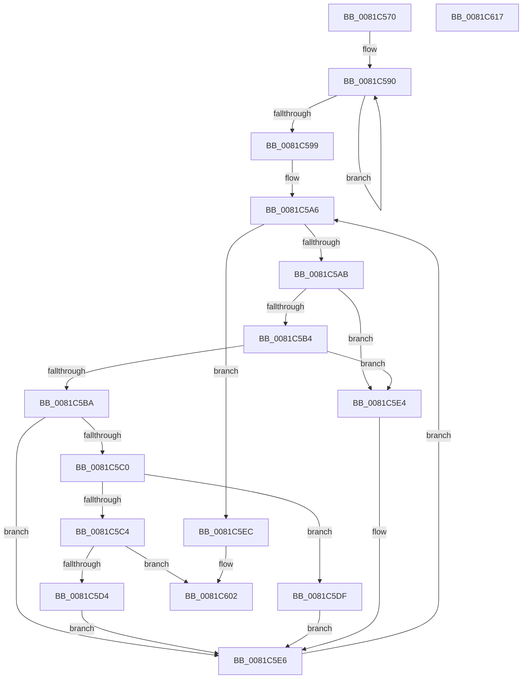

# AslpParsePattern

- RVA: `0x0081C570`–`0x0081C618` (길이 `168` bytes)
- VA: `0x000000014081C570`
- 실행 섹션: `PAGE`
- PDB 이름 있음: `예`; PDB Function 태그: `아니요`
- unwind 정보 RVA: `0x0005C954`
- 디코드: `55`개 명령, `168/168` bytes 표시
- 미해석 바이트: `0` (있으면 어셈블리에 `.byte`로 보존)

> 이 문서는 커널 이미지의 기계어와 PDB 기호를 분석해 생성했습니다. 4번과 5번은 함수 원형과 자료형을 바이너리 사용 방식에서 추정한 C 해석이며 원본 소스 복구 결과는 아닙니다.

## 1. Dependencies

- 직접 호출 지점: **2**; 고유 호출 대상: **1**
- 직접 호출자로 확인된 함수: **1**
- RIP 상대 이미지 참조: **0**

### Outgoing calls
- `0x0081C5CB` → [AslpAllocMatchNode](AslpAllocMatchNode_function_0081C430.md) (function, `0x0081C430`)
- `0x0081C5FD` → [AslpAllocMatchNode](AslpAllocMatchNode_function_0081C430.md) (function, `0x0081C430`)

### Direct callers
- [AslRegWildcardFindFirst](AslRegWildcardFindFirst_function_0081C2F0.md) at `0x0081C359`

### Static image references
- 디코드된 RIP-relative 메모리 참조가 없습니다.

## 2. Other-region calls and transfers

- 다른 실행 섹션으로 향하는 call: **0**
- 별도 외부 분기/꼬리 이동을 확인하지 못했습니다.

## 3. Assembly (complete function range)

```asm
0081C570  48 89 5C 24 08                  mov qword ptr [rsp + 8], rbx
0081C575  48 89 6C 24 10                  mov qword ptr [rsp + 0x10], rbp
0081C57A  48 89 74 24 18                  mov qword ptr [rsp + 0x18], rsi
0081C57F  57                              push rdi
0081C580  48 83 EC 20                     sub rsp, 0x20
0081C584  48 83 C8 FF                     or rax, 0xffffffffffffffff
0081C588  48 8B F2                        mov rsi, rdx
0081C58B  33 ED                           xor ebp, ebp
0081C58D  48 8B F9                        mov rdi, rcx
0081C590  48 FF C0                        inc rax
0081C593  66 39 2C 41                     cmp word ptr [rcx + rax*2], bp
0081C597  75 F7                           jne 0x14081c590
0081C599  8B C0                           mov eax, eax
0081C59B  48 8D 14 41                     lea rdx, [rcx + rax*2]
0081C59F  40 8A C5                        mov al, bpl
0081C5A2  48 8D 5A FE                     lea rbx, [rdx - 2]
0081C5A6  48 3B DF                        cmp rbx, rdi
0081C5A9  76 41                           jbe 0x14081c5ec
0081C5AB  0F B7 0B                        movzx ecx, word ptr [rbx]
0081C5AE  66 83 F9 2A                     cmp cx, 0x2a
0081C5B2  74 30                           je 0x14081c5e4
0081C5B4  66 83 F9 3F                     cmp cx, 0x3f
0081C5B8  74 2A                           je 0x14081c5e4
0081C5BA  66 83 F9 5C                     cmp cx, 0x5c
0081C5BE  75 26                           jne 0x14081c5e6
0081C5C0  84 C0                           test al, al
0081C5C2  74 1B                           je 0x14081c5df
0081C5C4  48 8D 4B 02                     lea rcx, [rbx + 2]
0081C5C8  4C 8B C6                        mov r8, rsi
0081C5CB  E8 60 FE FF FF                  call 0x14081c430
0081C5D0  85 C0                           test eax, eax
0081C5D2  78 2E                           js 0x14081c602
0081C5D4  48 8B D3                        mov rdx, rbx
0081C5D7  66 89 2B                        mov word ptr [rbx], bp
0081C5DA  40 8A C5                        mov al, bpl
0081C5DD  EB 07                           jmp 0x14081c5e6
0081C5DF  48 8B D3                        mov rdx, rbx
0081C5E2  EB 02                           jmp 0x14081c5e6
0081C5E4  B0 01                           mov al, 1
0081C5E6  48 83 EB 02                     sub rbx, 2
0081C5EA  EB BA                           jmp 0x14081c5a6
0081C5EC  84 C0                           test al, al
0081C5EE  4C 8B C6                        mov r8, rsi
0081C5F1  48 0F 44 D3                     cmove rdx, rbx
0081C5F5  F6 D8                           neg al
0081C5F7  48 1B C9                        sbb rcx, rcx
0081C5FA  48 23 CB                        and rcx, rbx
0081C5FD  E8 2E FE FF FF                  call 0x14081c430
0081C602  48 8B 5C 24 30                  mov rbx, qword ptr [rsp + 0x30]
0081C607  48 8B 6C 24 38                  mov rbp, qword ptr [rsp + 0x38]
0081C60C  48 8B 74 24 40                  mov rsi, qword ptr [rsp + 0x40]
0081C611  48 83 C4 20                     add rsp, 0x20
0081C615  5F                              pop rdi
0081C616  C3                              ret
0081C617  CC                              int3
```

## 4. C-style interpretation (structured pseudocode)

```c
__int64 __fastcall AslpParsePattern(__int64 a1, __int64 a2)
{
    __int64 result;
    __int64 v_rbp;
    __int64 v_rbx;
    __int64 v_rsp;
    unsigned __int64 v_stack_p10;
    unsigned __int64 v_stack_p18;
    unsigned __int64 v_stack_p8;

    v_stack_p8 = v_rbx;
    v_stack_p10 = v_rbp;
    v_stack_p18 = v_rsi;
    v_rsp = (v_rsp) - (32);
    result = (result) | (-1);
    v_rbp = 0;
loc_0081C590:
    result = (result) + 1;
    if ((*(unsigned __int16 *)(a1 + result * 2)) != 0) goto loc_0081C590;
loc_0081C5A6:
    if ((a1 + (unsigned int)((unsigned int)(result)) * 2 - 2) <= a1) goto loc_0081C5EC;
    if (((unsigned __int16)(*(unsigned __int16 *)(a1 + (unsigned int)((unsigned int)(result)) * 2 - 2))) == 42) goto loc_0081C5E4;
    if (((unsigned __int16)(*(unsigned __int16 *)(a1 + (unsigned int)((unsigned int)(result)) * 2 - 2))) == 63) goto loc_0081C5E4;
    if (((unsigned __int16)(*(unsigned __int16 *)(a1 + (unsigned int)((unsigned int)(result)) * 2 - 2))) != 92) goto loc_0081C5E6;
    if (0 == 0) goto loc_0081C5DF;
    result = AslpAllocMatchNode(a1 + (unsigned int)((unsigned int)(result)) * 2 - 2 + 2, a1 + (unsigned int)((unsigned int)(result)) * 2, a2, a4);
    if (sign_flag) goto loc_0081C602;
    *(unsigned __int16 *)(a1 + (unsigned int)((unsigned int)(result)) * 2 - 2) = 0;
    goto loc_0081C5E6;
loc_0081C5DF:
    goto loc_0081C5E6;
loc_0081C5E4:
loc_0081C5E6:
    v_rbx = (a1 + (unsigned int)((unsigned int)(result)) * 2 - 2) - (2);
    goto loc_0081C5A6;
loc_0081C5EC:
    a2 = a1 + (unsigned int)((unsigned int)(result)) * 2 - 2;
    if (1 == 0) { a2 = v_rbx; }
    result = (unsigned __int8)(-(1));
    a1 = (a1 + (unsigned int)((unsigned int)(result)) * 2 - 2 + 2) & (v_rbx);
    result = AslpAllocMatchNode(a1, a2, a2, a4);
loc_0081C602:
    v_rsp = (v_rsp) + (32);
    return result;
}
```

## 5. (Beta) C Style

```c
int64_t AslpParsePattern(void *Arg1, int64_t Arg2)
{
    uint8_t *arg1 = (uint8_t *)Arg1;

    int64_t result;
    int64_t local_rbp;
    int64_t local_rbx;
    int64_t local_rsp;
    uint64_t v_stack_p10;
    uint64_t v_stack_p18;
    uint64_t v_stack_p8;

    v_stack_p8 = local_rbx;
    v_stack_p10 = local_rbp;
    v_stack_p18 = local_rsi;
    local_rsp = (local_rsp) - (32);
    result = (result) | (-1);
    local_rbp = 0;
loc_0081C590:
    result = (result) + 1;
    if ((*(uint16_t *)(arg1 + result * 2)) != 0) goto loc_0081C590;
loc_0081C5A6:
    if ((Arg1 + (uint32_t)((uint32_t)(result)) * 2 - 2) <= Arg1) goto loc_0081C5EC;
    if (((uint16_t)(*(uint16_t *)(arg1 + (uint32_t)((uint32_t)(result)) * 2 - 0x2))) == 42) goto loc_0081C5E4;
    if (((uint16_t)(*(uint16_t *)(arg1 + (uint32_t)((uint32_t)(result)) * 2 - 0x2))) == 63) goto loc_0081C5E4;
    if (((uint16_t)(*(uint16_t *)(arg1 + (uint32_t)((uint32_t)(result)) * 2 - 0x2))) != 92) goto loc_0081C5E6;
    if (0 == 0) goto loc_0081C5DF;
    result = AslpAllocMatchNode(Arg1 + (uint32_t)((uint32_t)(result)) * 2 - 2 + 2, Arg1 + (uint32_t)((uint32_t)(result)) * 2, Arg2, a4);
    if (sign_flag) goto loc_0081C602;
    *(uint16_t *)(arg1 + (uint32_t)((uint32_t)(result)) * 2 - 0x2) = 0;
    goto loc_0081C5E6;
loc_0081C5DF:
    goto loc_0081C5E6;
loc_0081C5E4:
loc_0081C5E6:
    local_rbx = (Arg1 + (uint32_t)((uint32_t)(result)) * 2 - 2) - (2);
    goto loc_0081C5A6;
loc_0081C5EC:
    Arg2 = Arg1 + (uint32_t)((uint32_t)(result)) * 2 - 2;
    if (1 == 0) { Arg2 = local_rbx; }
    result = (uint8_t)(-(1));
    Arg1 = (Arg1 + (uint32_t)((uint32_t)(result)) * 2 - 2 + 2) & (local_rbx);
    result = AslpAllocMatchNode(Arg1, Arg2, Arg2, a4);
loc_0081C602:
    local_rsp = (local_rsp) + (32);
    return result;
}
```

### 관측된 메모리 오프셋

구조체 형식이 확인되지 않은 접근은 인자 기준의 오프셋으로만 기록했습니다.

| 기준 인자 | 오프셋 표현 | 폭 (bit) | 접근 |
|---|---:|---:|---|
| `Arg1` | `- 0x2` | `64` | `R` |
| `Arg1` | `+ 0x0 + rax*2` | `16` | `R` |
| `Arg1` | `+ 0x0 + rax*2` | `64` | `R` |

## 6. Execution-region graph

[열기: 2D/3D 그래프와 함수 탐색 컨트롤 패널](../../../control-panel.html?section=page&rva=0x0081C570&view=graph)

- 2D 그래프는 위에서 아래로 흐르고, 3D 그래프는 빈 공간을 드래그해 회전합니다. Shift+드래그는 이동, 휠은 확대·축소, 함수 노드 선택은 대상 보고서 이동입니다.

### Static fallback


