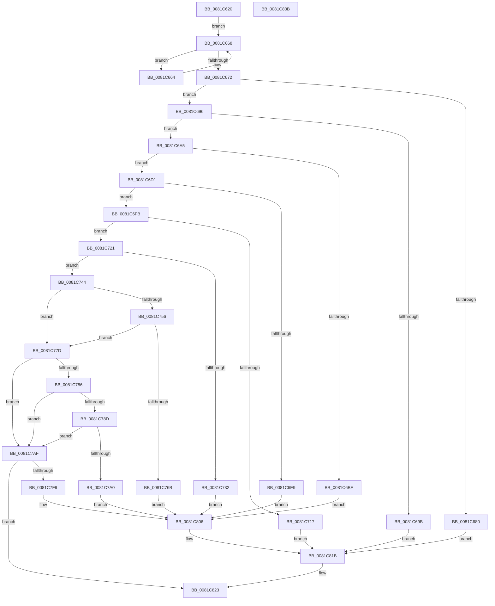

# AslpPathWildcardAllocMatchNode

- RVA: `0x0081C620`–`0x0081C83C` (길이 `540` bytes)
- VA: `0x000000014081C620`
- 실행 섹션: `PAGE`
- PDB 이름 있음: `예`; PDB Function 태그: `아니요`
- unwind 정보 RVA: `0x000D9D10`
- 디코드: `140`개 명령, `540/540` bytes 표시
- 미해석 바이트: `0` (있으면 어셈블리에 `.byte`로 보존)

> 이 문서는 커널 이미지의 기계어와 PDB 기호를 분석해 생성했습니다. 4번과 5번은 함수 원형과 자료형을 바이너리 사용 방식에서 추정한 C 해석이며 원본 소스 복구 결과는 아닙니다.

## 1. Dependencies

- 직접 호출 지점: **9**; 고유 호출 대상: **8**
- 직접 호출자로 확인된 함수: **2**
- RIP 상대 이미지 참조: **7**

### Outgoing calls
- `0x0081C6B4` → [RtlUShortAdd](../../text/47/RtlUShortAdd_function_00474F70.md) (function, `0x00474F70`)
- `0x0081C6DE` → [RtlUShortAdd](../../text/47/RtlUShortAdd_function_00474F70.md) (function, `0x00474F70`)
- `0x0081C709` → [AslAlloc](../95/AslAlloc_function_0095BD34.md) (function, `0x0095BD34`)
- `0x0081C727` → [RtlUnicodeStringCopy](../../text/3D/RtlUnicodeStringCopy_function_003D4130.md) (function, `0x003D4130`)
- `0x0081C760` → [RtlUnicodeStringCatString](../../text/41/RtlUnicodeStringCatString_function_0041CD30.md) (function, `0x0041CD30`)
- `0x0081C795` → [RtlUnicodeStringCbCatStringN](../../text/69/RtlUnicodeStringCbCatStringN_function_0069D2DC.md) (function, `0x0069D2DC`)
- `0x0081C7EE` → [ZwOpenFile](../../text/6A/ZwOpenFile_function_006AD730.md) (function, `0x006AD730`)
- `0x0081C816` → [AslLogCallPrintf](../95/AslLogCallPrintf_function_0095E4EC.md) (function, `0x0095E4EC`)
- `0x0081C81E` → [AslpPathWildcardFreeMatchNode](AslpPathWildcardFreeMatchNode_function_0081C918.md) (function, `0x0081C918`)

### Direct callers
- [AslPathWildcardFindFirst](AslPathWildcardFindFirst_function_0081B534.md) at `0x0081B8B0`
- [AslPathWildcardFindNext](AslPathWildcardFindNext_function_0081BB2C.md) at `0x0081BF9B`

### Static image references
- `0x0081C6BF` → RVA `0x0003F1D8` (`.rdata`; read)
- `0x0081C732` → RVA `0x0003F4B8` (`.rdata`; read)
- `0x0081C756` → RVA `0x0001BD80` (`.rdata`; read)
- `0x0081C76B` → RVA `0x0003F4E0` (`.rdata`; read)
- `0x0081C7A0` → RVA `0x0003F508` (`.rdata`; read)
- `0x0081C7F9` → RVA `0x0003F538` (`.rdata`; read)
- `0x0081C806` → RVA `0x0003F498` (`.rdata`; read)

## 2. Other-region calls and transfers

- 다른 실행 섹션으로 향하는 call: **6**
  - `0x0081C6B4` → [RtlUShortAdd](../../text/47/RtlUShortAdd_function_00474F70.md) (`PAGE` → `.text`)
  - `0x0081C6DE` → [RtlUShortAdd](../../text/47/RtlUShortAdd_function_00474F70.md) (`PAGE` → `.text`)
  - `0x0081C727` → [RtlUnicodeStringCopy](../../text/3D/RtlUnicodeStringCopy_function_003D4130.md) (`PAGE` → `.text`)
  - `0x0081C760` → [RtlUnicodeStringCatString](../../text/41/RtlUnicodeStringCatString_function_0041CD30.md) (`PAGE` → `.text`)
  - `0x0081C795` → [RtlUnicodeStringCbCatStringN](../../text/69/RtlUnicodeStringCbCatStringN_function_0069D2DC.md) (`PAGE` → `.text`)
  - `0x0081C7EE` → [ZwOpenFile](../../text/6A/ZwOpenFile_function_006AD730.md) (`PAGE` → `.text`)
- 별도 외부 분기/꼬리 이동을 확인하지 못했습니다.

## 3. Assembly (complete function range)

```asm
0081C620  48 89 5C 24 10                  mov qword ptr [rsp + 0x10], rbx
0081C625  48 89 7C 24 18                  mov qword ptr [rsp + 0x18], rdi
0081C62A  55                              push rbp
0081C62B  41 56                           push r14
0081C62D  41 57                           push r15
0081C62F  48 8B EC                        mov rbp, rsp
0081C632  48 83 EC 70                     sub rsp, 0x70
0081C636  33 C0                           xor eax, eax
0081C638  0F 57 C0                        xorps xmm0, xmm0
0081C63B  45 33 FF                        xor r15d, r15d
0081C63E  48 89 45 F0                     mov qword ptr [rbp - 0x10], rax
0081C642  0F 11 45 D0                     movups xmmword ptr [rbp - 0x30], xmm0
0081C646  89 45 F8                        mov dword ptr [rbp - 8], eax
0081C649  4C 8B F2                        mov r14, rdx
0081C64C  0F 11 45 E0                     movups xmmword ptr [rbp - 0x20], xmm0
0081C650  48 8B F9                        mov rdi, rcx
0081C653  0F 11 45 C0                     movups xmmword ptr [rbp - 0x40], xmm0
0081C657  4C 89 39                        mov qword ptr [rcx], r15
0081C65A  4C 89 79 08                     mov qword ptr [rcx + 8], r15
0081C65E  4C 89 79 18                     mov qword ptr [rcx + 0x18], r15
0081C662  EB 04                           jmp 0x14081c668
0081C664  49 83 C0 02                     add r8, 2
0081C668  4C 89 41 10                     mov qword ptr [rcx + 0x10], r8
0081C66C  66 45 39 38                     cmp word ptr [r8], r15w
0081C670  75 F2                           jne 0x14081c664
0081C672  49 8D 40 02                     lea rax, [r8 + 2]
0081C676  48 89 41 10                     mov qword ptr [rcx + 0x10], rax
0081C67A  66 44 39 38                     cmp word ptr [rax], r15w
0081C67E  75 16                           jne 0x14081c696
0081C680  41 F7 D9                        neg r9d
0081C683  1B DB                           sbb ebx, ebx
0081C685  81 E3 47 FE FF FF               and ebx, 0xfffffe47
0081C68B  81 C3 73 02 00 C0               add ebx, 0xc0000273
0081C691  E9 85 01 00 00                  jmp 0x14081c81b
0081C696  45 85 C9                        test r9d, r9d
0081C699  75 0A                           jne 0x14081c6a5
0081C69B  BB 03 01 00 C0                  mov ebx, 0xc0000103
0081C6A0  E9 76 01 00 00                  jmp 0x14081c81b
0081C6A5  0F B7 0A                        movzx ecx, word ptr [rdx]
0081C6A8  4C 8D 45 20                     lea r8, [rbp + 0x20]
0081C6AC  0F B7 55 48                     movzx edx, word ptr [rbp + 0x48]
0081C6B0  66 89 4D 20                     mov word ptr [rbp + 0x20], cx
0081C6B4  E8 B7 88 C5 FF                  call 0x140474f70
0081C6B9  8B D8                           mov ebx, eax
0081C6BB  85 C0                           test eax, eax
0081C6BD  79 12                           jns 0x14081c6d1
0081C6BF  4C 8D 0D 12 2B 82 FF            lea r9, [rip - 0x7dd4ee]
0081C6C6  41 B8 4C 0B 00 00               mov r8d, 0xb4c
0081C6CC  E9 35 01 00 00                  jmp 0x14081c806
0081C6D1  0F B7 4D 20                     movzx ecx, word ptr [rbp + 0x20]
0081C6D5  4C 8D 45 20                     lea r8, [rbp + 0x20]
0081C6D9  BA 04 00 00 00                  mov edx, 4
0081C6DE  E8 8D 88 C5 FF                  call 0x140474f70
0081C6E3  8B D8                           mov ebx, eax
0081C6E5  85 C0                           test eax, eax
0081C6E7  79 12                           jns 0x14081c6fb
0081C6E9  4C 8D 0D E8 2A 82 FF            lea r9, [rip - 0x7dd518]
0081C6F0  41 B8 52 0B 00 00               mov r8d, 0xb52
0081C6F6  E9 0B 01 00 00                  jmp 0x14081c806
0081C6FB  0F B7 45 20                     movzx eax, word ptr [rbp + 0x20]
0081C6FF  8B D0                           mov edx, eax
0081C701  66 89 47 02                     mov word ptr [rdi + 2], ax
0081C705  66 44 89 3F                     mov word ptr [rdi], r15w
0081C709  E8 26 F6 13 00                  call 0x14095bd34
0081C70E  48 89 47 08                     mov qword ptr [rdi + 8], rax
0081C712  48 85 C0                        test rax, rax
0081C715  75 0A                           jne 0x14081c721
0081C717  BB 17 00 00 C0                  mov ebx, 0xc0000017
0081C71C  E9 FA 00 00 00                  jmp 0x14081c81b
0081C721  49 8B D6                        mov rdx, r14
0081C724  48 8B CF                        mov rcx, rdi
0081C727  E8 04 7A BB FF                  call 0x1403d4130
0081C72C  8B D8                           mov ebx, eax
0081C72E  85 C0                           test eax, eax
0081C730  79 12                           jns 0x14081c744
0081C732  4C 8D 0D 7F 2D 82 FF            lea r9, [rip - 0x7dd281]
0081C739  41 B8 61 0B 00 00               mov r8d, 0xb61
0081C73F  E9 C2 00 00 00                  jmp 0x14081c806
0081C744  0F B7 0F                        movzx ecx, word ptr [rdi]
0081C747  48 8B 47 08                     mov rax, qword ptr [rdi + 8]
0081C74B  48 D1 E9                        shr rcx, 1
0081C74E  66 83 7C 48 FE 5C               cmp word ptr [rax + rcx*2 - 2], 0x5c
0081C754  74 27                           je 0x14081c77d
0081C756  48 8D 15 23 F6 7F FF            lea rdx, [rip - 0x8009dd]
0081C75D  48 8B CF                        mov rcx, rdi
0081C760  E8 CB 05 C0 FF                  call 0x14041cd30
0081C765  8B D8                           mov ebx, eax
0081C767  85 C0                           test eax, eax
0081C769  79 12                           jns 0x14081c77d
0081C76B  4C 8D 0D 6E 2D 82 FF            lea r9, [rip - 0x7dd292]
0081C772  41 B8 71 0B 00 00               mov r8d, 0xb71
0081C778  E9 89 00 00 00                  jmp 0x14081c806
0081C77D  48 8B 55 40                     mov rdx, qword ptr [rbp + 0x40]
0081C781  48 85 D2                        test rdx, rdx
0081C784  74 29                           je 0x14081c7af
0081C786  66 44 39 7D 48                  cmp word ptr [rbp + 0x48], r15w
0081C78B  76 22                           jbe 0x14081c7af
0081C78D  44 0F B7 45 48                  movzx r8d, word ptr [rbp + 0x48]
0081C792  48 8B CF                        mov rcx, rdi
0081C795  E8 42 0B E8 FF                  call 0x14069d2dc
0081C79A  8B D8                           mov ebx, eax
0081C79C  85 C0                           test eax, eax
0081C79E  79 0F                           jns 0x14081c7af
0081C7A0  4C 8D 0D 61 2D 82 FF            lea r9, [rip - 0x7dd29f]
0081C7A7  41 B8 79 0B 00 00               mov r8d, 0xb79
0081C7AD  EB 57                           jmp 0x14081c806
0081C7AF  0F 57 C0                        xorps xmm0, xmm0
0081C7B2  C7 44 24 28 21 00 00 00         mov dword ptr [rsp + 0x28], 0x21
0081C7BA  48 8D 4F 18                     lea rcx, [rdi + 0x18]
0081C7BE  C7 45 D0 30 00 00 00            mov dword ptr [rbp - 0x30], 0x30
0081C7C5  4C 8D 4D C0                     lea r9, [rbp - 0x40]
0081C7C9  4C 89 7D D8                     mov qword ptr [rbp - 0x28], r15
0081C7CD  4C 8D 45 D0                     lea r8, [rbp - 0x30]
0081C7D1  C7 45 E8 40 02 00 00            mov dword ptr [rbp - 0x18], 0x240
0081C7D8  BA 01 00 10 00                  mov edx, 0x100001
0081C7DD  48 89 7D E0                     mov qword ptr [rbp - 0x20], rdi
0081C7E1  F3 0F 7F 45 F0                  movdqu xmmword ptr [rbp - 0x10], xmm0
0081C7E6  C7 44 24 20 01 00 00 00         mov dword ptr [rsp + 0x20], 1
0081C7EE  E8 3D 0F E9 FF                  call 0x1406ad730
0081C7F3  8B D8                           mov ebx, eax
0081C7F5  85 C0                           test eax, eax
0081C7F7  79 2A                           jns 0x14081c823
0081C7F9  4C 8D 0D 38 2D 82 FF            lea r9, [rip - 0x7dd2c8]
0081C800  41 B8 87 0B 00 00               mov r8d, 0xb87
0081C806  48 8D 15 8B 2C 82 FF            lea rdx, [rip - 0x7dd375]
0081C80D  89 44 24 20                     mov dword ptr [rsp + 0x20], eax
0081C811  B9 01 00 00 00                  mov ecx, 1
0081C816  E8 D1 1C 14 00                  call 0x14095e4ec
0081C81B  48 8B CF                        mov rcx, rdi
0081C81E  E8 F5 00 00 00                  call 0x14081c918
0081C823  4C 8D 5C 24 70                  lea r11, [rsp + 0x70]
0081C828  8B C3                           mov eax, ebx
0081C82A  49 8B 5B 28                     mov rbx, qword ptr [r11 + 0x28]
0081C82E  49 8B 7B 30                     mov rdi, qword ptr [r11 + 0x30]
0081C832  49 8B E3                        mov rsp, r11
0081C835  41 5F                           pop r15
0081C837  41 5E                           pop r14
0081C839  5D                              pop rbp
0081C83A  C3                              ret
0081C83B  CC                              int3
```

## 4. C-style interpretation (structured pseudocode)

```c
__int64 __fastcall AslpPathWildcardAllocMatchNode(__int64 a1, __int64 a2, __int64 a3, int a4, __int64 a5, unsigned __int16 a6)
{
    __int64 result;
    __int64 v_r15;
    __int64 v_rbx;
    __int64 v_rsp;
    unsigned __int64 v_stack_m18;
    unsigned int v_stack_m20;
    unsigned __int64 v_stack_m28;
    unsigned int v_stack_m30;
    unsigned __int64 v_stack_m38;
    unsigned __int64 v_stack_m40;
    unsigned __int64 v_stack_m48;
    unsigned __int64 v_stack_m58;
    unsigned int v_stack_m60;
    unsigned int v_stack_m68;
    unsigned __int64 v_stack_p10;
    unsigned __int64 v_stack_p18;
    unsigned __int64 v_stack_p8;

    v_stack_p10 = v_rbx;
    v_stack_p18 = v_rdi;
    v_rsp = (v_rsp) - (112);
    result = 0;
    v_r15 = 0;
    v_stack_m28 = 0;
    v_stack_m48 = v_xmm0;
    v_stack_m20 = 0;
    v_stack_m38 = v_xmm0;
    v_stack_m58 = v_xmm0;
    *(unsigned __int64 *)(a1) = 0;
    *(unsigned __int64 *)(a1 + 8) = 0;
    *(unsigned __int64 *)(a1 + 24) = 0;
    goto loc_0081C668;
loc_0081C664:
    a3 = (a3) + (2);
loc_0081C668:
    *(unsigned __int64 *)(a1 + 16) = a3;
    if ((*(unsigned __int16 *)(a3)) != 0) goto loc_0081C664;
    *(unsigned __int64 *)(a1 + 16) = a3 + 2;
    if ((*(unsigned __int16 *)(a3 + 2)) != 0) goto loc_0081C696;
    a4 = (unsigned int)(-(a4));
    v_rbx = (unsigned int)((v_rbx) & (0xFFFFFE47ULL));
    v_rbx = (unsigned int)((v_rbx) + (0xC0000273ULL));
    goto loc_0081C81B;
loc_0081C696:
    if (a4 != 0) goto loc_0081C6A5;
    goto loc_0081C81B;
loc_0081C6A5:
    v_stack_p8 = (unsigned __int16)(*(unsigned __int16 *)(a2));
    result = RtlUShortAdd(*(unsigned __int16 *)(a2), a6, v_stack_p8, a4);
    if (!sign_flag) goto loc_0081C6D1;
    goto loc_0081C806;
loc_0081C6D1:
    result = RtlUShortAdd(v_stack_p8, 4, v_stack_p8, v_rip - 8246510);
    if (!sign_flag) goto loc_0081C6FB;
    goto loc_0081C806;
loc_0081C6FB:
    *(unsigned __int16 *)(a1 + 2) = (unsigned __int16)(v_stack_p8);
    *(unsigned __int16 *)(a1) = 0;
    result = AslAlloc(v_stack_p8, (unsigned int)((unsigned int)(v_stack_p8)), (unsigned int)(0xB52ULL), v_rip - 8246552);
    *(unsigned __int64 *)(a1 + 8) = result;
    if (result != 0) goto loc_0081C721;
    goto loc_0081C81B;
loc_0081C721:
    result = RtlUnicodeStringCopy(a1, a2, (unsigned int)(0xB52ULL), v_rip - 8246552);
    if (!sign_flag) goto loc_0081C744;
    goto loc_0081C806;
loc_0081C744:
    a1 = (*(unsigned __int16 *)(a1)) >> (1);
    if ((*(unsigned __int16 *)(*(unsigned __int64 *)(a1 + 8) + a1 * 2 - 2)) == 92) goto loc_0081C77D;
    result = RtlUnicodeStringCatString(a1, v_rip - 8391133, (unsigned int)(0xB61ULL), v_rip - 8245889);
    if (!sign_flag) goto loc_0081C77D;
    goto loc_0081C806;
loc_0081C77D:
    if (a5 == 0) goto loc_0081C7AF;
    if (a6 <= 0) goto loc_0081C7AF;
    result = RtlUnicodeStringCbCatStringN(a1, a5, a6, v_rip - 8245906);
    if (!sign_flag) goto loc_0081C7AF;
    goto loc_0081C806;
loc_0081C7AF:
    v_stack_m60 = 33;
    v_stack_m48 = 48;
    v_stack_m40 = 0;
    v_stack_m30 = 576;
    v_stack_m38 = a1;
    v_stack_m28 = v_xmm0;
    v_stack_m68 = 1;
    result = ZwOpenFile(a1 + 24, (unsigned int)(0x100001ULL), v_stack_m48, v_stack_m58);
    if (!sign_flag) goto loc_0081C823;
loc_0081C806:
    v_stack_m68 = (unsigned int)(result);
    result = AslLogCallPrintf(1, v_rip - 8246133, (unsigned int)(0xB87ULL), v_rip - 8245960);
loc_0081C81B:
    result = AslpPathWildcardFreeMatchNode(a1, v_rip - 8246133, (unsigned int)(0xB87ULL), v_rip - 8245960);
loc_0081C823:
    return (unsigned int)((unsigned int)((unsigned int)((unsigned int)(result))));
}
```

## 5. (Beta) C Style

```c
int64_t AslpPathWildcardAllocMatchNode(void *Arg1, void *Arg2, void *Arg3, int32_t Arg4, int64_t Arg5, uint16_t Arg6)
{
    uint8_t *arg1 = (uint8_t *)Arg1;
    uint8_t *arg2 = (uint8_t *)Arg2;
    uint8_t *arg3 = (uint8_t *)Arg3;

    int64_t result;
    int64_t local_r15;
    int64_t local_rbx;
    int64_t local_rsp;
    uint64_t v_stack_m18;
    uint32_t v_stack_m20;
    uint64_t v_stack_m28;
    uint32_t v_stack_m30;
    uint64_t v_stack_m38;
    uint64_t v_stack_m40;
    uint64_t v_stack_m48;
    uint64_t v_stack_m58;
    uint32_t v_stack_m60;
    uint32_t v_stack_m68;
    uint64_t v_stack_p10;
    uint64_t v_stack_p18;
    uint64_t v_stack_p8;

    v_stack_p10 = local_rbx;
    v_stack_p18 = local_rdi;
    local_rsp = (local_rsp) - (112);
    result = 0;
    local_r15 = 0;
    v_stack_m28 = 0;
    v_stack_m48 = v_xmm0;
    v_stack_m20 = 0;
    v_stack_m38 = v_xmm0;
    v_stack_m58 = v_xmm0;
    *(uint64_t *)(arg1) = 0;
    *(uint64_t *)(arg1 + 0x8) = 0;
    *(uint64_t *)(arg1 + 0x18) = 0;
    goto loc_0081C668;
loc_0081C664:
    Arg3 = (Arg3) + (2);
loc_0081C668:
    *(void **)(arg1 + 0x10) = Arg3;
    if ((*(uint16_t *)(arg3)) != 0) goto loc_0081C664;
    *(void **)(arg1 + 0x10) = Arg3 + 2;
    if ((*(uint16_t *)(arg3 + 0x2)) != 0) goto loc_0081C696;
    Arg4 = (uint32_t)(-(Arg4));
    local_rbx = (uint32_t)((local_rbx) & (0xFFFFFE47ULL));
    local_rbx = (uint32_t)((local_rbx) + (0xC0000273ULL));
    goto loc_0081C81B;
loc_0081C696:
    if (Arg4 != 0) goto loc_0081C6A5;
    goto loc_0081C81B;
loc_0081C6A5:
    v_stack_p8 = (uint16_t)(*(uint16_t *)(arg2));
    result = RtlUShortAdd(*(uint16_t *)(arg2), Arg6, v_stack_p8, Arg4);
    if (!sign_flag) goto loc_0081C6D1;
    goto loc_0081C806;
loc_0081C6D1:
    result = RtlUShortAdd(v_stack_p8, 4, v_stack_p8, v_rip - 8246510);
    if (!sign_flag) goto loc_0081C6FB;
    goto loc_0081C806;
loc_0081C6FB:
    *(uint16_t *)(arg1 + 0x2) = (uint16_t)(v_stack_p8);
    *(uint16_t *)(arg1) = 0;
    result = AslAlloc(v_stack_p8, (uint32_t)((uint32_t)(v_stack_p8)), (uint32_t)(0xB52ULL), v_rip - 8246552);
    *(uint64_t *)(arg1 + 0x8) = result;
    if (result != 0) goto loc_0081C721;
    goto loc_0081C81B;
loc_0081C721:
    result = RtlUnicodeStringCopy(Arg1, Arg2, (uint32_t)(0xB52ULL), v_rip - 8246552);
    if (!sign_flag) goto loc_0081C744;
    goto loc_0081C806;
loc_0081C744:
    Arg1 = (*(uint16_t *)(arg1)) >> (1);
    if ((*(uint16_t *)(*(uint64_t *)(arg1 + 0x8) + arg1 * 2 - 0x2)) == 92) goto loc_0081C77D;
    result = RtlUnicodeStringCatString(Arg1, v_rip - 8391133, (uint32_t)(0xB61ULL), v_rip - 8245889);
    if (!sign_flag) goto loc_0081C77D;
    goto loc_0081C806;
loc_0081C77D:
    if (Arg5 == 0) goto loc_0081C7AF;
    if (Arg6 <= 0) goto loc_0081C7AF;
    result = RtlUnicodeStringCbCatStringN(Arg1, Arg5, Arg6, v_rip - 8245906);
    if (!sign_flag) goto loc_0081C7AF;
    goto loc_0081C806;
loc_0081C7AF:
    v_stack_m60 = 33;
    v_stack_m48 = 48;
    v_stack_m40 = 0;
    v_stack_m30 = 576;
    v_stack_m38 = Arg1;
    v_stack_m28 = v_xmm0;
    v_stack_m68 = 1;
    result = ZwOpenFile(Arg1 + 24, (uint32_t)(0x100001ULL), v_stack_m48, v_stack_m58);
    if (!sign_flag) goto loc_0081C823;
loc_0081C806:
    v_stack_m68 = (uint32_t)(result);
    result = AslLogCallPrintf(1, v_rip - 8246133, (uint32_t)(0xB87ULL), v_rip - 8245960);
loc_0081C81B:
    result = AslpPathWildcardFreeMatchNode(Arg1, v_rip - 8246133, (uint32_t)(0xB87ULL), v_rip - 8245960);
loc_0081C823:
    return (uint32_t)((uint32_t)((uint32_t)((uint32_t)(result))));
}
```

### 관측된 메모리 오프셋

구조체 형식이 확인되지 않은 접근은 인자 기준의 오프셋으로만 기록했습니다.

| 기준 인자 | 오프셋 표현 | 폭 (bit) | 접근 |
|---|---:|---:|---|
| `Arg1` | `+ 0x0` | `16` | `R` |
| `Arg1` | `+ 0x0` | `16` | `W` |
| `Arg1` | `+ 0x0` | `64` | `W` |
| `Arg1` | `+ 0x2` | `16` | `W` |
| `Arg1` | `+ 0x8` | `64` | `R` |
| `Arg1` | `+ 0x8` | `64` | `W` |
| `Arg1` | `+ 0x10` | `64` | `W` |
| `Arg1` | `+ 0x18` | `64` | `R` |
| `Arg1` | `+ 0x18` | `64` | `W` |
| `Arg2` | `+ 0x0` | `16` | `R` |
| `Arg3` | `+ 0x0` | `16` | `R` |
| `Arg3` | `+ 0x2` | `64` | `R` |

## 6. Execution-region graph

[열기: 2D/3D 그래프와 함수 탐색 컨트롤 패널](../../../control-panel.html?section=page&rva=0x0081C620&view=graph)

- 2D 그래프는 위에서 아래로 흐르고, 3D 그래프는 빈 공간을 드래그해 회전합니다. Shift+드래그는 이동, 휠은 확대·축소, 함수 노드 선택은 대상 보고서 이동입니다.

### Static fallback


